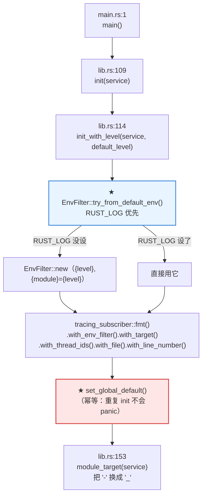
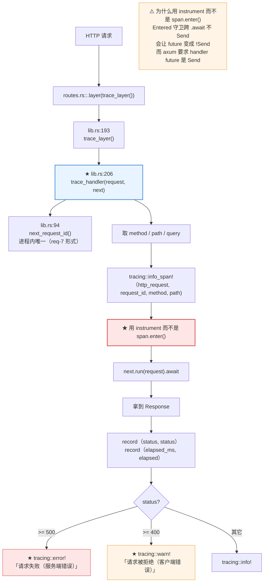
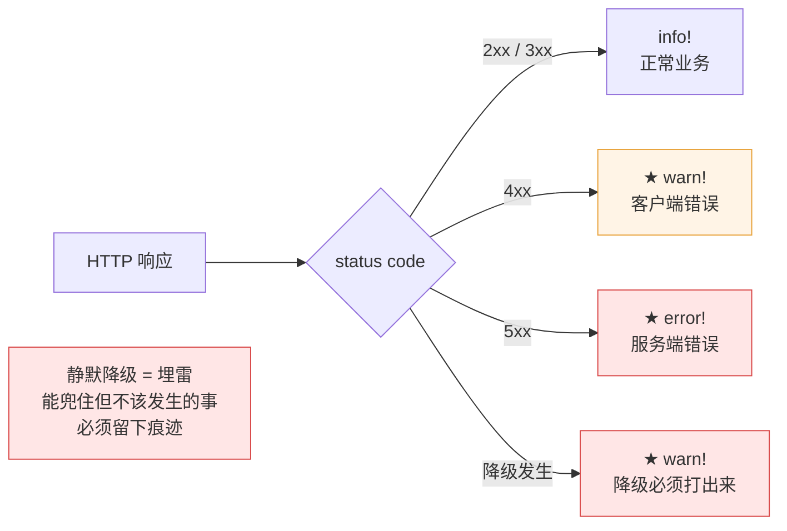
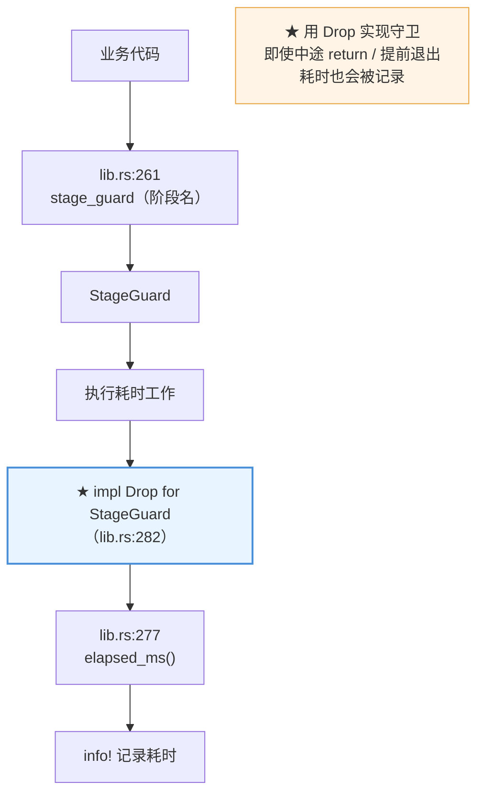

# 00-logging —— workspace 共享日志设施

全仓库 14 个学习项目，每一个都是独立的可执行服务。
如果每个项目各自实现一套日志初始化，日志格式、级别语义、
请求追踪方式就会各写各的，跨项目对照实验时也没法把日志放一起看。

所以日志设施抽成**独立的 workspace 成员 crate**，所有项目共用。

## 三个能力

| 能力 | 说明 |
|---|---|
| `init(service)` | 初始化全局 subscriber，一次性设置格式、级别、来源 |
| `trace_layer()` | HTTP 请求追踪中间件：请求 ID、方法、路径、耗时、状态码 |
| `stage_guard(name)` | 阶段耗时守卫 —— 进入时打日志，退出时打耗时 |

外加宏再导出：`info!` / `debug!` / `warn!` / `error!` / `trace!`。

## 快速开始

```rust
use agent_logging::{info, init, trace_layer};

#[tokio::main]
async fn main() {
    init("rag-06");

    let app: axum::Router = axum::Router::new()
        .route("/", axum::routing::get(|| async { "ok" }))
        .layer(trace_layer());

    info!(addr = "127.0.0.1:3000", "服务已启动");
    // ...
}
```

## 级别约定

| 级别 | 用途 | 典型场景 |
|---|---|---|
| `ERROR` | 请求失败、服务不可用、数据不一致 | LLM 调用失败、索引加载失败 |
| `WARN` | 能兜住但不该发生 | 参数非法、工具执行失败、降级 |
| `INFO` | 关键业务节点 | 服务启动、索引就绪、一次请求的最终结果 |
| `DEBUG` | 过程细节 | 召回了哪些块、Prompt 全文、重排分数 |
| `TRACE` | 逐行细节 | 每条候选块的原始分值 |

## 过滤

用环境变量 `RUST_LOG` 控制，遵循 `tracing-subscriber` 的 `EnvFilter` 语法：

```bash
RUST_LOG=info                          # 全局 info
RUST_LOG=debug,rag_06=trace            # rag_06 单独开到 trace
RUST_LOG=warn,rag_12::retriever=debug  # 只对某个模块开 debug
```

不设 `RUST_LOG` 时用各项目传入的默认级别（一般是 `info`）。

## 为什么不用 `println!`

1. **可过滤**：`println!` 没法按模块级别关掉，debug 输出一旦写进去
   就永远在生产路径上（每次 LLM 调用都刷一遍 Prompt，是很大的噪音）。
2. **有结构**：`info!(chunk_count = 12, ...)` 出来的字段可以被
   日志采集器解析，而 `println!("{}", ...)` 只有一坨文本。
3. **带 span 上下文**：HTTP 请求里的日志自动带上 `request_id`，
   一次请求触发的所有日志能串起来。

## 请求追踪

`trace_layer()` 会在每个请求上开一个 `http_request` span：

| 字段 | 含义 |
|---|---|
| `request_id` | 进程内唯一请求 ID（`req-7` 形式） |
| `method` | HTTP 方法 |
| `path` | 请求路径 |
| `status` | 响应状态码（响应后写入） |
| `elapsed_ms` | 耗时毫秒（响应后写入） |

## 全仓库的三条硬约定

1. **4xx 用 `warn!`，5xx 用 `error!`** —— 告警不能被 4xx 淹没。
2. **降级必须打 `warn!`** —— 降级是「能兜住但不该发生」，静默降级等于埋雷。
3. **不打 `println!` 混进业务逻辑** —— `println!` 没法按模块关掉，
   debug 输出一旦写进去就永远在生产路径上。

---

## 代码调用详细流程图（函数级）

> 节点写的是**真实函数名**，边上标的是**调用点行号**。全部对着源码。

### 初始化：一次性的全局设置



### 请求追踪：一个 HTTP 请求的日志生命周期

**核心是 `trace_handler`** —— 它给每个请求开一个 span，并把 `request_id` 传给这次请求触发的所有日志。



### 级别语义：为什么 4xx 和 5xx 要分开

**这是全仓库的硬约定** —— 告警不能被 4xx 淹没。



### 阶段耗时守卫



## 踩坑记录

### `clippy::type_complexity`：`FromFnLayer` 签名太长

Axum 0.8 的 `from_fn` 返回 `FromFnLayer<...>`，直接写出来会触发
clippy 的 `type_complexity` 告警（三个泛型参数嵌套）。抽成别名：

```rust
pub type TraceLayer = axum::middleware::FromFnLayer<
    fn(Request, Next) -> Pin<Box<dyn Future<Output = Response> + Send>>,
    (),
    (Request,),
>;
```

### 请求 ID 为什么不用 uuid

日志里的请求 ID 只需要**在一次进程运行内唯一**，不需要跨进程/跨机器唯一。
跨机器唯一是分布式追踪（OpenTelemetry）该解决的问题 ——
那是本仓库不打算引入的复杂度。用原子计数器就够了。

## 技术参考速查

| 主题 | 关键点 | 本项目位置 |
|---|---|---|
| 发射端 | `tracing` 的 `info!` / `debug!` / `warn!` / `error!` / `trace!` | `lib.rs` 再导出 |
| 接收端 | `tracing-subscriber` 的 `fmt` + `EnvFilter` + `chrono` | `init_with_level` |
| 过滤 | `RUST_LOG`，`EnvFilter` 语法（可按 crate / 模块） | `init_with_level` |
| 请求追踪 | Axum 0.8 `from_fn` + `tracing::Instrument` | `trace_handler` |
| 阶段计时 | `tracing::Span` + `Drop` 守卫 | `stage_guard` |
| 目标过滤 | crate 名 `rag-06` → 模块 target `rag_06` | `module_target` |
