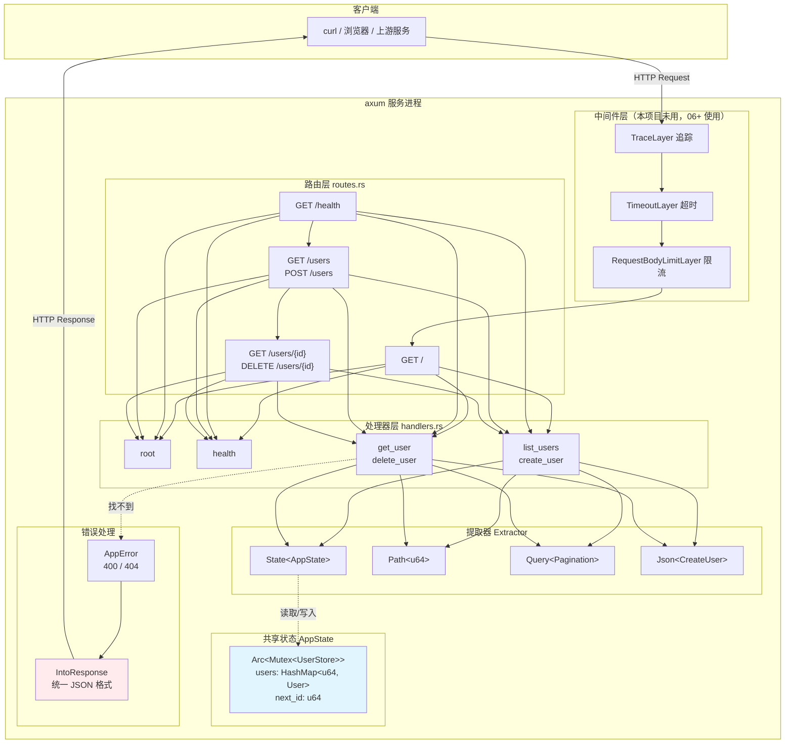
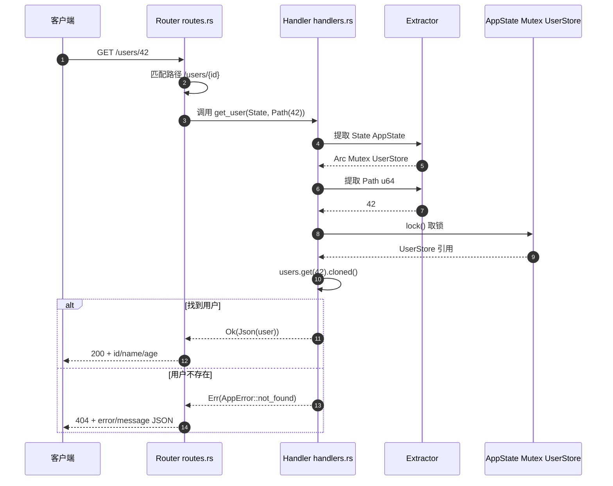
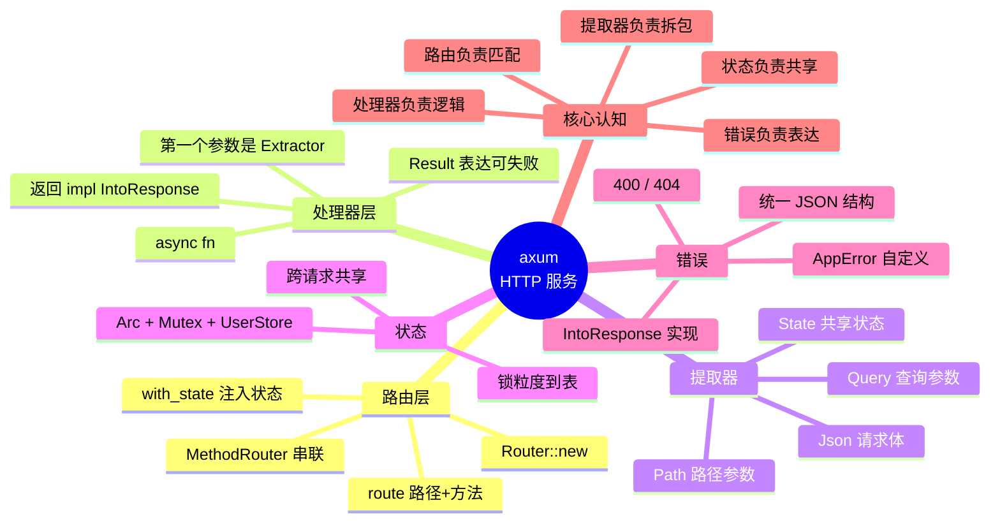

# 01-axum

基于 [axum](https://github.com/tokio-rs/axum) 0.8 的最小 HTTP 服务示例，演示**创建路由**与**处理请求**。

## 运行

```bash
make run          # 等价于 cargo run
cargo run         # 直接跑
```

服务启动后监听 `http://127.0.0.1:3000`。

## 项目结构

```
src/
├── main.rs      # 入口：绑定端口、启动服务
├── routes.rs    # 路由表
└── handlers.rs  # 处理器（处理请求）+ 状态 + 错误类型
```

## 架构全景



### 数据流：一次 `GET /users/{id}` 的完整路径



### 思维导图：axum 的四层结构



## 路由一览

| 方法   | 路径         | 说明                          | 返回                |
|--------|--------------|-------------------------------|---------------------|
| GET    | `/`          | 根路由                        | `Hello, axum!`      |
| GET    | `/health`    | 健康检查                      | `{"status":"ok"}`   |
| GET    | `/users`     | 用户列表，支持 `?page=&size=` | 用户数组 (JSON)     |
| POST   | `/users`     | 创建用户                      | 201 + 新用户 JSON   |
| GET    | `/users/{id}`| 查询单个用户                  | 用户 JSON / 404      |
| DELETE | `/users/{id}`| 删除用户                      | 204 / 404           |

## 关键点

### 1. 创建路由

路由用 `Router` 组合，`route()` 绑定路径与方法，多个方法可用 `MethodRouter` 串联：

```rust
Router::new()
    .route("/", get(handlers::root))
    .route("/health", get(handlers::health))
    .route("/users", get(handlers::list_users).post(handlers::create_user))
    .route("/users/{id}", get(handlers::get_user).delete(handlers::delete_user))
    .with_state(state)
```

> axum 0.8 的路径参数语法是 `{id}`（0.7 及以前是 `:id`）。

### 2. 处理请求

处理器是普通 `async fn`，第一个参数是提取器（Extractor），最后一个参数必须是返回类型 `impl IntoResponse`：

```rust
// 路径参数
async fn get_user(State(state): State<AppState>, Path(id): Path<u64>)
    -> Result<Json<User>, AppError>

// 查询参数
async fn list_users(State(state): State<AppState>, Query(pagination): Query<Pagination>)
    -> Json<Vec<User>>

// JSON 请求体
async fn create_user(State(state): State<AppState>, Json(payload): Json<CreateUser>)
    -> Result<(StatusCode, Json<User>), AppError>
```

- 提取器消耗请求体（如 `Json`），因此**有且只能有一个**；
- `State` / `Path` / `Query` / `Header` 等只读提取器可以有多个。

### 3. 共享状态

跨请求共享的数据用 `State` 提取器。处理器需要 `Send + Sync`，所以用 `Arc<Mutex<_>>`：

```rust
pub type AppState = Arc<Mutex<UserStore>>;
```

### 4. 错误处理

实现 `IntoResponse` 即可返回自定义错误状态码与 JSON 体：

```rust
impl IntoResponse for AppError {
    fn into_response(self) -> Response { /* (status, Json(...)) */ }
}
```

### 5. 分页默认值

`serde(default = "...")` 让查询参数可缺省：

```rust
#[derive(Debug, Deserialize)]
pub struct Pagination {
    #[serde(default = "default_page")]
    pub page: u32,
    #[serde(default = "default_size")]
    pub size: u32,
}
```

## curl 验证

```bash
# 或一键冒烟测试（自动起服务、跑完自动关）
make smoke
```

```bash
curl -s localhost:3000/
curl -s localhost:3000/health
curl -s "localhost:3000/users?page=1&size=10"
curl -s localhost:3000/users/1
curl -s -X POST localhost:3000/users \
  -H 'Content-Type: application/json' \
  -d '{"name":"Carlos","age":28}'
curl -s -X DELETE localhost:3000/users/3
```

## Makefile

```bash
make help        # 查看所有目标
make run         # 启动服务
make build       # 编译
make test        # 跑测试
make lint        # clippy 零警告
make fmt         # 格式化
make smoke       # 端到端冒烟测试
make clean       # 清理产物
```
