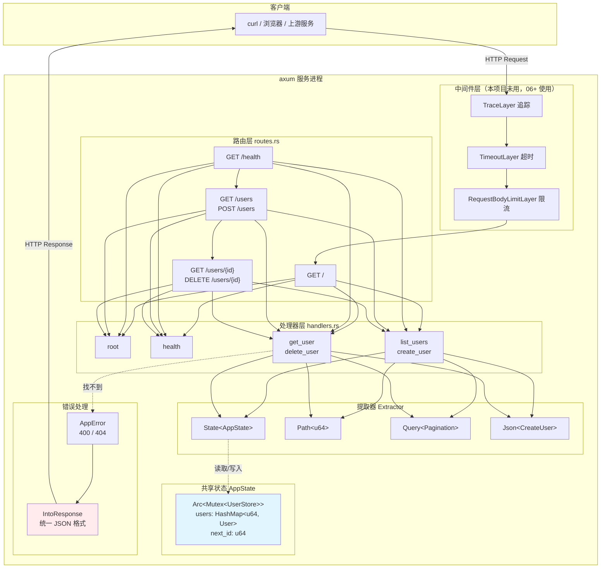
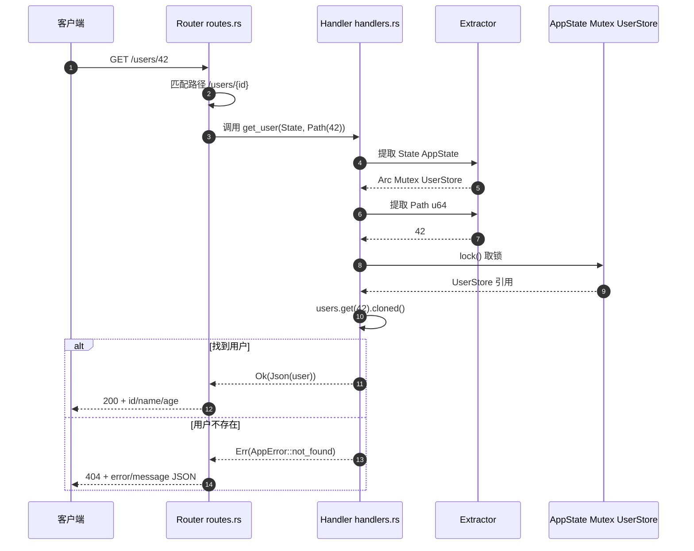
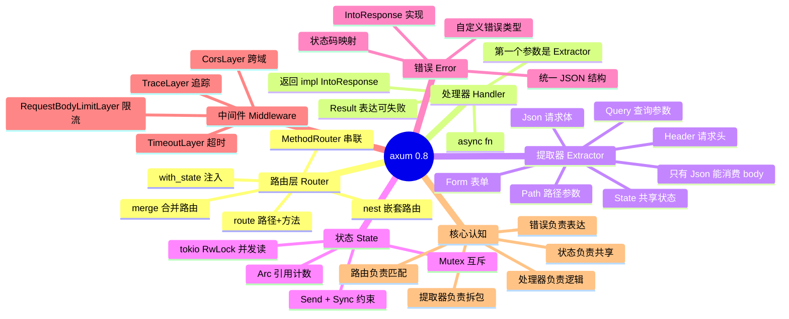

# 01-axum

基于 [axum](https://github.com/tokio-rs/axum) 0.8 的最小 HTTP 服务示例，演示**创建路由**与**处理请求**。

## 运行

```bash
make run          # 等价于 cargo run
cargo run         # 直接跑
```

服务启动后监听 `http://127.0.0.1:3000`。

## 项目结构

```
src/
├── main.rs      # 入口：绑定端口、启动服务
├── routes.rs    # 路由表
└── handlers.rs  # 处理器（处理请求）+ 状态 + 错误类型
```

## 架构全景



### 数据流：一次 `GET /users/{id}` 的完整路径



### 知识地图：axum 的四层结构

```mermaid
graph LR
    N1(("axum<br/>HTTP 服务"))
    subgraph N2["路由层"]
        N3["Router::new"]
        N2 --> N3
        N4["route 路径+方法"]
        N2 --> N4
        N5["MethodRouter 串联"]
        N2 --> N5
        N6["with_state 注入状态"]
        N2 --> N6
    end
    N1 --> N2
    subgraph N7["处理器层"]
        N8["async fn"]
        N7 --> N8
        N9["第一个参数是 Extractor"]
        N7 --> N9
        N10["返回 impl IntoResponse"]
        N7 --> N10
        N11["Result 表达可失败"]
        N7 --> N11
    end
    N1 --> N7
    subgraph N12["提取器"]
        N13["State 共享状态"]
        N12 --> N13
        N14["Path 路径参数"]
        N12 --> N14
        N15["Query 查询参数"]
        N12 --> N15
        N16["Json 请求体"]
        N12 --> N16
    end
    N1 --> N12
    subgraph N17["状态"]
        N18["Arc + Mutex + UserStore"]
        N17 --> N18
        N19["跨请求共享"]
        N17 --> N19
        N20["锁粒度到表"]
        N17 --> N20
    end
    N1 --> N17
    subgraph N21["错误"]
        N22["AppError 自定义"]
        N21 --> N22
        N23["IntoResponse 实现"]
        N21 --> N23
        N24["统一 JSON 结构"]
        N21 --> N24
        N25["400 / 404"]
        N21 --> N25
    end
    N1 --> N21
    subgraph N26["核心认知"]
        N27["路由负责匹配"]
        N26 --> N27
        N28["处理器负责逻辑"]
        N26 --> N28
        N29["提取器负责拆包"]
        N26 --> N29
        N30["状态负责共享"]
        N26 --> N30
        N31["错误负责表达"]
        N26 --> N31
    end
    N1 --> N26
```

## 思维导图：axum 的概念地图



## 路由一览

| 方法   | 路径         | 说明                          | 返回                |
|--------|--------------|-------------------------------|---------------------|
| GET    | `/`          | 根路由                        | `Hello, axum!`      |
| GET    | `/health`    | 健康检查                      | `{"status":"ok"}`   |
| GET    | `/users`     | 用户列表，支持 `?page=&size=` | 用户数组 (JSON)     |
| POST   | `/users`     | 创建用户                      | 201 + 新用户 JSON   |
| GET    | `/users/{id}`| 查询单个用户                  | 用户 JSON / 404      |
| DELETE | `/users/{id}`| 删除用户                      | 204 / 404           |

## 关键点

### 1. 创建路由

路由用 `Router` 组合，`route()` 绑定路径与方法，多个方法可用 `MethodRouter` 串联：

```rust
Router::new()
    .route("/", get(handlers::root))
    .route("/health", get(handlers::health))
    .route("/users", get(handlers::list_users).post(handlers::create_user))
    .route("/users/{id}", get(handlers::get_user).delete(handlers::delete_user))
    .with_state(state)
```

> axum 0.8 的路径参数语法是 `{id}`（0.7 及以前是 `:id`）。

### 2. 处理请求

处理器是普通 `async fn`，第一个参数是提取器（Extractor），最后一个参数必须是返回类型 `impl IntoResponse`：

```rust
// 路径参数
async fn get_user(State(state): State<AppState>, Path(id): Path<u64>)
    -> Result<Json<User>, AppError>

// 查询参数
async fn list_users(State(state): State<AppState>, Query(pagination): Query<Pagination>)
    -> Json<Vec<User>>

// JSON 请求体
async fn create_user(State(state): State<AppState>, Json(payload): Json<CreateUser>)
    -> Result<(StatusCode, Json<User>), AppError>
```

- 提取器消耗请求体（如 `Json`），因此**有且只能有一个**；
- `State` / `Path` / `Query` / `Header` 等只读提取器可以有多个。

### 3. 共享状态

跨请求共享的数据用 `State` 提取器。处理器需要 `Send + Sync`，所以用 `Arc<Mutex<_>>`：

```rust
pub type AppState = Arc<Mutex<UserStore>>;
```

### 4. 错误处理

实现 `IntoResponse` 即可返回自定义错误状态码与 JSON 体：

```rust
impl IntoResponse for AppError {
    fn into_response(self) -> Response { /* (status, Json(...)) */ }
}
```

### 5. 分页默认值

`serde(default = "...")` 让查询参数可缺省：

```rust
#[derive(Debug, Deserialize)]
pub struct Pagination {
    #[serde(default = "default_page")]
    pub page: u32,
    #[serde(default = "default_size")]
    pub size: u32,
}
```

## curl 验证

```bash
# 或一键冒烟测试（自动起服务、跑完自动关）
make smoke
```

```bash
curl -s localhost:3000/
curl -s localhost:3000/health
curl -s "localhost:3000/users?page=1&size=10"
curl -s localhost:3000/users/1
curl -s -X POST localhost:3000/users \
  -H 'Content-Type: application/json' \
  -d '{"name":"Carlos","age":28}'
curl -s -X DELETE localhost:3000/users/3
```

## 日志

全仓库统一走 `00-logging`（`agent-logging`）。

```bash
RUST_LOG=info cargo run -p axum-01
RUST_LOG=debug,axum_01=trace cargo run -p axum-01
```

| 事件 | 级别 | 关键字段 |
|---|---|---|
| 服务启动 | `INFO` | `addr` |
| 每个 HTTP 请求 | `INFO`（span 内） | `request_id` / `method` / `path` / `status` / `elapsed_ms` |
| 处理器内部的处理步骤 | `DEBUG` | 视具体端点而定 |

`trace_layer()` 会在每个请求上开一个 span —— 一次请求触发的所有日志
自动带上同一个 `request_id`，能串起来。

---
## 技术参考速查

### 提取器速查表

| 提取器 | 数据来源 | 位置 | 能消费 body？ | 典型用法 |
|---|---|---|---|---|
| `State<T>` | 路由器注入的共享状态 | 参数 | ❌ | `State(state): State<AppState>` |
| `Path<T>` | 路径参数 `/users/{id}` | 参数 | ❌ | `Path(id): Path<u64>` |
| `Query<T>` | 查询串 `?page=1` | 参数 | ❌ | `Query(p): Query<Pagination>` |
| `Json<T>` | 请求体（application/json） | 参数 | ✅ | `Json(b): Json<CreateUser>` |
| `Form<T>` | 请求体（form-urlencoded） | 参数 | ✅ | `Form(f): Form<Login>` |
| `Header<T>` | 请求头 | 参数 | ❌ | `Header(h): Header<UserAgent>` |
| `Extension<T>` | 请求扩展 | 参数 | ❌ | `Extension(e): Extension<Ctx>` |

⚠️ **消费 body 的提取器有且只能有一个** —— body 是一次性的流，不能读两遍。

### 处理器返回类型速查

| 返回类型 | 效果 |
|---|---|
| `Json<T>` | 200 + `application/json` |
| `String` / `&'static str` | 200 + `text/plain` |
| `StatusCode` | 状态码，无 body |
| `(StatusCode, Json<T>)` | 自定义状态码 + body |
| `impl IntoResponse` | 任意组合 |
| `Result<T, E>` | `Ok` 正常，`Err` 交给 `E: IntoResponse` |

### 常见中间件

| 中间件 | 作用 | 04~10 项目的用法 |
|---|---|---|
| `TraceLayer` | 打印方法、路径、耗时 | 全部使用 |
| `TimeoutLayer` | 超时返回 504 | 06~10 使用（**超时值随负载递增**） |
| `RequestBodyLimitLayer` | 限制请求体大小 | 全部使用（1MB） |
| `CorsLayer` | 跨域 | 未使用 |

### 状态码语义

| 码 | 含义 | 本项目用法 |
|---|---|---|
| 200 | 成功 | 查询成功 |
| 201 | 已创建 | `POST /users` |
| 204 | 无内容 | `DELETE /users/{id}` |
| 400 | 请求有误 | 参数非法 / JSON 解析失败 |
| 404 | 资源不存在 | 用户不存在 |
| 422 | 语义错误 | 业务校验失败 |
| 500 | 服务端错误 | 未预期异常 |
| 504 | 网关超时 | `TimeoutLayer` 触发 |

### 为什么用 `Arc<Mutex<_>>` 而不是 `Arc<RwLock<_>>`？

| | `Mutex` | `RwLock` |
|---|---|---|
| 读并发 | ❌ 独占 | ✅ 多读一写 |
| 复杂度 | 简单 | 略高（tokio 版要 `.await`） |
| 适用 | 写多 / 临界区短 | 读多 / 临界区长 |

`01-axum` 的 `UserStore` 操作极短，用 `Mutex` 足够。
**真正需要考虑的是**：如果换成 `tokio::sync::RwLock`，`lock()` 会变成 `.await`，
处理器签名也要跟着变 —— 这是「同步锁 vs 异步锁」的经典取舍。

### ⚠️ 处理器必须 `Send + Sync`

因为 axum 的 handler 要能跨线程移动（多线程运行时）。

所以 `AppState` 里的东西必须满足：

```rust
// Arc<Mutex<UserStore>> 之所以能用，
// 是因为 UserStore: Send，Mutex<T>: Send + Sync。
// 如果 UserStore 里塞了 Rc<RefCell<_>>，编译直接报错。
```

这是 Rust 类型系统帮你挡掉的一类并发 bug —— **报错发生在编译期，不是运行时**。

---

## Makefile

```bash
make help        # 查看所有目标
make run         # 启动服务
make build       # 编译
make test        # 跑测试
make lint        # clippy 零警告
make fmt         # 格式化
make smoke       # 端到端冒烟测试
make clean       # 清理产物
```
