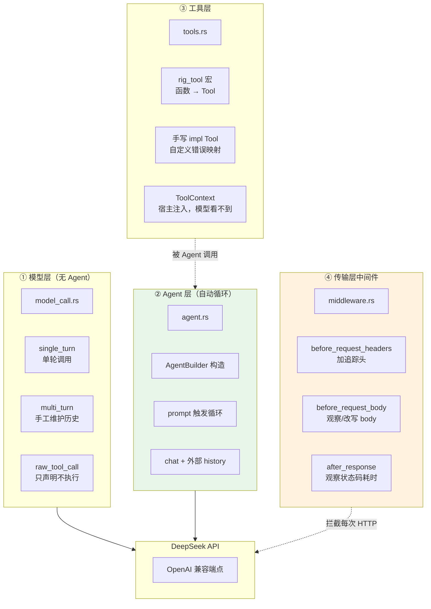
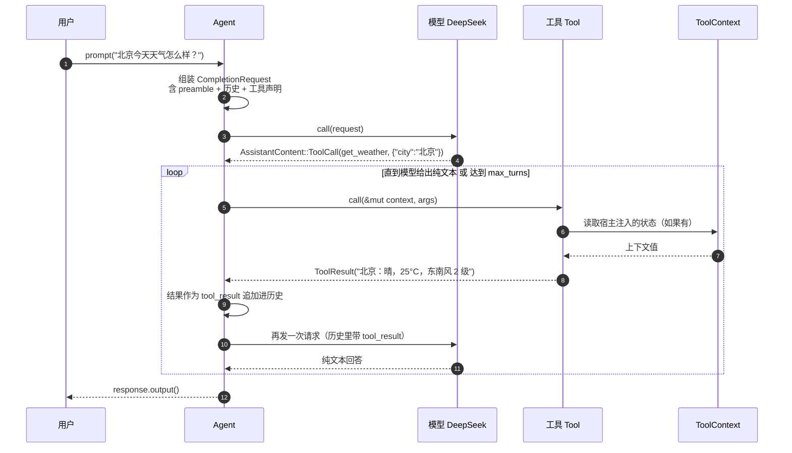
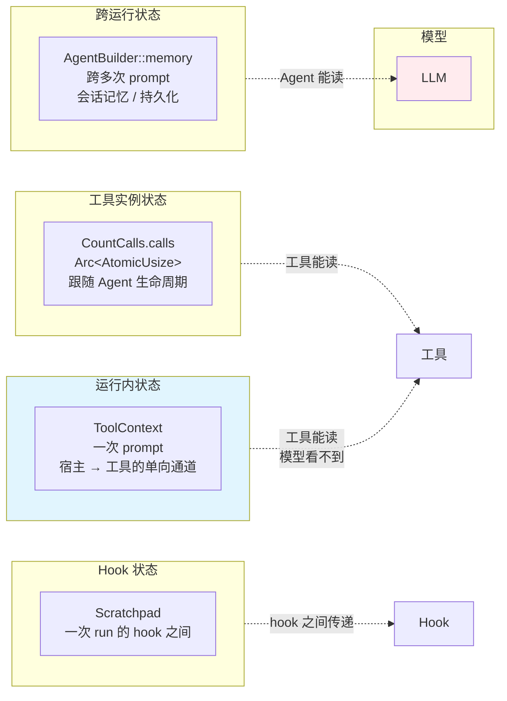
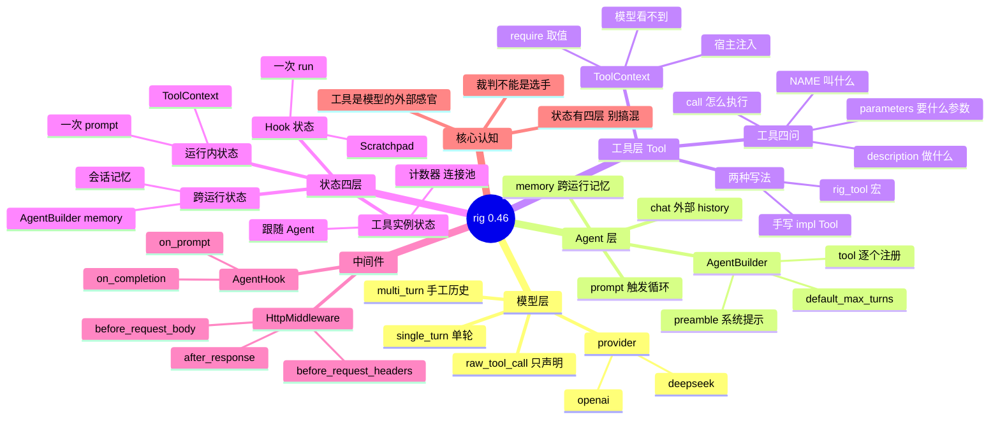

# 02-rig

基于 [Rig](https://github.com/0xPlaygrounds/rig) 0.46 的学习项目，跑通**模型/消息调用**与**创建 Agent**，并理解**工具（Tool）**、**状态（State）**和**中间件（Middleware）**。

## 运行

```bash
export DEEPSEEK_API_KEY=sk-xxx   # 必填
make run                        # 等价于 cargo run
```

用的是 DeepSeek（`deepseek-v4-flash`）。换 OpenAI 只需改 `src/model_call.rs` 与 `src/agent.rs` 里的 provider 构造。

## 项目结构

```
src/
├── main.rs        # 入口，串起所有 demo
├── model_call.rs  # 模型与消息调用（最底层）
├── agent.rs       # 创建 Agent
├── tools.rs       # 工具定义与执行
└── middleware.rs  # 传输层中间件
```

---

## 架构全景



### Agent 自动循环的时序图（核心）



### Rig 四层状态的归属图



### 知识地图：rig 的核心概念

```mermaid
graph LR
    N1(("rig<br/>AI 编排框架"))
    subgraph N2["模型调用"]
        N3["Message 四种角色"]
        N2 --> N3
        N4["CompletionRequest"]
        N2 --> N4
        N5["Model call / stream"]
        N2 --> N5
        N6["无循环"]
        N2 --> N6
    end
    N1 --> N2
    subgraph N7["Agent"]
        N8["AgentBuilder 构造"]
        N7 --> N8
        N9["preamble 系统提示"]
        N7 --> N9
        N10["default_max_turns"]
        N7 --> N10
        N11["prompt 自动循环"]
        N7 --> N11
        N12["chat 外部历史"]
        N7 --> N12
    end
    N1 --> N7
    subgraph N13["工具"]
        N14["rig_tool 宏"]
        N13 --> N14
        N15["手写 impl Tool"]
        N13 --> N15
        N16["NAME 叫什么"]
        N13 --> N16
        N17["description 做什么"]
        N13 --> N17
        N18["parameters 什么参数"]
        N13 --> N18
        N19["call 怎么执行"]
        N13 --> N19
    end
    N1 --> N13
    subgraph N20["状态"]
        N21["工具实例状态"]
        N20 --> N21
        N22["ToolContext 运行内"]
        N20 --> N22
        N23["memory 跨运行"]
        N20 --> N23
        N24["Scratchpad hook"]
        N20 --> N24
    end
    N1 --> N20
    subgraph N25["Middleware"]
        N26["传输层"]
        N25 --> N26
        N27["before_request_headers"]
        N25 --> N27
        N28["before_request_body"]
        N25 --> N28
        N29["after_response"]
        N25 --> N29
        N30["与 AgentHook 的区别"]
        N25 --> N30
    end
    N1 --> N25
    subgraph N31["核心认知"]
        N32["Agent = 手工循环的自动化"]
        N31 --> N32
        N33["工具四问"]
        N31 --> N33
        N34["上下文模型看不到"]
        N31 --> N34
        N35["middleware 作用在线缆层"]
        N31 --> N35
    end
    N1 --> N31
```

---

## 一、模型与消息调用

Rig 的最底层三个概念：

| 概念 | 说明 |
|------|------|
| `Message` | 一条消息：`system` / `user` / `assistant` / `tool_result` |
| `CompletionRequest` | 一次请求 = 消息序列 + 采样参数 + 工具声明 |
| `Model` | 一个模型端点，`call()` 发一次，`stream()` 流式读 |

```rust
let client: OpenAI = deepseek::from_env()?;
let model = client.completion(deepseek::DEEPSEEK_V4_FLASH);

let request = CompletionRequest::new("用一句话解释 Rust 的所有权机制。")
    .preamble("你是一个简洁的 Rust 导师。")
    .temperature(0.3)
    .max_tokens(512);

let response = model.call(request).await?;
println!("{}", response.text());
```

**多轮对话**手工维护消息序列：

```rust
let history = vec![
    Message::system("你是数学助手。"),
    Message::user("什么是素数？"),
    Message::assistant("素数是大于 1 且只有 1 和自身两个正因数的自然数。"),
    Message::user("那 97 呢？"),
];
let response = model.call(CompletionRequest::from(history)).await?;
```

**声明工具但不执行**——看清「模型请求调工具」长什么样：

```rust
let tool = ToolDefinition::new(
    ToolName::new("get_weather")?,
    "查询某个城市的天气",
    serde_json::json!({
        "type": "object",
        "properties": { "city": { "type": "string" } },
        "required": ["city"]
    }),
);
let response = model.call(CompletionRequest::new("北京今天天气怎么样？").tool(tool)).await?;

for call in response.tool_calls() {
    println!("{} {:?}", call.function.name, call.function.arguments);
}
```

模型会返回 `ToolCall`，但**没有人执行它**。这正是 Agent 存在的意义。

---

## 二、创建 Agent

`AgentBuilder` 是构造入口：

```rust
let agent = AgentBuilder::new(model)
    .name("assistant")
    .preamble("你是一个乐于助人的助手。需要外部信息时，主动调用工具。")
    .default_max_turns(8)
    .tool(AddTwo)
    .tool(GetWeather)
    .build();

let response = agent.prompt("北京今天天气怎么样？").await?;
println!("{}", response.output());
```

`prompt()` 内部自动跑一个循环：

```text
发请求 → 模型要调工具？→ 执行工具 → 结果作为 tool_result 追加进历史
       → 再发请求 …… → 模型给出纯文本回答 → 结束
```

上面 `model_call.rs` 里手工写的循环，全被 Agent 接管了。实际跑出来的消息序列：

```text
User      { content: [Text("北京今天天气怎么样？...")] }
Assistant { content: [ToolCall(get_weather, {"city":"北京"})] }
User      { content: [ToolResult(get_weather, "北京：晴，25°C，东南风 2 级")] }
Assistant { content: [Text("北京今天晴，气温 25°C，东南风 2 级。")] }
```

> **注意 `default_max_turns`**：默认只有 1 轮。工具调用会占掉一轮（调工具 + 读结果 + 作答至少 2~3 轮），不设置会直接报 `reached the max turns limit of 1`。

---

## 三、工具（Tool）

一个工具要回答四个问题：

| 问题 | 位置 |
|------|------|
| 叫什么 | `Tool::NAME` |
| 做什么 | `description()` |
| 要什么参数 | `parameters()`（JSON Schema） |
| 怎么执行 | `call(&mut ToolContext, args)` |

### 写法一：`#[rig_tool]` 宏

从普通函数自动生成上面四样东西：

```rust
#[rig_tool(description = "把两个整数相加", params(a = "第一个加数", b = "第二个加数"))]
pub fn add_two(a: i64, b: i64) -> Result<i64, ToolExecutionError> {
    Ok(a + b)
}
```

宏生成：`AddTwo`（工具体）、`AddTwoParameters`（参数结构体）、`ADD_TWO`（静态量）。

注册时用类型而非静态量，因为 `Tool: Sized` 不是 trait object：

```rust
.tool(AddTwo)
```

> 函数必须标 `pub`，否则宏生成的类型和静态量也是私有的。

### 写法二：手写 `impl Tool`

需要自定义错误映射、执行注解（annotations）时用：

```rust
impl Tool for CountCalls {
    const NAME: &'static str = "count_calls";
    type Args = CountCallsParams;
    type Output = usize;
    type Error = Infallible;

    fn description(&self) -> String { "返回本工具被调用的次数".into() }
    fn parameters(&self) -> serde_json::Value { /* JSON Schema */ }

    fn call(&self, _ctx: &mut ToolContext, _args: Self::Args)
        -> impl Future<Output = Result<Self::Output, Self::Error>> + Send
    {
        async move { Ok(/* ... */) }
    }
}
```

### 读 `ToolContext`

`ToolContext` 是工具的「入参通道」。宿主塞进去的工具读得到，**模型看不到**：

```rust
#[derive(Debug, Clone, Serialize, Deserialize, ContextValue)]
#[context(key = "session.user")]
pub struct SessionUser { pub name: String, pub tier: String }

#[rig_tool(name = "whoami", description = "查询当前登录用户")]
pub fn whoami(#[rig(context)] context: &mut ToolContext) -> Result<String, ToolExecutionError> {
    let user = context.require::<SessionUser>()?;
    Ok(format!("{}（{} 会员）", user.name, user.tier))
}
```

宿主侧注入：

```rust
let mut context = ToolContext::new();
context.insert(SessionUser { name: "Rodriguez".into(), tier: "pro".into() })?;

agent.prompt("调用 whoami 工具，告诉我我是谁。").tool_context(context).await?;
```

`#[rig(context)]` 标记这个参数是上下文而非模型要填的参数，因此它**不会**出现在 JSON Schema 里。

---

## 四、状态（State）

Rig 里「状态」分四层，职责完全不同：

| 层 | 载体 | 生命周期 | 用途 |
|----|------|----------|------|
| 工具实例状态 | 工具结构体自身的字段 | 跟随 Agent | 计数器、连接池、缓存 |
| 运行内状态 | `ToolContext` | 一次 `prompt` | 把宿主数据喂给工具 |
| 跨运行状态 | `AgentBuilder::memory` | 跨多次 `prompt` | 会话记忆、持久化 |
| Hook 状态 | `Scratchpad` | 一次 run 的 hook 之间 | 中间计数、路由决策 |

### 工具实例状态

工具实例被 Agent 共享，所以可变状态放实例里（用 `Arc<AtomicUsize>` 保证线程安全）：

```rust
#[derive(Clone, Default)]
pub struct CountCalls {
    calls: Arc<AtomicUsize>,
}
```

模型连续调三次，返回 1、2、3 —— 计数跨调用累加。

### 运行内状态

`ToolContext` 每次 `prompt` 独立，通过 `.tool_context(ctx)` 注入。值不发给模型，模型只能通过调工具间接知道。

### 跨运行状态

最轻量的做法是调用方自己持有历史：

```rust
let mut history: Vec<Message> = Vec::new();
agent.chat("我叫 Rodriguez，记住我。", &mut history).await?;
agent.chat("我刚才说我叫什么？", &mut history).await?;   // 记得
```

要自动持久化，用 `AgentBuilder::memory(store)`，接 `rig-memory` 的 `MemoryStore` / `DirStore`。

---

## 五、Middleware

Rig 的 middleware 作用在**传输层**（HTTP），不是 agent 层。三个钩子：

| 钩子 | 时机 | 能做什么 |
|------|------|----------|
| `before_request_headers` | 请求头发出去前 | 改 header |
| `before_request_body` | body 序列化后 | 观察或改写 body |
| `after_response` | 响应头刚到 | 观察状态码、耗时 |

```rust
impl HttpMiddleware for LatencyLogger {
    fn after_response<'a>(
        &'a self,
        exchange: Exchange<'a>,
        status: StatusCode,
        _headers: &'a HeaderMap,
    ) -> WasmBoxedFuture<'a, Result<(), Error>> {
        println!("{} {} -> {}", exchange.method, exchange.uri.path(), status.as_u16());
        Box::pin(async { Ok(()) })
    }
}
```

挂到客户端上：

```rust
let http = DynHttpClient::new(ReqwestClient::default())
    .with_middleware(logger.clone())
    .with_middleware(TraceHeader { tag: "02-rig-demo".into() });

let client = OpenAIConfig::from_env_with(&DEEPSEEK)?.connect(http);
```

多个 middleware 按**挂载顺序**执行：先跑所有 header 钩子，再跑所有 body 钩子，最后是响应钩子。

> **`AgentHook` vs `HttpMiddleware`**：`AgentHook` 工作在 agent 的**语义层**（选模型、改请求、拦截工具调用、模型路由），`HttpMiddleware` 工作在**线缆层**（每个 HTTP 请求）。两者互不替代。

## 日志

全仓库统一走 `00-logging`（`agent-logging`）。

```bash
RUST_LOG=info cargo run -p rig-02
RUST_LOG=debug,rig_02=trace cargo run -p rig-02
```

rig 的 middleware 钩子里也用结构化日志（而不是 `println!`）：

```rust
use agent_logging::info;

info!(
    seq = count,
    method = %exchange.method,
    path = %exchange.uri.path(),
    status = status.as_u16(),
    "上游模型请求完成"
);
```

| 事件 | 级别 | 关键字段 |
|---|---|---|
| 模型调用 | `INFO` | `model` / `prompt_chars` |
| 工具调用（rig 的 tool） | `DEBUG` | `tool` / `args` |
| 上游 HTTP 请求完成（middleware） | `INFO` | `method` / `path` / `status` |
| 模型调用失败 | `ERROR` | `model` / `error` |

---
---

## 思维导图：rig 的概念地图



---

## 技术参考速查

### 工具的「四问」对照表

一个合格的 `Tool` 必须回答这四个问题，缺一不可：

| 问题 | 承载什么 | 缺了会怎样 |
|---|---|---|
| **叫什么** | `const NAME: &'static str` | 模型调不出来 |
| **做什么** | `fn description() -> String` | 模型不知道该不该调 |
| **要什么参数** | `fn parameters() -> serde_json::Value` | 模型填不对参数 |
| **怎么执行** | `fn call(&mut ToolContext, Args)` | 逻辑无从落地 |

⚠️ `description()` 的质量**直接决定**模型会不会调用这个工具。
这是提示词工程的一部分，不是文档注释。

### 两种工具写法的取舍

| | `#[rig_tool]` 宏 | 手写 `impl Tool` |
|---|---|---|
| 代码量 | 少（几行） | 多（要写四个方法） |
| 适用 | 简单、无状态、参数直接 | 需要自定义错误映射 / annotations |
| 可读性 | 参数签名即文档 | 分离的四个方法 |

⚠️ `#[rig_tool]` 宏生成的参数结构体要求参数类型能 `Deserialize + Serialize`。

### 四层状态对照表（本项目最容易搞混的地方）

| 层 | 载体 | 生命周期 | 典型用途 | 本项目示例 |
|---|---|---|---|---|
| **工具实例状态** | 工具结构体自身的字段 | 跟随 Agent | 计数器、连接池、缓存 | `CountCalls.calls` |
| **运行内状态** | `ToolContext` | 一次 `prompt` | 把宿主数据喂给工具 | `SessionUser` |
| **跨运行状态** | `AgentBuilder::memory` | 跨多次 `prompt` | 会话记忆、持久化 | 见 `agent_with_history` |
| **Hook 状态** | `Scratchpad` | 一次 run 的 hook 之间 | 中间计数、路由决策 | — |

⚠️ **工具实例是被 Agent 共享的** —— 所以可变状态要放在**实例**里，
而不是 `ToolContext` 里（后者每次调用独立）。

### `ToolContext` 的关键性质

```text
宿主 insert(T)  ──▶  ToolContext  ──▶  工具 require::<T>()
                        │
                        └─▶ ✗ 不会发给模型
```

模型**看不到** `ToolContext` 里的值 —— 它必须通过**调用工具**才能间接知道。
这正是「工具」这个机制的意义：**给模型一个安全的、能触及外部世界的通道**。

用 `#[derive(ContextValue)]` + `#[context(key = "...")]` 可以用类型本身当槽位 key，
不用手写字符串，避免 key 冲突。

### `#[rig(context)]` 标记

```rust
#[rig_tool(name = "whoami", description = "...")]
pub fn whoami(#[rig(context)] context: &mut ToolContext) -> Result<String, ToolExecutionError> {
    // ...
}
```

`#[rig(context)]` 告诉宏：这个参数是**上下文**，不是模型要填的参数，
因此它**不会出现在 JSON Schema 里**。

少了这个标记 → 宏会试图把 `ToolContext` 当成一个要模型填的参数 → 生成的 Schema 是错的。

### 中间件钩子速查

| 钩子 | 时机 | 能做什么 |
|---|---|---|
| `before_request_headers` | 请求发出前 | 加追踪头、注入认证 |
| `before_request_body` | body 序列化后 | 观察 / 改写请求体 |
| `after_response` | 响应回来后 | 记录状态码、耗时、token 用量 |

### 工具调用的轮次成本

⚠️ **一次工具调用至少要 2~3 轮模型往返**：

```text
第 1 轮：模型输出 tool_call 请求
        ↓  （框架执行工具，不消耗模型轮次）
第 2 轮：模型读 tool_result，给出最终回答
```

所以 `default_max_turns` 要留够 —— 本项目设 8，
因为「调工具 + 读结果 + 作答」至少要 2~3 轮，复杂任务更多。

### Rig 与 01-axum 的概念对照

| | 01-axum | 02-rig |
|---|---|---|
| 关注点 | HTTP 服务端 | LLM 应用 |
| 入口 | `Router` + handler | `AgentBuilder` + `prompt` |
| 「请求」 | `Request<T>` → `Response` | `Message` → `CompletionResponse` |
| 中间件 | axum 的 `layer` | `HttpMiddleware` / `AgentHook` |
| 状态 | `State<T>` | `ToolContext` / 工具实例 / `Scratchpad` |

两者可以叠加：用 axum 暴露 HTTP 接口，rig 在里面跑 Agent。

---

## Makefile

```bash
make help        # 查看所有目标
make key         # 检查 DEEPSEEK_API_KEY
make run         # 跑全部 demo
make build       # 编译
make test        # 跑测试
make lint        # clippy 零警告
make fmt         # 格式化
make clean       # 清理产物
```
