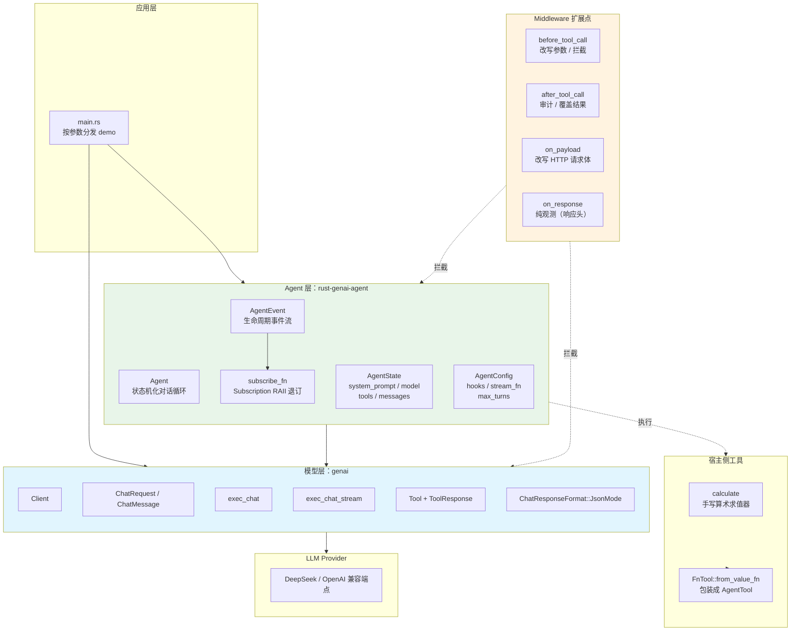
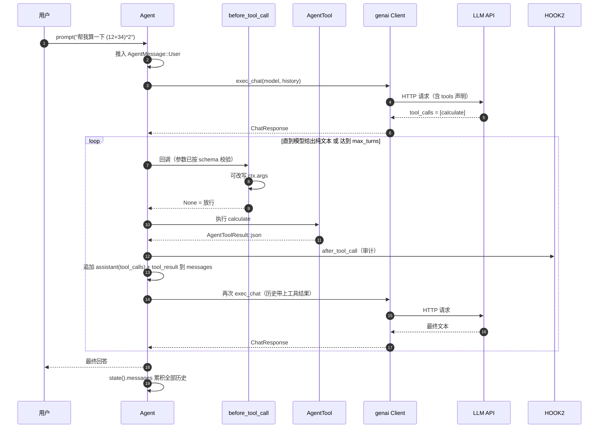
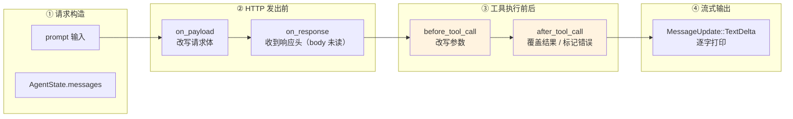
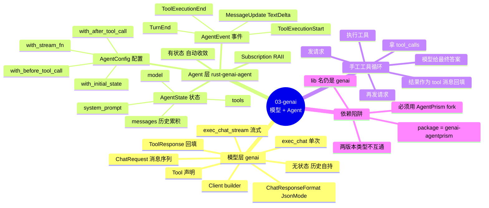

# 03-genAI

用 Rust 的 [`genai`](https://github.com/jeremychone/rust-genai) 跑通 **模型调用 → 消息 → 工具 → Agent** 这条主线，并理解三件事：**工具**、**状态**、**middleware**。

```bash
export DEEPSEEK_API_KEY=sk-...   # 必需
make all                          # 等价于 cargo run -- all
```

---

## 1. 两个 crate，两层

这是理解本项目最重要的一点。`genai` **不含** agent 循环。

| 层 | crate | 职责 | 状态 |
|---|---|---|---|
| 模型/消息层 | `genai` | 单次请求-响应、消息历史、流式、原始工具调用 | **无状态**，历史自己带 |
| Agent 层 | `rust-genai-agent` | 状态机化的对话循环：自动调工具、回填结果、多轮收敛 | **有状态**，历史自动累积 |

`rust-genai-agent` 把 `genai` 的流式接口包成一个 `StreamFn`（`GenaiStreamFn`），然后在它上面跑 `Agent` 循环。

## 架构全景



### Agent 自动循环的时序图



### Hook 拦截点全景（作用在链路的哪一段）



> ⚠️ 语义要点：`on_payload` / `on_response` 这类 **per-request** 钩子会**替换**构造期的钩子，两者不叠加 —— 每次物理请求（包括重试）每个通道只触发一次。

### 思维导图：genai 两层的分工



### ⚠️ 依赖陷阱（必读）

`rust-genai-agent` 依赖的是 **AgentPrism fork** 的 `genai`，不是上游 `genai 0.7`：

```toml
# crates.io 上叫 genai-agentprism，但 lib 名仍然叫 genai
genai = { version = "=0.7.0-beta.19.1-agentprism", package = "genai-agentprism" }
rust-genai-agent = "0.2.0"
```

两个包类型**不互通**，同时依赖会编译失败。所以 `Cargo.toml` 里只有一个 `genai` 依赖，指向 fork。

fork 相对上游的差异（踩过的坑）：

| 上游 `genai 0.7` | fork（实际用的） |
|---|---|
| `Client::builder().build() -> Result<Client>` | `-> Client`（不返回 Result） |
| `chat_res.usage: Option<Usage>` | `chat_res.usage: Usage`（非 Option） |
| `ToolResponse::parts` 之类 fork 专有 API | 上游没有 |

---

## 2. Demo 一览

```bash
make chat     # 1. 单轮 / 2. 多轮 / 3. 流式 / 4. JSON 模式
make tools    # 5. 原始工具调用（手工执行 + 回填）
make agent    # 6. Agent 自动工具循环
make hooks    # 7. 工具 middleware（before/after）
make http     # 8. HTTP 边界 middleware（on_payload/on_response）
make state    # 9. 状态累积与重置
make all      # 全部
```

> 也可直接 `cargo run -- chat` 等，`make` 只是包了一层。

---

## 3. 模型层：消息与工具

### 单轮

```rust
let chat_req = ChatRequest::new(vec![
    ChatMessage::system("你是一个简洁的助手，回答不超过一句话。"),
    ChatMessage::user("用一句话解释什么是 RAII。"),
]);
let chat_res = client.exec_chat(MODEL, chat_req, None).await?;
```

`ChatRequest` = system 提示 + 消息列表。`ChatResponse` 里有文本、usage、stop_reason。

### 多轮：历史就是状态

```rust
let mut chat_req = ChatRequest::from_system("...");
for q in questions {
    chat_req = chat_req.append_message(ChatMessage::user(q));
    let chat_res = client.exec_chat(MODEL, chat_req.clone(), None).await?;
    let answer = chat_res.first_text().unwrap_or("").to_string();
    // 关键：把 assistant 的回答也塞回历史，下一轮模型才看得见
    chat_req = chat_req.append_message(ChatMessage::assistant(answer));
}
```

`genai` 本身**不替你保管历史**（`previous_response_id` 只对 OpenAI Responses API 有效）。

### 流式

```rust
let chat_res = client.exec_chat_stream(MODEL, chat_req, None).await?;
let full = print_chat_stream(chat_res, None).await?;
```

### 原始工具调用：agent 层要自动化掉的部分

```text
发请求 → 模型返回 tool_calls → 你执行工具 → 结果作为 tool 消息回填
       → 再发请求 → 模型给出最终答案
```

```rust
// 1. 声明工具（标准 JSON Schema）
let tool = Tool::new("calculate").with_description("...").with_schema(json!({...}));

// 2. 第一轮拿 tool_calls
let chat_res = client.exec_chat(MODEL, chat_req.clone(), None).await?;
let tool_calls = chat_res.tool_calls().into_iter().cloned().collect::<Vec<_>>();

// 3. 执行
let responses = tool_calls.iter().map(|call| {
    ToolResponse::new(call.call_id.clone(), json!({ "result": value }).to_string())
}).collect::<Vec<_>>();

// 4. 回填：assistant 的 tool_calls + tool 结果
chat_req = chat_req.append_message(tool_calls).append_message(responses);

// 5. 第二轮拿最终答案
let chat_res = client.exec_chat(MODEL, chat_req, None).await?;
```

> `ToolResponse::new(call_id, content)` 的 `call_id` 必须和 `ToolCall::call_id` 一致，否则 provider 会拒绝。

---

## 4. Agent 层：create_agent

`Agent` 就是 Python LangChain `create_agent` / OpenAI Agents SDK `Agent` 的对应物：给一个模型 + 一组工具 + 系统提示，它自己跑工具循环。

```rust
let state = AgentState {
    model: MODEL.into(),
    system_prompt: "你是一个会使用工具的助手。需要算数时必须调用 calculate 工具。".into(),
    tools: vec![calculate_tool(), counting_tool()],
    ..AgentState::default()
};

let agent = Agent::new(
    AgentConfig::default()
        .with_initial_state(state)
        .with_stream_fn(Arc::new(GenaiStreamFn::new(client))),
);

agent.prompt("帮我算一下 (12 + 34) * 2").await?;
```

### 工具：`AgentTool`

```rust
let tool = FnTool::from_value_fn(
    ToolSpec::new("calculate", "计算一个算术表达式", calculate_schema()),
    |args: Value| async move {
        let expr = args.get("expression").and_then(|v| v.as_str()).unwrap_or_default();
        match calculate(&expr) {
            Ok(value) => Ok(AgentToolResult::json(json!({ "result": value }))),
            Err(e) => Err(ToolError::InvalidArguments(e.to_string())),
        }
    },
);
```

- `ToolSpec` —— 名字 + 描述 + **JSON Schema**。schema 有两个用途：告诉模型怎么调，以及**本地校验 + 类型强制**。
- `FnTool::from_value_fn` —— 只关心 `args`（已校验、已强转类型）。
- `FnTool::new` —— 完整版，额外拿到 `ToolCallContext`、`CancellationToken`、`UpdateSink`（可流式上报中间结果）。
- 工具返回值用 `ToolError` 报错时，错误会变成**普通的 error tool-result** 回给模型，模型能读到并自我纠正 —— 不会炸掉整个循环。

### 状态

`Agent` 是**有状态 facade**：

| 字段 | 含义 |
|---|---|
| `state().messages` | 已提交的历史，跨 `prompt()` 累积 |
| `state().tools` | 工具集 |
| `state().system_prompt` / `.model` | 运行时可改（`set_system_prompt` / `set_model`） |
| `state().is_streaming` | 是否有活跃运行 |
| `state().error_message` | 最近一次失败的错误文本 |
| `state().pending_tool_calls` | 已开始但未结束的工具调用 id |

`agent.reset()` 清空历史回到初始状态。

对比模型层：`genai::Client` 无状态，历史自己带；`Agent` 有状态，历史自动累积。

还有两个**队列**机制（`agent_loop` 用得上）：

- `agent.steer(msg)` —— 插队消息，在下一轮开始前注入
- `agent.follow_up(msg)` —— 后续消息，循环本来要结束时注入

### 事件流

```rust
let subscription = agent.subscribe_fn(|event, _cancel| async move {
    match event {
        AgentEvent::MessageUpdate {
            assistant_message_event: AssistantMessageEvent::TextDelta { delta, .. },
            ..
        } => print!("{delta}"),
        AgentEvent::ToolExecutionStart { tool_name, args, .. } => { /* ... */ }
        AgentEvent::ToolExecutionEnd { tool_name, is_error, .. } => { /* ... */ }
        _ => {}
    }
});
```

事件种类：`AgentStart` / `AgentEnd` / `TurnStart` / `TurnEnd` / `MessageStart` / `MessageUpdate` / `MessageEnd` / `ToolExecutionStart` / `ToolExecutionUpdate` / `ToolExecutionEnd`。

⚠️ `Subscription` 是 **RAII**：drop 即退订。必须持有到运行结束。

---

## 5. Middleware（钩子）

分两组，作用在不同层。

### 5.1 工具层：`before_tool_call` / `after_tool_call`

```rust
let config = AgentConfig::default()
    .with_before_tool_call(Arc::new(|ctx: &mut BeforeToolCallContext, _cancel| {
        Box::pin(async move {
            // ctx.args 已按 schema 校验并强制类型
            // 改写 ctx.args 就会直接传给工具（不再二次校验）
            if let Some(obj) = ctx.args.as_object_mut() {
                obj.insert("expression".into(), Value::String("(12+34)*2".into()));
            }
            None::<BeforeToolCallResult>   // None / block:false = 放行
        })
    }))
    .with_after_tool_call(Arc::new(|ctx: AfterToolCallContext, _cancel| {
        Box::pin(async move {
            Some(AfterToolCallResult {
                details: Some(json!({ "audited": true })),
                ..Default::default()
            })
        })
    }));
```

| 钩子 | 时机 | 能做什么 |
|---|---|---|
| `before_tool_call` | 工具执行前 | 改写参数、**拦截**（`block: true` + `reason`）、放行 |
| `after_tool_call` | 工具执行后 | 覆盖结果的 content / details / is_error |
| `try_before_tool_call` | 同上，但可失败 | `Err` → 变成 in-band error tool result，跳过执行 |
| `try_after_tool_call` | 同上，但可失败 | `Err` → 替换结果为 error result（**不回滚副作用**） |

fallible 版本优先于 legacy 版本，两者**不会同时触发**。

其他钩子：`transform_context`（每次 provider 请求前改写 transcript）、`should_stop_after_turn`（提前收敛）、`prepare_next_turn`（换模型/换 context）。

### 5.2 HTTP 边界：`on_payload` / `on_response`

```rust
let stream_fn = GenaiStreamFn::with_exec_hooks(
    genai::Client::builder(),
    Some(Arc::new(|payload, model| Box::pin(async move {
        // 返回 Some(v) 替换请求体；None 保持原样
        Some(payload)
    }))),
    Some(Arc::new(|info, model| Box::pin(async move {
        println!("status={}", info.status);   // 收到响应头就触发，body 还没读
    }))),
);
```

- `on_payload` —— 请求体序列化之后、发出去之前。
- `on_response` —— 收到响应头时触发，**4xx/5xx 也会触发**。纯观测。

⚠️ per-request 的钩子会**替换**构造期的钩子，两者不叠加；每次物理请求（含重试）每个通道只触发一次。

### 5.3 对照表

| 层 | 钩子 | 作用对象 |
|---|---|---|
| 工具 | `before/after_tool_call` | 工具调用的参数与结果 |
| 工具 | `transform_context` | 发给 provider 的 transcript |
| HTTP | `on_payload` / `on_response` | 请求体 / 响应头 |

---

## 6. 跑出来的实际效果

```
=== 6. Agent 自动工具循环 ===

  [事件] 开始调用工具 calculate args={"expression":"(12 + 34) * 2"}
  [事件] 开始调用工具 calculate args={"expression":"100 / 4"}
  [事件] 工具 calculate 结束 error=false result={"expression":"(12 + 34) * 2","result":92.0}
  [事件] 工具 calculate 结束 error=false result={"expression":"100 / 4","result":25.0}
  [事件] 本轮结束，工具结果 2 条
计算结果：

- **(12 + 34) × 2 = 92**
- **100 ÷ 4 = 25**
```

注意两个 `calculate` 是**并行**执行的 —— `ToolExecutionMode::Parallel` 是默认值。

middleware 生效的证据：

```
  [middleware] before: calculate args={"expression":"(12 + 34) * 2"}
  [middleware] after: calculate is_error=false

工具结果详情: {"expression":"(12+34)*2","result":92.0,"_audited":true}
```

`"( 12 + 34 ) * 2"` 变成了 `"(12+34)*2"`（before 钩子改写），`_audited: true` 是 after 钩子加的。

状态累积的证据：

```
  [状态] 消息数 = 2      # 第一轮后
  [状态] 消息数 = 4      # 第二轮后
  [状态] reset 后消息数 = 0
```

第二轮模型答对了「你叫 Rodriguez」—— 历史确实带过去了。

---

## 7. 文件结构

```
03-genai/
├── Cargo.toml
├── Makefile
├── README.md
└── src/
    ├── main.rs        # 入口，按名字分发到各个 demo
    ├── model_demo.rs  # 模型层：单轮/多轮/流式/JSON/原始工具调用
    ├── agent_demo.rs  # Agent 层：create_agent/事件/middleware/状态
    └── tools.rs       # 算术工具（手写求值器，无外部依赖）+ 单元测试
```

---

## 9. Makefile

```bash
make help        # 查看所有目标
make chat        # 模型层：单轮 / 多轮 / 流式 / JSON
make tools       # 模型层：原始工具调用
make agent       # Agent 层：自动工具循环
make hooks       # Agent 层：工具钩子
make http        # Agent 层：HTTP 边界 middleware
make state       # Agent 层：状态累积与重置
make all         # 全部
make build       # 编译
make test        # 跑测试
make lint        # clippy 零警告
make fmt         # 格式化
make clean       # 清理产物
```

---

## 8. 可以继续玩的方向

- **`agent_loop` / `run_agent_loop`** —— 无状态循环版本，宿主自己管 transcript 持久化。
- **`AgentBuilder` + `AgentSetup`** —— 数据（可 serde）和行为（`Arc<dyn Trait>`）分离，适合非 Rust 宿主（Swift/Kotlin via UniFFI）。
- **`steer` / `follow_up`** —— 交互式场景下的插队与后续消息。
- **`PriceCatalog`** —— 给 `AgentUsage` 算钱。
- **`ThinkingBudgets`** —— 按档位配置 reasoning token 预算。
- **叠加 01-axum** —— 用 axum 暴露 HTTP 接口，在 handler 里跑 `Agent`，配合 `on_payload`/`on_response` 打点。
