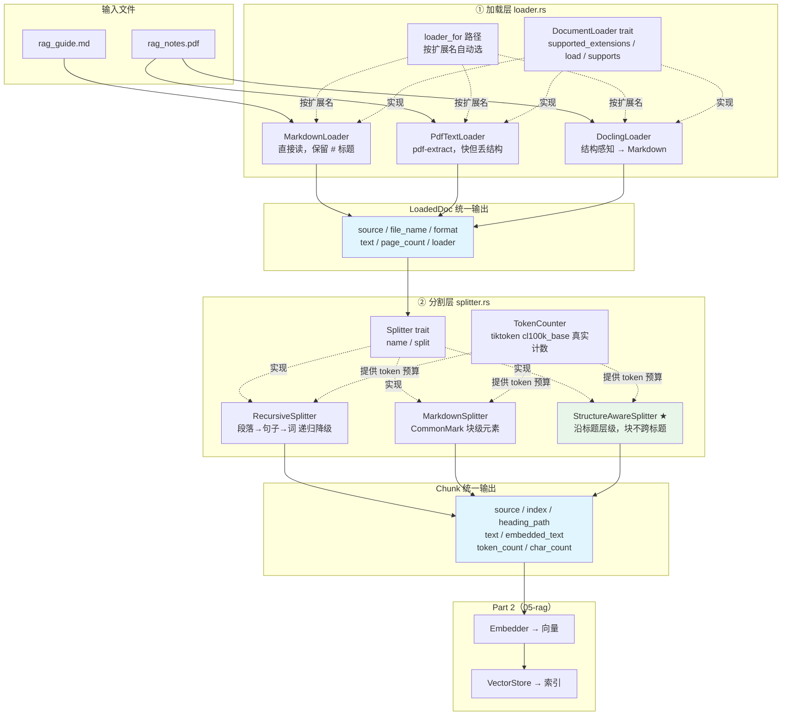
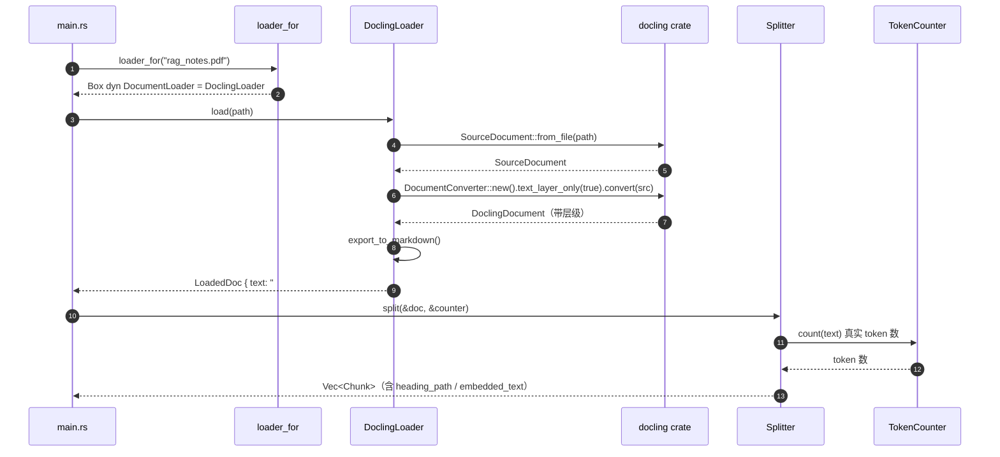
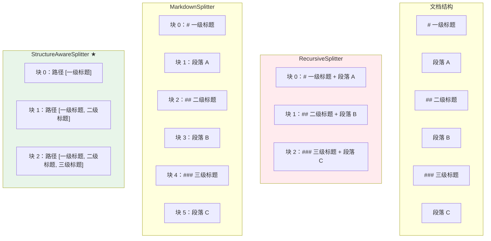
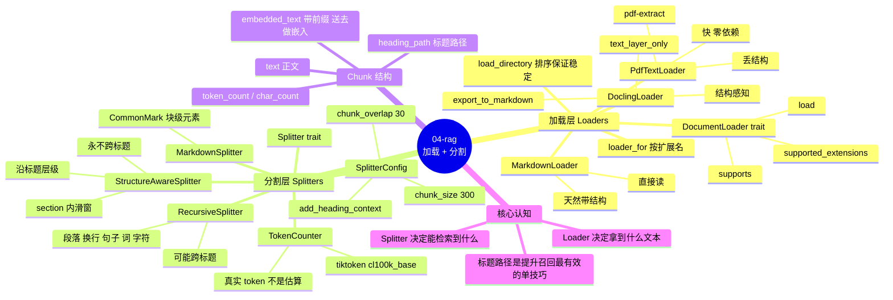

# 04-rag — RAG Part 1：加载与分割

> 目标：掌握不同格式文档（PDF、MD）的加载和文本分块策略。
> 对应 LlamaIndex 的 **Loaders** 概念，以及 Unstructured.io / MinerU / Docling 三类工具生态。

## 这一部分解决什么

RAG 流水线的头两步：

```text
文件 ──Loader──> 文本 ──Splitter──> 块
```

后面（嵌入、向量库、检索、重排、生成）在 Part 2。

**核心认知：Loader 决定你拿到什么文本，Splitter 决定模型能检索到什么。**

大多数 RAG 效果差不是模型的问题，而是这两步没做对：

- 用平铺文本抽取处理 PDF → 标题结构全丢 → 块边界全是乱的
- 按字符数硬切 → 切碎句子和表格 → 块本身语义就不完整
- 不加标题路径 → 「什么是 RAG」在「概述」和「深入」两节检索结果无法区分

## 快速开始

```bash
make load       # 加载：对比三种 loader 的输出
make split      # 分割：对比三种 splitter 的输出
make compare    # 对比：量化三种策略的差异
make pipeline   # 全流程：加载 → 分割 → 统计
make test       # 单元测试
```

> 也可直接 `cargo run -- load` 等，`make` 只是包了一层。

## 项目结构

```text
04-rag/
├── data/
│   ├── rag_guide.md        # Markdown 测试文档（多级标题、代码块）
│   ├── rag_notes.pdf       # PDF 测试文档（手写生成的规范 PDF 文本层）
│   ├── rag_notes.txt       # PDF 的源文本
│   ├── make_pdf.py         # PDF 生成脚本（无第三方依赖）
│   └── fetch_layout_model.sh  # 下载 Docling 版面模型（可选）
├── layout-demo/            # 独立 crate：Docling 完整 ML 管线演示
│   └── src/main.rs
├── src/
│   ├── loader.rs           # 加载层：DocumentLoader trait + 3 个实现
│   ├── splitter.rs         # 分割层：3 种策略 + Chunk 结构
│   └── main.rs             # 4 个 demo
└── Cargo.toml
```

---

## 架构全景



### 加载层的时序图（以 PDF 为例）



### 三种 Splitter 的切分行为对比



> 关键差异：`RecursiveSplitter` 的块**可能跨标题**（语义污染）；`StructureAwareSplitter` 保证**块永不跨标题**，且标题路径覆盖率 100%。

### 思维导图：加载与分割的知识地图



---

## 一、加载层（Loaders）

### 抽象

```rust
pub trait DocumentLoader: Send + Sync {
    fn supported_extensions(&self) -> &[&str];
    fn load(&self, path: &Path) -> Result<LoadedDoc, LoaderError>;
}
```

存在这个 trait 是为了：**上层流水线只依赖 `Box<dyn DocumentLoader>`**，
于是「本地 PDF loader」和「远程 API loader」（Unstructured / MinerU）可以互换。

`LoadedDoc` 是统一的输出格式：正文 + 元数据（来源、格式、页数、loader 名）。
后续所有 splitter 只认这个结构。

### 三种实现

| loader | 适用 | 结构保留 | 依赖 | 速度 |
|---|---|---|---|---|
| `MarkdownLoader` | `.md` / `.txt` | ✅ 原生 | 无 | 即时 |
| `PdfTextLoader` | `.pdf` | ❌ **全丢** | `pdf-extract` | 快 |
| `DoclingLoader` | `.pdf` / `.html` | ⚠️ 见下 | `docling` | 中等 |

#### `PdfTextLoader` —— 快，但丢结构

纯 Rust 的 PDF 文本层抽取。输出是**扁平的行**：

```text
Retrieval-Augmented Generation Engineering Notes
Section 1. Why chunking matters
Retrieval quality is dominated by chunk granularity. Chunks that are too large...
```

标题和正文完全混在一起，没有任何标记。分块器只能按字符数硬切。
**这就是为什么需要结构感知的 loader。**

#### `DoclingLoader` —— 结构感知

Docling 是 Python 版 docling 的 Rust 移植。它把 PDF 解析成带层级的
中间表示（`DoclingDocument`），再导出成 Markdown。

**⚠️ 真实限制（重要）**：Rust 版 docling 的 PDF 后端分两档：

| | `pdf-text`（本项目默认） | `pdf`（完整 ML 管线） |
|---|---|---|
| 文字内容 | ✅ | ✅ |
| 标题 → `##` | ❌ | ✅ |
| 表格结构 | ❌ | ✅ |
| 扫描件 OCR | ❌ | ✅（需另下 OCR 模型） |
| 额外依赖 | 无 | ONNX runtime |
| 运行期模型 | 无 | `.models/layout_heron_int8.onnx`（~68MB） |

主 crate 默认用 `pdf-text`（零额外依赖，`cargo run` 就能跑）。
完整 ML 管线放在独立 crate `layout-demo/` 里演示 —— 原因见「已知问题」。

`cargo run -- load` 的实际输出对比：

```text
[PdfTextLoader]  [pdf-extract] rag_notes.pdf (1785 字符, 38 行), 1 页
[DoclingLoader]  [docling]     rag_notes.pdf (1784 字符, 23 行)
```

两者文字内容一致，差别在结构 —— Docling 版少了 PDF 固有的空行和换行残留。

#### 完整 ML 管线：`layout-demo/`

```bash
# 1. 下载版面模型（~68MB）
./04-rag/data/fetch_layout_model.sh

# 2. 运行（从仓库根目录跑，模型放在 ./.models/）
cargo run --manifest-path 04-rag/layout-demo/Cargo.toml
```

实测输出：

```text
--- 识别到的标题 ---
  ## Retrieval-Augmented Generation Engineering Notes
  ## Section 1. Why chunking matters
  ## Section 2. Chunk size guidance
  ## Section 3. Structure aware chunking
  ## Section 4. Metadata and citations
  ## Section 5. Evaluation pitfalls
```

**这就是结构感知分块能在 PDF 上生效的前提** —— 标题没被还原成 `##`，
分块器就无从知道章节边界在哪。

### 工具生态的对应关系

题目提到的三个工具，在 Rust 生态里的对应：

| 工具 | 形态 | Rust 对应 | 本项目 |
|---|---|---|---|
| **Docling** | 本地 Python 库 / 服务 | `docling` crate（原生 Rust 移植） | ✅ 已集成 |
| **Unstructured.io** | 云端 SaaS API | `unstructured-client` crate（HTTP 客户端） | 见下 |
| **MinerU** | 云端 API / 本地 CLI | `mineru` crate（Rust 客户端） | 见下 |

**Unstructured.io / MinerU 是远程服务**，需要 API key 和网络。
本项目选择 Docling 做本地集成，因为：

1. 无需 API key，`cargo run` 就能跑
2. 无网络依赖，教育场景可复现
3. 同样的目标（结构感知），本地就能达到

要接入远程服务，只要实现 `DocumentLoader` trait 即可 —— 架构上完全兼容：

```rust
// 伪代码：Unstructured 适配器
impl DocumentLoader for UnstructuredLoader {
    fn load(&self, path: &Path) -> Result<LoadedDoc, LoaderError> {
        let elements = self.client.partition(path)?;   // 远程 API
        // elements 里每个元素都带 category（Title / NarrativeText / Table）
        // category == "Title" 的可以映射成 "# " 前缀 → 复用结构感知分块
        Ok(LoadedDoc { text: elements_to_markdown(elements), .. })
    }
}
```

关键洞察：**Unstructured 的 `Element.category` 提供了标题标记，
映射成 Markdown 之后，同一套结构感知分块器就能直接复用。**
这就是为什么 loader 层要输出统一格式。

## 二、分割层（Splitters）

### 三种策略

| 策略 | 切分依据 | 块会跨标题吗 | 适用 |
|---|---|---|---|
| `RecursiveSplitter` | 递归降级：段落→行→句→词 | ⚠️ 会 | 无结构文本 |
| `MarkdownSplitter` | CommonMark 块级元素 | ⚠️ 会 | Markdown |
| `StructureAwareSplitter` | 标题层级（section 边界） | ❌ **绝不** | 有结构的文档 |

### `RecursiveSplitter`

对应 LlamaIndex `SentenceSplitter` / LangChain `RecursiveCharacterTextSplitter`。

切分点优先级（从粗到细），每一级都尽量多塞，填满 token 预算才停：

```text
段落(\n\n) → 换行(\n) → 句子 → 词 → 字形簇 → 字符
```

**关键实现细节**：容量单位用的是**真实 BPE tokenizer**，不是「字符数 ÷ 4」估算。

```rust
let config = text_splitter::ChunkConfig::new(chunk_size)
    .with_sizer(counter.bpe())      // ← CoreBPE 实现了 ChunkSizer trait
    .with_overlap(chunk_overlap);
```

为什么重要：英文约 4 字符/token，中文约 1.5 字符/token，代码更碎。
用估算会让中文块的实际 token 数超标 2 倍以上，直接撑爆上下文预算。

（`with_overlap` 在 overlap ≥ capacity 时会返回 `Err` —— 代码里做了降级，
退回「无重叠」而不是 panic。重叠只是优化，不该让整条流水线挂掉。）

### `StructureAwareSplitter` —— 推荐

1. 用 docling 的 section 解析器把 Markdown 拆成「标题路径 + 正文词」
2. 沿 section 边界切，**块永不跨标题**
3. section 内部超长时，再按 token 预算滑动窗口切（带重叠）

**与递归分块的关键差异**：递归分块可能把「语义分块」这一节的最后一段
和「文档结构感知分块」这一节的开头拼在一起 —— 语义完全混乱。
结构感知分块不会。

### 标题路径 —— 提升召回最有效的单个技巧

每个块记录它所在的完整标题路径：

```rust
pub struct Chunk {
    pub heading_path: Vec<String>,   // ["RAG 检索增强生成", "文本分块策略", "语义分块"]
    pub text: String,                // 正文
    pub embedded_text: String,       // ← 送去做嵌入的其实是这个
    pub token_count: usize,
    // ...
}
```

`embedded_text` = 标题路径 + 空行 + 正文：

```text
# RAG 检索增强生成 > 为什么需要 RAG

大语言模型存在几个根本限制。首先是知识截止日期，模型的训练数据有截止时间……
```

**为什么要这样**：语义完全相同的句子，在不同章节里含义不同。
把层级语境注入向量，检索才能区分。

### 实测对比

`cargo run -- compare` 的输出（`rag_guide.md`，chunk_size=120 token）：

```text
策略                     块数   平均 token   最大 token      标题路径覆盖率
------------------------------------------------------------
recursive              17        111        148          94%
markdown               19         99        143          94%
structure-aware        18        100        139         100%
```

- **标题路径覆盖率**：块里有多少带上了「所在章节」信息
- structure-aware 是 100%（按标题切的，块必然在某个标题下）
- recursive / markdown 是 94%（有的块跨了标题，只能归属到其中一个）

### 重叠（overlap）

相邻块保留一部分重叠，避免关键句正好落在切分线上。

- 重叠太小 → 关键句被切断
- 重叠太大 → 成本翻倍，还引入重复内容干扰检索
- 经验值：块大小的 10%~20%

本项目默认 300 token / 30 token 重叠。

## 三、几个容易踩的坑

**1. 用字符数估算 token 数**
中文和代码里误差极大。必须用真实 tokenizer。

**2. 忘记加标题路径**
语义相同的句子在不同章节含义完全不同。

**3. 表格被拍平成一行**
表格结构丢失后，检索基本无效。要保留表格需要 Docling 的完整 `pdf` feature
或 Unstructured 的 `Table` element 类型。

**4. 只做召回不做重排**
向量检索召回 20 条，再用交叉编码器重排取 top 3 —— 效果提升明显。（Part 2）

**5. 测试集泄漏**
用测试问题评估时，如果文档内容本身包含了答案，指标会虚高。（Part 2）

## 四、已知问题

### 完整 ML 管线（Docling 版面分析）不能放进主 workspace

`layout-demo/` 必须是一个**脱离 workspace 的独立 crate**，原因：

```text
docling (完整 ML 管线)  →  ort ^2.0.0-rc.14
rig → fastembed 4.9.1   →  ort =2.0.0-rc.9   ← 精确锁定
```

两者的 `ort` 版本 semver 不兼容。Cargo 的依赖解析只能二选一，
放在同一个 workspace 里会让**整个 workspace 都无法解析**（连 `cargo build` 都过不去）。

实测过几种绕法，都不可行：

| 尝试 | 结果 |
|---|---|
| 升级 `ort` 到 rc.15 | ❌ fastembed 锁死 `=2.0.0-rc.9`，不让升 |
| 换 fastembed 版本 | ❌ rig-fastembed 锁 `^4.5`，最新的 5.x/7.x 也用 rc.9 之前的 ort |
| 降级 docling 到 2.20.0 | ❌ 依然要 `ort ^2.0.0-rc.13` |
| 去掉 rig 的 fastembed | ❌ fastembed 是 `rig` 的可选依赖，但 `rig-agent` 默认链仍会带上 |

所以 `layout-demo/Cargo.toml` 里写了空的 `[workspace]` 表，
让它脱离父 workspace 独立解析依赖。

### PDF 测试文档是自己生成的

`data/rag_notes.pdf` 由 `data/make_pdf.py` 手写 PDF 语法生成，不用第三方库。

原因：macOS 自带的 `cupsfilter` 也能生成 PDF，但它把每行文字拆成多个独立的
show-text 操作，行与行的 y 坐标差很小，PDF 文本层后端在还原阅读顺序时
会把相邻行**交错**在一起 —— 看起来像 loader 的 bug，其实是 PDF 本身的
编码方式决定的。手写 PDF 保证每行一个完整的 `Tj` 操作、坐标严格递增，
阅读顺序可还原。

## 五、依赖清单

```toml
docling = { version = "2.67", default-features = false, features = ["chunking", "pdf-text"] }
pdf-extract = "0.12"
pulldown-cmark = "0.13"
text-splitter = { version = "0.33", features = ["markdown", "tiktoken-rs"] }
tiktoken-rs = "0.12"
```

`text-splitter` 的 `tiktoken-rs` feature 很关键 —— 它让 `CoreBPE` 实现了
`ChunkSizer` trait，从而能做**精确的 token 级切分**，而不是字符数近似。

## 六、Part 2 预告

接下来要做的：

- 嵌入模型（DeepSeek / OpenAI embedding API）
- 向量存储（内存版 / LanceDB / Qdrant）
- 相似度检索 + 交叉编码器重排
- 把块拼成 prompt，调用 LLM 生成带引用的答案

## 七、Makefile

```bash
make help        # 查看所有目标
make load        # 对比三种 loader 的输出
make split       # 对比三种 splitter 的输出
make compare     # 量化不同策略的差异
make pipeline    # 全流程：加载 → 分割 → 统计
make all         # 全部 demo
make build       # 编译
make test        # 跑单元测试
make lint        # clippy 零警告
make fmt         # 格式化
make clean       # 清理产物
```
