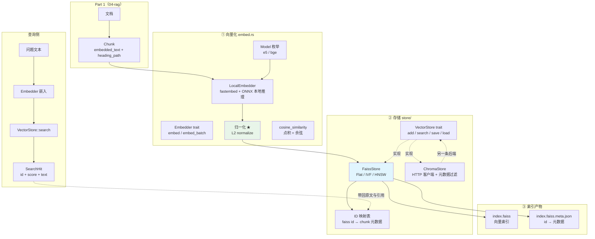
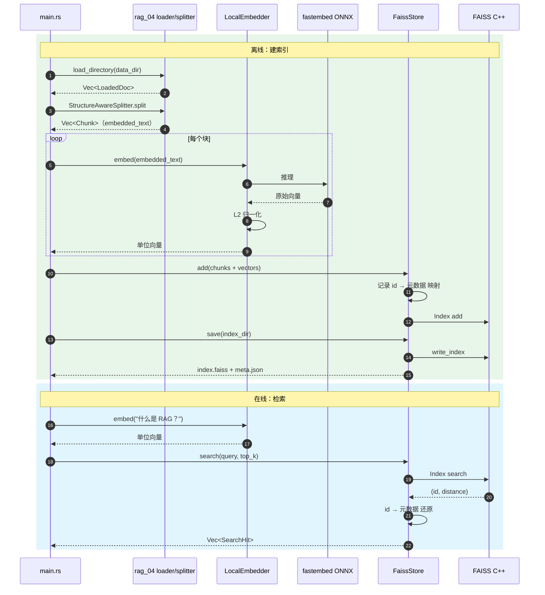
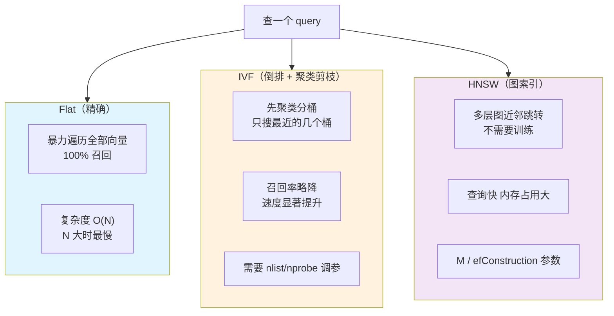
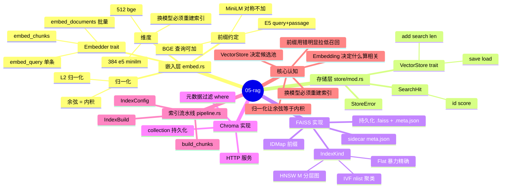
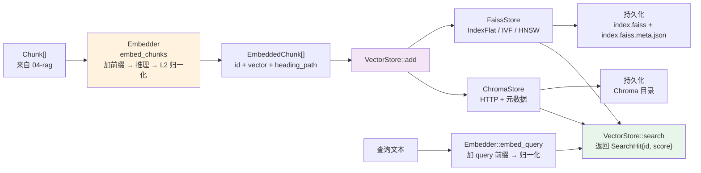

# 05-rag — RAG Part 2：向量化与存储

> 教程参考：[FAISS Intro](https://github.com/facebookresearch/faiss/wiki) · [Sentence Transformers](https://www.sbert.net/)
>
> 学习目标：**理解 Embedding 原理，使用 FAISS / Chroma 构建本地向量索引**

Part 1（[04-rag](../04-rag)）解决了「文档 → 块」。本部分解决「块 → 能被检索的东西」：

```text
块 ──Embedder──> 向量 ──Store──> 索引 ──search(query)──> 命中的块
```

这是 RAG 流水线的第三、四步。第一步（加载）和第二步（分割）已经在 Part 1 完成 —— 本项目直接 `use rag_04::{loader, splitter}` 复用，不重复造轮子。

---

## 快速开始

```bash
# 前置依赖（macOS）
brew install faiss          # 提供 libfaiss_c.dylib
make deps                   # 检查 FAISS 是否就绪
cargo install cargo-edit    # 可选

# 运行
make embed      # 向量化：向量长什么样、相似度怎么算
make build-index# 建索引：Part 1 的块 → 向量 → FAISS
make search     # 检索：FAISS 召回 top-k
make compare    # 对比：Flat / IVF / HNSW 三种索引
make persist    # 持久化：存盘再加载，验证结果一致
make chroma     # Chroma：写入 + 服务端元数据过滤
make all        # 全部
```

> 也可直接 `cargo run -p rag-05 -- embed` 等，`make` 只是包了一层。

Chroma demo 需要先起服务（不启动会优雅降级，不影响其它 demo）：

```bash
uv venv .venv && uv pip install --python .venv/bin/python chromadb
.venv/bin/chroma run --path ./chroma-data --port 8765
# 或用根 Makefile：make chroma
```

---

## 架构全景



### 建索引 + 检索的时序图



### 三种 FAISS 索引的取舍



### 知识地图：向量化与存储

```mermaid
graph LR
    N1(("05-rag<br/>向量化 + 存储"))
    subgraph N2["Embedding 原理"]
        N3["one-hot → dense"]
        N2 --> N3
        subgraph N4["三种相似度"]
            N5["余弦"]
            N4 --> N5
            N6["点积"]
            N4 --> N6
            N7["欧氏"]
            N4 --> N7
        end
        N2 --> N4
        subgraph N8["归一化 最关键一步"]
            N9["归一化后 点积 = 余弦"]
            N8 --> N9
            N10["FAISS 用 IP 度量"]
            N8 --> N10
        end
        N2 --> N8
        subgraph N11["非对称模型前缀"]
            N12["query 走 query 侧前缀"]
            N11 --> N12
            N13["passage 走 passage 侧前缀"]
            N11 --> N13
        end
        N2 --> N11
        N14["维度 换模型必须重建索引"]
        N2 --> N14
    end
    N1 --> N2
    subgraph N15["Sentence Transformers"]
        N16["fastembed 本地 ONNX"]
        N15 --> N16
        N17["无 Python 无 API key"]
        N15 --> N17
        N18["模型缓存到本地"]
        N15 --> N18
        N19["版本锁 4.x"]
        N15 --> N19
    end
    N1 --> N15
    subgraph N20["FAISS"]
        N21["Flat 精确"]
        N20 --> N21
        N22["IVF 聚类"]
        N20 --> N22
        N23["HNSW 图"]
        N20 --> N23
        N24["ID 映射必须存在索引内"]
        N20 --> N24
        N25["IVF 描述串带 Flat 后缀"]
        N20 --> N25
        subgraph N26["持久化两个文件"]
            N27["index.faiss"]
            N26 --> N27
            N28["meta.json"]
            N26 --> N28
        end
        N20 --> N26
    end
    N1 --> N20
    subgraph N29["Chroma"]
        N30["HTTP 客户端"]
        N29 --> N30
        N31["距离语义必须对齐"]
        N29 --> N31
        N32["服务端元数据过滤"]
        N29 --> N32
        N33["upsert 而非 add"]
        N29 --> N33
        N34["create_collection 不支持 configuration"]
        N29 --> N34
    end
    N1 --> N29
    subgraph N35["VectorStore trait"]
        N36["add search save load"]
        N35 --> N36
        N37["让检索层不依赖具体后端"]
        N35 --> N37
    end
    N1 --> N35
    subgraph N38["核心认知"]
        N39["Embedding 决定什么算相关"]
        N38 --> N39
        N40["VectorStore 决定在多少候选里找"]
        N38 --> N40
    end
    N1 --> N38
```

---

## 思维导图：向量化与存储体系



---

## 索引流水线：从块到可检索



⚠️ **查询和文档走的是不同的路径** ——
`embed_query` 会加 `query: ` 前缀，`embed_documents` 会加 `passage: ` 前缀。
用错前缀会**明显拉低召回率**，而且不会有任何报错。

---

## 一、Embedding 原理

### 1.1 从 one-hot 到 dense

传统检索用关键词匹配：把文档和查询都表示成词袋，算重叠度。问题是：

- 「怎么把向量存起来」和「向量数据库怎么存」没有共同词 → 检索不到
- 同义词（「显卡」/「GPU」）互相匹配不上

Embedding 模型把文本映射成固定维度的稠密向量，让**语义相近的文本在向量空间里也相近**：

```text
"检索增强生成"     → [0.065, -0.002, -0.048, ...]  (384 维)
"RAG 是一种技术"   → [0.081,  0.001, -0.044, ...]  ← 非常接近
"今天天气不错"     → [0.037,  0.005, -0.018, ...]  ← 明显更远
```

### 1.2 三种相似度度量

| 度量 | 公式 | 特点 |
|---|---|---|
| 余弦相似度 | $\cos\theta = \frac{A\cdot B}{\|A\|\|B\|}$ | 只看方向，忽略长度。**文本检索的标准选择** |
| 内积 | $A \cdot B$ | 方向和长度都算 |
| 欧氏距离 | $\sqrt{\sum (a_i-b_i)^2}$ | FAISS 的 `L2` metric |

### 1.3 归一化：整个项目最关键的一步

**L2 归一化**（把向量缩放到模长为 1）之后：

$$\text{当 } \|A\| = \|B\| = 1 \text{ 时，} \quad A \cdot B = \cos\theta$$

这带来三个直接好处：

1. **余弦相似度 == 内积** —— FAISS 可以用 `MetricType::InnerProduct` 索引，比 L2 快
2. **分数方向天然正确** —— 内积越大越相似，不用转换
3. **排序不受模长干扰** —— 未归一化时，内积会被模长主导（见下面的测试）

本项目所有向量都做归一化。`fastembed` 内置了归一化，所以拿到的向量模长恒为 1.0000。

> 这不是理论洁癖。测试 `unnormalized_vectors_rank_by_magnitude_not_direction` 记录了这个事实：
> 模长差 10 倍的两个向量，未归一化时「长的那个」永远排前面，哪怕它方向更偏。

### 1.4 前缀：非对称模型的隐藏约定

很多嵌入模型区分「查询」和「文档」两种角色：

| 模型系 | 查询前缀 | 文档前缀 |
|---|---|---|
| E5（`multilingual-e5-small`） | `query: ` | `passage: ` |
| BGE（`bge-small-zh-v1.5`） | 无 | 无 |
| MiniLM（对称模型） | 无 | 无 |

**用错前缀会明显拉低召回率。** 本项目把这件事封装进 `Embedder` trait：

```rust
pub trait Embedder: Send + Sync {
    fn needs_query_prefix(&self) -> bool;
    fn needs_document_prefix(&self) -> bool;
    // ...
}
```

上层流水线只依赖 `Box<dyn Embedder>`，于是「本地 ONNX 模型」和「远程 API」可以互换。

### 1.5 维度：换了模型就得重建索引

维度由模型写死在 FAISS 索引里：

| 模型 | 维度 | 语言 | 说明 |
|---|---|---|---|
| `all-MiniLM-L6-v2` | 384 | 英文为主 | 最快，体积最小 |
| `multilingual-e5-small` | **384** | 多语言 | **本项目默认**，中英文都能用 |
| `bge-small-zh-v1.5` | 512 | 中文 | 中文检索效果更好 |

**换模型必须重建索引。** 本项目在 sidecar 元数据里存了模型名，加载时检查，不一致直接报错：

```
✓ 被拒绝: FAISS 操作失败: 索引是用模型 `intfloat/multilingual-e5-small` 建的，
           当前模型是 `BAAI/bge-small-zh-v1.5`，必须重建索引
```

---

## 二、Sentence Transformers：本地推理

本项目用 [`fastembed`](https://github.com/qdrant/fastembed) 在 Rust 里跑 ONNX 版的 sentence-transformers 模型：

- **无 Python 依赖** —— 不需要 `sentence-transformers`、不装 PyTorch
- **无 API key** —— 模型自动从 HuggingFace 下载到本地缓存
- **快** —— ONNX Runtime，比 Python 版快好几倍

```rust
let mut opts = fastembed::InitOptions::new(fastembed::EmbeddingModel::MultilingualE5Small)
    .with_show_download_progress(true);
let model = fastembed::TextEmbedding::try_new(opts)?;
let vectors = model.embed(texts, None)?;   // 第二个参数是 batch_size
```

### Sentence Transformers 内部发生了什么

```text
文本
 └→ Tokenizer（BERT WordPiece）  → token id 序列
     └→ Transformer Encoder（12 层注意力）  → 上下文相关的 token 表示
         └→ Pooling（CLS / mean / max）  → 一个句向量
             └→ L2 归一化  → 最终的 384 维向量
```

**关键在 Transformer 编码器**：每个 token 的最终表示已经融入了上下文信息。
这正是它比词袋模型强的原因 —— 「苹果发布新手机」和「苹果很甜」里的「苹果」
经过编码后向量完全不同。

### fastembed 版本锁定

```toml
fastembed = "4.9.1"   # ⚠️ 不能升到 5+
```

原因：rig 0.46 依赖的 `rig-fastembed` 需要 fastembed `^4.5`，而 fastembed 5+
依赖 `ort =2.0.0-rc.15`，4.x 依赖 `ort =2.0.0-rc.9`。ort 用的是**精确版本约束**，
两个版本在同一个 workspace 里会直接冲突。

---

## 三、FAISS：索引结构

### 3.1 为什么需要索引

暴力比对（Flat）是 O(N) 的。10 万条向量、一次查询 = 10 万次距离计算。
ANN（Approximate Nearest Neighbor）用一点精度损失换数量级的速度。

### 3.2 三种索引

| 类型 | 描述串 | 原理 | 何时用 |
|---|---|---|---|
| **Flat** | `Flat` | 跟每个向量比一遍 | 数据量小，要 100% 精确 |
| **IVFFlat** | `IVF{nlist},Flat` | 先聚类，查询只搜 `nprobe` 个簇 | 十万级以上 |
| **HNSW** | `HNSW{M}` | 多层可导航小世界图 | 大规模、高召回 |

#### Flat —— 精确但线性

所有向量平铺在内存里，查询时逐个算距离。**没有精度损失** —— 作为教学基线最合适，
你看到的检索结果就是理论最优，不会被近似算法干扰。

#### IVF —— 用聚类剪枝

先用 k-means 把向量空间分成 `nlist` 个簇。查询时只搜其中 `nprobe` 个簇。

- `nlist` 越大 → 簇越细 → 越准但越慢
- `nprobe` 越大 → 搜的簇越多 → 越准但越慢

**训练数据要够**：至少 `39 × nlist` 个点。本项目数据只有 18 条，`nlist=4` 时
FAISS 会警告：

```
WARNING clustering 18 points to 4 centroids: please provide at least 156 training points
```

结果 IVF 的召回率只有 77%，而 Flat 和 HNSW 都是 100%：

```text
索引                 条数     耗时(ms)         与精确解一致     内存(MB)
------------------------------------------------------------
Flat               18         31           100%       0.03
IVF4,Flat          18         20            77%       0.03
HNSW16             18         24           100%       0.03
```

这就是「用精度换速度」的具体体现 —— 数据量不够时，IVF 反而更差。

#### HNSW —— 图索引

把向量组织成多层图，查询时从顶层入口点贪心往下走。单查询 O(log N)，
召回率靠 `efSearch` 调节。

### 3.3 ID 映射必须存在索引内部

FAISS 默认给每个向量分配顺序 ID（0, 1, 2...）。我们想把 ID 换成稳定的整数，
方便引用和去重。

**关键点**：映射必须存在 FAISS 索引内部，才能跟着 `write_index`/`read_index` 一起持久化。

```rust
// ✅ 正确：IDMap 前缀让索引自带映射
index_factory(d, "IDMap,Flat", MetricType::InnerProduct)

// ❌ 错误：Rust 侧包装，序列化时只写出裸索引，ID 映射丢失
IdMap::new(index_factory(d, "Flat", ...)?)
```

第二种写法在加载时会直接报错：

```
Error: '!(index_->ntotal == 0)' failed: index must be empty on input
```

（`IdMap::new` 要求被包装的索引是空的，而 `read_index` 返回的是已填充的索引。）

### 3.4 IVF 的描述串要带 `,Flat` 后缀

```rust
index_factory(d, "IDMap,IVF4,Flat", ...)   // ✅
index_factory(d, "IDMap,IVF4", ...)         // ❌ could not parse index string IVF4
```

### 3.5 持久化：两个文件

FAISS 的 `write_index` 只写向量索引，**不写元数据**。所以本项目同时写一个
sidecar JSON：

```text
index/
├── index.faiss           # FAISS 向量索引（含 ID 映射）
└── index.faiss.meta.json # 块元数据：模型名、维度、ID → 记录
```

sidecar 里存了**模型名** —— 加载时检查，是防止「换了模型没重建索引」的最后一道防线。

加载后检索结果与存盘前**完全一致**（demo 里用 `assert_eq!` 断言）。

---

## 四、Chroma：带元数据过滤的向量库

### 4.1 定位差异

| | FAISS | Chroma |
|---|---|---|
| 形态 | **库** —— 链接进你的进程 | **服务** —— 独立进程，HTTP 访问 |
| 元数据 | 在 Rust 侧，要自己 join | **在数据库里**，能服务端过滤 |
| 过滤 | 检索回来自己过滤（浪费） | 检索时就在服务端过滤（省 I/O） |
| 并发 | 进程内，天然独占 | 多客户端共享 |

**元数据过滤是 Chroma 相对 FAISS 最大的价值。**

### 4.2 距离语义必须对齐（最容易踩的坑）

| 空间 | Chroma 返回的 `distances` | 方向 |
|---|---|---|
| `l2`（**默认**） | 平方 L2 距离 | 越小越相似 |
| `ip` | 内积 | 越大越相似 |
| `cosine` | `1 - 余弦相似度` | 越小越相似 |

FAISS 用的是 `InnerProduct`（越大越相似）。**直接混用会把排序和分数都搞错。**

本项目的处理：

1. 集合建成 `cosine` 空间（`chromadb` crate 还不支持 `configuration` 参数，
   所以直接打 Chroma 的 HTTP API）
2. 把距离换算回相似度：`score = 1.0 - distance`

这样两个 store 的 `SearchHit.score` 语义完全一致，可以直接对比：

```text
FAISS:  0.8720 rag_guide.md#12 [RAG 检索增强生成 > 元数据] ...
Chroma: 0.8720 rag_guide.md#12 [RAG 检索增强生成 > 元数据] ...   ← 分数完全相同
```

### 4.3 服务端元数据过滤

```rust
let filter = json!({ "source": { "$eq": "rag_guide.md" } });
let hits = store.search_filtered(&query, 3, Some(filter)).await?;
```

过滤下推到存储层，只扫满足条件的向量。FAISS 做不到这个 ——
它只返回整数 ID，过滤得在 Rust 侧做（先召回一堆再筛，白白浪费 I/O）。

### 4.4 写入用 upsert

`add` 在 ID 已存在时会报错；`upsert` 覆盖。本项目用 upsert，让 demo 可以重复运行。

---

## 五、代码结构

```text
05-rag/
├── Cargo.toml
├── build.rs               # 找 libfaiss_c 的链接搜索路径
├── index/                 # 索引产物（gitignore）
│   ├── index.faiss
│   └── index.faiss.meta.json
└── src/
    ├── main.rs            # 6 个 demo
    ├── lib.rs             # 库入口：把 embed / pipeline / store 暴露给 06-rag
    ├── embed.rs           # Embedder trait + LocalEmbedder + 向量数学
    ├── pipeline.rs        # 加载 → 分割 → 向量化 的接缝
    └── store/
        ├── mod.rs         # VectorStore trait + SearchHit
        ├── faiss_store.rs # FAISS：Flat / IVF / HNSW + 持久化
        └── chroma_store.rs# Chroma：HTTP 客户端 + 服务端过滤
```

### 作为库被 06-rag 复用

本 crate 同时是一个**库**和**可执行 demo**。`src/lib.rs` 把三个模块公开出去，
让 [06-rag](../06-rag)（完整 RAG 系统）可以直接复用：

```rust
use rag_05::embed::{Embedder, LocalEmbedder};
use rag_05::store::{FaissStore, IndexKind, VectorStore};
```

这样 06-rag 不需要把「向量化 + 向量存储」抄一遍 ——
04（加载 + 分割）和 05（向量化 + 存储）拼起来就是完整的 RAG 流水线。

### VectorStore trait

把 FAISS 和 Chroma 抽象成同一套操作，上层代码不用改：

```rust
pub trait VectorStore: Send + Sync {
    fn name(&self) -> &str;
    fn model_name(&self) -> &str;
    fn dimension(&self) -> usize;
    fn len(&self) -> usize;

    fn add(&mut self, chunks: &[EmbeddedChunk])
        -> impl Future<Output = Result<(), StoreError>> + Send;
    fn search(&mut self, query: &[f32], k: usize)
        -> impl Future<Output = Result<Vec<SearchHit>, StoreError>> + Send;
    fn save(&self, path: &Path)
        -> impl Future<Output = Result<(), StoreError>> + Send;
    fn load(&mut self, path: &Path)
        -> impl Future<Output = Result<(), StoreError>> + Send;
}
```

方法都是 `async fn` —— Chroma 是 HTTP 服务，天然异步；FAISS 的实现用
立即就绪的 future 包住同步逻辑，调用方写法一致。

### 为什么每条向量都要配元数据

FAISS 只返回**整数 ID**，不返回文本。但 RAG 最终要拿原文去喂 LLM，
所以每条向量都必须配一份元数据（来源文件、标题路径、正文）。这就是
`EmbeddedChunk` 存在的原因：

```rust
pub struct EmbeddedChunk {
    pub id: String,              // "rag_guide.md#12"
    pub source: String,          // "rag_guide.md"
    pub index: usize,            // 12
    pub heading_path: Vec<String>, // ["RAG 检索增强生成", "元数据"]
    pub text: String,            // 块正文
    pub vector: Vec<f32>,        // 384 维，已归一化
}
```

---

## 六、踩过的坑

### 6.1 faiss crate 找不到 libfaiss_c

```
ld: library 'faiss_c' not found
```

`faiss-sys` 的 build script 只输出 `cargo:rustc-link-lib=faiss_c`，
**不输出链接搜索路径**。解决方案是 `build.rs` 里补上：

```rust
println!("cargo:rustc-link-search=native=/opt/homebrew/lib");
```

`05-rag/build.rs` 做了更完整的探测：`FAISS_LIB_DIR` 环境变量 →
`pkg-config` → Homebrew 前缀。

> ⚠️ 不要重复输出 `cargo:rustc-link-lib=dylib=faiss_c` —— `faiss-sys`
> 已经输出过一次，重复会让链接器刷 "duplicate libraries" 警告。

### 6.2 静态链接 FAISS 在 macOS 上编译失败

```
Could NOT find OpenMP_CXX
```

Apple Clang 不支持 `-fopenmp`。如果非要用静态链接，得装 `libomp`：

```bash
brew install cmake libomp gcc openblas
faiss = { version = "0.13.0", features = ["static"] }
```

但构建非常慢。本项目走**动态链接**（`brew install faiss`），几秒搞定。

### 6.3 fastembed 版本冲突

见 §2.1。workspace 里同时有 rig 0.46（要 fastembed 4.x）和 05-rag（想用 7.x），
ort 的精确版本约束直接冲突。解法是锁 4.9.1。

### 6.4 Chroma 的 `create_collection` 不支持 configuration

`chromadb` crate 2.3.0 的签名是：

```rust
pub async fn create_collection(&self, name: &str, metadata: Option<Metadata>, get_or_create: bool)
```

没有 `configuration` 参数，没法指定距离空间。只能自己打 HTTP：

```rust
POST /api/v2/tenants/{tenant}/databases/default_database/collections
{ "name": "...", "get_or_create": true, "configuration": { "hnsw": { "space": "cosine" } } }
```

### 6.5 `cargo run -p` 的工作目录是 workspace 根

```rust
// ❌ 找不到文件
const DATA_DIR: &str = "../04-rag/data";

// ✅ 用 CARGO_MANIFEST_DIR 定位
fn data_dir() -> PathBuf {
    PathBuf::from(env!("CARGO_MANIFEST_DIR")).join("../04-rag/data")
}
```

---

## 七、测试

```bash
cargo test -p rag-05
```

20 个测试，覆盖向量数学、索引类型、维度校验、持久化往返、模型不匹配拦截。

有两个测试专门记录「为什么必须归一化」：

```rust
// 未归一化时内积被模长主导
assert_eq!(hits[0].id, "long", "未归一化时内积被模长主导");

// 归一化后按方向排序
assert_eq!(hits[0].id, "short", "归一化后按方向排序");
```

还有一个测试守住曾经踩过的坑 —— ID 映射用 HashMap 存时，
遍历顺序不确定导致检索结果和记录错位：

```rust
#[tokio::test]
async fn many_records_keep_correct_label_mapping() {
    // 50 条方向各不相同的向量，每条都要能查回自己
    for (i, c) in chunks.iter().enumerate() {
        let hits = store.search(&c.vector, 1).await.unwrap();
        assert_eq!(hits[0].id, c.id, "第 {i} 条检索到了错误的记录");
    }
}
```

---

## 日志

全仓库统一走 `00-logging`（`agent-logging`）。

```bash
RUST_LOG=info cargo run -p rag-05 -- index
RUST_LOG=debug,rag_05=trace cargo run -p rag-05 -- search "问题"
```

| 事件 | 级别 | 关键字段 |
|---|---|---|
| 建索引（加载 → 分块 → 向量化 → 写入） | `INFO` | `chunk_count` / `dimension` / `elapsed_ms` |
| 嵌入模型加载（首次会下载） | `INFO` | `model` / `dimension` |
| 向量化一批块 | `DEBUG` | `batch_size` / `total` |
| 写入 FAISS / Chroma | `DEBUG` | `store` / `count` |
| 检索 | `DEBUG` | `top_k` / `hit_count` / `elapsed_ms` |
| 维度不匹配 | `ERROR` | `expected` / `actual` |

---

## 八、下一步
本部分只做了**召回（retrieve）**。完整 RAG 还需要：

- **重排（rerank）** —— 召回 50 条，再用 cross-encoder 精排 top-5
  （cross-encoder 同时看 query 和文档，比双塔模型准得多）
- **生成（generate）** —— 把命中的块拼成提示词，调 LLM
- **混合检索** —— 向量检索 + BM25 关键词检索，结果融合
- **引用** —— 用元数据生成可追溯的引用标注

这些都在 [06-rag](../06-rag)（Part 3）—— 一个完整的 Naive RAG 系统，
带 HTTP 问答 API 和自主 Agent。

> ⚠️ Part 3 里的检索**没有**做重排（Naive 的定义就是不做）。
> 重排是 Part 4 的内容。

---

## 技术参考速查

### 三种嵌入模型对照表

| | multilingual-e5-small | bge-small-zh-v1.5 | all-MiniLM-L6-v2 |
|---|---|---|---|
| 维度 | 384 | 512 | 384 |
| 语言 | 多语言 | 中文为主 | 英文 |
| 查询前缀 | `query: ` | 无（可不加） | 无 |
| 文档前缀 | `passage: ` | 无 | 无 |
| 大小 | ~470MB | ~95MB | ~90MB |
| 适合 | **默认**，中英混合 | 纯中文 | 纯英文、小模型 |

⚠️ **前缀用错会明显拉低召回率** —— 这是嵌入环节最常见的静默 bug。
`Embedder` trait 把这件事封装掉了：上层调 `embed_query` / `embed_documents`，
**不需要知道用的是哪个模型**。

### 为什么必须 L2 归一化

```text
归一化前：cos(a,b) = a·b / (|a|·|b|)     ← 要算两次范数
归一化后：cos(a,b) = a·b                 ← 就是内积
```

所以归一化之后：

| FAISS 索引 | 配置 | 分数含义 |
|---|---|---|
| `IndexFlatIP` | `InnerProduct` | **余弦相似度**（因为已归一化） |
| `IndexFlatL2` | `L2` | 距离，需要 `1 - d/2` 换算成本项目统一用「**越大越相似**」的语义 |

### FAISS 三种索引对照表

| | Flat | IVF{nlist} | HNSW{M} |
|---|---|---|---|
| 原理 | 暴力遍历全部 | k-means 聚类剪枝 | 多层可导航小世界图 |
| 构建 | 无 | 需训练（聚类） | 需训练（建图） |
| 查询 | O(N) | O(N/nlist × nprobe) | O(log N) 量级 |
| 召回 | **100% 精确** | 有损失 | 有损失 |
| 内存 | 低 | 中 | **高**（图结构） |
| 适用 | <1万，要精确 | 十万级 | **大规模高召回** |

⚠️ **IVF 的描述串必须带 `,Flat` 后缀** —— 写 `IVF4` 会被 FAISS 解析失败。
这是本项目实际踩过的坑。

### `IDMap,` 前缀的作用

```text
不带 IDMap：FAISS 只知道「第 i 个向量」，不知道它是谁
带 IDMap：  索引自带 ID 映射，ID 能随索引一起持久化
```

所以本项目统一用 `IDMap,{描述串}` 作为交给 FAISS 的完整描述。

### sidecar 元数据为什么必须单独存

```text
index.faiss          ← FAISS 的索引文件，只有向量和 ID
index.faiss.meta.json ← 我们自己的：模型名、索引类型、维度、记录顺序
```

FAISS 不知道我们的块长什么样（`heading_path`、原文、来源文件），
所以要单独存一份。

⚠️ **加载时必须校验模型名** —— 不一致就报错，
否则**维度对不上，FAISS 会直接报错或静默返回垃圾结果**。

### `VectorStore` trait 的契约

| 方法 | 语义 | FAISS | Chroma |
|---|---|---|---|
| `add` | 追加向量 | ✅ | ✅ |
| `search` | 检索，返回 `SearchHit` | ✅ | ✅ |
| `len` | 当前条数 | ✅ | ✅ |
| `save` | 持久化 | 写 `.faiss` | Chroma 自动 |
| `load` | 加载 | 读 `.faiss` | Chroma 自动 |

⚠️ **在 10-rag-milvus（远程向量库）上，`save`/`load` 是 no-op** ——
数据在服务端，客户端只负责「确保它在」。这不是缺陷。

### 换模型的三连坑

```text
1. 维度变了        → 旧索引的向量维度对不上
2. 向量空间变了    → 旧向量和新查询不在同一空间，检索结果全是垃圾
3. 语义变了        → 就算维度碰巧一样，也完全不可比
```

**结论：换嵌入模型 = 重建索引，没有例外。**
本项目在 sidecar 里存 `model_name` 就是为了在加载时挡住第 3 种情况。

### 嵌入推理是 CPU 密集的同步调用

```rust
tokio::task::spawn_blocking(move || { ... })
```

直接调会**阻塞 tokio 的工作线程** —— 一次几十到几百毫秒，
期间同线程上的其它请求全被卡住。

09-rag-eval 里也踩了同样的坑（语义相似度指标那段）。

---

## 九、Makefile

```bash
make help         # 查看所有目标
make deps         # 检查系统 FAISS 是否就绪
make embed        # 向量化：看向量长什么样
make build-index  # 建索引：块 → 向量 → FAISS
make search       # 检索：召回 top-k
make compare      # 对比 Flat / IVF / HNSW
make persist      # 持久化：存盘再加载
make chroma       # Chroma：写入 + 元数据过滤（需先起 Chroma）
make all          # 全部 demo
make build        # 编译
make test         # 跑测试
make lint         # clippy 零警告
make fmt          # 格式化
make clean        # 清理产物
```
