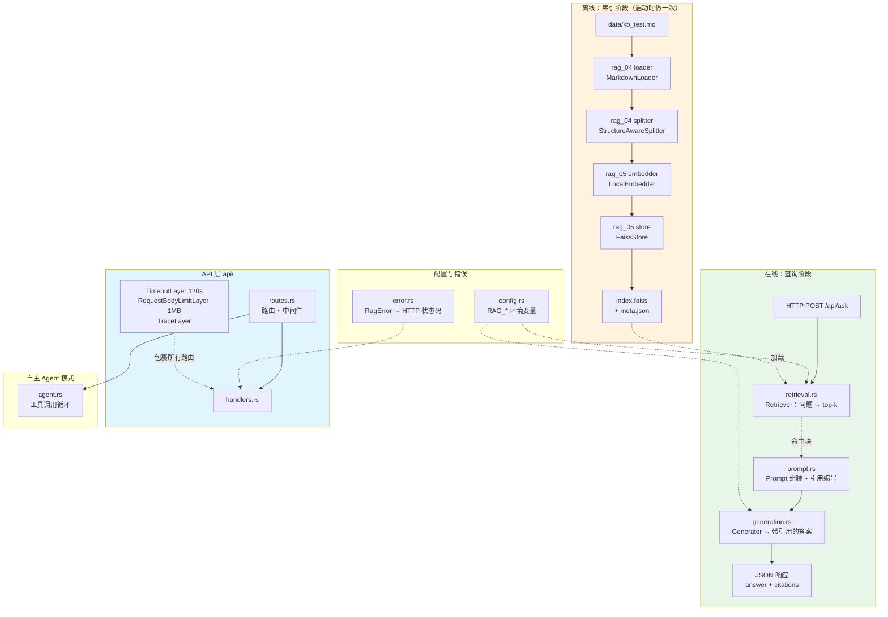
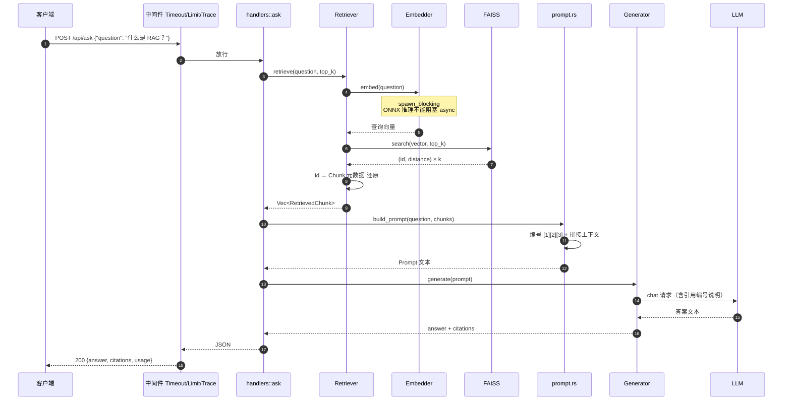
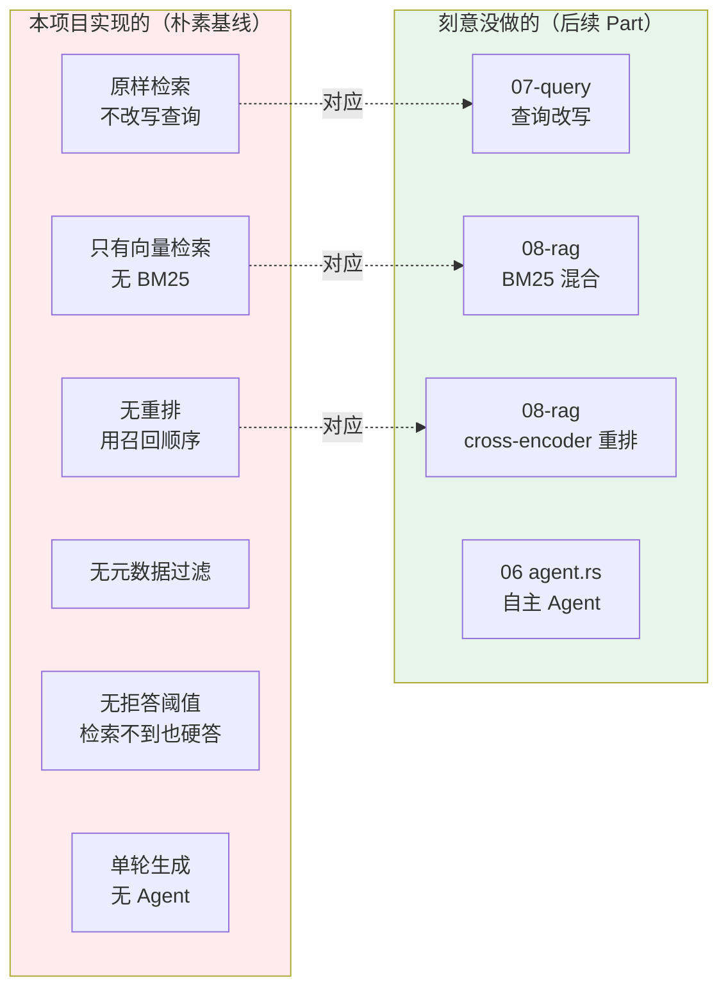
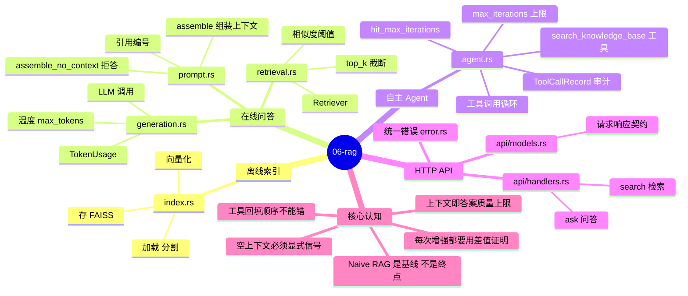
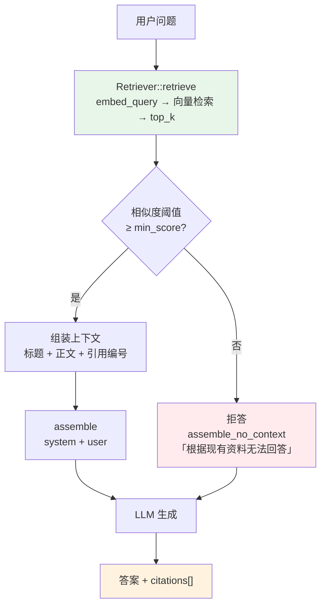
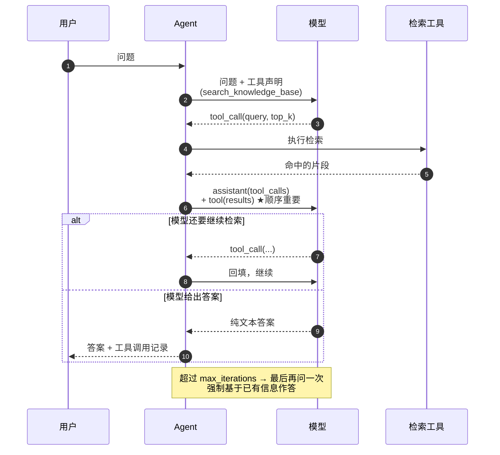
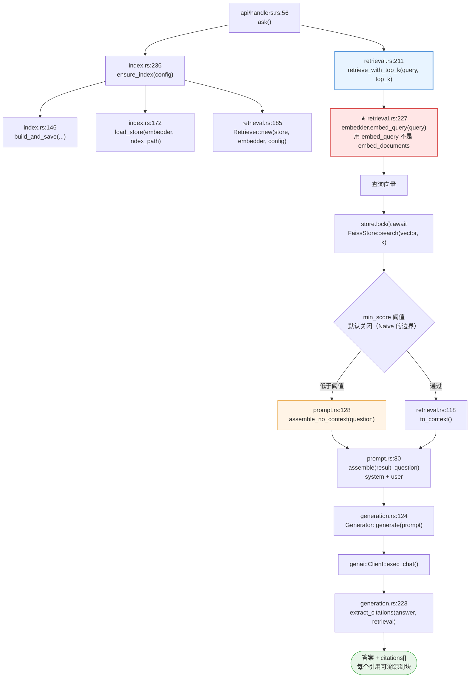
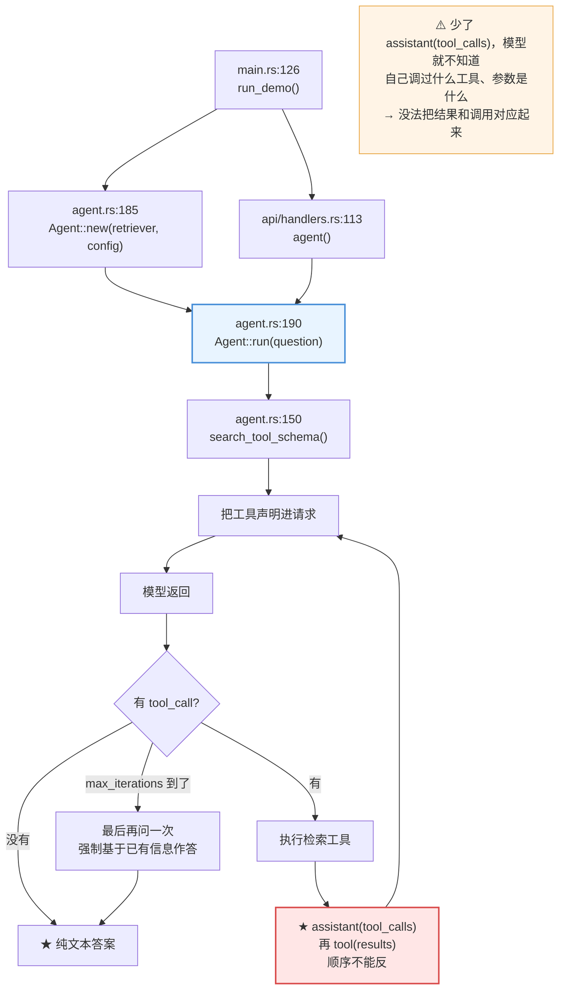
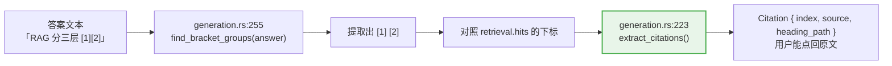

# 06-rag — 手撕 Naive RAG 系统

把 04（加载 + 分割）、05（向量化 + 存储）接上**检索**和**生成**，
做一个完整的、可运行的、带 HTTP API 的文档问答系统 —— 并且**手撕**每一层，
不依赖 LangChain / LlamaIndex 这类框架。

```text
离线（索引阶段）
  文档 ──Loader──> 文本 ──Splitter──> 块 ──Embedder──> 向量 ──Store──> 索引

在线（查询阶段）
  问题 ──Embedder──> 查询向量 ──Retriever(top-k)──> 命中块
                                                     │
                                    Prompt 组装 ─────┘
                                         │
                                         └──> LLM ──> 带引用的答案
```

## 快速开始

```bash
export DEEPSEEK_API_KEY=sk-...   # 生成环节需要（检索不需要）

make demo      # 端到端 demo：检索 → 生成 → 引用
make serve     # 启动 HTTP 服务（127.0.0.1:3000）
make test      # 单元 + 集成测试（不调 LLM）
```

> 也可直接 `cargo run -p rag-06 -- demo` 等，`make` 只是包了一层。

首次运行会下载嵌入模型（`multilingual-e5-small`，约 470MB）到
workspace 根目录的 `.fastembed_cache/`。

## 项目结构

```text
06-rag/
├── data/
│   └── kb_test.md          # 检索测试集：8 个语义互不相关的独立知识点
├── src/
│   ├── config.rs           # 配置（默认值 < 环境变量）
│   ├── error.rs            # 统一错误 → HTTP 状态码映射
│   ├── index.rs            # 索引层：文档 → 块 → 向量 → 索引（含持久化）
│   ├── retrieval.rs        # 检索层：问题 → top-k 命中块
│   ├── prompt.rs           # Prompt 组装：命中块 → 上下文
│   ├── generation.rs       # 生成层：Prompt → 带引用的答案
│   ├── agent.rs            # 自主 Agent：工具调用循环
│   ├── api/
│   │   ├── mod.rs          # 共享状态
│   │   ├── models.rs       # 请求 / 响应模型（API 契约）
│   │   ├── extract.rs      # 自定义 JsonBody 提取器（统一错误格式）
│   │   ├── handlers.rs     # 处理器
│   │   └── routes.rs       # 路由表 + 中间件
│   └── main.rs             # 入口：serve / demo 两种模式
└── tests/
    └── integration.rs      # 集成测试：建索引 → 检索 → 命中正确性
```

---

## 架构全景



### 一次 `/api/ask` 的完整时序



### 「Naive」的边界图示



### 知识地图：Naive RAG

```mermaid
graph LR
    N1(("06-rag<br/>Naive RAG"))
    subgraph N2["离线索引"]
        N3["loader 复用 04-rag"]
        N2 --> N3
        N4["splitter 复用 04-rag"]
        N2 --> N4
        subgraph N5["embedder 复用 05-rag"]
            N6["fastembed ONNX"]
            N5 --> N6
            N7["L2 归一化"]
            N5 --> N7
        end
        N2 --> N5
        subgraph N8["store 复用 05-rag"]
            N9["FaissStore"]
            N8 --> N9
            N10["id 映射"]
            N8 --> N10
        end
        N2 --> N8
        subgraph N11["持久化"]
            N12["index.faiss"]
            N11 --> N12
            N13["meta.json"]
            N11 --> N13
        end
        N2 --> N11
        subgraph N14["启动时自动建索引"]
            N15["首个请求不等模型"]
            N14 --> N15
        end
        N2 --> N14
    end
    N1 --> N2
    subgraph N16["在线检索"]
        subgraph N17["Retriever"]
            N18["embed 问题"]
            N17 --> N18
            N19["search top-k"]
            N17 --> N19
            N20["id → Chunk 还原"]
            N17 --> N20
        end
        N16 --> N17
        subgraph N21["RetrievedChunk"]
            N22["text"]
            N21 --> N22
            N23["source"]
            N21 --> N23
            N24["heading_path"]
            N21 --> N24
            N25["score"]
            N21 --> N25
        end
        N16 --> N21
    end
    N1 --> N16
    subgraph N26["Prompt 组装"]
        N27["编号 1 2 3"]
        N26 --> N27
        N28["上下文拼接"]
        N26 --> N28
        N29["引用说明"]
        N26 --> N29
        N30["每句话都有作用"]
        N26 --> N30
    end
    N1 --> N26
    subgraph N31["生成"]
        N32["Generator"]
        N31 --> N32
        N33["genai 客户端"]
        N31 --> N33
        N34["引用编号落地"]
        N31 --> N34
        N35["usage 统计"]
        N31 --> N35
    end
    N1 --> N31
    subgraph N36["Agent 模式"]
        N37["工具调用循环"]
        N36 --> N37
        N38["自主决策"]
        N36 --> N38
        N39["与 Naive 的差异"]
        N36 --> N39
    end
    N1 --> N36
    subgraph N40["API 层"]
        N41["路由 /api/ask"]
        N40 --> N41
        N42["路由 /api/agent"]
        N40 --> N42
        N43["路由 /api/search"]
        N40 --> N43
        N44["路由 /api/reindex"]
        N40 --> N44
        N45["TimeoutLayer 120s"]
        N40 --> N45
        N46["RequestBodyLimitLayer"]
        N40 --> N46
        N47["TraceLayer"]
        N40 --> N47
        N48["统一 JSON 错误"]
        N40 --> N48
    end
    N1 --> N40
    subgraph N49["核心认知"]
        N50["Naive 是教学基线"]
        N49 --> N50
        N51["每个增强都要用差值证明"]
        N49 --> N51
        N52["索引单独一层"]
        N49 --> N52
        N53["异步里 Mutex 的坑"]
        N49 --> N53
    end
    N1 --> N49
```

---

## 思维导图：Naive RAG 全貌



---

## 问答链路：从问题到带引用的答案



### 自主 Agent 的工具调用循环



⚠️ **回填顺序**：先 `assistant(tool_calls)`，再 `tool(results)`。
少了前者，模型不知道自己「调过什么工具、参数是什么」，
就没法把结果和调用对应起来。

---

## 代码调用详细流程图（函数级）

> 节点写的是**真实函数名**，边上标的是**调用点行号**。全部对着源码。

### ★ 问答链路：从问题到带引用的答案



### 自主 Agent 的工具调用循环

**06 的 Agent 是「自主」的** —— 模型自己决定要不要检索、检索什么。



### 引用可溯源：`[n]` 是怎么映射回块的



## 一、架构调研

### 1.1 Naive RAG：为什么叫「朴素」

RAG 系统的演进被普遍归纳为三档：**朴素（Naive）→ 高级（Advanced）→ 模块化（Modular）**。
Naive 是所有后续架构的**基线** —— 它故意只做最少的步骤。

**Naive 的七步**：

| # | 步骤 | 本项目对应 |
|---|---|---|
| 1 | 加载文档 | 复用 04-rag 的 `load_directory` |
| 2 | 固定大小滑动窗口分块 | 复用 04-rag 的 `StructureAwareSplitter`（结构感知是本仓库的增强，见下） |
| 3 | 用**同一个**模型嵌入每个块 | `LocalEmbedder` |
| 4 | 块文本 + 元数据 + 向量一起存储 | `FaissStore` + sidecar JSON |
| 5 | 用**同一个**模型嵌入问题 | `embed_query` |
| 6 | 按余弦相似度取 top-k | `FaissStore::search` |
| 7 | 把 top-k 拼进 Prompt，生成答案 | `prompt::assemble` + `Generator` |

**「朴素」由「缺了什么」定义**，这些缺失恰好是后续所有增强手段的路线图：

| 没做的事 | 会导致什么 | 增强手段 |
|---|---|---|
| 查询改写 | 问「它多少钱」召不回「价格」 | HyDE / 查询分解 / Agent 自主改写 |
| 混合检索（向量 + BM25） | 具体编号、API 名召不回 | BM25 + RRF 融合 |
| 重排（cross-encoder） | top-10 里真正相关的排在第 8 | Cross-encoder rerank |
| 元数据过滤 | 混进别的文档的块 | 按 source / 时间 / 权限过滤 |
| 相似度阈值 | 什么都不相关也硬答 | `min_score` + 拒答 |
| 结构感知分块 | 块跨标题，语义混乱 | 04-rag 已实现 |

本项目把 `min_score` 和「Agent 自主改写」也做进去了 —— 但它们是**可选的**
（`min_score` 默认关闭，Agent 是独立端点），所以主线仍然是 Naive。

### 1.2 Semantic Search / Knowledge Base

**语义搜索**和**关键词搜索**的根本区别：

```text
关键词搜索（BM25）：  "咖啡因 半衰期"  ←→  文档里必须出现「半衰期」这三个字
语义搜索（向量）：    "喝完多久睡得着"  ←→  文档里写「半衰期 5~6 小时」也能召回
```

语义搜索靠**嵌入模型**把文本映射到同一语义空间，向量间的距离就是语义距离。

**知识库（Knowledge Base）** 是语义搜索的存储底座，它要管三件事：

| 职责 | 常见做法 | 本项目 |
|---|---|---|
| 存什么 | 块文本 + 元数据 + 向量 | FAISS 向量 + sidecar JSON 元数据 |
| 怎么切 | 固定窗口 / 结构感知 / 语义 | 复用 04-rag 的结构感知分块 |
| 怎么找 | 暴力 / IVF / HNSW | `Flat`（精确，作为 ground truth） |

**关键工程点**：块文本、元数据、向量必须**一起存**。
FAISS 只返回整数 ID —— 光有向量是没法生成答案的，你还得知道这段文字来自哪个文件、
哪个章节、原文是什么。05-rag 的 `EmbeddedChunk` 就是这个整体。

### 1.3 Retrieval 架构：召回与精排

检索分两个阶段，**必须**分开：

```text
① 召回（Recall）    向量检索 / BM25      快、便宜、但只做「粗筛」
        ↓  20~100 条候选
② 精排（Rerank）    Cross-encoder       慢、贵、但「准」
        ↓  top 3~5
   送进 Prompt
```

**为什么必须分两步** —— 两种模型的信息能力不同：

| | 双编码器（bi-encoder） | 交叉编码器（cross-encoder） |
|---|---|---|
| 输入 | 问题**或**文档（分别编码） | 问题 **+** 文档（拼在一起） |
| 能否看到交互 | ❌ 不能，只能比距离 | ✅ 能 |
| 能否预计算 | ✅ 文档向量可离线算 | ❌ 每个候选都要跑一次 |
| 速度 | 毫秒级 | 秒级 |
| 用途 | 召回 | 精排 |

向量库之所以能快，正是因为双编码器**看不到问题和文档的交互** —— 它只能比距离。
这既是它的优势（可预计算、可索引），也是它的天花板（只能粗筛）。

本项目是 Naive 版，所以**只做召回，没有精排**：`top_k` 就是最终进 Prompt 的条数。

一个常见误解要澄清：**检索的「k」不是越大越好**。
没有重排时，召回顺序就是最终顺序，多召回只会往 Prompt 里塞噪声块。
所以本项目默认 `top_k = 4`。

### 1.4 LLM Powered Autonomous Agents

Naive RAG 的流程是**写死的**：

```text
问题 → 一定检索 → 一定拼 top-k → 一定生成
```

Agent 的流程是**模型决定的**：

```text
问题 → 模型判断「我需要查资料吗？」
         ├─ 不需要 → 直接回答
         └─ 需要   → 模型调用 search 工具（自己写查询词）
                    ↓
                 结果回填 → 模型再判断
                    ├─ 还需要 → 继续调工具（换查询词）
                    └─ 够了   → 给出最终答案
```

本质差异：**谁来决定检索的时机和查询词**。

- Naive：用原问题去检索
- Agent：模型把问题改写成更适合检索的关键词

三个 Agent 能救、Naive 救不了的场景：

1. **查询词不匹配** —— 问「怎么防止它崩掉」，文档里写的是「容错与降级」。
   Naive 用原问题检索召不回；Agent 改写成「容错 降级」就召回了。
2. **多跳问题** —— 「A 的作者还写了什么」要先查 A，再查作者的作品。
   Naive 一次检索做不到；Agent 可以调两次工具。
3. **不需要检索** —— 问「你好」这种通用问题，检索只会引入噪声。Agent 可以直接答。

**工具调用的循环**：

```text
┌────────────────────────────────────────────┐
│ 1. 发消息（含工具声明）                      │
├────────────────────────────────────────────┤
│ 2. 模型返回 tool_calls                      │
├────────────────────────────────────────────┤
│ 3. 执行工具，把结果作为 tool 消息回填          │
├────────────────────────────────────────────┤
│ 4. 回到 1，直到模型不再要求调工具              │
└────────────────────────────────────────────┘
```

⚠️ **必须有循环上限**。模型可能反复调同一个工具（工具描述写得不好时很常见），
没有上限就是烧钱的死循环。本项目用 `max_iterations`（默认 5）兜底。

---

## 二、实现要点

### 2.1 分层：每个模块只做一件事

```text
config      参数（默认值 < 环境变量）
  ↓
index       文档 → 块 → 向量 → 索引        离线
  ↓
retrieval   问题 → top-k 命中块            在线
  ↓
prompt      命中块 → 上下文
  ↓
generation  上下文 + 问题 → 带引用的答案
```

每层都不认识上一层的内部结构 —— `retrieval` 拿到的是 `Vec<RetrievedChunk>`，
不关心它是 FAISS 还是 Chroma 来的。这样换向量库只改 `index` 一层。

### 2.2 引用怎么「落地」

模型在答案里写 `[1]`，但**模型并不知道** `[1]` 是哪个块 —— 是我们在 Prompt 里
用 `[1] # 标题\n正文` 的形式告诉它的。所以「可溯源」需要两步：

1. Prompt 里给每个块编号（本项目已做）
2. 解析答案里的 `[n]`，映射回具体的块（本项目已做）

只有第 1 步，答案是「看起来带引用」；两步都做，引用才能核对。

⚠️ **越界的引用编号必须丢掉**。模型经常编造不存在的编号（只给了 3 个块却引用 `[9]`），
留着等于给用户一个假引用入口。`generation::extract_citations` 会过滤掉 `0` 和 `> 块数` 的编号。

### 2.3 索引要单独一层

建索引是**离线**操作（跑嵌入模型，CPU 密集，一次几分钟），
检索是**在线**操作（一次向量查找，毫秒级）。成本模型完全不同。

混在一起的后果：每次问问题都要重新嵌入整个知识库 —— 生产里不可接受。

所以：**建一次索引 → 存盘 → 后续只加载 + 检索**。
服务启动时 `ensure_index` 会检查：不存在就建，存在就加载。

⚠️ **换嵌入模型必须重建索引**。元数据里记了模型名，加载时校验，
不一致直接报错 —— 而不是静默返回一堆不相关的块。

### 2.4 异步里的 Mutex：`std::sync` vs `tokio::sync`

FAISS 的 `IndexImpl` 是 `Send + Sync` 的，但 `search` 要 `&mut self`
（内部搜索缓冲区不是线程安全的）。所以共享一个 store 需要串行化。

用 `std::sync::Mutex` 会编译失败：

```text
error: future cannot be sent between threads safely
  future returned by `ask` is not `Send`
  the trait `Send` is not implemented for `std::sync::MutexGuard<'_, FaissStore>`
```

因为 `std::sync::MutexGuard` **不是 `Send`**，而检索是 `async fn`，持锁期间要 `.await`。
`tokio::sync::MutexGuard` 在 `T: Send` 时是 `Send`，所以能跨 await 持有。

代价：所有检索共享一把锁，**并发检索实际上被串行化**。对教学项目够用
（检索是毫秒级纯内存操作）。真正的并发方案是每请求一个 store 实例，
或用 FAISS 的 `SearchParameters` 做无锁搜索。

### 2.5 嵌入模型的缓存目录（一个真实的坑）

fastembed 的默认缓存目录是**相对路径** `.fastembed_cache`，相对于**当前工作目录**：

```text
cargo run  -p rag-06   → CWD = workspace 根 → 缓存到 <root>/.fastembed_cache
cargo test -p rag-06   → CWD = 06-rag/    → 缓存到 06-rag/.fastembed_cache  ← 重新下载 470MB！
```

所以 `index::cache_dir()` 显式返回**绝对路径**：优先 `FASTEMBED_CACHE_DIR` 环境变量，
否则用 workspace 根目录下的 `.fastembed_cache`。

### 2.6 统一的错误格式

axum 的 `Json<T>` 提取器在解析失败时会**直接短路**，返回纯文本：

```text
Failed to deserialize the JSON body into the target type: missing field `question`
```

而业务错误走的是 JSON：

```json
{ "error": "Bad Request", "message": "请求参数不合法: 问题不能为空" }
```

客户端要处理两种格式，很别扭。

解法是自定义提取器 `JsonBody<T>`，把 `JsonRejection` 转成 `RagError::BadRequest`，
再给 `RagError` 实现 `IntoResponse`。这样**所有**错误都是同一种 JSON 格式。

### 2.7 Prompt 里每句话的作用

| 指令 | 防的是什么 |
|---|---|
| 「只根据提供的资料回答」 | 模型用自己的先验知识编答案（幻觉） |
| 「资料里没有答案就说无法回答」 | 强行作答，比不知道更糟 |
| 「用 `[n]` 标注引用」 | 答案不可溯源，用户无法核对 |

这三条是 RAG 提示词里最基础、也最有效的三条。

---

## 三、API

### 路由表

| 方法 | 路径 | 说明 |
|---|---|---|
| GET  | `/` | 服务信息 + 索引状态 |
| GET  | `/health` | 健康检查 |
| POST | `/api/ask` | **Naive RAG 问答**（原问题检索 → 生成） |
| POST | `/api/agent` | **Agent 问答**（模型自己决定检索） |
| POST | `/api/search` | 只检索不生成（调试用） |
| POST | `/api/reindex` | 重建索引 |

### 为什么分 `/api/ask` 和 `/api/agent`

因为它们的**行为差异是本项目要观察的核心现象**。
同一个问题打两个端点，就能直接对比出「查询改写」带来的差异 ——
这比读十篇架构文章都直观。

### 请求 / 响应

```bash
# Naive RAG 问答
curl -s http://127.0.0.1:3000/api/ask \
  -H 'Content-Type: application/json' \
  -d '{"question":"什么是 RAG？","include_context":true}'

# Agent 问答
curl -s http://127.0.0.1:3000/api/agent \
  -H 'Content-Type: application/json' \
  -d '{"question":"怎么防止系统崩掉？"}'

# 只检索
curl -s http://127.0.0.1:3000/api/search \
  -H 'Content-Type: application/json' \
  -d '{"query":"向量检索怎么算相似度？","top_k":3}'
```

`/api/ask` 响应：

```json
{
  "answer": "RAG 系统由索引阶段和查询阶段两个阶段组成 [3]。\n\n**索引阶段（离线）** ...",
  "citations": [
    { "index": 1, "chunk_id": "rag_guide.md#3", "source": "rag_guide.md",
      "heading_path": ["RAG 检索增强生成", "基本架构", "索引阶段（离线）"] }
  ],
  "retrieved": [ ... ],
  "elapsed_ms": 1669,
  "usage": { "prompt_tokens": 384, "completion_tokens": 141, "total_tokens": 525 },
  "model": "deepseek-flash"
}
```

`/api/agent` 响应会多出 `tool_calls` —— 能看到 Agent 到底调了什么：

```json
{
  "answer": "...",
  "tool_calls": [
    { "iteration": 1, "tool": "search_knowledge_base",
      "arguments": { "query": "系统崩溃 预防 高可用 容灾", "top_k": 5 },
      "result": "[1] # 知识库测试文档\n咖啡因是腺苷受体的拮抗剂..." }
  ],
  "iterations": 2,
  "hit_max_iterations": false
}
```

### 错误响应

所有错误统一格式：

```json
{ "error": "Bad Request", "message": "请求参数不合法: 问题不能为空" }
```

状态码映射：

| 错误 | HTTP | 含义 |
|---|---|---|
| `BadRequest` | 400 | 参数不合法（空问题、top_k 超范围、body 解析失败） |
| `NotReady` | 503 | 索引还没建好 |
| `Retrieval` | 500 | 检索失败（索引为空、维度不匹配） |
| `Generation` | 502 | LLM 调用失败（网络、鉴权、模型报错） |

分开的意义：调用方能区分「我请求写错了」（改请求）和「你服务坏了」（重试/报警），
而不用去猜错误消息里的中文。

---

## 四、配置

默认值 < 环境变量。

| 变量 | 说明 | 默认 |
|---|---|---|
| `DEEPSEEK_API_KEY` | **必需**（生成环节） | — |
| `RAG_DATA_DIR` | 知识库目录 | `../04-rag/data` |
| `RAG_INDEX_PATH` | 索引文件路径 | `index/index.faiss` |
| `RAG_BIND_ADDR` | 监听地址 | `127.0.0.1:3000` |
| `RAG_EMBEDDING_MODEL` | `e5` / `bge` | `e5` |
| `RAG_TOP_K` | 召回块数 | `4` |
| `RAG_MIN_SCORE` | 相似度下限（空 = 关闭） | 空 |
| `RAG_MODEL` | 生成模型 | `deepseek-flash` |
| `RAG_TEMPERATURE` | 采样温度 | `0.1` |
| `RAG_MAX_TOKENS` | 最大生成 token | `2000` |
| `RAG_CHUNK_SIZE` | 块大小（token） | `300` |
| `RAG_CHUNK_OVERLAP` | 块重叠（token） | `30` |
| `RAG_AUTO_INDEX` | 启动时自动建索引 | `true` |
| `FASTEMBED_CACHE_DIR` | 嵌入模型缓存目录 | `<workspace>/.fastembed_cache` |

---

## 日志

全仓库统一走 `00-logging`（`agent-logging`）。

```bash
RUST_LOG=info cargo run -p rag-06 -- demo
RUST_LOG=debug,rag_06=trace cargo run -p rag-06 -- demo
```

| 事件 | 级别 | 关键字段 |
|---|---|---|
| 建索引（加载 → 分块 → 向量化 → 写入） | `INFO` | `chunk_count` / `elapsed_ms` |
| 检索 | `DEBUG` | `top_k` / `hit_count` / `elapsed_ms` |
| 相似度阈值过滤掉的块数 | `DEBUG` | `dropped` |
| Prompt 组装 | `DEBUG` | `context_len` / `chunk_count` |
| 生成完成 | `INFO` | `answer_len` / `citation_count` / `elapsed_ms` |
| LLM 调用失败 | `ERROR` | `error` |

HTTP 层用 `agent_logging::trace_layer()`。

RAG 系统里最容易被「悄悄改坏」的参数是 `top_k` 和 `chunk_size`：
改一个数字，检索结果就变了，答案质量跟着变，但**没有任何报错**。
所以把它们收拢到一处 + 启动时打印出来。

---

## 五、实测

### 5.1 Naive RAG 检索效果

知识库：`06-rag/data/kb_test.md`（8 个语义互不相关的独立章节）。
每个问题都对应其中一个章节 —— 「第一名是不是那一节」就是有意义的断言。

实测（`POST /api/search`，`top_k=3`）：

```text
问: 咖啡因的半衰期是多久？
  [1] 0.9281  # 咖啡因的作用机制
  [2] 0.8826  # 咖啡因的副作用
  [3] 0.8196  # 光合作用的两个阶段

问: 为什么海水是咸的？
  [1] 0.9355  # 海水为什么是咸的
  [2] 0.8166  # 光合作用的两个阶段
  [3] 0.8006  # 咖啡因的作用机制

问: 光合作用暗反应发生在哪里？
  [1] 0.9115  # 光合作用的两个阶段
  [2] 0.8055  # 咖啡因的作用机制
  [3] 0.7942  # TCP 三次握手

问: TCP 为什么需要三次握手？
  [1] 0.9320  # TCP 三次握手
  [2] 0.8145  # 编译型语言和解释型语言
  [3] 0.8073  # 咖啡因的作用机制

问: 数据库索引为什么能加速查询？
  [1] 0.9095  # 数据库索引的原理
  [2] 0.8246  # 编译型语言和解释型语言
  [3] 0.8167  # TCP 三次握手
```

相关章节稳定排第一，且分数明显拉开（正确项 0.91+ vs 其它 0.79~0.88）。

> ⚠️ **一个实测踩到的坑**：测试文档最初有一段「本文件是……测试集」的前言，
> 没有任何标题。结构感知分块会把它单独切成一个块，而**它对任何查询都相似度很高**
> （因为它含有「知识库」「文档」「检索」这些高频词）—— 于是它成了**万能吸铁石**，
> 排在了所有查询的第一名，把真正的答案挤到第二。
>
> 修法：把前言去掉（让文档从第一个标题开始）。
>
> 这暴露了 Naive RAG 的一个真实缺陷 —— **没有元数据过滤、没有阈值**，
> 一个「话题上无关但词汇上沾边」的块可以挤掉正确答案。
> 这正是重排（rerank）和阈值要解决的问题。

### 5.2 生成的答案质量

实测「RAG 索引阶段和查询阶段分别做什么？」：

```text
答: RAG 系统由索引阶段和查询阶段两个阶段组成 [3]。

**索引阶段（离线）** 负责把原始文档变成可检索的结构，流程为：加载文档 → 分割成文本块
→ 计算嵌入向量 → 存入向量库 [1]。

**查询阶段（在线）** 负责处理用户提问，流程为：将问题编码 → 在向量库做相似度检索，
取得 Top-K 文档块 → 把文档块拼装成 Prompt → 调用 LLM → 输出答案 [2]。

引用: 3 条 | token: prompt=384 completion=141 total=525
  [1] rag_guide.md#3 · RAG 检索增强生成 > 基本架构 > 索引阶段（离线）
  [2] rag_guide.md#4 · RAG 检索增强生成 > 基本架构 > 查询阶段（在线）
  [3] rag_guide.md#2 · RAG 检索增强生成 > 基本架构
```

引用编号 → 块 ID → 标题路径，**三层都能对上**。

### 5.3 Agent vs Naive 的行为差异

问「怎么防止系统崩掉？」（知识库里没有这个主题）：

```text
Agent:
  iter 1 search_knowledge_base {"query": "系统崩溃 预防 高可用 容灾", "top_k": 5}
  iter 1 search_knowledge_base {"query": "服务稳定性 限流 熔断 降级 过载保护", "top_k": 5}

  答: 我在知识库里没有找到关于「防止系统崩溃」的资料。
      两次检索返回的内容全部是 RAG 相关的文档片段 ...
```

注意 Agent 做了**两件事**：
1. 把口语问题改写成了检索友好的关键词（「崩溃」→「高可用 容灾」「限流 熔断 降级」）
2. 一次不够就换查询词再检索一次

这是 Naive 做不到的 —— Naive 只会拿原问题检索一次。

问「怎么让切分出来的块不要把句子切断？」（知识库**有**这个主题）：

```text
Naive:
  [1] 0.9178 # 文本分块策略 > 固定大小分块
  [2] 0.9037 # 文本分块策略 > 语义分块
  [3] 0.9005 # 重叠
  → 答对了，但召回的是「有哪些分块策略」，需要模型自己筛
```

---

## 六、依赖清单

### 06-rag 直接依赖

```toml
anyhow = "1.0.104"
axum = { version = "0.8.9", features = ["macros"] }
genai = { version = "=0.7.0-beta.19.1-agentprism", package = "genai-agentprism" }
serde = { version = "1.0.229", features = ["derive"] }
serde_json = "1.0.154"
tempfile = "3.27.0"      # dev-dependency
thiserror = "2.0.17"
tokio = { version = "1.54.1", features = ["full"] }
tower-http = { version = "0.6", features = ["timeout", "limit", "trace"] }

rag-04 = { path = "../04-rag" }   # 复用 Loader / Splitter
rag-05 = { path = "../05-rag" }   # 复用 Embedder / VectorStore
```

### 完整锁定版本（`Cargo.lock`）

| crate | 版本 | 用途 |
|---|---|---|
| `axum` | 0.8.9 | HTTP 框架 |
| `axum-macros` | 0.5.6 | `#[axum::debug_handler]` |
| `tower-http` | 0.6.11 | 超时 / 请求体限制 / 追踪 |
| `tokio` | 1.54.1 | 异步运行时 |
| `genai-agentprism` | 0.7.0-beta.19.1-agentprism | LLM 客户端（DeepSeek） |
| `fastembed` | 4.9.1 | 本地 ONNX 嵌入模型 |
| `ort` | 2.0.0-rc.9 | ONNX Runtime（fastembed 的传递依赖） |
| `faiss` | 0.13.0 | 向量检索 |
| `faiss-sys` | 0.7.0 | FAISS C++ 绑定 |
| `docling` | 2.67.1 | 结构感知文档解析 |
| `pdf-extract` | 0.12.1 | PDF 文本层抽取 |
| `pulldown-cmark` | 0.13.6 | Markdown 解析 |
| `text-splitter` | 0.33.1 | token 级精确切分 |
| `tiktoken-rs` | 0.12.1 | 真实 tokenizer 计数 |
| `chromadb` | 2.3.0 | Chroma 向量库客户端 |
| `reqwest` | 0.11.27 / 0.12.28 / 0.13.5 | HTTP（多版本共存） |
| `serde` | 1.0.229 | 序列化 |
| `serde_json` | 1.0.154 | JSON |
| `thiserror` | 2.0.21 | 错误派生 |
| `anyhow` | 1.0.104 | 错误上下文 |
| `tempfile` | 3.27.0 | 测试临时目录 |

### ⚠️ 两个版本陷阱

**1. `fastembed` 锁 4.x**

```text
rig 0.46 → rig-fastembed 0.46 → fastembed ^4.5
fastembed 5+  → ort =2.0.0-rc.15
fastembed 4.9 → ort =2.0.0-rc.9   ← 精确锁定
```

`ort` 用的是精确版本约束，两个版本在同一个 workspace 里会冲突。
所以 fastembed 必须锁 4.x。

**2. `genai` 必须指向 AgentPrism fork**

```toml
genai = { version = "=0.7.0-beta.19.1-agentprism", package = "genai-agentprism" }
```

crates.io 上叫 `genai-agentprism`，但 lib 名仍然叫 `genai`。
`rust-genai-agent` 依赖的是这个 fork，和上游 `genai 0.7` 的类型**不互通**。

fork 相对上游的差异（03-rag README 记的坑）：

| 上游 `genai 0.7` | fork |
|---|---|
| `Client::builder().build() -> Result<Client>` | `-> Client`（不返回 Result） |
| `chat_res.usage: Option<Usage>` | `chat_res.usage: Usage`（非 Option） |

本项目用的是 fork 的 API（`Client::builder().build()` 不返回 Result）。

### 系统依赖

FAISS 走动态链接，需要系统装好 `libfaiss_c`：

```bash
brew install faiss    # macOS
```

05-rag 的 `build.rs` 会自动探测 `FAISS_LIB_DIR` → `pkg-config` → Homebrew 前缀。

---

## 七、测试

```bash
cargo test -p rag-06
```

**26 个测试**，分三层：

| 层 | 数量 | 调 LLM | 覆盖 |
|---|---|---|---|
| 单元测试（各模块内） | 19 | ❌ | 引用解析、Prompt 组装、错误映射、配置解析 |
| 集成测试（`tests/integration.rs`） | 7 | ❌ | 建索引 → 检索 → 命中正确性、阈值过滤、存盘加载一致性 |
| 端到端 | 手动 | ✅ | `cargo run -- demo` |

**集成测试为什么不调 LLM**：LLM 调用慢、贵、还不确定。
「检索是否召回了正确的块」是确定性可以断言的，「模型是否基于资料回答」不是。

集成测试的关键断言（`kb_test.md` 的每个章节语义互不相关，所以能断言命中）：

```rust
let cases = [
    ("咖啡因的半衰期是多久？", "咖啡因的作用机制"),
    ("为什么海水是咸的？", "海水为什么是咸的"),
    ("光合作用暗反应发生在哪里？", "光合作用的两个阶段"),
    ("TCP 为什么需要三次握手？", "TCP 三次握手"),
    ("数据库索引为什么能加速查询？", "数据库索引的原理"),
];
```

---

## 八、已知限制

1. **并发检索被串行化** —— 共享一把 `tokio::sync::Mutex`。教学项目够用，
   生产需要每请求一个 store 实例或 FAISS 的无锁搜索。

2. **只有稠密检索** —— 没有 BM25。具体编号、API 名这类精确匹配召不回来。

3. **没有重排** —— `top_k` 就是最终进 Prompt 的条数。
   生产上应该「召回 20 条 → cross-encoder 精排 → 取 top 3」。

4. **没有拒答阈值** —— 默认 `min_score = None`，检索到什么就用什么。
   设 `RAG_MIN_SCORE=0.8` 可以体验带阈值的版本。

5. **`/api/reindex` 会阻塞** —— 嵌入模型是 CPU 密集的，重建期间整个服务都卡。
   生产上应该放到独立的后台任务。

6. **索引不增量更新** —— 改了文档要整个重建。对小知识库够用，大库需要增量 upsert。

---

## 九、下一步

按「性价比」排序的增强路线 —— 每一步都能用「加之前 vs 加之后」的实测差值验证：

| 优先级 | 增强 | 预期收益 |
|---|---|---|
| 高 | **混合检索**（向量 + BM25，RRF 融合） | 精确匹配类问题召回率大幅提升 |
| 高 | **重排**（cross-encoder） | top-k 精度提升明显 |
| 中 | **查询改写 / HyDE** | 口语化问题的召回提升 |
| 中 | **拒答阈值** | 减少「一本正经胡说八道」 |
| 中 | **元数据过滤** | 多文档场景下避免串味 |
| 低 | **答案校验**（groundedness check） | 检出幻觉 |
| 低 | **上下文压缩 / 去重** | 省 token，减少重复内容干扰 |

完整的 Naive → Advanced → Modular 路线图见
[Build with AI Today - The Naive RAG Pipeline](https://buildwithaitoday.com/track/rag-knowledge/learn/rag_naive_rag_pipeline)。

## 参考资料

- [The Naive RAG Pipeline — Build with AI Today](https://buildwithaitoday.com/track/rag-knowledge/learn/rag_naive_rag_pipeline)
- [Naive RAG: The Basic Pipeline — Learnixo](https://learnixo.io/blog/rag-naive)
- [RAG 101: Demystifying Retrieval-Augmented Generation Pipelines — NVIDIA](https://developer.nvidia.com/blog/rag-101-demystifying-retrieval-augmented-generation-pipelines/)
- [Retrieval strategies: Finding the right information — Anyscale](https://docs.anyscale.com/rag/quality-improvement/retrieval-strategies)
- [Design and Develop a RAG Solution on Azure — Microsoft Learn](https://learn.microsoft.com/en-us/azure/architecture/ai-ml/guide/rag/rag-solution-design-and-evaluation-guide)
- [Effective Practices for Architecting a RAG Pipeline — InfoQ](https://www.infoq.com/articles/architecting-rag-pipeline/)
- [Common retrieval augmented generation (RAG) techniques explained — Microsoft Cloud Blog](https://www.microsoft.com/en-us/microsoft-cloud/blog/2025/02/04/common-retrieval-augmented-generation-rag-techniques-explained/)

---

## 技术参考速查

### RAG 三档架构对照

| | Naive（06） | Advanced（07/08） | Modular |
|---|---|---|---|
| 检索 | 单路向量 | 多路 + 融合 + 重排 | 可插拔检索器 |
| 查询处理 | 原样送检 | 改写 / HyDE / 分解 | 独立改写模块 |
| 生成 | 一次 | 一次 | 可多次 / 分步 |
| 目的 | **基线** | 提升精度 | 工程化 |

⚠️ **Naive 不是「差版本」，是「对照组」** ——
后面 07/08/09 的所有收益，都是相对于它测出来的。

### 三种问答模式的对照

| | Naive RAG | 自主 Agent | 纯 LLM |
|---|---|---|---|
| 检索时机 | 固定，提问前一次 | **模型自己决定** | 不检索 |
| 检索次数 | 1 | 0~N | 0 |
| 优点 | 简单、可预测 | 问题复杂时更准 | 最快 |
| 缺点 | 问法不对就召不回 | 慢、不确定、可能死循环 | 靠模型先验 |
| 成本 | 1 次 LLM | 1~N 次 LLM | 1 次 LLM |

### `assemble` 的三个变体

| 函数 | 场景 | 资料区内容 |
|---|---|---|
| `assemble(result, question)` | 正常检索到内容 | 编号的上下文 |
| `assemble_with_system(result, question, system)` | Agent 场景 | 同上，但换 system 提示 |
| `assemble_no_context(question)` | 没召回到 / 想拒答 | **「没有召回到任何相关资料」** |

⚠️ **空上下文必须给显式信号** —— 给一个空的资料块，
模型会误以为「资料里确实没写，所以我知道答案」，
于是**用先验知识编造答案**。这个细节直接决定 `faithfulness` 指标的高下。

### 引用编号 `[1]` `[2]` 的作用

```text
【参考资料】
[1] # RAG > 混合检索
BM25 由 IDF、词频饱和、长度归一化组成……

【问题】
BM25 打分公式是什么
```

模型输出里的 `[1]` 对应上下文里的 `[1]` ——
这就是 09-rag-eval 的 `faithfulness` 能**定位到具体句子**的前提。

### 自主 Agent 的关键设计

| 设计点 | 本项目做法 | 原因 |
|---|---|---|
| 工具声明 | `search_knowledge_base(query, top_k)` | 参数越简单，模型越容易填对 |
| 参数校验 | `query` 空 → 回错误让模型纠正 | **回错误比崩溃好** |
| `top_k` 钳制 | `.clamp(1, 20)` | 防止模型要 1000 条撑爆上下文 |
| 迭代上限 | `max_iterations` | 防止死循环烧钱 |
| 达到上限 | 最后再问一次强制作答 | 宁可答案差点，不要不返回 |
| 未知工具 | 回「错误：未知工具」 | 模型能自己纠正 |
| 审计 | `Vec<ToolCallRecord>` | 能回看模型调了什么 |

⚠️ **`hit_max_iterations: true` 是有价值的信号** ——
它说明工具描述不够清楚，或者问题太复杂。**这个字段本身就该被监控。**

### `ToolCallRecord` 的价值

```text
iteration   第几轮调的工具
tool        工具名
arguments   模型给的参数   ← 这里能看出模型有没有改写查询词
result      工具返回内容
```

想优化 Agent 的表现，先看 `arguments` —— **模型到底用原话检索，
还是改写成了关键词**。这直接决定了 07-query 的查询改写有没有必要。

### 配置速查

| 环境变量 | 说明 | 默认 |
|---|---|---|
| `RAG_DATA_DIR` | 知识库目录 | `06-rag/data` |
| `RAG_INDEX_PATH` | 索引路径 | `06-rag/index/index.faiss` |
| `RAG_MODEL` | 生成模型 | `deepseek-flash` |
| `RAG_TEMPERATURE` | 生成温度 | `0.1` |
| `RAG_MAX_TOKENS` | 生成上限 | `2000` |
| `RAG_TOP_K` | 检索条数 | `4` |
| `RAG_MIN_SCORE` | 相似度阈值 | — |
| `RAG_EMBEDDING_MODEL` | 嵌入模型 | `e5` |
| `RAG_CHUNK_SIZE` | 块大小（token） | `300` |
| `RAG_CHUNK_OVERLAP` | 块重叠（token） | `30` |
| `RAG_AUTO_INDEX` | 启动时自动建索引 | `true` |
| `RAG_BIND_ADDR` | 监听地址 | `127.0.0.1:3000` |

### 与后续项目的关系

| 项目 | 在 06 的基础上加了什么 |
|---|---|
| [07-query](07-query/) | 查询改写 + 多路融合 —— 解决「问法不对」 |
| [08-rag](08-rag/) | BM25 + 重排 —— 解决「检索不准」 |
| [09-rag-eval](09-rag-eval/) | 评估指标 —— 解决「说不清有没有用」 |

---

## 十、Makefile

```bash
make help        # 查看所有目标
make demo        # 端到端 demo（不起服务）
make serve       # 启动 HTTP 服务（127.0.0.1:3000）
make reindex     # 重建索引
make smoke       # 冒烟测试：起服务 → ask → 关服务
make build       # 编译
make test        # 单元 + 集成测试
make lint        # clippy 零警告
make fmt         # 格式化
make clean       # 清理产物
```
