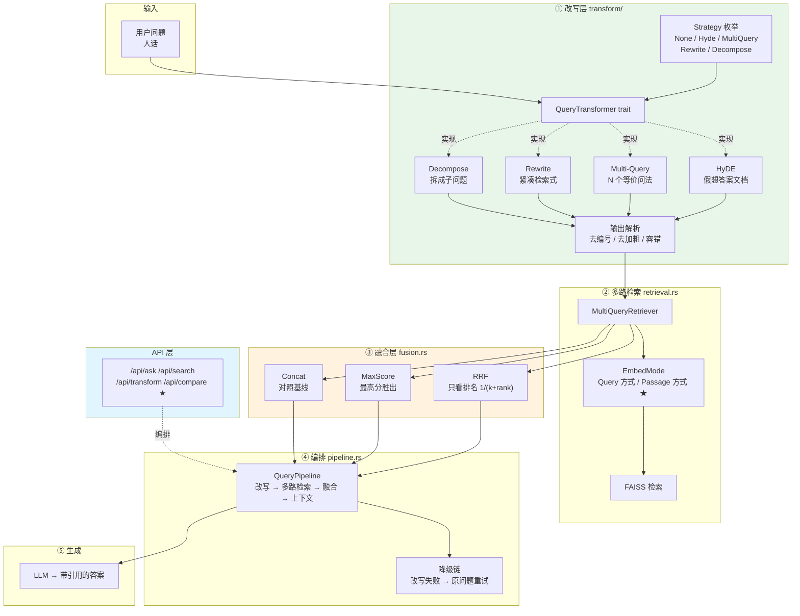
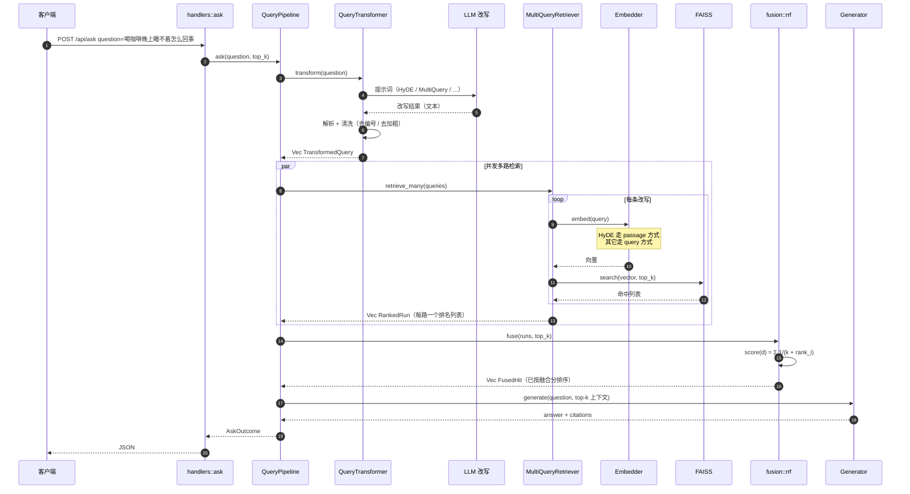
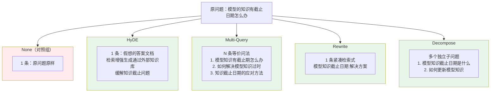
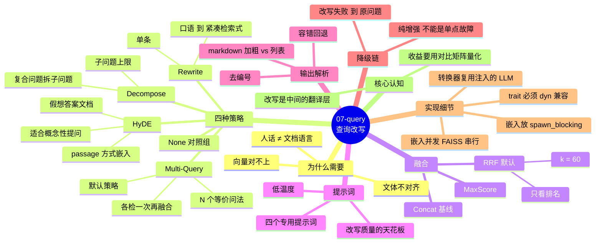

# 07-query — 手撕 Query Transformation（查询改写）

在 06-rag 的完整 RAG 链路上加一层 **Query Transformation**：
**在检索之前，把用户的问题翻译成「文档的语言」**。

对应教程：**LlamaIndex Query Transformations** —— 实现 HyDE、Multi-Query、
Rewrite、Decompose 四种查询改写策略，以及多路结果的 RRF 融合。

```text
06-rag（Naive RAG）                    07-query（本项目）
─────────────────────                   ─────────────────────
问题 ──原样──> 向量检索 ──> 命中块       问题 ──改写──> N 条检索式
                                                │
                                          多路检索（并发）
                                                │
                                          RRF 融合
                                                │
                                          top-k ──> LLM ──> 答案
```

## 快速开始

```bash
export DEEPSEEK_API_KEY=sk-...   # 改写 + 生成都需要

make serve     # 启动 HTTP 服务（127.0.0.1:3010）
make demo      # 端到端 demo：改写 → 检索 → 融合 → 生成
make compare   # 多策略对比 ★（本项目的核心产出）
make test      # 单元 + 集成测试（不调 LLM）
```

> 也可直接 `cargo run -p rag-07 -- demo` 等，`make` 只是包了一层。

首次运行会下载嵌入模型（`multilingual-e5-small`，约 470MB）到
workspace 根目录的 `.fastembed_cache/`。

## 项目结构

```text
07-query/
├── data/
│   └── kb.md                # 知识库：6 个互不相关的章节
├── src/
│   ├── config.rs            # 配置（默认值 < 环境变量）
│   ├── error.rs             # 统一错误 → HTTP 状态码映射
│   ├── llm.rs               # LLM trait（GenaiLlm / ScriptedLlm）
│   ├── index.rs             # 索引层（复用 06 的底层能力）
│   ├── transform/           # ★ 改写策略（核心）
│   │   ├── mod.rs           #   trait + 策略枚举 + 输出解析 + 降级包装
│   │   ├── prompts.rs       #   四个提示词
│   │   ├── hyde.rs          #   HyDE
│   │   ├── multi_query.rs   #   Multi-Query
│   │   ├── rewrite.rs       #   Rewrite
│   │   └── decompose.rs     #   Decompose
│   ├── fusion.rs            # 多路融合：RRF / MaxScore / Concat
│   ├── retrieval.rs         # 多路检索器（含 EmbedMode：query vs passage）
│   ├── pipeline.rs          # 端到端编排 + 降级链
│   ├── api/
│   │   ├── mod.rs           #   共享状态
│   │   ├── models.rs        #   请求 / 响应模型（API 契约）
│   │   ├── extract.rs       #   自定义 JsonBody 提取器
│   │   ├── handlers.rs      #   处理器
│   │   └── routes.rs        #   路由表 + 中间件
│   └── main.rs              # 入口：serve / demo / compare 三种模式
└── tests/
    └── integration.rs       # 集成测试：建索引 → 多路检索 → 融合
```

---

## 架构全景



### 改写 + 多路检索 + 融合的时序图



### 四种改写策略的产出形态对比



### 思维导图：查询改写的知识地图



---

## 一、为什么需要查询改写

06-rag 的检索**只有一步**：把问题变成向量，去索引里找最相似的 k 个。
问题在于：**人话和文档不是同一种语言**。

| 用户问 | 文档写 | 向量能对上吗 |
|---|---|---|
| 「喝咖啡晚上睡不着是怎么回事」 | 「咖啡因的副作用包括失眠、心悸」 | 勉强 |
| 「模型的知识有截止日期怎么办」 | 「RAG 通过外部知识库缓解知识截止问题」 | 难 |
| 「文档切多大合适」 | 「块大小通常设定在三百至五百 token」 | 难 |

根因是**文体不对齐**：用户用疑问句，文档用陈述句。
嵌入模型虽然做过 query→passage 的非对称训练，但这个对齐是**有损的**。

查询改写就是在中间加一层翻译，把用户的问法转成文档的写法。

---

## 二、四种改写策略

### 2.1 HyDE（Hypothetical Document Embeddings）

**核心洞察**：向量检索在「问题 ↔ 文档」之间对齐很难，但在「文档 ↔ 文档」之间对齐很容易。

所以与其想办法把问题变成文档，不如**直接生成一段假想的答案文档**，用它去检索真实文档。

```text
问题：模型的知识有截止日期怎么办

HyDE 生成：
  模型的知识截止日期问题可以通过检索增强生成（RAG）来解决。
  RAG 在生成答案前先从外部知识库检索相关文档片段，
  把这些片段作为上下文提供给语言模型，从而补充模型训练数据之外的信息。

用这段话去检索 → 向量和文档在同一分布 → 命中率高
```

**实现上的关键细节**：HyDE 生成的明明是**文档**，所以必须用
`embed_documents`（`passage:` 前缀）嵌入，**不能**用 `embed_query`（`query:` 前缀）。
E5 这类非对称模型对前缀很敏感，用错会明显掉效果。

这个差异由 `EmbedMode` 统一处理：

```text
Strategy::Hyde   → EmbedMode::Document
其它所有策略      → EmbedMode::Query
```

### 2.2 Multi-Query（多问法 + 融合）

一个问题往往有多种「问法」，每种问法在向量空间里落点不同。
Multi-Query 让 LLM 生成 N 个**语义等价但措辞不同**的问法，各自检索后融合。

关键在于「**等价但不同**」：

- 太接近（`什么是 RAG` / `什么是 RAG 呢`）→ 多路结果几乎一样，白花成本
- 差别太大（变成不同的问题）→ 召回噪声，稀释融合结果

### 2.3 Rewrite（改写��检索式）

解决**指代消解**问题：

```text
用户：RAG 和微调有什么区别？
用户：那它训练成本高吗？        ← 「它」是什么？
```

嵌入模型把「它」编码成一个固定方向的向量 —— 所有含「它」的句子都在向量空间里
挨得很近，但**离任何具体内容都很远**。

Rewrite 把它补全成自包含的检索式：
「RAG 和微调相比，哪种方式的训练成本更高？」

### 2.4 Decompose（复合问题拆解）

复合问题问的是**多个方面**，单一向量检索无法同时覆盖：

```text
「光合作用的光反应和暗反应分别在什么位置进行？各自的作用是什么？」
                    ↑ 位置意图        ↑ 作用意图
```

这个句子的向量落在两个意图的**中间地带** —— 两边都不够近，两个意图都没召回好。

拆开之后，每个子问题都很具体 → 向量很尖 → 召回准。

### 2.5 Multi-Query 和 Decompose 的区别

这两个策略**经常被混淆**，但它们解决的是不同的问题：

| | Multi-Query | Decompose |
|---|---|---|
| 拆的是什么 | **措辞** | **意图** |
| 产出 | 同一问题的 N 种说法 | N 个不同的问题 |
| 解决的问题 | 单一意图召不全 | 多意图互相干扰 |
| 典型输入 | 「模型知识截止怎么办」 | 「A 和 B 的区别是什么？」 |

一个实用的判据：**如果 N 个变体之间可以互相替代，是 Multi-Query；
如果 N 个变体之间不能互相替代（缺一个就不完整），是 Decompose。**

---

## 三、多路结果融合

Multi-Query / Decompose 各自检索一次，得到 N 份排序列表。
融合要解决两件事：**去重**（同一个块不能占多个位置）和**排序**。

### 3.1 RRF（Reciprocal Rank Fusion）—— 默认

```text
score(d) = Σ  1 / (k + rank_i(d))
            i∈lists
```

**它的妙处在于只看排名，不看分数。**

为什么这很重要？因为不同检索路径的分数**根本不可比**：

| 路径 | 分数范围 |
|---|---|
| 原问题 | 0.62 ~ 0.78 |
| HyDE 假想文档 | 0.55 ~ 0.83 |
| Multi-Query 变体 | 0.60 ~ 0.75 |

你不能直接把 0.78 和 0.55 比大小 —— 但「排第 1」和「排第 20」是可以比的。
RRF 只用排名，所以天然免疫这个问题。这也是 RRF 成为工业界默认选择的原因。

**常数 `k = 60` 的作用**：压制头部的排他性。

- `k = 0` → 第 1 名得 1.0 分，第 10 名得 0.1 分 —— 头部极度强势
- `k = 60` → 第 1 名得 0.0164，第 10 名得 0.0143 —— 差距很小，
  **「多路都排在中上」比「一路排第一」更有价值**

这是 RRF 的核心设计哲学：**共识 > 单点最优**。

### 3.2 MaxScore（最高分胜出）

```text
score(d) = max_i score_i(d)
```

| | RRF | MaxScore |
|---|---|---|
| 需要分数可比 | ❌ 不需要 | ✅ 需要 |
| 奖励「多路都命中」 | ✅ 是 | ❌ 否 |
| 对单路高分极度敏感 | 较稳健 | ❌ 容易 |

### 3.3 Concat（对照基线）

把各路结果依次拼起来去重，**没有排序逻辑**。
用它来对比 RRF，能直观看出「融合算法」比「简单拼接」好在哪。

---

## 四、提示词：改写质量的天花板

改写看起来像「让 LLM 换个说法」，但提示词写得好坏，检索召回率能差出一倍。

差的提示词（最常见的错误写法）：

```text
请改写下面的问题：
{question}
```

这会让 LLM 输出「模型如何解决知识截止日期问题？」这样的**陈述式检索式** ——
而索引里存的是文档原文（陈述句、术语、长句）。

好的提示词要做三件事：

1. **明确输出格式** —— 编号列表、每行一条、不要解释
2. **对齐目标文体** —— 告诉 LLM 检索目标是「文档原文」，不是「问法」
3. **给出正反例** —— 告诉 LLM 什么样的改写是好的

四个提示词都遵循同一个骨架：

```text
[角色]   你是……检索助手
[任务]   把下面的问题改写成……
[格式]   必须输出 N 行，每行一个，不要编号不要解释
[示例]   输入 → 输出
[输入]   {question}
```

---

## 五、输出解析：最容易被忽略的工程细节

三种策略（除 Rewrite 外）都依赖 LLM 输出**多个**结果，而 LLM 的输出格式是**不受控**的：

```text
1. 问法一          ← 编号
2. 问法二
```

```text
- 问法一           ← 项目符号
```

```text
Here are the queries:   ← 元话语（必须丢掉）
1. 问法一
```

```text
**问法一**         ← markdown 加粗（不是列表标记）
```

`parse_numbered_lines` 必须容忍所有这些「小毛病」。它是本模块**最关键的一段代码** ——
因为它是完全确定的，所以能被单元测试充分覆盖（详见 `transform/mod.rs` 的 12 个测试）。

### 5.1 一个容易踩的坑：markdown 加粗 vs 列表符号

无条件剥 `*` 会把 `**问法一**` 变成 `问法一**` —— 反而破坏了原文。

markdown 的列表语法规定 `*` / `-` 后面必须跟空格（否则会被当成强调语法），
所以「后面跟空白」正好能区分这两种情况。

---

## 六、降级链：改写必须是「纯增强」

这个流水线**每一环都有降级路径**：

| 环节失败 | 降级行为 |
|---|---|
| 改写失败（LLM 挂） | 用原问题继续检索 |
| 某一路检索失败 | 跳过这一路，用其它路的结果 |
| 融合失败 | 退回 concat 拼接 |
| 生成失败 | 报错（但**检索结果仍然返回**，它们本身有价值） |

关键在第一条：**改写失败不应该让整个请求失败**。
退回原问题继续检索，召回差一点，但答案仍然能给出。

这让「查询改写」保持为一个**可选的增强层**，而不是新的故障点。
`QueryError::is_degradable()` 把这个判断变成显式的，而不是散落在各处的 `if let Ok(...)`。

---

## 七、API

| 方法 | 路径 | 说明 |
|---|---|---|
| GET | `/health` | 健康检查 |
| GET | `/` | 服务信息 + 索引状态 |
| POST | `/api/ask` | 改写 → 检索 → 融合 → 生成 |
| POST | `/api/search` | 改写 → 检索（不生成） |
| POST | `/api/transform` | 只改写（迭代提示词用） |
| POST | `/api/compare` | **多策略对比 ★** |
| POST | `/api/reindex` | 重建索引 |

### 7.1 `/api/compare` —— 本项目的核心端点

对同一个问题依次跑完多个策略，返回每个策略的改写结果、命中块、
是否命中期望关键词，以及**策略之间的召回重叠度矩阵**。

```bash
curl -s localhost:3010/api/compare -H 'Content-Type: application/json' -d '{
  "question": "模型的知识有截止日期怎么办",
  "strategies": ["none", "hyde", "multi_query", "decompose"],
  "expected": ["检索增强生成"]
}'
```

响应里的 `overlap` 矩阵直接告诉你**改写到底有没有带来新信息**：

```json
{
  "overlap": [
    [4, 3, 3, 2],
    [3, 4, 3, 2],
    [3, 3, 4, 2],
    [2, 2, 2, 4]
  ],
  "successful_strategies": ["multi_query"]
}
```

- 对角线 = 该策略自己召回的块数
- 非对角线 = 两个策略的「共识部分」
- **全矩阵都高** → 改写没带来新信息（白花 LLM 钱）
- **某行明显偏低** → 那个策略的视角独特，有价值

`successful_strategies` 是最实用的「量化收益」方式 ——
不用人工判读，直接看哪个策略把正确块捞上来了。

---

## 八、配置

所有参数集中在 `config.rs`，来源是 `默认值 < 环境变量`（`QUERY_` 前缀）。

| 变量 | 说明 | 默认 |
|---|---|---|
| `QUERY_DATA_DIR` | 知识库目录 | `07-query/data` |
| `QUERY_INDEX_PATH` | 索引文件路径 | `index/index.faiss` |
| `QUERY_BIND_ADDR` | 监听地址 | `127.0.0.1:3010` |
| `QUERY_EMBEDDING_MODEL` | `e5` / `bge` | `e5` |
| `QUERY_STRATEGY` | 默认改写策略 | `multi_query` |
| `QUERY_NUM_QUERIES` | Multi-Query 问法数 | `3` |
| `QUERY_MAX_SUB_QUESTIONS` | Decompose 子问题上限 | `4` |
| `QUERY_TRANSFORM_MODEL` | 改写模型 | `deepseek-flash` |
| `QUERY_TRANSFORM_TEMPERATURE` | 改写温度 | `0.0` |
| `QUERY_TRANSFORM_MAX_TOKENS` | 改写 max tokens | `512` |
| `QUERY_TOP_K` | 最终块数 | `4` |
| `QUERY_PER_QUERY_K` | 每路召回数 | 自动（top_k × 2） |
| `QUERY_FUSION` | 融合方法 | `rrf` |
| `QUERY_MIN_SCORE` | 相似度下限 | 空 |
| `QUERY_MODEL` | 生成模型 | `deepseek-flash` |
| `QUERY_TEMPERATURE` | 生成温度 | `0.1` |
| `QUERY_MAX_TOKENS` | 生成 max tokens | `2000` |

### 为什么 `per_query_k` 默认是 `top_k × 2`

多路检索 + 融合后，真正有用的块可能来自任何一路。
如果每路只取 `top_k` 条，最终 top-k 里可能有 2 条是重复的，实际只有 2 条有效信息。

---

## 九、几个实现细节

### 9.1 嵌入必须放在 `spawn_blocking` 里

`embed_query` / `embed_documents` 是**同步的 CPU 密集**调用（ONNX 推理），
直接在 async 上下文里调用会**阻塞 tokio 的工作线程**。

一次嵌入大约几十到几百毫秒 —— 在这个期间，同一个 worker 线程上的其它请求全部被卡住。

`spawn_blocking` 把它们丢到专门的阻塞线程池，保证 async 运行时不被卡。

### 9.2 嵌入并发，FAISS 搜索串行

- **嵌入**是纯 CPU 计算，可以真正并行
- **FAISS 搜索**受 mutex 限制（`search` 需要 `&mut self`），本来就是串行的

所以分两步：**先把所有查询的向量算出来，再依次做向量检索**。
把两者塞进同一个 future，tokio 只会并发调度，实际还是要排队等锁。

### 9.3 trait 必须 dyn 兼容

`Llm` 和 `QueryTransformer` 都用**装箱 future**：

```text
async fn      →  fn f() -> Pin<Box<dyn Future<Output = T> + Send + '_>>
```

因为这两种「返回 future」的写法都**不 dyn 兼容**，而本项目需要
`Box<dyn Llm>` / `Box<dyn QueryTransformer>` 在运行时切换实现。

代价是一次 `Box` 分配 —— 相对于一次 LLM 网络调用（几十毫秒）完全不值得优化。

### 9.4 转换器必须复用流水线注入的 LLM

`QueryPipeline::transformer()` **不能**新建 `GenaiLlm` —— 必须复用注入进来的那个。原因：

1. **测试可替换** —— 测试注入 `ScriptedLlm`（零网络、完全确定），
   如果转换器自己新建真实 LLM，测试就会真的去调网络，完全失去意义
2. **模型一致** —— 改写和生成应该用同一个模型实例，否则配置里的
   `transform_model` 会被绕过

---

## 十、测试策略

| 层 | 是否调 LLM | 覆盖内容 |
|---|---|---|
| 单元测试（各模块内，59 个） | 否 | 改写解析、RRF 融合、提示词结构、错误映射、降级行为 |
| 集成测试（14 个） | 否 | 建索引 → 多路检索 → 融合 → 命中正确性 |
| 端到端（需 API key） | 是 | 完整问答 |

集成测试**不调 LLM** —— LLM 调用慢、贵、还不确定。
用 [`ScriptedLlm`] 喂预设答案，把「LLM 会输出什么」固定住，其余都能确定性断言。

---

## 十一、扩展方向

本项目实现了 Query Transformation 这一层。06-rag README 里那张
「Naive 缺什么」的表里，剩下的增强手段：

| 没做的事 | 会导致什么 | 增强手段 | 状态 |
|---|---|---|---|
| ~~查询改写~~ | 问「它多少钱」检索不到「价格」 | HyDE / Multi-Query | ✅ 本项目 |
| 混合检索（向量 + BM25） | 问具体编号、API 名时召不回来 | BM25 + RRF | ⬜ |
| 重排（cross-encoder 精排） | top-10 里有 3 个真正相关的排在第 8 | Cross-encoder rerank | ⬜ |
| 元数据过滤 | 混进了别的文档的块 | 按 source/时间过滤 | ⬜ |
| 相似度阈值 | 什么都不相关时也硬答 | `min_score` | ✅ 已内置 |
| 自反思 / CRAG | 检索质量差时不知道该重试 | CRAG | ⬜ |

**混合检索**是下一个最自然的方向 —— 本项目的 RRF 融合层已经为它做好了准备
（`FusionMethod` 现在融合的是「同一种检索的多路结果」，
加上 BM25 之后就是「两种检索的结果」，RRF 同样适用）。

---

## 十二、Makefile

```bash
make help        # 查看所有目标
make demo        # 端到端 demo
make compare     # 多策略对比 ★
make serve       # 启动 HTTP 服务（127.0.0.1:3010）
make reindex     # 重建索引
make smoke       # 冒烟测试：起服务 → compare → 关服务
make build       # 编译
make test        # 单元 + 集成测试
make lint        # clippy 零警告
make fmt         # 格式化
make clean       # 清理产物
```
