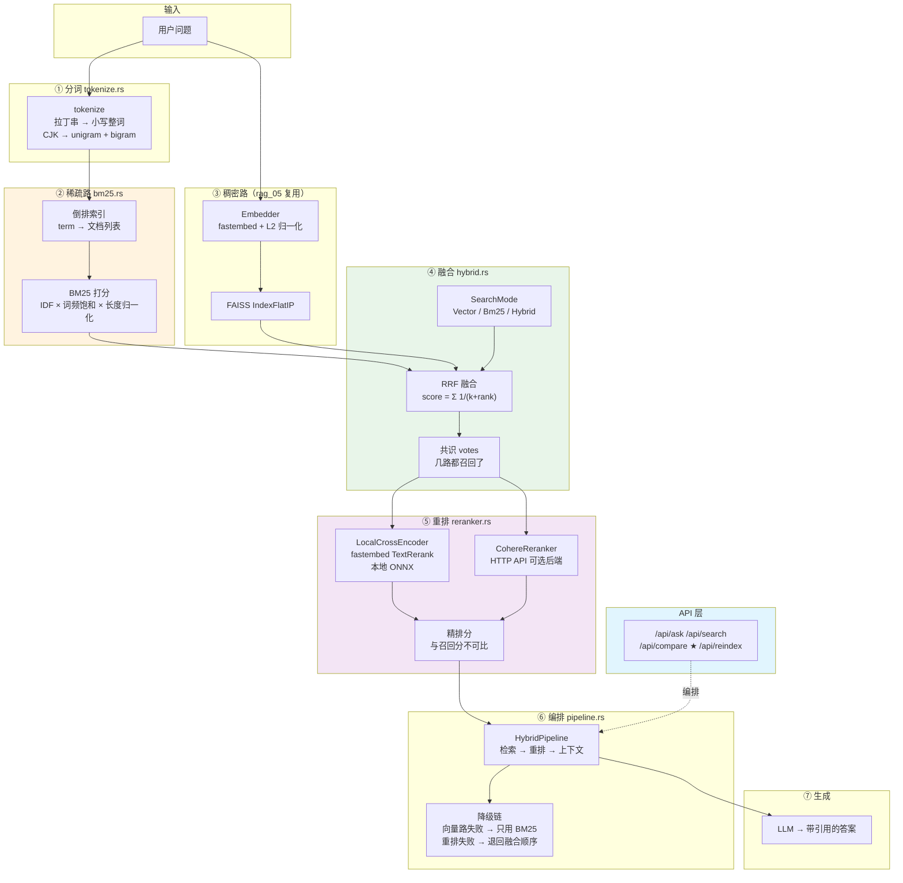
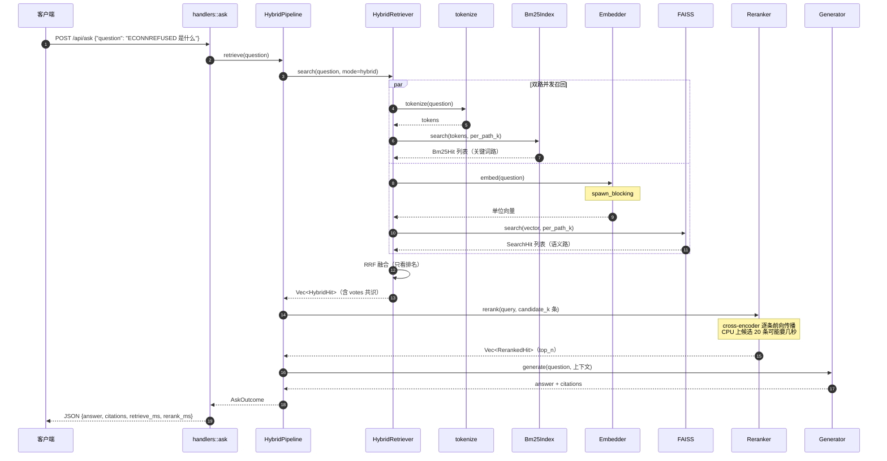
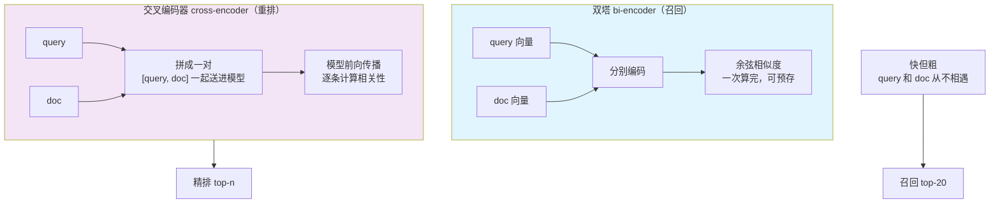
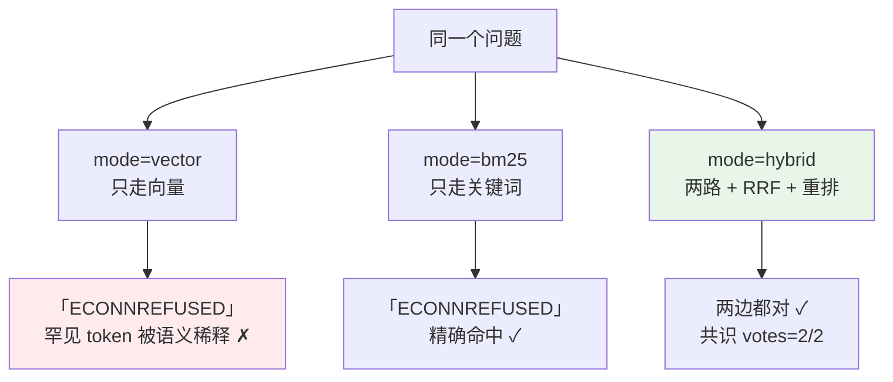
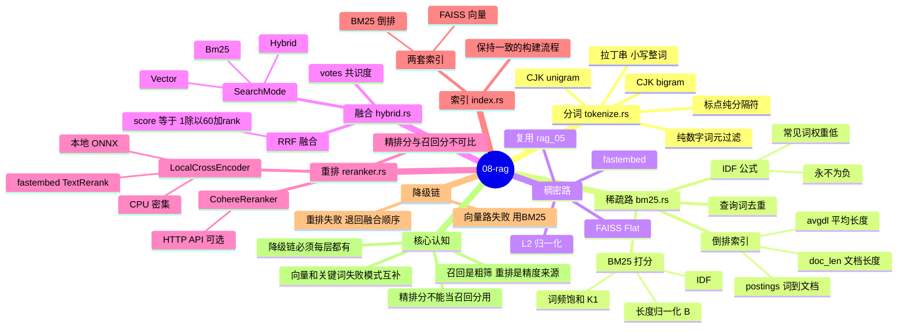
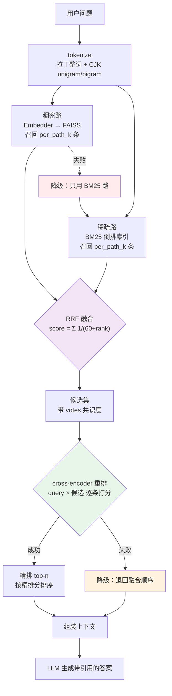

# 08-rag — 手撕混合检索（Hybrid Search）与重排（Rerank）

在 07-query 的完整 RAG 链路上加一层**检索侧**的增强：
**一路向量检索不够准 —— 加一路关键词检索，再加一层 cross-encoder 精排。**

对应教程：**LlamaIndex Cohere Rerank**（两阶段检索）
对应论文：**Modular RAG**（Gao et al., 2023 —— Routing + Reranking 模块）

```text
    07-query（已有）                        08-rag（本项目）
────────────────────                   ─────────────────────
问题 ──原样──> 向量检索 ──> 命中块       问题 ──> BM25 关键词路 ──┐
                                                │               ├─ RRF 融合
                                          向量语义路 ────────────┘
                                                │
                                          候选集（top-20）
                                                │
                                          cross-encoder 重排
                                                │
                                          top-n ──> LLM ──> 答案
```

## 快速开始

```bash
export DEEPSEEK_API_KEY=sk-...   # 只有跑问答（/api/ask）才需要

make serve     # 启动 HTTP 服务（127.0.0.1:3020）
make demo      # 端到端 demo：混合检索 → 重排 → 生成
make compare   # 多模式对比 ★（本项目的核心产出）
make test      # 单元 + 集成测试（不调 LLM）
```

> 也可直接 `cargo run -p rag-08 -- demo` 等，`make` 只是包了一层。

⚠️ **重排很吃 CPU** —— debug 构建下 11 个候选要 ~6 秒，release 下 ~0.85 秒。
**用 release 构建跑 demo / 生产部署**：`cargo run --release -p rag-08 -- compare`。

首次运行会下载两个模型到 workspace 根目录的 `.fastembed_cache/`：

| 模型 | 用途 | 大小 |
|---|---|---|
| `intfloat/multilingual-e5-small` | 嵌入（向量检索） | ~470MB |
| `BAAI/bge-reranker-base` | 交叉编码器（重排） | ~1.1GB |

## 项目结构

```text
08-rag/
├── data/
│   └── kb.md                # 知识库：10 个互不相关的章节（含错误码速查）
├── src/
│   ├── config.rs            # 配置（默认值 < 环境变量）
│   ├── error.rs             # 统一错误 → HTTP 状态码映射
│   ├── llm.rs               # LLM 抽象层（复用 rag_07）
│   ├── tokenize.rs          # ★ 中英混排分词（CJK unigram + bigram）
│   ├── bm25.rs              # ★ BM25 打分 + 倒排索引
│   ├── hybrid.rs            # ★ 双路召回 + RRF 融合
│   ├── reranker.rs          # ★ 重排（本地 cross-encoder / Cohere API）
│   ├── index.rs             # 索引层（FAISS + BM25 双索引）
│   ├── pipeline.rs          # 端到端编排 + 降级链
│   ├── api/
│   │   ├── mod.rs           #   共享状态
│   │   ├── models.rs        #   请求 / 响应模型（API 契约）
│   │   ├── extract.rs       #   自定义 JsonBody 提取器
│   │   ├── handlers.rs      #   处理器
│   │   └── routes.rs        #   路由表 + 中间件
│   └── main.rs              # 入口：serve / demo / compare 三种模式
└── tests/
    └── integration.rs       # 集成测试：建双索引 → 双路检索 → 融合 → 重排
```

---

## 架构全景



### 一次 `/api/ask` 的完整时序（双路并发 + 重排）



### 双塔 vs 交叉编码器（为什么重排能提升精度）



### 三种检索模式的对照（核心产出）



### 知识地图：混合检索与重排

```mermaid
graph LR
    N1(("08-rag<br/>混合检索 + 重排"))
    subgraph N2["分词 tokenize"]
        N3["拉丁串 小写整词"]
        N2 --> N3
        N4["CJK unigram + bigram"]
        N2 --> N4
        N5["bigram 保留词序"]
        N2 --> N5
        N6["标点当分隔符"]
        N2 --> N6
    end
    N1 --> N2
    subgraph N7["BM25 稀疏检索"]
        subgraph N8["打分公式"]
            N9["IDF 词稀有度"]
            N8 --> N9
            N10["词频饱和 k1 = 1.2"]
            N8 --> N10
            N11["长度归一化 b = 0.75"]
            N8 --> N11
        end
        N7 --> N8
        N12["倒排索引"]
        N7 --> N12
        N13["失败模式 对罕见 token 弱"]
        N7 --> N13
    end
    N1 --> N7
    subgraph N14["向量稠密检索"]
        N15["复用 05-rag"]
        N14 --> N15
        N16["L2 归一化"]
        N14 --> N16
        N17["失败模式 对精确词弱"]
        N14 --> N17
    end
    N1 --> N14
    subgraph N18["RRF 融合"]
        N19["只看排名不看分数"]
        N18 --> N19
        N20["k = 60"]
        N18 --> N20
        N21["跨路天然可比"]
        N18 --> N21
        N22["votes 共识标记"]
        N18 --> N22
    end
    N1 --> N18
    subgraph N23["重排 rerank"]
        N24["cross-encoder"]
        N23 --> N24
        N25["本地 fastembed"]
        N23 --> N25
        N26["Cohere API 可选"]
        N23 --> N26
        N27["分数与召回分不可比"]
        N23 --> N27
        N28["候选数决定天花板"]
        N23 --> N28
        N29["失败可降级"]
        N23 --> N29
    end
    N1 --> N23
    subgraph N30["索引一致性"]
        N31["FAISS 落盘"]
        N30 --> N31
        subgraph N32["BM25 不落盘"]
            N33["每次启动重建"]
            N32 --> N33
            N34["避免两份不一致"]
            N32 --> N34
        end
        N30 --> N32
        N35["BM25 用正文"]
        N30 --> N35
        N36["向量用标题+正文"]
        N30 --> N36
    end
    N1 --> N30
    subgraph N37["降级链"]
        N38["向量失败 → 只用 BM25"]
        N37 --> N38
        N39["BM25 失败 → 只用向量"]
        N37 --> N39
        N40["重排失败 → 退回融合顺序"]
        N37 --> N40
        N41["生成失败 → 仍返回检索结果"]
        N37 --> N41
    end
    N1 --> N37
    subgraph N42["核心认知"]
        N43["召回阶段的排序不够准"]
        N42 --> N43
        N44["重排才是精度来源"]
        N42 --> N44
        N45["收益靠对照组量化"]
        N42 --> N45
    end
    N1 --> N42
```

---

## 思维导图：混合检索与重排体系



---

## 混合检索 + 重排链路



⚠️ **重排是 CPU 密集的** —— cross-encoder 要把「查询 + 候选」拼起来逐条推理。
并发太高会互相抢 CPU，整体反而更慢（09-rag-eval 也踩了同样的坑）。

---

## 一、为什么要混合检索

06/07 的检索**只有一路**：向量检索。问题在于**向量检索对精确关键词是盲的**。

| 查询 | 向量检索 | BM25 |
|---|---|---|
| 「怎么优化检索速度」 | ✅ 语义匹配 | ⚠️ 关键词对不上，召不回 |
| 「`ECONNREFUSED` 错误码」 | ❌ 罕见 token 被语义稀释 | ✅ 精确命中 |
| 「`bge-reranker-v2-m3`」 | ❌ 型号名几乎没有语义 | ✅ 精确命中 |
| 「光反应发生在哪」 | ✅ 语义匹配 | ⚠️ 召不回 |

**两者的失败模式正好互补** —— 这就是混合检索（Hybrid Search）的理论基础。

知识库 `data/kb.md` 里的「错误码速查」一节就是为此设计的：
里面全是 `ECONNREFUSED`、`ETIMEDOUT`、`ENOMEM` 这类罕见字符串，
向量检索几乎不可能命中，BM25 却能精确命中。

## 二、BM25：稀疏检索

BM25 是最经典的稀疏检索算法，也是 Elasticsearch / Lucene 默认的打分函数。

```text
                       f(t,D) · (k₁ + 1)
 score(D,Q) = Σ  IDF(t) · ─────────────────────
 t∈Q                    f(t,D) + k₁ · (1 - b + b·|D|/avgdl)
```

三个部分各管一件事：

| 部分 | 作用 | 类比 |
|---|---|---|
| `IDF(t)` | 这个词**有多稀有** | 罕见词比常见词更能区分文档 |
| `f(t,D)` | 这个词在文档里**出现几次** | 出现多次 → 更相关（但有饱和） |
| `\|D\|/avgdl` | 文档**长度归一化** | 长文档不该仅因为长就占优 |

- **`k₁ = 1.2`** —— 词频饱和速度。出现 100 次比出现 10 次相关，但**不可能相关 10 倍**：
  第 11 次出现带来的信息量远小于第 1 次。
- **`b = 0.75`** —— 长度惩罚强度。
- **IDF** 用 `ln(1 + (N - df + 0.5) / (df + 0.5))`，带平滑，保证**永远为正**。
  没有平滑的话，出现在一半以上文档里的词会得到负 IDF ——
  那会让「文档包含了太多常见词」反而**降低**分数，明显不合理。

### 2.1 分词：中英混排怎么处理

BM25 的前提是「把文本切成词」。中文没有空格，英文有。

本项目的方案（`src/tokenize.rs`）：

```text
拉丁字母/数字串 → 整段小写成一个词
CJK 字符        → 单字（unigram）+ 相邻双字（bigram）
其它字符        → 分隔符
```

**为什么 CJK 要出 bigram**：只用单字会丢掉词序信息。

```text
「数据检索」 → 数据 / 据检 / 检索
「检索数据」 → 检索 / 索数 / 数据
```

unigram 集合完全一样，但 bigram 集合不同了 —— 词序信息被保留下来。
这是一个经典的折中：**不做真正的分词，但也不完全丢掉词序**。

（真正的中文分词 —— 词典 + CRF / BERT —— 效果好得多，但不在本项目范围内。）

### 2.2 倒排索引

为了让打分高效，维护倒排索引：

```text
词 → [(文档下标, 该词词频), ...]
```

查询时只遍历「查询里出现的词」对应的 posting list，不用扫描全部文档。
这是 BM25 能在百万级文档上跑得动的原因。

---

## 三、RRF：两路怎么合并

**不能直接加权求和**，因为两路的分数根本不可比：

| | 分数来源 | 典型范围 |
|---|---|---|
| 向量检索 | 余弦相似度 | 0.55 ~ 0.85 |
| BM25 | 对数加权和 | 0 ~ 15+ |

一个 0.85 的余弦相似度对上 15 分的 BM25 —— 加权系数怎么调都不对。

所以用 **RRF（Reciprocal Rank Fusion，倒数排名融合）**：

```text
 score(d) = Σ  1 / (k + rank_i(d))
              i∈lists
```

**只看排名，不看分数** —— 于是跨路径天然可比。

`k = 60`（复用 `rag_07::fusion::RRF_K`，和 07-query 保持一致）。
它的作用是**压制头部的排位性**：`k = 60` 时第 1 名得 0.0164、第 10 名得 0.0143，
差距很小 —— **「多路都排在中上」比「一路排第一」更有价值**。

融合后的每条命中都带：

- `vector_score` —— 向量路的相似度（没被向量路召回时是 `None`）
- `bm25_score` —— BM25 路的分数（没被 BM25 路召回时是 `None`）
- `votes` —— **共识度**。两路都命中 = 2/2，几乎一定对；1/2 可能只是某一路的噪声。

---

## 四、重排：精排环节

### 4.1 为什么召回之后还要重排

向量检索用的是**双编码器（bi-encoder）**：问题和文档**分别**编码，
编码时彼此看不见，只能比向量距离。

```text
问题 ──encode──> q        d ──encode──> 文档
                       ↘ 比距离 ↙
```

这带来两个后果：**快**（文档向量可离线算好）和**粗**（问题和文档之间没有任何交互）。

重排模型用的是 **cross-encoder**：把问题和文档**拼在一起**送进模型。

```text
问题 + 文档 ──encode──> 相关性分数
```

它能看到交互，所以更准 —— 但每个候选都要跑一次模型，慢得多。

所以标准做法是**两阶段**：

```text
召回（快、粗）──> top-20~50 ──> 重排（慢、精）──> top-3~5
```

### 4.2 教程里的对照

[LlamaIndex 的 Cohere Rerank 例子](https://developers.llamaindex.ai/python/examples/node_postprocessor/coherererank/)
演示的正是这个流程：

```python
query_engine = index.as_query_engine(
    similarity_top_k=10,                 # ← 先召回 10 条
    node_postprocessors=[cohere_rerank],  # ← 再精排成 2 条
)
```

那个例子特别有说服力：**只取 top-2 时答案是幻觉的**
（召回了不相关的段落，模型硬编了一个答案）；
而 **top-10 召回 + rerank 到 top-2**，答案才正确。

这正好说明：**召回阶段的排序是不够准的，重排才是精度的来源**。

### 4.3 本项目的两个后端

| 后端 | 实现 | 需要 key | 说明 |
|---|---|---|---|
| `LocalCrossEncoder` | fastembed 的 ONNX cross-encoder | ❌ | **默认**。`bge-reranker-base` 中英双语 |
| `CohereReranker` | Cohere `/v1/rerank` HTTP API | ✅ | 对齐教程 |

切到 Cohere：

```bash
export COHERE_API_KEY=...
export HYBRID_RERANK_BACKEND=cohere
```

### 4.4 ⚠️ 重排分数不可比

不同 reranker 的分数**不能互相比较**，也不能设阈值：

- cross-encoder 输出的是 **logit**（任意实数，正负都有）
- Cohere 输出的是 **relevance_score**（`[0, 1]` 的概率）

所以分数只用于**同一次重排内部**排序。

### 4.5 重排失败是可降级的

重排是**精排**环节 —— 它挂了，顶多退回「融合后的原始顺序」，检索结果**依然可用**。

这和生成失败完全不同：生成挂了就没有答案了。

代码里这个区别是**显式**的：

```rust
pub fn is_degradable(&self) -> bool {
    matches!(self, RagError::Rerank(_))
}
```

### 4.6 重排的延迟代价（实测）

重排是本项目**唯一**的重活 —— 检索是毫秒级，重排是**秒级**。

实测（Apple Silicon，11 个候选块，`bge-reranker-base`）：

| 构建模式 | 重排耗时 |
|---|---|
| `cargo run`（debug） | ~6000 ms |
| `cargo run --release` | ~850 ms |

**所以生产部署必须用 release 构建。** debug 模式下 ONNX 推理没有优化，慢 7 倍。

这也是**两阶段检索**存在的根本原因：把 20 个候选逐条送进 cross-encoder 是必要的代价，
但如果对**整个知识库**这么做就完全不可接受了。所以先用便宜的召回缩小范围，再花贵的重排。

### 4.7 ⚠️ 候选池大小决定重排的天花板

`HYBRID_RERANK_CANDIDATE_K = 20` 意味着**每路召回也至少要 20 条**，
否则两路合并去重后凑不满 20 个候选，「送 20 条进重排」就是个空承诺。

这条约束在代码里是显式的（见 [`src/pipeline.rs`](src/pipeline.rs) 的 `retrieve_with`），
并且有对应的回归测试（`rerank_receives_enough_candidates`）。

---

## 五、索引：两套索引怎么保持一致

混合检索需要**同一批块**的两种索引。两份索引的块 ID 必须一一对应。

### 5.1 BM25 索引**不落盘**

BM25 只需要分块结果，**不需要嵌入模型** —— 分块是纯 CPU 的字符串操作，几百个块只要几毫秒。

所以启动时的流程是：

```text
索引不存在 ──> 跑嵌入模型建 FAISS 索引 ──> 落盘
索引存在   ──> 加载 FAISS 索引（几毫秒）+ 重建 BM25 索引（几毫秒）
```

好处：

1. **不需要维护第二套持久化格式** —— 没有「两个索引版本不一致」的问题
2. **BM25 索引永远和 FAISS 索引的块完全一致** —— 因为它们来自同一次分块
3. **改文档后不用清理 BM25 缓存** —— 它每次启动都重建

代价：每次启动多花几毫秒。

### 5.2 ⚠️ BM25 用正文，向量用「标题 + 正文」

向量索引用 `embedded_text`（含标题路径）—— 标题能帮语义检索。

但 BM25 是**关键词**匹配：如果把「# 标题 > 子标题」也塞进去，
标题词会主导打分，让「按标题命中」压过「按正文命中」。
实践中我们希望 BM25 找的是**正文里的关键词**，标题信息通过 `heading_path` 字段单独保留，供 Reranker 用。

---

## 六、API

| 方法 | 路径 | 说明 |
|---|---|---|
| GET  | `/health` | 健康检查 |
| GET  | `/` | 服务信息 + 索引状态 |
| POST | `/api/ask` | 混合检索 + 重排 + 生成 |
| POST | `/api/search` | 混合检索 + 重排（不生成） |
| POST | `/api/compare` | **多模式对比** ★ |
| POST | `/api/reindex` | 重建索引 |

统一错误响应：

```json
{ "error": "Bad Request", "message": "请求参数不合法: 问题不能为空" }
```

### 6.1 `/api/compare` —— 核心端点

本项目的价值不在「加了一个 BM25」，而在**「证明了混合检索值多少」**。

```bash
curl -s localhost:3020/api/compare -H 'Content-Type: application/json' -d '{
  "question": "ECONNREFUSED 是什么意思",
  "modes": ["vector", "bm25", "hybrid"],
  "expected": ["错误码速查"]
}'
```

响应里的 `hit` 字段直接告诉你：**哪些模式召回了正确答案**。

`overlap` 是**召回重叠度矩阵** —— `overlap[i][j]` = 模式 i 和 j 共同召回的块数：

- 对角线 = 该模式自己召回的块数
- 全矩阵都高 → 混合检索没带来新信息
- 某行明显偏低 → 那个模式的视角独特，有价值

### 6.2 三个对照组

| 对照组 | 参数 | 说明 |
|---|---|---|
| 只走向量 | `mode=vector` | 06/07 的水平 |
| 只走 BM25 | `mode=bm25` | 纯关键词检索 |
| 混合 + 重排 | `mode=hybrid` | 本项目的产出 |

关闭重排（对照「重排前 vs 重排后」）：

```bash
HYBRID_RERANK_ENABLED=false cargo run -p rag-08
```

---

## 七、配置

所有参数都是「默认值 < 环境变量」：

| 变量 | 说明 | 默认 |
|---|---|---|
| `HYBRID_DATA_DIR` | 知识库目录 | `08-rag/data` |
| `HYBRID_INDEX_PATH` | 索引文件路径 | `index/index.faiss` |
| `HYBRID_BIND_ADDR` | 监听地址 | `127.0.0.1:3020` |
| `HYBRID_EMBEDDING_MODEL` | `e5` / `bge` | `e5` |
| `HYBRID_TOP_K` | 最终块数 | `4` |
| `HYBRID_PER_PATH_K` | 每路召回数 | 自动（top_k × 2） |
| `HYBRID_MODE` | `vector` / `bm25` / `hybrid` | `hybrid` |
| `HYBRID_MIN_SCORE` | 相似度下限（可空） | 空 |
| `HYBRID_RERANK_ENABLED` | 是否启用重排 | `true` |
| `HYBRID_RERANK_BACKEND` | `local` / `cohere` | `local` |
| `HYBRID_RERANK_MODEL` | `bge` / `m3` / `jina` | `bge` |
| `COHERE_API_KEY` | Cohere API key | 空 |
| `HYBRID_COHERE_MODEL` | Cohere 模型名 | `rerank-multilingual-v3.0` |
| `HYBRID_RERANK_CANDIDATE_K` | 送进重排的候选数 | `20` |
| `HYBRID_RERANK_TOP_N` | 重排后保留条数 | `4` |
| `HYBRID_MODEL` | 生成模型 | `deepseek-flash` |
| `HYBRID_TEMPERATURE` | 生成温度 | `0.1` |
| `HYBRID_MAX_TOKENS` | 生成 max tokens | `2000` |
| `HYBRID_AUTO_INDEX` | 启动时自动建索引 | `true` |

---

## 日志

全仓库统一走 `00-logging`（`agent-logging`）。

```bash
RUST_LOG=info cargo run -p rag-08 -- compare
RUST_LOG=debug,rag_08=trace cargo run -p rag-08 -- search "问题"
```

| 事件 | 级别 | 关键字段 |
|---|---|---|
| 建索引（加载 → 分块 → 向量化 → 写入） | `INFO` | `chunk_count` / `elapsed_ms` |
| BM25 索引构建 | `DEBUG` | `doc_count` |
| 稠密路召回 | `DEBUG` | `top_k` / `hit_count` |
| 关键词路召回 | `DEBUG` | `top_k` / `hit_count` |
| RRF 融合 | `DEBUG` | `input_count` / `output_count` / `rrf_k` |
| 重排（cross-encoder / Cohere） | `DEBUG` | `candidate_count` / `top_n` / `backend` |
| 重排失败 → 降级为融合顺序 | `WARN` | `error` |
| 检索完成 | `INFO` | `mode` / `hit_count` / `elapsed_ms` |

HTTP 层用 `agent_logging::trace_layer()`。

---

## 八、降级链

每一环都有降级路径：

| 环节失败 | 降级行为 |
|---|---|
| 向量路失败 | 只用 BM25 路的结果 |
| BM25 路失败 | 只用向量路的结果 |
| 两路都失败 | 直接报错（没有数据就没答案） |
| **重排失败** | **退回融合后的原始顺序** |
| 生成失败 | 报错（检索结果仍随响应返回） |

---

## 九、与前后项目的关系

| 项目 | 查询处理 | 检索 |
|---|---|---|
| 06-rag | 原样 | 单路向量 |
| 07-query | 改写（HyDE / MultiQuery / ...） | 多路向量 + RRF |
| **08-rag（本项目）** | **原样** | **双路（向量 + BM25）+ RRF + 重排** |

08 **不用** LLM 做查询改写 —— 它的重点是**检索侧**。

两个项目**可以叠加**：改写之后的每个查询都走一遍混合检索 + 重排。

---

## 十、测试

```bash
cargo test -p rag-08
```

| 层 | 是否调 LLM | 覆盖内容 |
|---|---|---|
| 单元测试（各模块内） | 否 | 分词、BM25 打分、RRF 融合、重排排序、错误映射 |
| 集成测试（`tests/integration.rs`） | 否 | 建双索引 → 双路检索 → 融合 → 重排 → 命中正确性 |
| 端到端测试（需 API key） | 是 | 完整问答 |

集成测试用 [`ScriptedLlm`]（脚本化 LLM）和 `KeywordReranker`（确定性重排替身）
把「LLM 会输出什么」这个不确定因素固定住，其余全都可以断言。

⚠️ 集成测试需要嵌入模型。如果模型没下载过，会自动下载（约 470MB）。

---

## 十一、参考

- [LlamaIndex — Cohere Rerank](https://developers.llamaindex.ai/python/examples/node_postprocessor/coherererank/)
- [Modular RAG — Gao et al., 2023](https://arxiv.org/abs/2310.11511)
- [BM25 — Robertson & Zaragoza, 2004](https://www.microsoft.com/en-us/research/publication/the-lm-and-lmr-at-the-30th-anniversary-of-the-vector-space-model/)
- [RRF — Cormack et al., 2009](https://plg.uwaterloo.ca/~gvcormac/cormacksigir09-rrf.pdf)
- [BGE Reranker](https://github.com/FlagOpen/FlagEmbedding)

---

## 技术参考速查

### BM25 公式拆解

```text
score(d, q) = Σ  IDF(t) × ( tf × (K1 + 1) ) / ( tf + K1 × length_norm )
                                      └──── 词频饱和 ────┘
                                                    └──── 长度归一化 ────┘

IDF(t)      = ln( (N - df + 0.5) / (df + 0.5) + 1 )
length_norm = 1 - B + B × (doc_len / avgdl)
```

| 参数 | 含义 | 默认 | 调大的影响 |
|---|---|---|---|
| `K1` | 词频饱和速度 | 1.2~2.0 | 重复词的边际收益更高 |
| `B` | 长度归一化强度 | 0.75 | 长文档被惩罚更狠 |
| `avgdl` | 语料平均文档长度 | 自动算 | — |

### 三部分各自解决什么

| 部分 | 解决 | 单独去掉会怎样 |
|---|---|---|
| **IDF** | 常见词没区分度 | 「的」「系统」这类词主导排序 |
| **词频饱和** | 重复出现不等于更重要 | 刷词的文档霸榜 |
| **长度归一化** | 长文档天然命中更多词 | 长文档总是排前面 |

⚠️ **IDF 用 `+1` 保证永不为负** —— 否则出现在超过一半文档里的词会得到负分，
反而排到最后。测试 `idf_is_always_positive` 专门守这条。

### BM25 vs 向量检索的失败模式对照

| 查询类型 | 向量检索 | BM25 | 谁赢 |
|---|---|---|---|
| 精确关键词（`IndexFlatIP`） | ❌ 召不回 | ✅ 精准 | **BM25** |
| 同义改写（「怎么优化检索速度」vs「检索性能调优」） | ✅ 命中 | ❌ 对不上 | **向量** |
| 罕见专有名词 | ⚠️ 模糊 | ✅ 精确 | **BM25** |
| 概念性问答 | ✅ | ❌ | **向量** |

> **这正是混合检索的价值 —— 两者的失败模式正好互补。**

### CJK 分词：unigram + bigram

```text
「检索增强」→ unigram: 检 索 增 强
             → bigram:  检索 索增 增强
```

| | unigram | bigram |
|---|---|---|
| 保留词序 | ❌ | ✅ |
| 索引大小 | 小 | 2 倍 |
| 「索增强」能匹配「检索增强」吗 | ✅ 能（都是单字） | ❌ 不能 |

⚠️ **只做 unigram 会产生大量假匹配**（「索增强」匹配到「检索增强」）；
**只做 bigram 会漏掉单字查询**。所以两者都要出。

本项目的规则：

| 字符类型 | 处理 |
|---|---|
| 拉丁字母 / 数字 | 连续串 → 小写整词（`IndexFlatIP` → `indexflatip`） |
| CJK 汉字 | unigram + bigram |
| 标点 / 空白 / Markdown 符号 | **纯分隔符**，直接丢弃 |

⚠️ **纯数字词元要过滤** —— `1`、`2024` 在 BM25 里几乎没有区分度，
留着只会稀释真正有意义的词。

### 查询词去重

```text
查询里同一个词出现两次 → 只算一次
```

原因：**IDF 已经编码了「这个词有多稀有」**。
重复查询词是想强调，但在 BM25 的词集合语义里，
重复只会线性放大同一个词的贡献，偏离了「词集合」的含义。

业界实现（Lucene / Elasticsearch）也是去重的。

### 融合与重排的分界

| | 召回（两路检索 + RRF） | 重排（cross-encoder） |
|---|---|---|
| 模型 | bi-encoder（编码一次） | cross-encoder（编码 N 次） |
| 能否看到 query 和 doc 一起 | ❌ 分开编码 | ✅ 一起编码 |
| 精度 | 粗筛 | **精排** |
| 成本 | 低，可大规模 | 高，只能对少量候选 |
| 候选规模 | 几十~几百 | 几十 |

> **召回是粗筛，重排才是精度的真正来源。**

⚠️ **精排分和召回分不可比** —— cross-encoder 输出的是 logits，
范围可能是 `-11 ~ +11`；召回分是余弦相似度（`0.6 ~ 0.8`）。
**把精排分当阈值用会完全失效。**

### `SearchMode` 三档

| 模式 | 走哪几路 | 用途 |
|---|---|---|
| `Vector` | 只有稠密 | 06-rag 的水平（对照组） |
| `Bm25` | 只有稀疏 | 关键词路的天花板（对照组） |
| `Hybrid` | 两路 + RRF + 重排 | 优化组 |

`/api/compare` 能同时跑三档做差值 —— 这就是 09-rag-eval 的基础。

### 降级链的每一层

| 环节失败 | 降级行为 | 代价 |
|---|---|---|
| 向量路失败 | 只用 BM25 路 | 召回变窄，但能出结果 |
| BM25 路失败 | 只用向量路 | 同上 |
| 重排失败 | 退回融合顺序 | 精度降低，但排序仍合理 |
| 两路都失败 | 走「无上下文」提示词 | 拒答 |

⚠️ **降级链必须每层都有** —— 否则向量库抖一下，整个服务就 500 了。

### 重排的 CPU 成本

cross-encoder 对**每个候选**都要做一次完整推理。
`rerank_candidate_k = 20` 就是 20 次推理。

所以：

- ⚠️ 重排是 **CPU 密集**的，**并发不能开太高**（09-rag-eval 也踩了这个坑）
- ⚠️ `rerank_candidate_k` 越大越准，但越慢 —— 要权衡

### 配置速查

| 环境变量 | 说明 | 默认 |
|---|---|---|
| `HYBRID_DATA_DIR` | 知识库目录 | `08-rag/data` |
| `HYBRID_INDEX_PATH` | 索引路径 | `08-rag/index/index.faiss` |
| `HYBRID_BIND_ADDR` | 监听地址 | `127.0.0.1:3020` |
| `HYBRID_EMBEDDING_MODEL` | 嵌入模型 | `e5` |
| `HYBRID_MODE` | 检索模式 | `hybrid` |
| `HYBRID_TOP_K` | 最终返回条数 | `5` |
| `HYBRID_PER_PATH_K` | 每路召回数 | `20` |
| `HYBRID_RERANK_ENABLED` | 是否启用重排 | `true` |
| `HYBRID_RERANK_BACKEND` | `local` / `cohere` | `local` |
| `HYBRID_RERANK_MODEL` | 本地重排模型 | `BAAI/bge-reranker-base` |
| `HYBRID_RERANK_CANDIDATE_K` | 重排候选数 | `20` |
| `HYBRID_RERANK_TOP_N` | 重排后保留数 | `5` |
| `HYBRID_COHERE_MODEL` | Cohere 重排模型 | `rerank-multilingual-v3.0` |
| `HYBRID_MODEL` | 生成模型 | `deepseek-flash` |
| `HYBRID_TEMPERATURE` | 生成温度 | `0.1` |
| `HYBRID_MAX_TOKENS` | 生成上限 | `2000` |
| `HYBRID_AUTO_INDEX` | 启动时自动建索引 | `true` |

⚠️ **`HYBRID_PER_PATH_K` 和 `HYBRID_TOP_K` 是两个不同的量** ——
前者是「每路召回多少」（召回池），后者是「最终给 LLM 多少」（上下文大小）。
重排在两者之间：`RERANK_CANDIDATE_K` 个候选里精排出 `RERANK_TOP_N` 个。

---

## 十二、Makefile

```bash
make help        # 查看所有目标
make demo        # 端到端 demo
make compare     # 多模式对比 ★
make serve       # 启动 HTTP 服务（127.0.0.1:3020）
make reindex     # 重建索引（FAISS + BM25）
make smoke       # 冒烟测试：起服务 → compare → 关服务
make build       # 编译
make test        # 单元 + 集成测试
make lint        # clippy 零警告
make fmt         # 格式化
make clean       # 清理产物
```
