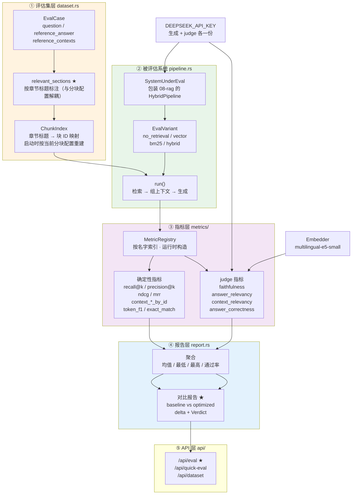
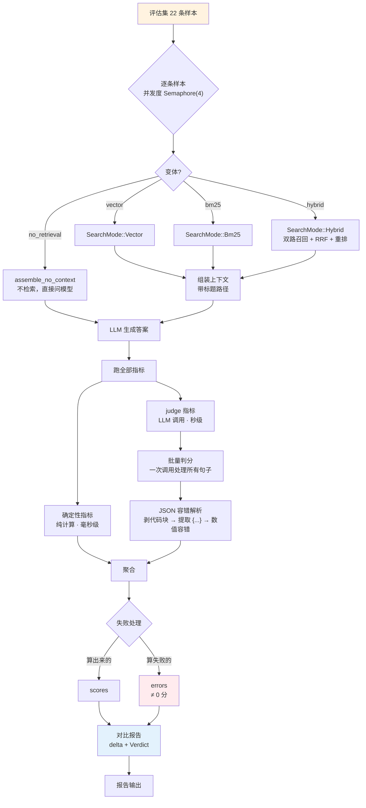
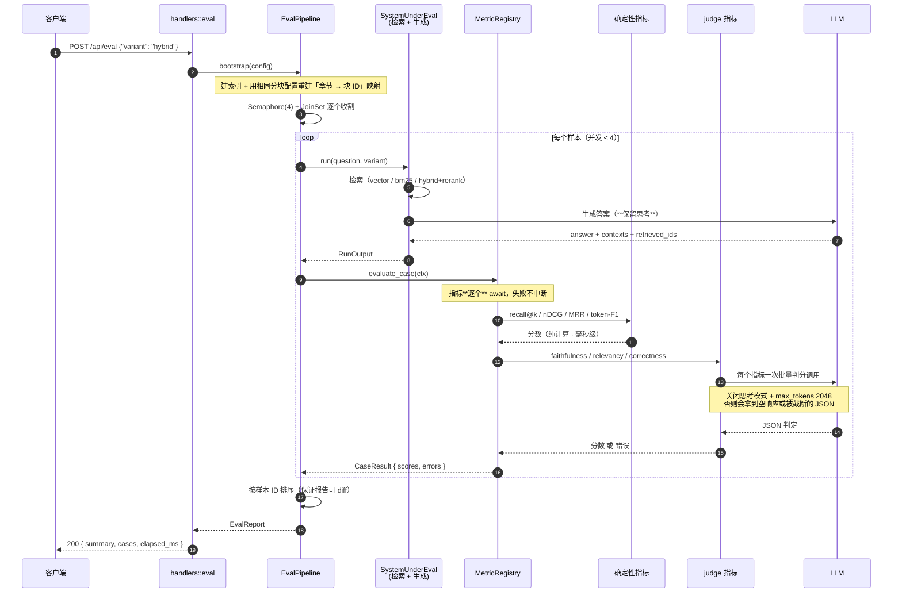
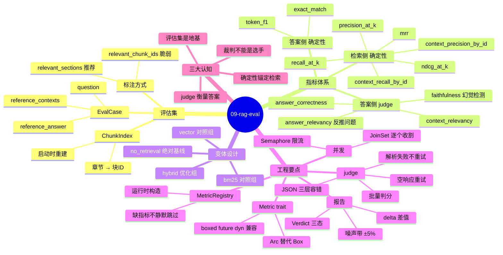

# 09-rag-eval — 手撕 RAG 评估（Evaluation）与优化前后对比

前面 8 个项目把 RAG 链路**建**起来了。但每一个都在回答同一个问题：

> **「我这个改动到底有没有用？」**

而 06/07/08 的答案是「看起来有用」—— 靠肉眼看召回结果、靠感觉判断答案变好了。
**这不是工程**。

本项目把「看起来有用」变成**「可复现的差值」**。

对应文档：
- [RAGAs 评估框架](https://docs.ragas.io/en/latest/index.html)（指标定义的主要来源）
- [FlashRAG](https://github.com/RUC-NLPIR/FlashRAG)（检索指标的来源）
- [DeepEval](https://github.com/confident-ai/deepeval)（RAGAS 聚合口径，交叉验证用）
- [LightEval](https://github.com/huggingface/lighteval)（模型级 benchmark，不在 RAG 范围）

```text
              08-rag（被评估的系统）              09-rag-eval（本项目）
─────────────────────────────────      ─────────────────────────────────
问题 ──> BM25 路 ──┐                      评估集（地面真相）
       向量语义路 ──┴─ RRF ─> 重排 ─> LLM      │
       top-k 上下文                          ┌──┴──┐
                                          ▼     ▼
                                      baseline  optimized
                                      （只走向量）（混合+重排）
                                          │     │
                                          └─┬───┘
                                            ▼
                                     指标计算（确定性 + judge）
                                            │
                                       对比报告（差值表）★
```

## 快速开始

```bash
export DEEPSEEK_API_KEY=sk-...   # 生成 + judge 都要调模型

make demo      # 快速演示：跑一条评估集，打印详细结果
make compare   # 优化前后对比（vector vs hybrid）★ 核心产出
make eval      # 完整评估（所有变体）
make serve     # 启动 HTTP 服务（127.0.0.1:3030）
make test      # 单元 + 集成测试（不调 LLM，零网络）
```

> 也可直接 `cargo run -p rag-09 -- compare` 等，`make` 只是包了一层。

首次运行会下载模型到 workspace 根目录的 `.fastembed_cache/`：

| 模型 | 用途 | 大小 |
|---|---|---|
| `intfloat/multilingual-e5-small` | 嵌入（检索 + 语义相似度指标） | ~470MB |
| `BAAI/bge-reranker-base` | 交叉编码器（重排） | ~1.1GB |

## 项目结构

```text
09-rag-eval/
├── data/
│   └── eval_cases.json       # 评估集（22 个样本，标注章节标题）
├── src/
│   ├── config.rs             # 配置（默认值 < 环境变量）
│   ├── error.rs              # 统一错误 → HTTP 状态码映射
│   ├── dataset.rs            # ★ 评估集 + 「章节 → 块 ID」映射
│   ├── metrics/
│   │   ├── types.rs          #   Metric trait / EvalContext / MetricScore
│   │   ├── deterministic.rs  # ★ recall@k / nDCG / MRR / token F1
│   │   └── judge.rs          # ★ faithfulness / relevancy / correctness
│   ├── report.rs             # ★ 报告 + 对比报告
│   ├── pipeline.rs           # 编排：跑系统 → 算指标 → 出报告
│   └── api/
│       ├── mod.rs            #   共享状态
│       ├── models.rs         #   请求 / 响应模型（API 契约）
│       ├── extract.rs        #   自定义 JsonBody 提取器
│       ├── handlers.rs       #   处理器
│       └── routes.rs         #   路由表 + 中间件
├── main.rs                   # 入口：eval / compare / demo / serve 四种模式
└── tests/
    └── integration.rs        # 集成测试（用 ScriptedLlm，零网络）
```

---

## 架构全景



> ⚠️ 注意 `MetricRegistry` 是**运行时构造**的 —— judge 指标依赖 `Llm`，
> 语义指标还依赖 `Embedder`，这些只有运行时才有。
> 没配 API key 时**不注册** judge 指标（而不是启动就报错）。

---

## 评估流水线：从问题到差值



### 一次评估运行的完整时序



### 关键路径的三条铁律

| 规则 | 原因 | 代码位置 |
|---|---|---|
| **judge 批量判分**，不逐句调用 | 逐句 = N 次网络往返（22 样本 × 8 句 ≈ 176 次），根本跑不动 | `judge.rs` `parse_sentence_verdicts` |
| **judge 关闭思考模式** | 推理模型的思考 token 和正文共用 `max_tokens`，会把正文吃光 | `config.rs` `judge_disable_reasoning` |
| **失败 ≠ 0 分** | 「算出来是 0」和「没算出来」语义完全不同 | `CaseResult { scores, errors }` |

---

## 思维导图：整个评估体系



---

## 一、核心认知

### 1. 评估集是地基

评估集标错了，后面全是错的 —— **而且不会报错**。

本项目最隐蔽的一个坑：

```text
块 ID = "{文件名}#{块序号}"
       ▲           ▲
       │           └── 由「分块配置」决定！
       └── 来自文档加载
```

块序号是**分块的产物** —— 改一下 `chunk_size`，同一个段落的块序号就变了，
评估集里所有相关块 ID 全部失效，召回率恒为 0，**且没有任何报错**。

所以本项目的评估集支持两种标注方式：

```json
{
  "id": "bm25-formula",
  "question": "BM25 打分公式是什么",
  "reference_answer": "BM25 由 IDF、词频饱和、长度归一化三部分组成……",
  "reference_contexts": ["……"],
  "relevant_sections": ["BM25 打分算法"]     // ← 推荐：和分块配置无关
}
```

`relevant_sections` 标注**章节标题**，运行时按当前分块配置翻译成块 ID。
标题是文档的**事实**，块 ID 是分块的**产物** —— 用标题标注，改 `chunk_size` 不会让评估集失效。

启动时还会主动检查标注是否对得上：

```
⚠ 以下样本的相关块标注没对上（召回指标会是 0）: bm25-formula
  → 检查章节名是否和知识库标题完全一致，或直接改用 relevant_chunk_ids
```

### 2. 指标必须分成两组

| | 确定性指标 | LLM-as-a-judge 指标 |
|---|---|---|
| 例子 | recall@k、nDCG、token F1 | faithfulness、answer relevancy |
| 速度 | 毫秒 | 秒 |
| 成本 | 零 | 每条样本几分钱 |
| 可复现 | ✅ 完全确定 | ⚠️ 有抖动 |

如果只有 judge 指标，「优化后涨了 0.05」这个结论**不可信** ——
judge 自身的抖动就有 ±0.05。

所以本项目的策略是：

- **用确定性指标锚定「检索准不准」**（地基）
- **用 judge 指标衡量「答案好不好」**（补充）

### 3. 差值要有噪声带

```rust
pub enum Verdict {
    Improved,   // 差值 ≥ 0.05
    Regressed,  // 差值 ≤ -0.05
    Unchanged,  // 差值在 ±0.05 之间
}
```

小于 5% 的差值**不能**当成真实收益 —— 那多半是 judge 的抖动。

### 4. 失败 ≠ 0 分

```rust
pub struct CaseResult {
    pub scores: BTreeMap<String, MetricScore>,   // 算出来了的
    pub errors: BTreeMap<String, String>,        // 算失败的
}
```

「指标算出来是 0 分」和「指标没算出来」是两回事。
如果都塞进 `scores`，用户会以为「faithfulness 是 0 分」，而不是「faithfulness 没跑」。

### 5. 裁判不能是选手

`judge 模型` 应该和 `生成模型` **不同** —— 同模型自评有系统性偏高。

```bash
EVAL_GENERATION_MODEL=deepseek-flash
EVAL_JUDGE_MODEL=gpt-4o-mini     # ← 不同的模型
```

---

## 二、指标体系

### 检索侧（确定性，无 API 费用）

| 指标 | 来源 | 公式 | 回答什么问题 |
|---|---|---|---|
| `recall_at_k` | FlashRAG | `\|检索前k ∩ 相关\| / \|相关\|` | 正确答案在候选集里吗？ |
| `precision_at_k` | FlashRAG | `\|检索前k ∩ 相关\| / k` | 捞进来的是不是都对？ |
| `ndcg_at_k` | FlashRAG | `DCG / IDCG`（`2^-i` 折损） | 正确答案排得够靠前吗？ |
| `mrr` | FlashRAG | `1 / 第一个相关结果的排名` | 第一个正确结果多靠前？ |
| `context_precision_by_id` | RAGAs (ID 版) | `相关块数 / 检索总数` | 检索结果里有多少是相关的？ |
| `context_recall_by_id` | RAGAs (ID 版) | `被召回的相关块 / 全部相关块` | 相关块都找到了吗？ |

**recall 和 precision 要一起看**：

| recall | precision | 含义 | 该做什么 |
|---|---|---|---|
| 高 | 高 | 完美 | — |
| 低 | 高 | 相关块没被召回 | 加大候选池 / 调排序 |
| 高 | 低 | 召回了但混进噪声 | 加阈值 / 加重排 |
| 低 | 低 | 检索基本失效 | 换嵌入模型 / 换分块策略 |

**recall vs nDCG vs MRR**：

- `recall` 只看「有没有」，**完全忽略位置**
- `nDCG` 看整个排序，位置越靠前分越高
- `MRR` **只看第一个**正确结果在哪

### 答案侧

| 指标 | 来源 | 类型 | 问的问题 |
|---|---|---|---|
| `token_f1` | FlashRAG | 确定性 | 答案和标准答案的 token 重合度 |
| `exact_match` | FlashRAG | 确定性 | 归一化后是否逐字一致（几乎必然低，作为下界参照） |
| `faithfulness` | **RAGAs** | judge | 答案里每句话都有据可依吗？（**幻觉检测**） |
| `answer_relevancy` | **RAGAs** | judge | 答案和问题相关吗？ |
| `context_relevancy` | **RAGAs** | judge | 检索到的上下文和问题相关吗？ |
| `answer_correctness` | **RAGAs** | judge | 答案和标准答案说的是一回事吗？ |

### judge 指标的三个可靠性前提

1. **结构化输出** —— judge 必须返回 JSON（分数 + 理由），解析失败 = 这次评估失败（可降级），**不是静默 0 分**
2. **低温度** —— 温度必须低（默认 0.0），否则同一份输入会得到不同分数
3. **要求给出理由** —— 没有理由的分数不可解释

`faithfulness` 的实现（**拆句判**而不是整段判）：

```text
1. 把答案拆成陈述句
2. 对每句问 judge：「这句能不能从上下文推出来？」
3. 忠实度 = 有依据的陈述数 / 总陈述数
```

整段判的问题是「3 句对 1 句错，judge 给 0.75」—— 你不知道错在哪句。
拆句判能得到「第 3 句无依据」这样的定位信息。

`answer_relevancy` 的实现（**反推问题法**，RAGAs 官方做法）：

```text
1. 让模型从答案反推出问题
2. 把反推的问题和原问题算语义相似度（用嵌入模型）
3. 相似度就是 relevancy
```

为什么不用「答案 vs 标准答案」？因为措辞不同是正常的，
而「答案 vs 问题的相关性」是更本质的性质 —— 它还能检测**答非所问**。

---

## 三、评估变体

| 变体 | 检索策略 | 角色 |
|---|---|---|
| `no_retrieval` | 不检索，直接问模型 | **绝对基线** —— RAG 比直接问模型强多少？ |
| `vector` | 只走向量 | **对照组** —— 06-rag 的水平 |
| `bm25` | 只走 BM25 | **对照组** —— 关键词路的天花板 |
| `hybrid` | 混合 + 重排 | **优化组** —— 08-rag 的水平 |

`no_retrieval` 这一档极其重要 —— 它回答「**RAG 到底值多少**」。
没有这个基线，所有 RAG 的提升都缺少参照系。

> ⚠️ `no_retrieval` 的分数不会是 0 —— 模型的先验知识里有一部分答案。
> 这个分数就是「模型本来就知道多少」，RAG 要做的是**在这个基础上补上它不知道的**。

---

## 四、HTTP API

| 方法 | 路径 | 说明 |
|---|---|---|
| GET | `/` | 服务信息 + 评估集状态 |
| GET | `/health` | 健康检查 |
| GET | `/api/dataset` | 评估集详情（**标注是否有效**） |
| POST | `/api/eval` | **完整评估**（多变体对比）★ |
| POST | `/api/quick-eval` | 快速评估单个问题 |

### `GET /api/dataset` —— 标注体检

```bash
curl -s localhost:3030/api/dataset | jq '.cases[] | select(.has_relevant == false)'
```

这个端点把「每个样本解析出了几个相关块」直接暴露出来 ——
一眼就能看出标注是否有效。这是防「静默失败」的关键。

### `POST /api/eval` —— 核心端点

```bash
curl -s localhost:3030/api/eval -H 'Content-Type: application/json' -d '{
  "variants": ["no_retrieval", "vector", "bm25", "hybrid"]
}' | jq '.comparison'
```

响应里 `comparison.deltas` 是核心产出：

```json
{
  "deltas": [
    { "name": "recall_at_k",   "baseline": 0.62, "optimized": 0.91, "delta": 0.29,  "verdict": "improved" },
    { "name": "ndcg_at_k",     "baseline": 0.55, "optimized": 0.83, "delta": 0.28,  "verdict": "improved" },
    { "name": "faithfulness",  "baseline": 0.78, "optimized": 0.86, "delta": 0.08,  "verdict": "improved" },
    { "name": "token_f1",      "baseline": 0.41, "optimized": 0.43, "delta": 0.02,  "verdict": "unchanged" }
  ]
}
```

### `POST /api/quick-eval` —— 单点调试

```bash
curl -s localhost:3030/api/quick-eval -H 'Content-Type: application/json' -d '{
  "question": "BM25 打分公式是什么",
  "reference_answer": "BM25 由 IDF、词频饱和、长度归一化组成……",
  "relevant_sections": ["BM25 打分算法"],
  "metrics": ["token_f1", "faithfulness"]
}'
```

> ⚠️ **单样本分数不能用来做优化决策** —— 一个样本的波动可能很大。
> 做决策要看 `/api/eval` 的整集聚合分数。

---

## 五、指标的实现细节

### `Metric` trait 为什么是 boxed future

和 07 的 `QueryTransformer` / 08 的 `Reranker` 完全一样的理由：

```text
async fn      →  fn f() -> Pin<Box<dyn Future<Output = T> + Send + '_>>
```

trait 要 dyn 兼容（要能塞进 `Box<dyn Metric>`），
而 Rust 的 `async fn` 和 RPITIT 都**不是** dyn 兼容。

### `Metric` trait 为什么不是枚举

因为指标的**依赖不同**：

- 确定性指标（token F1、recall@k）什么都不需要
- LLM judge 指标需要一个 `Llm`
- 语义相关度指标还需要一个 `Embedder`

用 trait，依赖在**构造时**注入好了 —— 指标自己不管依赖从哪来。

### judge 的 JSON 解析要容错

LLM 的 JSON 输出有各种「小毛病」：

- 裹在 ```` ```json ```` 代码块里
- 前后有解释文字
- 用了单引号
- 分数写成了 `"0.85"`（字符串）

这些**不是错误** —— 是模型的自然输出习惯。
直接 `serde_json::from_str` 会失败，然后整次评估挂掉 —— 太脆了。

所以做了三层兜底：剥代码块 → 提取最外层 `{...}`（配对括号计数，跳过字符串字面量）→ 数值字段容错。

### 嵌入是 CPU 密集的同步调用

```rust
tokio::task::spawn_blocking(move || { ... })
```

直接调会**阻塞 tokio 的工作线程** —— 一次几十到几百毫秒，期间同线程上的其它请求全被卡住。

### judge 要批量调用，不要逐句调用

这是本项目踩过的一个真实的性能坑。

「拆句判」听起来更精确，但**逐句调用是 N 次网络往返**：

```text
逐句调用：22 样本 × 平均 8 句 = 176 次 LLM 调用 → 好几分钟
context_relevancy 更糟：上下文有 20~40 句 → 近千次调用 → 根本跑不动
```

所以改成**一次调用处理所有句子**：

```json
{ "scores": [1.0, 0.0, 1.0], "reasons": ["", "这句上下文没有提到", ""] }
```

既省了 8 倍的往返，又**保留了逐句定位能力** —— 哪个句子是幻觉照样能指出来。

⚠️ 批量返回的数组长度可能和输入对不上（少给、多给、空数组）。
处理策略见 [`parse_sentence_verdicts`](src/metrics/judge.rs)：
**按能拿到的分数算，缺的按 0 分补齐** —— 宁可低估，不要高估。

### judge 调用要重试

实测发现 judge 偶尔会返回**空响应** —— 网络抖动或上游限流的瞬时故障。

```text
"faithfulness": 0.0, "reason": "计算失败: 评估判定失败: judge 输出里找不到 JSON: "
```

注意这个分数是 **0.0 但标了「计算失败」** —— 这正是「失败 ≠ 0 分」的价值：
它不会被误读成「答案有幻觉」。

但**不该因为一次抖动就丢掉整个指标的评估**，所以加了有限次重试：

| 失败类型 | 重试？ | 理由 |
|---|---|---|
| 空响应 | ✅ 重试 | 瞬时故障，重试就好 |
| 调用出错（网络） | ✅ 重试 | 同上 |
| **解析失败** | ❌ 不重试 | 模型确实返回了看不懂的内容，重试也是同样结果 |

解析失败不重试是有意的 —— 重试只浪费时间和 API 费用。
这种情况应该**如实记为失败**，让报告暴露「judge 提示词需要改」这个事实。

### 评估要并发，但并发度不能高

每个样本要跑 1 次生成 + 4~5 次 judge 调用。串行跑 22 个样本要好几分钟。

用 `JoinSet` + `Semaphore` 限流（默认 4）：

- `JoinSet` 而不是 `join_all` —— 后者要等**全部**完成才返回，
  一个样本卡住整个评估就卡住；`JoinSet` 可以逐个收割
- `Semaphore` 限流 —— 无限并发会打爆上游限流，拿到一堆 429，反而更慢

⚠️ **别把并发调太高** —— 重排是 **CPU 密集**的（cross-encoder 逐条推理），
并发 8 时 CPU 会跑到 200%，互相抢 CPU 后单任务变慢，整体未必更快。

⚠️ 并发完成顺序不确定，所以结果按**样本在评估集里的下标**排序 ——
否则两次运行的报告无法 diff。

---

## 六、配置

| 环境变量 | 说明 | 默认 |
|---|---|---|
| `EVAL_DATA_DIR` | 知识库目录 | `08-rag/data` |
| `EVAL_INDEX_PATH` | 索引路径 | `09-rag-eval/index/index.faiss` |
| `EVAL_DATASET` | 评估集路径 | `09-rag-eval/data/eval_cases.json` |
| `EVAL_REPORT_DIR` | 报告输出目录 | `09-rag-eval/reports` |
| `EVAL_VARIANTS` | 逗号分隔的变体 | 全部 |
| `EVAL_JUDGE_ENABLED` | 是否启用 judge 指标 | `true` |
| `EVAL_JUDGE_MODEL` | judge 模型 | `deepseek-flash` |
| `EVAL_JUDGE_TEMPERATURE` | judge 温度 | `0.0` |
| `EVAL_JUDGE_MAX_TOKENS` | judge 的 max tokens | `2048` |
| `EVAL_JUDGE_DISABLE_REASONING` | 是否关闭 judge 模型的「思考」 | `true` |
| `EVAL_GENERATION_MODEL` | 生成模型 | `deepseek-flash` |
| `EVAL_GENERATION_TEMPERATURE` | 生成温度 | `0.1` |
| `EVAL_TOP_K` | 检索 top-k | `4` |
| `EVAL_RERANK_ENABLED` | 是否启用重排 | `true` |
| `EVAL_CONCURRENCY` | 评估并发度 | `4` |

---

## 日志

全仓库统一走 `00-logging`（`agent-logging`）。

```bash
RUST_LOG=info cargo run -p rag-09 -- compare
RUST_LOG=debug,rag_09=trace cargo run -p rag-09 -- quick
```

| 事件 | 级别 | 关键字段 |
|---|---|---|
| 组件装配（加载索引 / 评估集 / 指标注册表） | `INFO`（`stage_guard`） | 阶段耗时 |
| 变体评估开始 / 结束 | `INFO` | `variant` / `case_count` / `failed` / `elapsed_ms` |
| 单样本的检索 / 生成 / 打分 | `DEBUG` | `case_id` / `variant` |
| judge 调用失败（该样本指标记为失败） | `WARN` | `case_id` / `metric` / `error` |
| 报告产出（基线 vs 优化后差值） | `INFO` | `report_dir` / 差值汇总 |
| 参数非法（400） | `WARN` | `status` / `error` |
| 存储 / 内部错误（500） | `ERROR` | `status` / `error` |

HTTP 层用 `agent_logging::trace_layer()`。

---

其它环境变量（`DEEPSEEK_API_KEY` 等）沿用 06/07/08 的约定。

### ⚠️ 关于「思考模式」和 `max_tokens`

这一条踩过坑，值得单独说。

DeepSeek / Qwen 这类**推理模型**默认会先「思考」再回答，
而且**思考的 token 和正文共用 `max_tokens` 预算**。

实测（`deepseek-flash`，`max_tokens = 1024`，judge 提示词）：

```text
思考开启：reasoning_tokens = 1024，completion_tokens = 1024
          → 正文长度 0，finish_reason = length   ← 什么都没拿到
思考关闭：completion_tokens = 78
          → 正文长度 111，finish_reason = stop     ← 正常
```

也就是说：**推理模型 + 小 `max_tokens` = 输出被思考吃光**。

在本项目里这会表现成 judge 指标大面积「计算失败」，
错误信息是 `judge 输出里找不到 JSON: `（后面什么都没有）——
因为正文确实是空的。

所以本项目的默认策略是：

| 场景 | 思考 | max_tokens | 理由 |
|---|---|---|---|
| **judge 指标** | **关闭** | 2048 | 结构化短输出，要稳定不要花哨 |
| **生成答案** | 开启 | 2000 | 问答质量需要推理，预算给够 |

⚠️ 如果你换成一个**不思考**的模型，把 `EVAL_JUDGE_DISABLE_REASONING`
设成 `false` 也无所谓（那个参数对非推理模型无影响）。

---

## 七、报告长什么样

### 一次真实的运行结果

下面是本项目在 **22 样本 × 2 变体**上的真实输出（`make compare`）：

```text
=== 对比报告 ===
基线: 09-rag-eval · Vector 评估
优化: 09-rag-eval · Hybrid 评估

指标                              基线        优化后         差值  结论
---------------------------------------------------------------------
token_f1                    0.6112     0.6255    +0.0144  → 持平
exact_match                 0.0000     0.0000    +0.0000  → 持平
recall_at_k                 1.0000     1.0000    +0.0000  → 持平
precision_at_k              0.2614     0.2614    +0.0000  → 持平
ndcg_at_k                   0.9924     0.9924    +0.0000  → 持平
mrr                         1.0000     1.0000    +0.0000  → 持平
context_precision_by_id     0.2614     0.2614    +0.0000  → 持平
context_recall_by_id        1.0000     1.0000    +0.0000  → 持平
faithfulness                0.9551     0.9486    -0.0065  → 持平
answer_correctness          0.8952     0.9667    +0.0714  ↑ 变好
answer_relevancy            0.9660     0.9612    -0.0048  → 持平
context_relevancy           1.0000     1.0000    +0.0000  → 持平

=== 结论 ===
  ↑ answer_correctness: 0.8952 → 0.9667（+0.0714）
```

### 这个结果说明了什么

**这是本项目最有价值的一课** —— 评估报告揭示了三件「靠肉眼看不出来」的事：

**① 混合检索提升的是「答案质量」，不是「召回率」**

所有检索指标都是 0 差值。这不是「混合检索没用」，而是**召回率本来就满了** ——
知识库只有 11 个块，`top_k=4` 已经把相关块捞进来了，**没有提升空间**。

真正变好的是 `answer_correctness`（+0.07）——
混合检索 + 重排把「一堆带噪声的上下文」换成了「更精准的上下文」，
所以模型基于它给出的答案更接近标准答案。

> **教训**：只测「召回率」会漏掉混合检索真正的价值。
> 必须同时测**答案侧**的指标。

**② `precision_at_k` 只有 0.26，但不是系统的错**

`precision_at_k = 相关块数 / 检索总数 = 1 / 4 ≈ 0.25`。
知识库总共 11 个块，标注的相关块只有 1 个 —— 剩下 3 个**必然是噪声**。

这是**评估集规模**和**知识库规模**不匹配导致的，不是检索质量问题。
真实的知识库有几千个块时，这个指标才有意义。

**③ 噪声带救了我们**

`faithfulness` 差了 -0.0065，`answer_relevancy` 差了 -0.0048。
如果不做噪声带判断，这两个会被标成「变差了」—— **但它们就是 judge 的抖动**。

这就是 `Verdict::Unchanged` 存在的意义。

### 报告的明细部分

```text
=== 09-rag-eval · Hybrid 评估 ===
模式: hybrid | 评估集: kb-eval | 样本数: 22 | 耗时: 48213ms

指标           平均分      最低      最高   通过率   样本
--------------------------------------------------
token_f1          0.6255   0.0000   0.7812    0.36     22
recall_at_k       1.0000   1.0000   1.0000    1.00     22
faithfulness      0.9486   0.5000   1.0000    0.91     22
...

最差样本（平均分 0.3542）:
  ID: bm25-formula
  问: BM25 打分公式是什么
  答: 根据现有资料，无法给出完整的 BM25 打分公式……

    [token_f1]      0.3660 —— precision=0.234 recall=0.835 共同 token=71
    [precision_at_k] 0.2500 —— 前 5 条中 1 条相关
    [faithfulness]   0.5000 —— 1/2 句有依据；问题：「XXX」无依据
```

最差样本会附带**具体理由** —— 这才是评估报告的价值：
**能指导下一步该修什么**，而不是一堆孤零零的数字。

---

## 八、测试

```bash
make test
```

**全部测试不需要网络、不需要 API key** —— LLM 用 07 的 `ScriptedLlm` 替身。

| 层次 | 数量 | 覆盖什么 |
|---|---|---|
| 单元测试 | 67 | 指标公式、JSON 解析、judge 重试、报告聚合、差值计算、章节映射 |
| 集成测试 | 10 | 评估集加载 → 标注解析 → 指标计算 → 报告 → 对比 |

集成测试里最关键的一条是 `judge_failure_is_recorded_not_fatal` ——
它验证了「judge 挂了不会让整次评估失败」这个降级语义。

---

## 九、和其它项目的关系

| 项目 | 提供什么 | 本项目怎么用 |
|---|---|---|
| 04-rag | `Splitter` / `loader` | 重建「章节 → 块 ID」映射 |
| 05-rag | `Embedder` / `chunk_id` | 语义相似度指标 + 块 ID 生成 |
| 06-rag | `prompt` / `config` | Prompt 组装 + 嵌入模型枚举 |
| 07-query | `Llm` / `ScriptedLlm` | judge 依赖 + 测试替身 |
| 08-rag | `HybridPipeline` / `SearchMode` / `tokenize` | **被评估的系统本体** |

⚠️ **08-rag 的配置是通过 `EvalConfig::to_rag_config()` 转换的，不是抄一份** ——
抄一份的话，08 改了参数 09 不会跟着改，对比实验就失去意义了。

---

## 十、技术参考速查

### 评估指标公式全表

| 指标 | 方向 | 公式 | 典型值 | 失败信号 |
|---|---|---|---|---|
| `recall_at_k` | 越大越好 | `\|前k∩相关\| / \|相关\|` | 1.0 | 0 → 检索没召回 |
| `precision_at_k` | 越大越好 | `\|前k∩相关\| / k` | 0.26 | 低 → 混进噪声 |
| `ndcg_at_k` | 越大越好 | `DCG/IDCG`，`DCG = Σ 2^-i · rel_i` | 0.99 | 低 → 排序差 |
| `mrr` | 越大越好 | `1/第一个相关结果的排名` | 1.0 | 低 → 正确结果排太后 |
| `context_precision_by_id` | 越大越好 | `相关块数 / 检索总数` | 0.26 | 低 → 噪声多 |
| `context_recall_by_id` | 越大越好 | `被召回相关块 / 全部相关块` | 1.0 | 0 → 漏召回 |
| `token_f1` | 越大越好 | `2PR/(P+R)`，中文按 unigram+bigram | 0.63 | 低 → 答案措辞差异大 |
| `exact_match` | 越大越好 | 归一化后逐字相等 | 0.0 | **天然接近 0，作为下界参照** |
| `faithfulness` | 越大越好 | `有依据的陈述数 / 总陈述数` | 0.95 | 低 → **幻觉** |
| `answer_relevancy` | 越大越好 | `反推问题` 与 `原问题` 的嵌入余弦 | 0.97 | 低 → 答非所问 |
| `context_relevancy` | 越大越好 | `上下文推问题` 与 `原问题` 的嵌入余弦 | 1.00 | 低 → 检索内容跑题 |
| `answer_correctness` | 越大越好 | `答案` 与 `标准答案` 的语义对齐分 | 0.97 | 低 → 答错/答偏 |

### 指标选择的决策树

```text
问「正确答案在候选集里吗？」
  └─→ recall_at_k

问「正确的结果排得够靠前吗？」
  └─→ ndcg_at_k（看整体排序）
  └─→ mrr（只看第一个）

问「捞进来的是不是都对？」
  └─→ precision_at_k

问「答案里有没有编造的内容？」
  └─→ faithfulness ★ 最重要的幻觉检测

问「答案答的是不是这个问题？」
  └─→ answer_relevancy

问「检索到的内容和问题相关吗？」
  └─→ context_relevancy

问「答案和标准答案说的是一回事吗？」
  └─→ answer_correctness
```

### judge 提示词的关键约束

| 约束 | 原因 | 不遵守的后果 |
|---|---|---|
| **返回 JSON** | 解析失败 = 这次评估失败 | 整条样本的 judge 指标全废 |
| **JSON 数组与输入等长** | 逐句定位靠下标对应 | 句子和分数对不上，定位信息全错 |
| **温度 0.0** | 同样的输入要得到同样的分数 | 差值小于噪声带，无法判断收益 |
| **必须给理由** | 没理由的分数不可解释 | 知道「0.6 分」，不知道错在哪句 |
| **关闭思考模式** | 推理 token 吃 `max_tokens` 预算 | 正文为空，`finish_reason: length` |

### 降级语义对照表

| 环节失败 | 行为 | 报告里的表现 |
|---|---|---|
| 检索失败 | 用空上下文**继续**生成 | `errors` 里有记录，样本标记不可信 |
| 生成失败 | **跳过**该样本 | 不计入聚合 |
| judge 空响应 | 重试（有限次） | 重试成功则正常，失败则进 `errors` |
| judge 网络错误 | 重试（有限次） | 同上 |
| judge 解析失败 | **不重试** | 直接进 `errors` —— 重试也是同样结果 |
| 批量数组长度对不上 | 按拿到的算，缺的补 0 | 宁可低估，不要高估 |

### 评估结果的可信度分级

| 置信度 | 条件 | 能用来做什么 |
|---|---|---|
| 🟢 高 | 确定性指标，标注已验证 | 可作为优化决策依据 |
| 🟡 中 | judge 指标，样本数 ≥ 20，差值 > 5% | 可作为优化决策依据 |
| 🔴 低 | 单样本、judge 指标、差值 < 5% | **只能调试，不能决策** |

### 成本与耗时速查

| 项目 | 数值 | 说明 |
|---|---|---|
| judge 单次调用 | 几百毫秒 ~ 几秒 | 取决于模型和提示词长度 |
| 批量判分后单样本 judge | 1~2 次调用 | 对比逐句的 N 次 |
| 22 样本 × 4 变体总耗时 | 数分钟 | 批量化之后 |
| 单条 judge 调用成本 | 几分钱 | `deepseek-flash` 级别 |
| 并发度 | 4 | 太高会打爆上游限流 / 抢 CPU |

---

## 十一、下一步

| 方向 | 说明 |
|---|---|
| 加指标 | `answer_similarity`（DeepEval 风格）、`context_utilization`（上下文利用率） |
| 换 judge | 用本地模型做 judge（省 API 费用、可离线） |
| 回归测试 | 把评估接进 CI —— 每次改 prompt 都跑一遍，防止指标倒退 |
| 参数扫描 | 自动扫 `top_k` / `chunk_size` / `rerank_candidate_k`，找最优组合 |
| 多知识库 | 评估集按知识库拆分，各自维护标注 |
