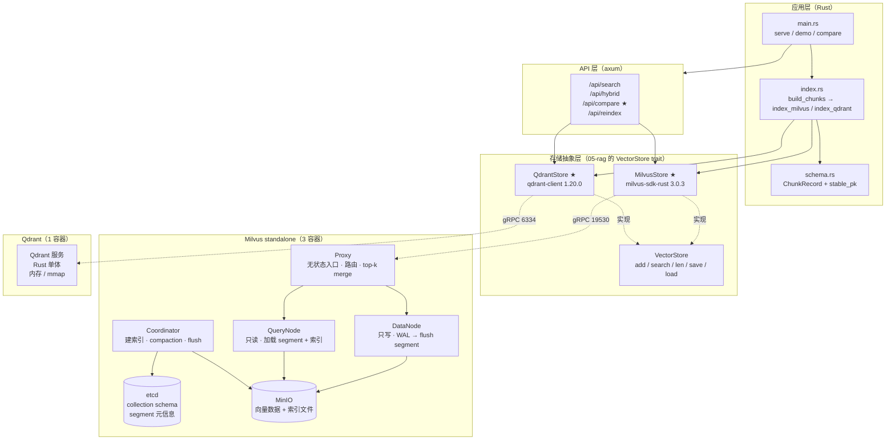
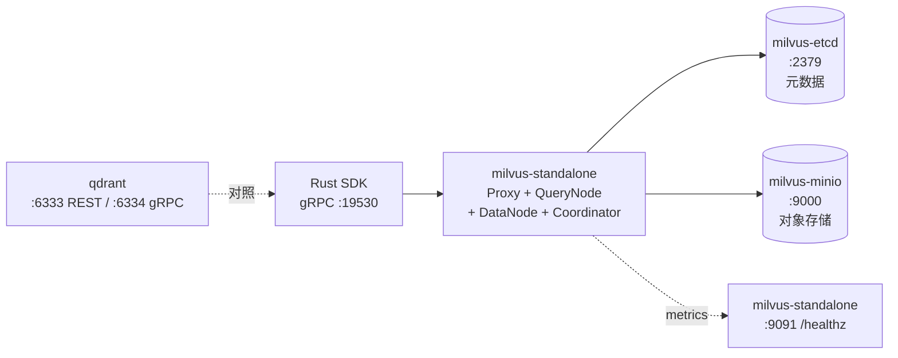
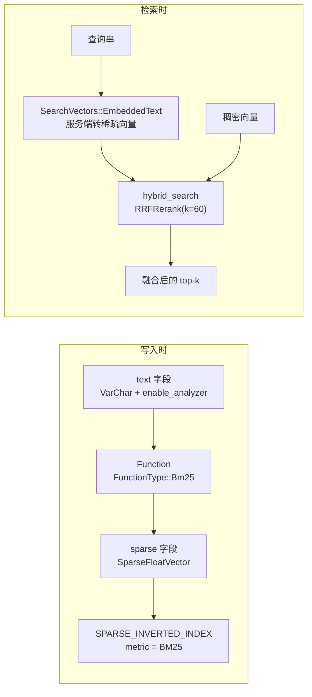
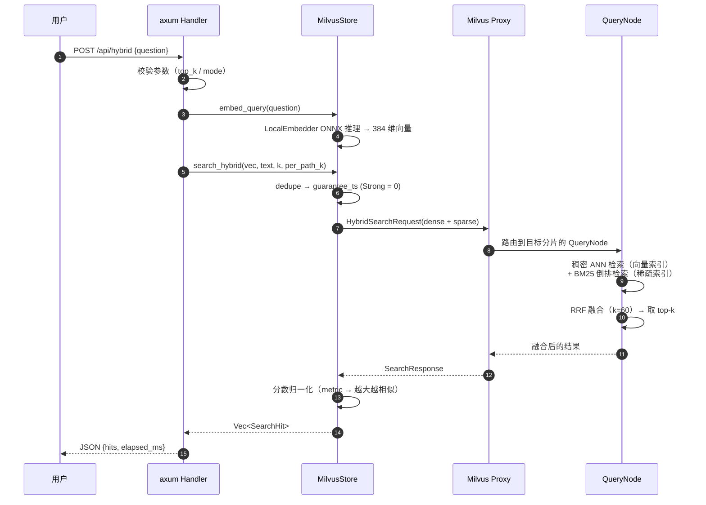
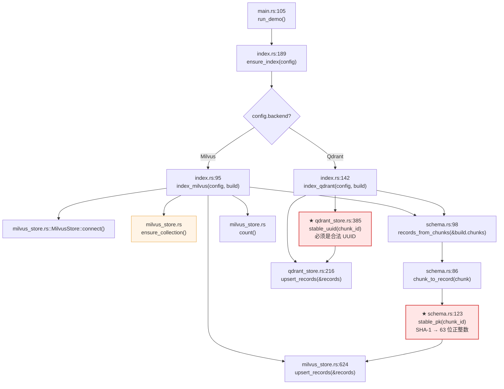
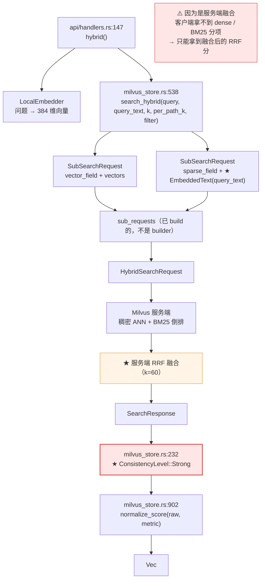
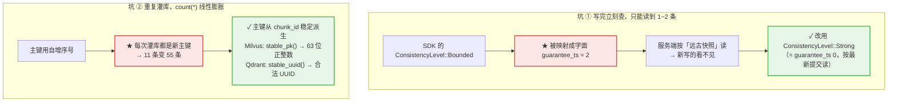
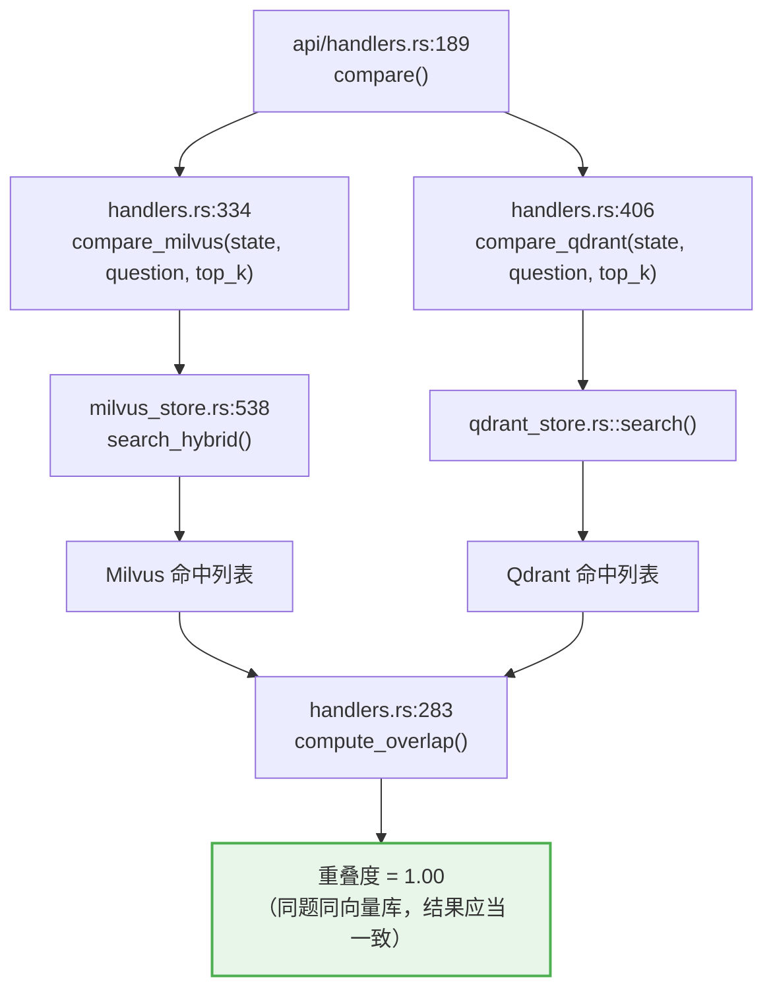
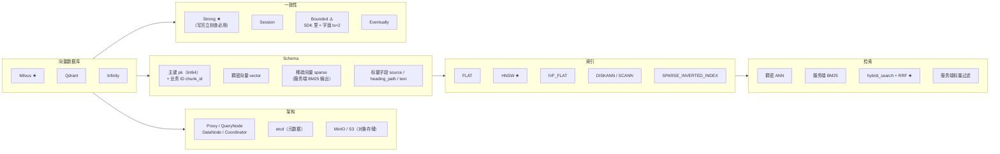

# 10-rag-milvus — 生产级向量数据库（Milvus）与横向选型对照

前面 9 个项目把 RAG 链路**建**起来了，但索引一直待在**进程内**（FAISS）或**玩具级 HTTP 服务**（Chroma）里：

| 项目 | 索引在哪 | 规模上限 | 多租户 | 混合检索 |
|---|---|---|---|---|
| 05-rag | 进程内 `.faiss` 文件 | 单机内存 | 无 | 无 |
| 06-rag | Chroma HTTP | 单机 | 无 | 无 |
| 08-rag | FAISS + 自写 BM25 | 单机内存 | 无 | 自己写 RRF |
| **10-rag-milvus** | **独立分布式服务** | **亿级** | **partition / resource group** | **服务端 BM25 + RRF** |

本项目把索引搬进**真正的生产级向量数据库**，并且 —— 这是关键 —— 把 **Milvus** 和 **Qdrant** 放在一起做**同题对照**。

对应文档：
- [Milvus 官方文档 · Install Standalone (Docker)](https://milvus.io/docs/install_standalone-docker.md)
- [Milvus Rust SDK (milvus-sdk-rust)](https://github.com/milvus-io/milvus-sdk-rust)
- [Qdrant 官方文档](https://qdrant.tech/documentation/)
- [Infinity（备选对照，本项目未部署）](https://github.com/infiniflow/infinity)

---

## 快速开始

```bash
make up          # 启动 Milvus standalone + Qdrant（docker compose）★
make demo        # 端到端：建索引 + 稠密检索 + 服务端混合检索
make compare     # Milvus ↔ Qdrant 同题对照 ★ 核心产出
make serve       # 启动 HTTP 服务（127.0.0.1:3030）
make test        # 单元 + 集成测试
```

> 也可直接 `cargo run -p rag-10 -- demo` 等，`make` 只是包了一层。

首次运行会下载嵌入模型（`intfloat/multilingual-e5-small`，约 470MB）到 workspace 根目录的 `.fastembed_cache/`。

---

## 项目结构

```text
10-rag-milvus/
├── data/
│   └── kb.md                 # 语料：讲向量数据库自己的知识库
├── docker/
│   └── docker-compose.yml    # ★ etcd + MinIO + Milvus + Qdrant
├── src/
│   ├── config.rs             # 配置（默认值 < 环境变量）
│   ├── error.rs              # 统一错误 → HTTP 状态码映射
│   ├── schema.rs             # ★ ChunkRecord + stable_pk（稳定主键派生）
│   ├── milvus_store.rs       # ★ MilvusStore：实现 VectorStore trait
│   ├── qdrant_store.rs       # ★ QdrantStore：同一 trait 的另一实现
│   ├── index.rs              # 索引流水线（复用 05-rag 的切块 + 向量化）
│   ├── api/
│   │   ├── mod.rs            #   共享状态
│   │   ├── models.rs         #   请求 / 响应模型（API 契约）
│   │   ├── extract.rs        #   自定义 JsonBody 提取器
│   │   ├── handlers.rs       #   处理器
│   │   └── routes.rs         #   路由表 + 中间件
│   └── main.rs               # 入口：serve / demo / compare 三种模式
└── tests/
    └── integration.rs        # ★ 集成测试（需真实 Milvus + Qdrant）
```

---

## 架构全景



---

## Milvus standalone 部署

官方 standalone 是**三个容器**，不是一个大容器：



| 容器 | 职责 | 丢了会怎样 |
|---|---|---|
| `milvus-etcd` | collection schema、segment 元信息、别名 | **元数据丢失 = collection 不可见**（向量还在 MinIO） |
| `milvus-minio` | 向量数据、索引文件（WAL flush 后的 segment） | **数据丢失 = 需要从备份恢复** |
| `milvus-standalone` | Proxy + QueryNode + DataNode + Coordinator | 服务不可用，数据仍在 |
| `qdrant` | 横向对照对象 | 不影响 Milvus |

关键设计：**etcd 存元数据、对象存储存数据**。这个分层决定了备份策略 —— 两者要**一起**备份，不能只备一个。

```bash
cd 10-rag-milvus/docker
docker compose up -d       # 起三个 + 一个
docker compose ps          # 看健康状态
docker compose logs -f standalone
```

⚠️ 首次启动要 60~90 秒（建索引、加载模型），`healthcheck` 的 `start_period` 给到了 90s。

---

## SDK 使用要点（踩坑记录）

### 1. 不要 `use milvus::v2::prelude::*`

```rust
// ❌ 会把 milvus::v2::error::Result（1 个泛型参数）引入作用域，
//    遮蔽 std::Result<T, E>（2 个泛型参数），
//    然后全文件报 E0107: type alias takes 1 generic argument but 2 were supplied
use milvus::v2::prelude::*;

// ✅ 显式导入
use milvus::v2::client::ClientV2;
use milvus::v2::request::dql::{SearchRequest, HybridSearchRequest, SubSearchRequest};
use milvus::v2::types::{DataType, FieldData, SearchVectors, ConsistencyLevel};
```

### 2. `ConsistencyLevel::Bounded` 在 SDK 里被映射成「字面时间戳 2」

这是本项目**最隐蔽的一个坑**，症状是：

> 刚把 11 条数据灌进 Milvus，检索却只返回 1~2 条。

原因在 SDK 内部：

```rust
// milvus-sdk-rust 3.0.3 src/v2/client/cache.rs
match consistency {
    ConsistencyLevel::Strong | ConsistencyLevel::Customized => 0, // 0 = 读最新提交
    ConsistencyLevel::Eventually => 1,
    ConsistencyLevel::Bounded => 2,   // ← 字面 ts=2，读的是远古快照
    ConsistencyLevel::Session => /* 真实的 session ts */,
}
```

`Bounded` 在 SDK 里**不是**「集合级 Bounded（最新 ts − 延迟）」，
而是直接把 `guarantee_timestamp = 2` 发给服务端 —— 于是读到的是 ts=2 时刻的快照，
那时候一条数据都还没写进去。

**结论：写完立刻查，必须用 `Strong`。**

```rust
// ✅ 写完立刻查 —— 用 Strong
.consistency_level(ConsistencyLevel::Strong)
```

> 附带说明：用 REST API（`POST /v2/vectordb/entities/search`）测同样的问题，
> 默认走集合级 Bounded，能正常返回 5 条 —— 所以「REST 正常、SDK 不正常」时，
> 先怀疑 SDK 的参数映射。

### 3. 主键必须由业务 ID 稳定派生

如果主键用「自增序号」，每次灌库同一份语料都会新增一份数据：

```text
第 1 次灌库  → count(*) = 11
第 5 次灌库  → count(*) = 55   ← 5 份重复
```

而且检索结果里会混进同一段文本的多份副本。

正确做法：**主键 = f(chunk_id)**。

```rust
// schema.rs
pub fn stable_pk(chunk_id: &str) -> i64 {
    let digest = sha1::Sha1::digest(chunk_id.as_bytes());
    let mut bytes = [0u8; 8];
    bytes.copy_from_slice(&digest[..8]);
    // 只保留 63 位 —— 保证非负
    (u64::from_be_bytes(bytes) >> 1) as i64
}
```

Qdrant 侧同理 —— 但它更严格：**字符串 point id 必须是合法 UUID**，
传 `"kb.md#0"` 会报 `Unable to parse UUID`。所以那边派生的是 UUIDv5。

| 后端 | 主键类型 | 派生方式 | 幂等 |
|---|---|---|---|
| Milvus | Int64（不可 `auto_id`） | `stable_pk`（SHA-1 → 63 位正整数） | ✅ |
| Qdrant | UInt64 或 **UUID** | `stable_uuid`（UUIDv5） | ✅ |

### 4. BM25 函数字段只能声明一次

`text` 字段要开分析器才能喂给 BM25 函数。如果按「普通字段 + 带分析器字段」声明两次，
Milvus 会直接拒绝建表。

```rust
// ✅ 一份声明，按需开启分析器
let text_field = if config.enable_bm25 {
    FieldSchema::new()
        .name(self.schema.text_field.clone())
        .data_type(DataType::VarChar)
        .max_length(65535)
        .enable_analyzer(true)
} else {
    FieldSchema::new()
        .name(self.schema.text_field.clone())
        .data_type(DataType::VarChar)
        .max_length(65535)
};
```

### 5. `has_collection` 返回的是结构体不是 bool

```rust
// ❌ cannot apply unary operator '!' to type HasCollectionResponse
if !response { ... }

// ✅
if !response.exists() { ... }
```

### 6. `sub_requests` 要的是**构建好的**请求，不是 builder

```rust
// ❌ mismatched types: expected Vec<SubSearchRequest>, found Vec<SubSearchRequestBuilder>
sub_requests.push(sparse);

// ✅
sub_requests.push(sparse.build()?);
```

### 7. `VectorStore` 不是 dyn 兼容的

05-rag 的 `VectorStore` 用的是 RPITIT（`impl Future<Output = ...> + Send`），
所以**不能**写 `&mut dyn VectorStore`。泛型代码要写成：

```rust
pub fn as_vector_store<S: VectorStore>(store: &mut S) -> &mut S { store }
```

### 8. Qdrant 的 `Payload` 在 crate 根，不在 `qdrant` 模块

```rust
// ❌ no Payload in qdrant / module payload is private
use qdrant_client::qdrant::Payload;

// ✅
use qdrant_client::Payload;
```

### 9. Qdrant 的 `Query` 走 Universal Query API

```rust
// ❌ the trait From<query::Variant> is not implemented for Query
builder.query(qdrant::Query { variant: Some(...) });

// ✅ 直接传 VectorInput / TextQuery —— 有对应的 From 实现
builder.query(qdrant::VectorInput::from(vec.to_vec()));
builder.query(qdrant::TextQueryBuilder::new(text).build());
```

---

## 服务端混合检索（BM25 + RRF）

08-rag 是在 **Rust 侧**自己写倒排索引 + BM25 + RRF。
Milvus 把整套东西做成了**服务端函数**：



对应代码（`milvus_store.rs`）：

```rust
let dense = SubSearchRequest::builder()
    .vector_field(self.schema.vector_field.clone())
    .vectors(SearchVectors::Float(vec![query.to_vec()]))
    .limit(per_path_k as i64)
    .build()?;

let sparse = SubSearchRequest::builder()
    .vector_field(self.schema.sparse_field.clone())
    // EmbeddedText：告诉服务端「用 BM25 函数把这个文本转成稀疏向量」
    .vectors(SearchVectors::EmbeddedText(vec![query_text.to_string()]))
    .limit(per_path_k as i64)
    .build()?;

let request = HybridSearchRequest::builder()
    .collection_name(self.collection.clone())
    .sub_requests(vec![dense, sparse])
    // RRF：只看排名不看分数 —— 稠密和 BM25 的分数本来就不可比
    .rerank(RRFRerank::new().k(60))
    .limit(k as i64)
    .consistency_level(ConsistencyLevel::Strong)
    .build()?;
```

### RRF 的分数是「排名分」，不是相似度

RRF（Reciprocal Rank Fusion）的定义：

\[
\text{score}(d) = \sum_{i \in \text{lists}} \frac{1}{k + \text{rank}_i(d)}
\]

它**只看排名**，完全不看各路自己的分数 —— 因为余弦相似度（0~1）和 BM25 权重（无上界）
根本不可比。这也是为什么 `hybrid_search` 的输出分数只有 0.01~0.03，
**不能**跟稠密检索的 0.95 放在一起比较。

| 融合策略 | Milvus 类型 | 适用 |
|---|---|---|
| RRF | `RRFRerank::new().k(60)` | **默认** —— 两路分数不可比时 |
| Weighted | `WeightedRerank::new().weights([0.7, 0.3])` | 两路分数同量纲、可加权 |

### 服务端 vs 客户端混合检索

| | 08-rag（客户端） | **10-rag-milvus（服务端）** |
|---|---|---|
| 分词 | 自己实现 | 服务端分析器 |
| 倒排索引 | 自己维护（内存） | `SPARSE_INVERTED_INDEX`（落盘 + 压缩） |
| BM25 权重 | 自己算 | 服务端算（带 IDF 统计） |
| RRF 融合 | 自己写 | 服务端 `RRFRerank` |
| 网络往返 | 2 次（两路各查一次） | **1 次**（一次 `hybrid_search`） |
| segment 剪枝 | 无（两路都全扫） | 有 |

---

## 距离度量与分数归一化

这是接入任何向量库**最容易踩**的坑：不同后端的分数**方向和量纲都不一样**。

| 空间 | Milvus 返回 | 方向 | 归一化处理 |
|---|---|---|---|
| `COSINE` | 余弦相似度 | 越大越相似 | **直接用** ✅ |
| `IP` | 内积 | 越大越相似 | 归一化后 == 余弦，**直接用** ✅ |
| `L2` | **平方**欧氏距离 | 越小越相似 | `1 - d/2` ⚠️ |

原因：归一化向量下 \(d^2 = 2 - 2\cos\theta\)，所以

\[
\text{score} = 1 - \frac{d^2}{2} = \cos\theta
\]

代码里统一到 `SearchHit.score`（「越大越相似」）：

```rust
fn normalize_score(raw: f32, metric: MetricKind) -> f32 {
    match metric {
        MetricKind::Cosine | MetricKind::Ip => raw,
        // L2 返回平方距离 → 换算回余弦
        MetricKind::L2 => 1.0 - raw / 2.0,
    }
}
```

> 集成测试 `milvus_l2_scores_are_normalized` 就是断言这个换算方向 ——
> 同向向量换算后分数必须接近 1.0。

---

## Schema 设计

```text
pk           Int64             主键（stable_pk 派生，非自增）
chunk_id     VarChar           业务 ID —— `{文件名}#{序号}`
source       VarChar           来源文件
heading_path JSON              标题路径（数组）
text         VarChar           原文（BM25 的输入，开启分析器）
vector       FloatVector       稠密向量
sparse       SparseFloatVector BM25 稀疏向量（服务端生成，客户端不写）
```

为什么同时要 `pk` 和 `chunk_id`？

- `pk` 是 Milvus 的**主键** —— 类型受限（Int64 / VarChar），不可 `auto_id`
- `chunk_id` 是**业务身份** —— 换库、重建索引后仍然稳定

这跟数据库里「自增 ID」和「业务主键」的区别是一样的。

`sparse` 字段是**服务端函数输出** —— 客户端**不需要**（也不能）写这个字段。

---

## Milvus ↔ Qdrant 同题对照 ★

这是本项目的**核心产出**。选型不能靠「谁的名气大」，靠谱的做法是：
**同一份语料、同一套嵌入模型、同一批查询**，分别灌进两个库，用同一套指标对比。

### 三种向量库的定位

| | **Milvus** | **Qdrant** | **Infinity** |
|---|---|---|---|
| 架构 | 分布式（etcd + 对象存储 + 计算节点） | 单体服务（Rust 写） | 分布式（MPP + 对象存储） |
| 部署 | 3 容器 | **1 容器** | 多组件 |
| 全文检索 | 服务端 BM25 函数（稀疏向量） | payload text index + BM25 | 内置全文 + 向量 |
| 混合检索 | `hybrid_search` + RRF/Weighted | prefetch + `Fusion::Rrf` | 多路融合 |
| 分片 | 内建（shard / partition / resource group） | 分片键 + 多副本 | 分区表 |
| 内存模型 | segment 加载到 QueryNode | 内存 / mmap | 向量表 + 索引 |
| 运维复杂度 | 高 | **低** | 高 |
| 典型场景 | 亿级、多租户、有运维能力 | 中小规模、快速上线 | 分析型负载 |

选型建议：

- 数据量千万级以上、需要多租户隔离、团队有运维能力 → **Milvus**
- 中小规模、想快速上线、运维资源有限 → **Qdrant**
- 需要「向量 + 全文 + SQL」统一分析 → **Infinity**

### 对照怎么跑

```bash
make compare
```

输出形如：

```text
问: 什么是向量数据库
  milvus (5 条, 3ms):
    0.9506  kb.md#0  向量数据库知识库 > 向量数据库是什么
    0.9155  kb.md#1  向量数据库知识库 > 为什么需要专门的向量数据库
    ...
  qdrant (5 条, 2ms):
    0.9506  kb.md#0  向量数据库知识库 > 向量数据库是什么
    ...
```

HTTP 端点：

```bash
curl -s localhost:3030/api/compare -H 'Content-Type: application/json' \
  -d '{"question":"混合检索怎么融合两路结果","top_k":5}'
```

响应里除了两边的命中，还给出**重合度**和**重合的块 ID** ——
这才是「公平对照」该有的输出。

```json
{
  "question": "混合检索怎么融合两路结果",
  "results": [
    { "backend": "milvus", "ok": true, "count": 5, "elapsed_ms": 3, "hits": [...] },
    { "backend": "qdrant", "ok": true, "count": 5, "elapsed_ms": 2, "hits": [...] }
  ],
  "overlap": 1.0,
  "shared_ids": ["kb.md#6", "kb.md#1", "kb.md#7", "kb.md#9", "kb.md#5"]
}
```

集成测试 `both_backends_agree_on_top_result` 断言：
两边第一名**必须一致**，分数差 < 1e-3 ——
因为语料、模型、度量都一样，差异只该来自浮点累加顺序。

---

## HTTP API

| 方法 | 路径 | 说明 |
|---|---|---|
| GET | `/` | 服务信息 + collection 状态 |
| GET | `/health` | 健康检查（含后端连通性） |
| POST | `/api/search` | 纯检索（`mode`: dense / hybrid / keyword） |
| POST | `/api/hybrid` | **服务端混合检索**（Milvus BM25 + RRF）★ |
| POST | `/api/compare` | **Milvus ↔ Qdrant 同题对照** ★ |
| POST | `/api/reindex` | 重建索引 |

```bash
# 稠密检索
curl -s localhost:3030/api/search -H 'Content-Type: application/json' \
  -d '{"question":"什么是向量数据库","mode":"dense","top_k":5}'

# 服务端混合检索
curl -s localhost:3030/api/hybrid -H 'Content-Type: application/json' \
  -d '{"question":"混合检索怎么融合两路结果","top_k":5}'

# 带过滤（服务端标量过滤）
curl -s localhost:3030/api/search -H 'Content-Type: application/json' \
  -d '{"question":"索引","filter":"source == \"kb.md\""}'
```

---

## 检索流程时序



---

## 代码调用详细流程图（函数级）

> 节点写的是**真实函数名**，边上标的是**调用点行号**。全部对着源码。

### 灌库链路：两个后端同一套流程



### ★ 服务端混合检索：两条路在 Milvus 内部汇合

**关键：BM25 是在服务端跑的**（`EmbeddedText` 让 Milvus 自己把文本转成稀疏向量），客户端只发一次请求、拿一个融合分。



### 两个必踩的坑：写进去读不到 + 重复灌库膨胀



### 同题对照：Milvus ↔ Qdrant

**两个后端跑同一份索引，比较的是「重叠度」而不是「谁更强」。**



## 知识地图



---

## 技术参考速查

| 主题 | 关键点 | 本项目位置 |
|---|---|---|
| Milvus 部署 | standalone = etcd + MinIO + Milvus 三容器 | `docker/docker-compose.yml` |
| 官方 Rust SDK | `milvus-sdk-rust` 3.0.3，v2 API（`ClientV2`） | `Cargo.toml` |
| Client | `ClientV2::new(&ConnectConfig::new().uri(...).token(...))` | `milvus_store.rs::connect` |
| 建表 | `CreateCollectionRequest` → `CreateIndexRequest` → `LoadCollectionRequest` | `ensure_collection` |
| ⚠️ 顺序 | 不 `load_collection` 就搜不到数据 | `ensure_collection` |
| ⚠️ prelude | 不要 `use milvus::v2::prelude::*`（`Result` 遮蔽） | 全文件 |
| ⚠️ 一致性 | `Bounded` 在 SDK 里 = 字面 ts=2 → 用 `Strong` | `search_dense` / `search_hybrid` |
| ⚠️ 主键 | 稳定派生（SHA-1 → 63 位），否则重复灌库堆数据 | `schema.rs::stable_pk` |
| ⚠️ BM25 字段 | `text` 只能声明一次（带 `enable_analyzer`） | `build_schema` |
| BM25 函数 | `FunctionType::Bm25` + `SearchVectors::EmbeddedText` | `search_hybrid` |
| 混合检索 | `HybridSearchRequest` + `RRFRerank::new().k(60)` | `search_hybrid` |
| RRF 公式 | `score = Σ 1/(k + rank)` —— 只看排名，不看分数 | — |
| 距离度量 | `COSINE`/`IP` 越大越相似；`L2` 返回**平方**距离需换算 | `normalize_score` |
| Qdrant SDK | `qdrant-client` 1.20.0，**gRPC :6334** | `qdrant_store.rs` |
| ⚠️ Qdrant ID | 字符串 point id 必须是**合法 UUID** → 派 UUIDv5 | `stable_uuid` |
| ⚠️ Qdrant Payload | 在 crate 根（`qdrant_client::Payload`），不在 `qdrant` 模块 | `qdrant_store.rs` |
| Qdrant 全文 | payload text index（`TokenizerType::Multilingual`）+ BM25 | `ensure_collection` / `search_text` |
| dyn 兼容 | `VectorStore` 用 RPITIT → 不能 `dyn VectorStore` | `index.rs::as_vector_store` |
| `VectorStore` trait | 05-rag 定义：add / search / len / save / load | `rag_05::store` |

---

## 测试

```bash
make test              # 单元 + 集成
make test-integration  # 只跑集成（强制要求后端可用）
```

| 层 | 需要 Docker | 覆盖内容 |
|---|---|---|
| 单元测试 | 否 | 主键派生、分数归一化、配置解析、schema 映射 |
| 集成测试 | **是** | collection 生命周期、upsert 幂等、稠密检索、BM25 混合、RRF 融合、L2 归一化、两库对照、HTTP `/api/compare` |

集成测试连不上后端时会**跳过**（而不是失败），避免没起 Docker 时被红字淹没；
设 `RAG10_REQUIRE_BACKEND=1` 则直接失败 —— CI 用这个。

---

## 日志

全仓库统一走 `00-logging`（`agent-logging`）。

```bash
RUST_LOG=info cargo run -p rag-10 -- compare
RUST_LOG=debug,rag_10=trace cargo run -p rag-10 -- search "问题"
```

| 事件 | 级别 | 关键字段 |
|---|---|---|
| 连接 Milvus / Qdrant | `INFO` | `uri` / `collection` |
| 建 collection / 建索引 / load | `INFO` | `collection` / `dimension` |
| 灌库（分批 upsert） | `INFO` | `collection` / `batch_count` / `total` |
| 稠密检索 | `DEBUG` | `top_k` / `hit_count` / `elapsed_ms` |
| 服务端混合检索（BM25 + RRF） | `DEBUG` | `top_k` / `per_path_k` / `hit_count` |
| 两库同题对照 | `INFO` | 两库各自的 `hit_count` / 重合度 |
| 后端不可达（503） | `WARN` | `error` |
| 存储 / 内部错误（500） | `ERROR` | `status` / `error` |

HTTP 层用 `agent_logging::trace_layer()`。

---

## 踩坑清单

| 现象 | 根因 | 解法 |
|---|---|---|
| 刚灌完库只搜到 1~2 条 | SDK 把 `Bounded` 映射成字面 ts=2 | 改用 `ConsistencyLevel::Strong` |
| `count(*)` 一路膨胀 | 主键自增，重复灌库变 insert | 主键用 `stable_pk` 稳定派生 |
| `E0107` 一片红 | `prelude::*` 的 `Result` 遮蔽了 std 的 | 显式导入各模块 |
| `!HasCollectionResponse` | 返回的是结构体 | 用 `.exists()` |
| `expected Vec<SubSearchRequest>` | 传了 builder | `.build()?` 之后再 push |
| `no Payload in qdrant` | `Payload` 在 crate 根 | `use qdrant_client::Payload` |
| `Unable to parse UUID` | Qdrant 字符串 ID 必须是 UUID | 派生 UUIDv5 |
| `dimension 4 does not match 384` | 测试向量维度与 collection 不符 | 向量维度必须等于嵌入模型维度 |
| 建表报字段重复 | `text` 声明了两次 | 只声明一次，按需开 `enable_analyzer` |
| 搜不到任何结果 | 忘了 `load_collection` | `ensure_collection` 里统一 load |

---

## 下一步

- **11-rag-advance** —— 用 Unstructured / MinerU 处理含表格与图片的复杂 PDF，
  做表格几何还原、图片抽取与结构感知分块。
- 有了本项目的对照能力（`/api/compare`），下一步可以接
  **09-rag-eval 的评估集**，直接量化「换向量库到底提升了多少」。
