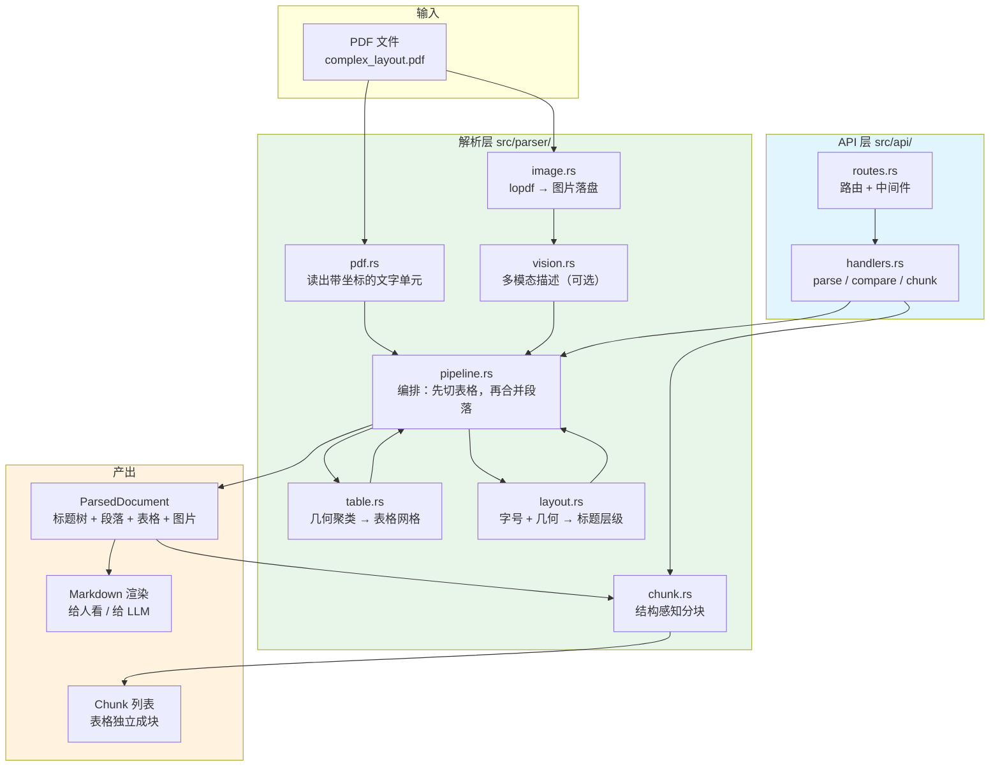
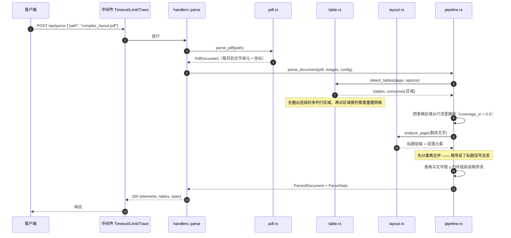
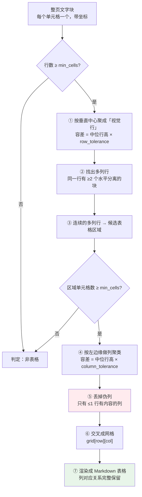
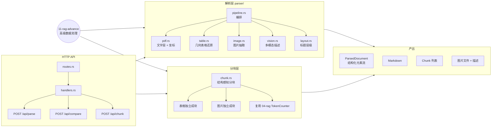
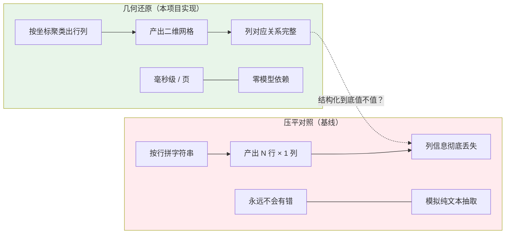
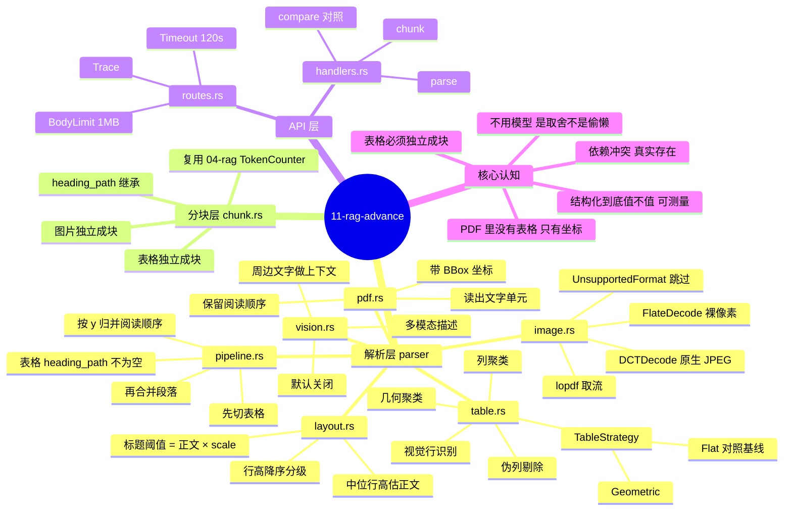
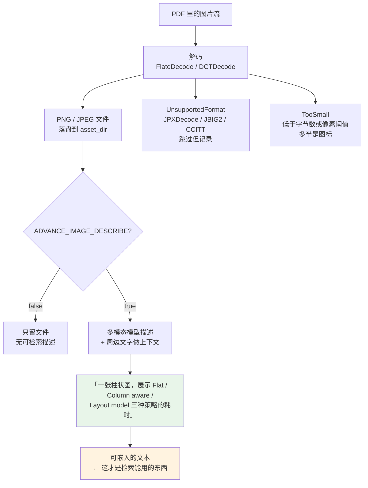

# 11-rag-advance —— 高级数据处理

> **把「不规整的文档」变成「可检索的结构化数据」。**

---

## 这个项目解决什么问题

04~10 全都在假设文档是**规整的 Markdown** —— 有标题层级、正文成段、偶尔有几张图。

现实里的企业文档不是这样：

| 文档类型 | 现实情况 |
|---|---|
| 年报 / 财报 | 几十张表格，段落反而是次要的 |
| 技术手册 | 表格 + 代码块 + 示意图 + 交叉引用 |
| 论文 | 双栏排版、脚注、公式、图表混排 |
| 招标文件 | 大量表格，条款编号嵌在表格里 |

这些内容一旦被压平成纯文本，语义就**永久丢失**了：

```text
原始表格                      压平之后
┌──────────┬──────┬────────┐   Flat text  none  column major  low
│ 策略     │ 表格 │ 读取顺序│   ← 读者知道有 4 列，
├──────────┼──────┼────────┤     但不知道「low」对应哪一列
│ Flat text│ none │ 列优先 │
│ Layout   │ full │ 行优先 │   ← 检索更糟：语义完全糊掉
└──────────┴──────┴────────┘
```

本项目做四件事：

| 模块 | 做什么 | 关键文件 |
|---|---|---|
| 表格还原 | 用**纯几何**把散落的文字块还原成网格 | `src/parser/table.rs` |
| 图片抽取 | 从 PDF 里挖出内嵌位图 + 生成可检索描述 | `src/parser/image.rs`、`vision.rs` |
| 版面分析 | 识别标题层级，产出结构化文档树 | `src/parser/layout.rs` |
| 结构感知分块 | 表格整块保留，行内可检索 | `src/parser/chunk.rs` |

---

## 快速开始

```bash
# ① 造一份测试 PDF（含表格 + 矢量图 + 标题层级）
python3 11-rag-advance/data/make_complex_pdf.py 11-rag-advance/data/complex_layout.pdf

# ② 解析，看结构化结果
cargo run -p rag-11 -- demo

# ③ ★ 核心对照实验：几何还原 vs 压平
cargo run -p rag-11 -- compare

# ④ 分块
cargo run -p rag-11 -- chunk

# ⑤ 启动 HTTP 服务
cargo run -p rag-11 -- serve
```

### 输出长什么样

```text
── 统计 ──
  1836 字符 → 1993 字符 | 标题 4 段落 7 表格 2 图片 0/0
  文字层: 有

── 结构化元素 ──
  [p1 表格] | Strategy | Tables | Reading order | Cost | ⏎ | --- | --- | --- | --- | ...
  [p1 表格] | Property | Why it matters | Loss symptom | ⏎ | --- | --- | --- | ...
  [p1 H1 标题] Advanced Data Processing for Retrieval
  [p1 段落] This document exercises the parsing pipeline for complex documents. ...
  [p1 H2 标题] 1. Why flat text extraction fails
  [p1 段落] A flat text extractor reads the drawing operators in order and treats ...
  [p1 H2 标题] 2. Measured layout drift
  ...
```

对照实验（`compare`）的输出最能说明问题：

```text
【几何还原】
  4 行 × 4 列
| Strategy | Tables | Reading order | Cost |
| --- | --- | --- | --- |
| Flat text | none | column major | low |
| Column aware | partial | row major | medium |
| Layout model | full | row major | high |

【压平对照】
  30 行 × 1 列（列信息丢失）
  Strategy Tables Reading order Cost
  Flat text none column major low
  ...
```

---

## 架构全景



### 一次 `/api/parse` 的完整时序



### 几何表格还原的算法流程



> ⑤ 是最容易出错的一步：居中对齐的数字列会让「同一列」的左边缘相差几个单位，
> 于是 3 列被拆成 6 列，其中 3 列只有一半有内容。

### 知识地图：11-rag-advance



### 两条技术路线的对照



> 这张图是本项目的**核心对照实验**：左边是几何还原，右边是压平基线。
> `POST /api/compare` 就是把同一个 PDF 同时跑两条路线，让「值不值」变成可测量的。

### 思维导图：11-rag-advance 全貌



---

## 技术路线：**为什么不用模型**

教程里 Unstructured / MinerU 这类工具的核心是版面分析模型（Layout Model）+
表格结构模型（TableFormer）+ OCR。效果确实好，但代价是：

| 代价 | 具体表现 |
|---|---|
| 依赖体积 | 几十 MB ~ 几百 MB 的 ONNX 模型 |
| 速度 | 秒级 per 页（要渲染页面 + 跑推理） |
| **依赖冲突** | `fastembed 4.9.1` 锁死 `ort =2.0.0-rc.9`（**精确版本约束**），而 `docling-pdf` 的 `ml` feature 要求 `ort ^2.0.0-rc.14` → 同一个 crate 里**无解** |
| 部署 | GPU / ONNX Runtime 环境是硬门槛 |

本项目走**纯几何路线**：

- 零模型依赖
- 毫秒级（单页 PDF 解析 < 10ms，不含进程启动）
- 只用 `lopdf` + `docling-pdf` 的文本层解析器

### 依赖冲突的具体形态

这个冲突是**实测**过的，不是推测：

```text
$ cargo add fastembed@4.9.1 docling-pdf@2.67.1 --features ml
error: failed to select a version for `ort`.
    ... required by package `docling-pdf v2.67.1`
    versions that meet the requirements `^2.0.0-rc.14` are: 2.0.0-rc.15, 2.0.0-rc.14
all possible versions conflict with previously selected packages
  previously selected package `ort v2.0.0-rc.9`
    ... which satisfies dependency `ort = "=2.0.0-rc.9"` of package `fastembed v4.9.1`
```

`fastembed` 用的是 `=2.0.0-rc.9`（**精确到 patch**），
`docling-pdf` 用的是 `^2.0.0-rc.14`（caret）。
两个范围没有交集 —— Cargo 直接放弃。

因为本 workspace 的 `05-rag` / `06-rag` / `08-rag` 都依赖 `fastembed`，
一旦 `11-rag-advance` 引入 `docling-pdf` 的 ML feature，
**整个 workspace 都编译不过**。

所以本项目用 `docling-pdf` 的纯文本层模式：

```toml
docling-pdf = { version = "2.67.1", default-features = false, features = ["ocr-prep"] }
```

**代价**（诚实地说）：

- **合并单元格**处理不了 —— 几何聚类只能还原规整网格
- **无框线表格**（靠间距排版的表格）识别率下降
- **扫描件**完全处理不了（没有文字层 → 需要 OCR，另一条路线）

所以本项目**不是**要取代 MinerU，而是要让人**理解** MinerU 到底在做什么，
以及在什么场景下值得付那个代价。

---

## 核心算法：几何表格还原

### PDF 里没有「表格」

一个表格在 PDF 文件里是：

- 一堆**带坐标**的文字块（每个单元格一个）
- 一些画线的指令（格线）
- 可能还有合并单元格的说明

纯文本抽取拿到的是「一行一行的字」，**列的对应关系彻底丢失**。

### 还原步骤

```text
① 按垂直中心把文字块聚成「行」
   （同一行的块 y 几乎一样）

② 把连续的「多列行」圈成一个候选表格区域
   （一行里有 ≥2 个水平分离的块）

③ 对区域内的单元格做列聚类
   （按左边缘，左边缘相近的算同一列）

④ 交叉成网格
```

### 三个关键工程细节

#### ① 容差必须相对行高

不同文档字号不同，固定的「差 2 个单位算同一行」在 8pt 正文里太宽、
在 20pt 标题里太窄。所以容差取**行高的倍数**：

```rust
let row_tol = median_height * options.row_tolerance;   // 默认 0.7
let col_tol = median_height * options.column_tolerance; // 默认 1.5
```

`median_height` 用**中位数**而不是平均数 —— 一个巨大的标题单元格
会把平均值拉偏。

#### ② 要清掉「伪列」

居中对齐的数字列是最容易出问题的场景：

```text
       10        20        30
       40        50        60
```

如果 10 和 20 的左边缘差了 3 个单位而容差是 2，就会被拆成两列，
于是 3 列的表变成 6 列，其中 3 列只有一半有内容。

解法：丢掉「在所有行里只有 ≤1 行有内容」的列。

```rust
if grid.len() >= 3 {
    for ci in 0..ncols {
        let used = grid.iter()
            .filter(|r| r.get(ci).is_some_and(|c| !c.trim().is_empty()))
            .count();
        if used <= 1 { keep[ci] = false; }  // 伪列
    }
}
```

#### ③ 段落不能被误判成表格

**两栏排版**的两段长文字，数量上像表格（每行 2 个块），但内容是段落。

判据：**单元格不能太长**。

```rust
// 一个表格单元格 rarely 超过 120 字符；一个段落几乎总是超过。
if max_len > 120 { return false; }
```

#### ④ 先定位表格区域，再重建网格

**不能对整页直接做网格重建** —— 段落会被当成「只有一个单元格的行」，
拼出一个 30 行 4 列、90% 是空格的假表格。

所以流程是：先按「视觉行」聚类 → 圈出连续的**多列行**区域 →
再对每个区域单独做列聚类和网格重建。

（`tests/integration.rs::detect_tables_does_not_treat_paragraphs_as_tables` 守住这条。）

---

## 分块：表格为什么必须独立成块

这是本项目最重要的设计决策。

### 方案 A：表格和正文混在一个块里

```text
┌─────────────────────────────────────┐
│ 表格的每一行会散落在块里的不同位置   │  ← 「low」在块尾，
│ 一行在块首、一行在块尾               │     「Flat」在块首
│ 语义被稀释                          │
└─────────────────────────────────────┘
```

### 方案 B：表格独立成块 ★

```text
┌─────────────────────────────────────┐
| Strategy | Cost |                   │  ← 表头和数据行
| -------- | ---- |                   │     位置相邻
| Flat     | low  |                   │
└─────────────────────────────────────┘
```

方案 B 的额外好处：**表格块可以被整块引用** ——
用户问「Flat 策略的成本是多少」，答案可以直接引用这张表。

### 实现上的一个坑（踩过了）

> 解析时如果先把所有表格 push 进元素列表、再 push 文字，
> 表格块的 `heading_path` 会是**空的** —— push 表格的时候还没遇到任何标题。
>
> 修法：把表格按 y 坐标和文字元素**归并**成一条按阅读顺序排列的流。
> （`tests/integration.rs::table_chunks_carry_their_section_heading` 是这个 bug 的回归测试。）

---

## 图片处理：图片不能直接检索

向量模型吃文本。图片进入知识库的唯一路径：



### 编码格式的处理

| PDF 里的 filter | 处理 |
|---|---|
| 无 / `FlateDecode` | 解压得到**裸像素**，用 `png` crate 编码成 PNG |
| `DCTDecode` | 内容**就是** JPEG 文件，直接写 `.jpg` |
| `JPXDecode` | JPEG2000 —— 跳过（纯 Rust 没有好用的解码器） |
| `CCITTFaxDecode` / `JBIG2Decode` | 跳过（扫描件专用） |

跳过的图片**不是失败** —— 它们被记成 `UnsupportedFormat`，在报告里能看到。

### 描述要带周边上下文

光看图片，模型只能说「一张柱状图」。但如果告诉它
「这段文字描述的是三种提取策略在表格还原上的耗时对比」，
它就能说「一张柱状图，展示 Flat / Column aware / Layout model 三种策略的耗时，
Layout model 最慢」。

后者才是**能检索到**的描述。

```bash
# 开启（需要多模态模型的 API key）
export ADVANCE_IMAGE_DESCRIBE=true
export OPENAI_API_KEY=sk-...
cargo run -p rag-11 -- serve
```

默认**关闭** —— 它要花钱。

---

## HTTP API

```bash
cargo run -p rag-11 -- serve   # 127.0.0.1:3040
```

| 方法 | 路径 | 说明 |
|---|---|---|
| GET  | `/` | 服务信息 + 配置 |
| GET  | `/health` | 健康检查 |
| POST | `/api/parse` | **解析 PDF → 结构化结果** ★ |
| POST | `/api/compare` | **几何还原 vs 压平** 同题对照 ★ |
| POST | `/api/chunk` | 解析 + 分块 |

```bash
# 解析
curl -s http://127.0.0.1:3040/api/parse \
  -H 'Content-Type: application/json' \
  -d '{"path":"complex_layout.pdf"}' | jq '.stats'

# 对照
curl -s http://127.0.0.1:3040/api/compare \
  -H 'Content-Type: application/json' \
  -d '{"path":"complex_layout.pdf"}' | jq '.verdict'

# 分块
curl -s http://127.0.0.1:3040/api/chunk \
  -H 'Content-Type: application/json' \
  -d '{"path":"complex_layout.pdf"}' | jq '.kind_counts'
```

### 统一错误响应

```json
{ "error": "Unprocessable Entity", "message": "文档解析失败: PDF 没有可解析的页面" }
```

| 错误 | HTTP | 含义 |
|---|---|---|
| `BadRequest` | 400 | 请求参数不合法 |
| `NotFound` | 404 | 文件不存在 |
| `Parse` | 422 | **PDF 解析失败**（文件损坏、加密、不是 PDF） |
| `Internal` | 500 | 内部错误 |

> 为什么「解析失败」要单列一类？混在 500 里的话，运维看到的告警全是 500，
> 以为是服务挂了 —— 其实只是有人在上传损坏的 PDF。

---

## 配置

所有环境变量前缀 `ADVANCE_`（和 04~10 都不撞）。

| 变量 | 说明 | 默认 |
|---|---|---|
| `ADVANCE_DATA_DIR` | 文档目录 | `11-rag-advance/data` |
| `ADVANCE_ASSET_DIR` | 图片输出目录 | `11-rag-advance/assets` |
| `ADVANCE_BIND_ADDR` | 监听地址 | `127.0.0.1:3040` |
| `ADVANCE_TABLE_MIN_CELLS` | 表格最少单元格数 | `4` |
| `ADVANCE_IMAGE_DESCRIBE` | 是否生成图片描述 | `false` |
| `ADVANCE_VISION_MODEL` | 多模态模型 | `gpt-4o-mini` |
| `ADVANCE_CHUNK_SIZE` | 块大小（token） | `300` |

---

## 日志

全仓库统一走 `00-logging`（`agent-logging`）。

```bash
RUST_LOG=info cargo run -p rag-11 -- compare
RUST_LOG=debug,rag_11=trace cargo run -p rag-11 -- chunk
```

| 事件 | 级别 | 关键字段 |
|---|---|---|
| PDF 文本层解析 | `DEBUG` / `INFO` | `file_name` / `bytes` / `page_count` |
| PDF 没有可解析页面（损坏 / 加密） | `WARN` | `file_name` |
| 图片抽取完成 | `INFO` | `pdf` / `total` / `extracted` |
| 图片描述失败（跳过该图） | `WARN` | `image_id` / `error` |
| 本页表格检测完成 | `DEBUG` | `page_no` / `table_count` / `consumed_regions` |
| 文档结构化解析完成 | `INFO` | `page_count` / `element_count` / `table_count` / `heading_count` / `paragraph_count` / `has_text_layer` |
| 结构感知分块完成 | `DEBUG` | `file_name` / `chunk_count` |
| 表格策略对照完成 | `INFO` | `geometric_tables` / `flat_tables` |
| 解析失败（422） | `ERROR` | `status` / `error` |
| 文件不存在 / path 为空（404 / 400） | `WARN` | `path` |

HTTP 层用 `agent_logging::trace_layer()`；注意本项目超时给到 300 秒
（几百页 PDF 解析是秒级的）。

---

## 目录结构

```text
11-rag-advance/
├── src/
│   ├── lib.rs
│   ├── main.rs              # 4 种运行模式：serve / demo / compare / chunk
│   ├── config.rs            # 环境变量配置
│   ├── error.rs             # 统一错误 → HTTP 状态码
│   ├── api/
│   │   ├── mod.rs           # AppState
│   │   ├── routes.rs        # 路由表
│   │   ├── handlers.rs      # 处理器
│   │   ├── models.rs        # API 契约
│   │   └── extract.rs       # 自定义 JSON 提取器
│   └── parser/
│       ├── mod.rs
│       ├── geometry.rs      # BBox / PositionedText / ElementKind
│       ├── pdf.rs           # 读出带坐标的文字单元 ★ 地基
│       ├── table.rs         # 几何表格还原 ★
│       ├── image.rs         # 图片抽取
│       ├── layout.rs        # 标题识别
│       ├── pipeline.rs      # 编排：先切表格，再合并段落
│       ├── chunk.rs         # 结构感知分块
│       └── vision.rs        # 多模态描述
├── data/
│   ├── make_complex_pdf.py      # 造含表格 + 矢量图的 PDF
│   ├── make_pdf_with_image.py   # 造含内嵌位图的 PDF
│   ├── complex_layout.pdf
│   └── with_image.pdf
├── tests/
│   ├── fixtures.rs          # 纯 Rust 的 PDF 构造器
│   └── integration.rs       # 端到端测试
└── Cargo.toml
```

---

## 测试

```bash
cargo test -p rag-11
```

```
test result: ok. 47 passed   # 单元测试
test result: ok.  9 passed   # 集成测试
```

### 测试策略

**单元测试**测**算法** —— 给一组人造坐标，看表格能不能还原、标题能不能认出来。

```rust
#[test]
fn sparse_columns_are_dropped() {
    // 3 列，但第 3 列只有 1 行有内容 —— 是聚类误差产生的伪列。
    let mut cells = grid_cells([["A", "B", "C"], ["1", "2", "3"], ["4", "5", ""]]);
    cells[2].bbox.left = 400.0;

    let table = reconstruct_table(&cells, 1, &TableOptions::default()).unwrap();
    assert!(table.column_count() <= 2, "稀疏列应该被丢掉");
}
```
**集成测试**测**链路** —— 真的造一个 PDF，真的解析它。

```rust
#[test]
fn table_markdown_preserves_the_column_mapping() {
    // 关键断言：表头和数据在同一行 —— 列对应关系没丢。
    assert!(markdown.contains("| Name | Type | Cost | Notes |"));
    assert!(markdown.contains("| Flat | none | low | fast |"));
}
```

### 为什么自己造 PDF

二进制测试夹具在 git diff 里看不出来，改坏了也没人知道。
所以测试用 **Rust** 写一个极简的 PDF 构造器（`tests/fixtures.rs`），
不依赖 Python —— CI 上不一定有 Python。

> ⚠️ 手写 PDF 的两个坑：
> 1. 每行文字要一个独立的 `Tj`（否则阅读顺序还原会交错）
> 2. y 坐标要严格单调递减（页面原点在左下角，y 向上）

---

## 与其它项目的关系

```text
04-rag      规整文本怎么切块
  ↓
05-rag      怎么建向量索引
  ↓
06-rag      怎么检索 + 生成
  ↓
07-query    查询改写 / 分解 / HyDE
  ↓
08-rag      混合检索（向量 + BM25 + Reranker）
  ↓
09-rag-eval 效果好不好（RAGAs / FlashRAG）
  ↓
10-rag-milvus 上生产（Milvus / Qdrant）
  ↓
11-rag-advance  ★ 不规整的文档怎么变成结构化数据
```

**11 是「回头补地基」的** —— 前面的项目都在假设输入是干净的 Markdown。
本项目处理的是「输入不干净」这个真实问题。

如果要把本项目接到检索链路上：

```rust
// ① 解析成结构化文档
let doc = rag_11::parser::parse_file(&pdf_path, &config)?;

// ② 结构感知分块（表格独立成块）
let chunks = rag_11::parser::chunk_document(&doc, &ChunkOptions::default());

// ③ 交给 05-rag 的嵌入器
let embedder = rag_05::embed::LocalEmbedder::new(Model::MultilingualE5Small, Some(rag_05::embed::cache_dir()))?;
let embedded = chunks.iter().map(|c| EmbeddedChunk {
    id: c.id.clone(),
    source: c.source.clone(),
    index: c.index,
    heading_path: c.heading_path.clone(),
    text: c.text.clone(),
    vector: embedder.embed_query(&c.embedded_text)?,
}).collect::<Vec<_>>();

// ④ 建索引（复用 05-rag 的 FaissStore）
let mut store = rag_05::store::FaissStore::new(IndexKind::Flat, embedder.dimension(), embedder.model_name())?;
store.add(&embedded).await?;
```

---

## 参考资料

| 工具 | 定位 | 本项目的关系 |
|---|---|---|
| [Unstructured](https://unstructured-io.github.io/unstructured/) | 通用文档解析库（Python） | 思路参考：本项目做 Rust 版的核心子集 |
| [MinerU](https://github.com/opendatalab/MinerU) | 高精度 PDF 解析（模型驱动） | 对照：模型路线能做到什么 |
| [Docling](https://github.com/docling-project/docling) | IBM 的文档转换工具 | **本项目的地基**（用它的文本层解析器） |
| [PDF-Extract-Kit](https://github.com/opendatalab/PDF-Extract-Kit) | 工具集（版面 + OCR + 表格） | 对照：模型路线 |
| [GOT-OCR2.0](https://github.com/Ucas-HaoranWei/GOT-OCR2.0) | 端到端 OCR 模型 | 对照：纯模型路线 |

### 相关论文

- *TableFormer: Table Structure Understanding with Transformers* —— 表格结构识别
- *GOT-OCR2.0* —— 统一文本/表格/公式识别模型
- *Docling Technical Report* —— 文档转换的工程实践

---

## 已知限制

1. **合并单元格**处理不了（几何聚类的固有局限）
2. **扫描件**处理不了（没有文字层 → 需要 OCR）
3. **无框线表格**（靠间距排版）识别率下降
4. **图片描述**默认关闭（要花钱 + 要 API key）
5. **页面尺寸**是从坐标范围推断的，不是读 `/MediaBox`（误差不影响分块）
6. 标题识别依赖**行高** —— 如果 PDF 里标题和正文字号相同，会漏识别

### 未来可做

- [ ] 接入 OCR（用 `ocrmypdf` 或 `tesseract` 预处理扫描件）
- [ ] 表格标题行（caption）识别 —— 「表 1：三种策略对比」
- [ ] 跨页表格合并（表格跨页是很常见的）
- [ ] 多栏排版检测（现在只处理单栏）
- [ ] 表格 → 问答对的自动生成（用 LLM 把表格转成可检索的陈述句）

---

## 快速索引

```bash
# 解析
cargo run -p rag-11 -- demo
cargo run -p rag-11 -- demo path/to/file.pdf

# 对照实验（最有说服力的输出）
cargo run -p rag-11 -- compare

# 分块
cargo run -p rag-11 -- chunk

# 服务
cargo run -p rag-11 -- serve

# 测试
cargo test -p rag-11
```
