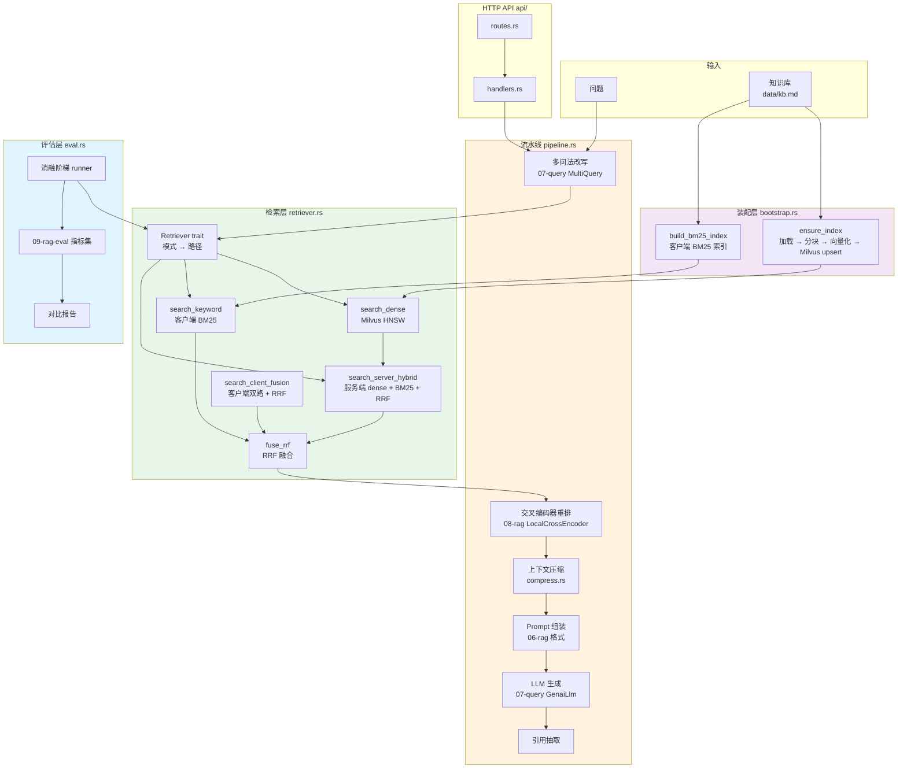
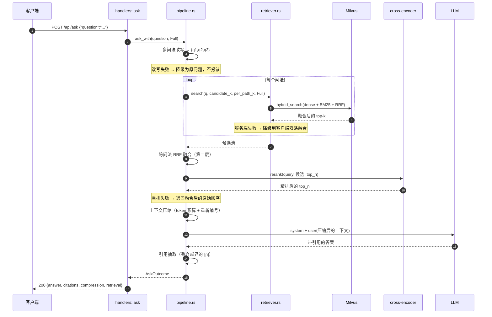
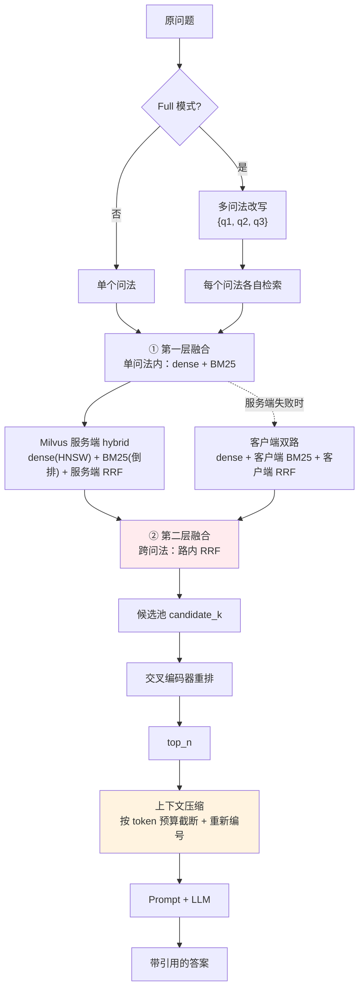
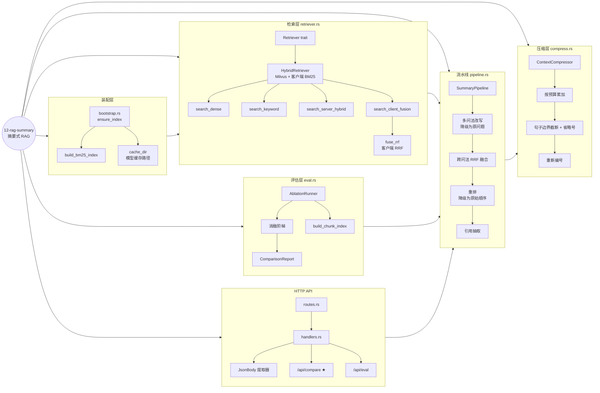
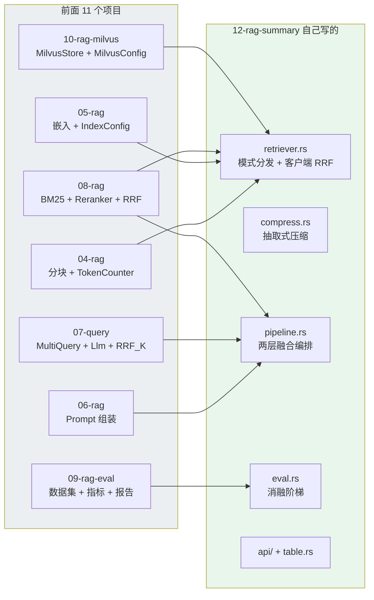
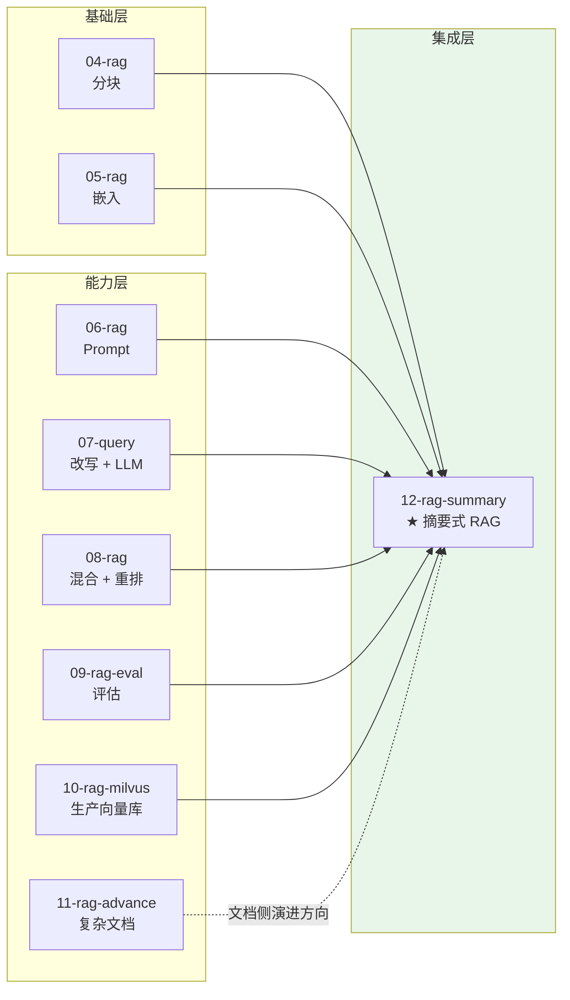

# 12-rag-summary —— 摘要式 RAG

> **把「检索到的片段」压成「一段有据可依的摘要」。**
> 混合检索 + 交叉编码器重排 + Milvus 生产向量库，三件事合成一个服务。

---

## 这个项目解决什么问题

前面 11 个项目各自解决了一个问题，但**它们从来没有被装进同一个进程**：

| 项目 | 解决什么 | 局限 |
|---|---|---|
| 04-rag | 加载 + 分块 | 只有分块 |
| 05-rag | 向量化 + 存储 | 存储是本地 FAISS 文件 |
| 06-rag | Prompt + 生成 | 检索是纯向量 |
| 07-query | 查询改写 | 改写完还是纯向量 |
| 08-rag | 混合检索 + 重排 | 索引在**进程内**，数据一大就吃不消 |
| 09-rag-eval | 怎么量化效果 | 评估的是 08 的水平 |
| 10-rag-milvus | 生产向量库 | **只到检索为止**，没有重排、没有压缩 |
| 11-rag-advance | 复杂文档解析 | 只到解析为止 |

本项目做的是**集成 + 两处补强**：

```text
08 的「混合 + 重排」  +  10 的「生产向量库」  +  摘要场景必需的「上下文压缩」
```

### 补强一：上下文压缩

这是 08~11 都没有的一层，也是**摘要式任务特有**的。

普通问答式 RAG 的输出和输入差不多长；摘要式任务的输出**远短于**输入。
这带来一个反直觉的结论：**上下文越长，效果可能越差**。

| 机制 | 后果 |
|---|---|
| 稀释 | 20 个块里只有 3 个相关，其余是噪声 |
| 干扰 | 不相关片段会诱导模型去引用它们（幻觉） |
| 成本 | 上下文 token 直接等于钱和延迟 |

所以本项目在「重排」之后加了一层**抽取式压缩**：按相关度累加 token 预算，
超预算的片段按句子边界截断并标省略号。

> 为什么是**抽取式**而不是生成式？生成式压缩看起来更「智能」，但它
> **用一个可靠性问题换另一个**：你本来担心「上下文太长」，现在要担心
> 「压缩时把关键信息压掉了」。而且压缩本身要调一次 LLM —— 多一次网络往返。
> 抽取式只做「挑选 + 截断」，进入上下文的每一句都**逐字来自原始语料**。

### 补强二：消融阶梯

单看「最终效果」无法回答「哪个环节有用」。

本项目把优化拆成**五档**，每档比上一档多**恰好一个**增强：

```text
dense ──> keyword ──> hybrid ──> hybrid_rerank ──> full
  ▲          ▲           ▲            ▲              ▲
  │          │           │            │              │
  基线      对照组    +混合融合    +交叉编码器    +改写+压缩
```

相邻两档的差值是**可归因**的 —— 这正是「消融实验」的意义。

---

## 快速开始

```bash
# ① 启动 Milvus（etcd + minio + milvus 三个容器）
make -C 10-rag-milvus up

# ② 命令行问答
cargo run -p rag-12 -- demo "混合检索和重排分别解决什么问题"

# ③ ★ 同题消融对照：五档策略跑同一个问题
cargo run -p rag-12 -- compare "混合检索怎么融合两路结果"

# ④ ★ 跑评估集，产出消融报告
SUMMARY_EVAL_LIMIT=5 cargo run -p rag-12 -- eval

# ⑤ 启动 HTTP 服务（127.0.0.1:3050）
cargo run -p rag-12 -- serve
```

### 输出长什么样

```text
── 问答 ──
问题: 混合检索和重排分别解决什么问题
模式: full

【答案】
混合检索和重排解决的问题不同：

**混合检索**解决的是"单一检索方式各有短板"的问题。倒排索引/稀疏检索擅长精确匹配
（如特定错误码、函数名），向量/稠密检索擅长语义泛化……两者思路正交，结合后可以
同时利用关键词匹配的精确性和语义匹配的相关性，互相补充[2][5]。

**重排**解决的是"向量召回精度有限"的问题。向量检索用双编码器，速度快但精度有限；
重排用交叉编码器把问题和文档拼在一起送进模型，能看到词与词的细粒度交互……
标准做法是两阶段：先召回二十到五十条候选，再用重排模型精排成三到五条[1]。

【检索过程】
  路径: server_hybrid | 候选 16 块 → 重排后 5 块 | 改写 3 个问法
  耗时: 检索 76ms | 重排 1324ms | 总计 8300ms

【上下文压缩】
  1373 → 1167 token (15%) | 保留 5 块，砍掉 0 块，有截断

【引用】
  [1] kb.md#7 重排与交叉编码器
  [2] kb.md#3 倒排索引
  [5] kb.md#5 混合检索
```

`compare` 的输出把五档并排放在一起：

```text
┌─ 模式: dense
│  路径: dense_only | 耗时 1298ms
│    [1] kb.md#5 dense=Some(0.91292554) bm25=None votes=1 | 混合检索把稀疏检索和稠密检索结合起来…
└─
┌─ 模式: keyword
│  路径: keyword_only | 耗时 1292ms
│    [1] kb.md#5 dense=None bm25=Some(14.453699) votes=1 | 混合检索把稀疏检索和稠密检索结合起来…
└─
┌─ 模式: hybrid
│  路径: server_hybrid | 耗时 1315ms
│    [1] kb.md#5 dense=None bm25=None votes=1 | 混合检索把稀疏检索和稠密检索结合起来…
└─
```

> ⚠️ 注意 `dense=` / `bm25=` 两列在 `hybrid` 档是 `None` —— 这不是 bug。
> 服务端混合检索返回的是**融合后**的 RRF 分数，两路的原始分数已被服务端
> 合成为一个值，客户端拿不到分项。详见「分数语义」一节。

---

## 架构全景



### 一次 `/api/ask` 的完整时序



### 两层融合的算法流程



> ① 是「**单问法内**的 dense ↔ BM25 融合」，② 是「**多个问法之间**的融合」。
> 两层都用 RRF，但**排名口径不同**：① 是各路自己的名次，② 是每个问法内部的��次。
> 混用会算出完全错误的分数（见「踩过的坑」）。

### 知识地图：12-rag-summary



### 复用了前 11 个项目的什么



> 原则：**能复用的绝不复写**。
> `MilvusConfig` 直接 `pub use` 自 10，`Reranker` / `Bm25Index` 直接用 08 的，
> 指标注册表直接用 09 的 —— 这样上游修了 bug，本项目自动受益。
> 本项目只写 10~11 没有的那一层：**压缩**和**阶梯**。

---

## 核心设计决策

### ① 为什么「关键词路」用客户端 BM25 而不是服务端 BM25

Milvus 的服务端 BM25 走的是**内置分析器**（英文优先的 `standard`）。
对英文友好，对中文会把整句当成一个 token —— 分词效果有限。

08-rag 那套「CJK 单字 + 双字」的客户端分词对中文效果好得多。

所以本项目**两条路都留**：

| 路 | 优点 | 缺点 | 用途 |
|---|---|---|---|
| 服务端 BM25 | 一次 RPC，大规模可用 | 中文分词弱 | **生产主路径** |
| 客户端 BM25 | 中文分词好，可控 | 索引在进程内 | **精确对照 + 降级路径** |

这不只是「两条路都实现」—— 它让「服务端 vs 客户端」这件事本身可被对比。

### ② 分数语义必须准确

混合检索的两路分数**根本不可比**：

| 路 | 分数来源 | 典型范围 |
|---|---|---|
| 稠密 | 余弦相似度 | 0.55 ~ 0.85 |
| BM25 | 对数加权和 | 0 ~ 15+ |

所以融合只能用 **RRF**（只看排名）：

```text
score(d) = Σ  1 / (k + rank_i(d))        k = 60
```

而**报告里的分数标注**必须诚实：

| 路径 | `score` | `dense_score` | `bm25_score` |
|---|---|---|---|
| `dense_only` | 余弦相似度 | ✅ 同 score | `None` |
| `keyword_only` | BM25 分 | `None` | ✅ 同 score |
| `client_fusion` | RRF 融合分 | ✅ 该路稠密分 | ✅ 该路 BM25 分 |
| `server_hybrid` | 服务端 RRF 分 | `None` | `None` |

> ⚠️ 服务端混合检索**不能**把分数标成 `dense` —— 服务端已经把两路合成为一个
> RRF 分，客户端拿不到分项。硬标的话就会出现「dense=0.0164」这种
> **看起来像余弦相似度、实则是 RRF 分**的值，误导性极强。
> 所以诚实地填 `None`。

同理，`min_score` 阈值**只对能拿到稠密分的路径生效** —— 拿 RRF 分和余弦阈值比
是量纲错误。

### ③ 为什么用「抽取式」压缩而不是「生成式」

见开头。核心是：

> **抽取式只做「挑选 + 截断」，进入上下文的每一句都逐字来自原始语料。**
> 生成式压缩会丢信息，还多一个 LLM 调用点。

另外两个细节：

- **按句子边界截断**，不按字符 —— 切到句子中间会产生「半句话」，是纯噪声
- **加省略号标记** —— 不加的话模型可能把片段当成完整论述来引用（幻觉）
- **压缩后重新编号** —— 否则模型会引用一个已经被砍掉的片段

### ④ 为什么检索层要抽成 `Retriever` trait

三个理由，和 08 抽 `Reranker` 是同一套逻辑：

1. **测试能注入替身** —— API 层的参数校验不应该依赖一个真实运行的 Milvus
2. **失败模式隔离** —— 「Milvus 不可达」和「BM25 索引为空」是不同的错误
3. **未来可替换** —— 加云端向量库时流水线一行都不用改

```rust
pub trait Retriever: Send + Sync + std::fmt::Debug {
    fn search<'a>(
        &'a self,
        query: &'a str,
        k: usize,
        per_path_k: usize,
        mode: SearchMode,
    ) -> Pin<Box<dyn Future<Output = RagResult<Vec<Hit>>> + Send + 'a>>;

    fn name(&self) -> &str;
}
```

> 返回值用显式装箱的 future 而不是 `async fn` —— 因为 `async fn` 不是
> dyn 兼容的（这一点在 07 的 `Llm` trait 里已经踩过一次）。

---

## 降级链

这个流水线**每一环都有降级路径**：

| 环节失败 | 降级行为 | 会不会报错 |
|---|---|---|
| 多问法改写失败 | 退回原问题继续检索 | ❌ |
| 服务端混合检索失败 | 退回客户端双路融合 | ❌ |
| 客户端融合也失败 | 报错（没数据就没答案） | ✅ |
| 重排失败 | 退回融合后的原始顺序 | ❌ |
| 上下文压缩失败 | 退回未压缩的完整片段 | ❌ |
| 生成失败 | 报错（检索结果仍随错误一起返回） | ✅ |

降级发生时，响应里的 `degrade_reason` 会说清楚**降了什么、为什么**：

```json
{
  "degrade_reason": "重排失败（模型加载失败），降级为融合后的原始顺序",
  "reranked": false
}
```

> 为什么改写失败不报错？召回差一点，但**答案仍然能给出**。
> 而检索彻底失败没数据可答 —— 那才是真的没法服务。

---

## 踩过的坑

### ① 服务端混合检索的分数不能拆成 dense / bm25

已在「分数语义」一节详述。踩的时候症状是：报告里 `dense=0.0164`，
一眼就发现不对劲 —— 0.0164 不可能是余弦相似度。

### ② 跨问法融合的排名必须是「路内排名」

RRF 公式里的 `rank_i(d)` 是文档 d **在第 i 路里**的名次。

如果把各路的命中拼成一个列表再按全局下标算排名，
第二路的第 1 名会被当成第 `len(route1)+1` 名 —— RRF 分数被严重低估，
多路融合退化成「第一路说了算」。

**回归测试**（`cross_query_fusion_uses_per_route_ranks`）锁住了这个行为：

```rust
// 两路完全一样：["a", "b"] 和 ["a", "b"]。
// 「a」在两路都排第 1 → 分数 = 2 / (60 + 1) ≈ 0.0328。
let expected = 2.0 / 61.0;
assert!((fused[0].score - expected).abs() < 1e-6);
```

### ③ 客户端 BM25 必须用 `text` 而不是 `embedded_text`

向量索引用 `embedded_text`（含标题路径前缀）—— 标题能帮语义检索。

但 BM25 是**关键词**匹配：如果把标题也塞进去，标题词会主导打分，
让「按标题命中」压过「按正文命中」。

### ④ 分块配置必须处处一致

客户端 BM25、Milvus 索引、评估集的块索引 —— 三处必须用**完全相同**的
`SplitterConfig`。否则块 ID 对不上，融合的是两批不同的块。

这个坑**不会报错**，只是静默地降低效果 —— 所以有专门的测试守着：

```rust
#[test]
fn bm25_index_covers_the_same_chunks_as_the_chunk_index() {
    assert_eq!(bm25.len(), chunk_index.chunk_count());
}
```

### ⑤ Milvus 的 `ConsistencyLevel` 必须用 `Strong`

用 `Bounded` 会被 SDK 映射成字面时间戳 `2`，读到的是远古快照 ——
表现为「刚灌完库却只搜到 1~2 条」。这个坑在 10-rag-milvus 里踩过一次，
本项目直接复用 `MilvusStore`，不用再踩。

### ⑥ collection 名必须和 10-rag-milvus 隔离

两个项目共用同一个 Milvus 实例。collection 名分别是
`rag_summary_chunks` 和 `rag_chunks` —— 否则索引会互相覆盖，
而且因为 embedding 模型一样，撞起来**极难发现**。

---

## HTTP API

```bash
cargo run -p rag-12 -- serve   # 127.0.0.1:3050
```

| 方法 | 路径 | 说明 |
|---|---|---|
| GET  | `/` | 服务信息 + 配置 + 索引状态 |
| GET  | `/health` | 健康检查（含 Milvus 连通性） |
| POST | `/api/search` | **纯检索**（不生成） |
| POST | `/api/ask` | **完整问答**（检索 → 重排 → 压缩 → 生成） |
| POST | `/api/compare` | **同题消融对照** ★ |
| POST | `/api/eval` | **跑评估集**（产出报告） |
| POST | `/api/reindex` | 重建索引 |

```bash
# 问答
curl -s http://127.0.0.1:3050/api/ask \
  -H 'Content-Type: application/json' \
  -d '{"question":"混合检索怎么融合两路结果"}' | jq '.citations'

# ★ 同题消融对照
curl -s http://127.0.0.1:3050/api/compare \
  -H 'Content-Type: application/json' \
  -d '{"question":"BM25 打分公式是什么"}' | jq '{overlap, modes: [.variants[].mode]}'

# 跑评估集（limit 限制样本数，避免几分钟的等待）
curl -s http://127.0.0.1:3050/api/eval \
  -H 'Content-Type: application/json' \
  -d '{"limit":5}' | jq '.reports[] | {variant, failed}'
```

### 统一错误响应

```json
{ "error": "Bad Request", "message": "请求参数不合法: 问题不能为空" }
```

| 错误 | HTTP | 含义 |
|---|---|---|
| `BadRequest` | 400 | 请求参数不合法（含 JSON 解析失败） |
| `NotReady` | 503 | 索引未就绪 / Milvus 不可达 |
| `Retrieval` | 500 | 检索失败 |
| `Rerank` | 502 | 重排失败 |
| `Generation` | 502 | LLM 调用失败 |
| `Internal` | 500 | 内部错误 |

> JSON 解析失败也归到 `BadRequest`（400），而不是 422 ——
> 「请求体不是合法 JSON」和「参数值不合法」是同一类用户错误。

---

## 配置

所有环境变量前缀 `SUMMARY_`（和 04~11 都不撞）。

| 变量 | 说明 | 默认 |
|---|---|---|
| `SUMMARY_DATA_DIR` | 知识库目录 | `12-rag-summary/data` |
| `SUMMARY_EVAL_DATASET` | 评估集路径 | `09-rag-eval/data/eval_cases.json` |
| `SUMMARY_BIND_ADDR` | 监听地址 | `127.0.0.1:3050` |
| `SUMMARY_MODE` | 默认检索模式 | `full` |
| `SUMMARY_TOP_K` | 最终块数 | `5` |
| `SUMMARY_PER_PATH_K` | 每路召回数 | `20` |
| `SUMMARY_MIN_SCORE` | 相似度下限（只对 dense / client_fusion 生效） | 空 |
| `SUMMARY_RERANK_ENABLED` | 是否启用重排 | `true` |
| `SUMMARY_RERANK_BACKEND` | `local` / `cohere` | `local` |
| `SUMMARY_RERANK_MODEL` | `bge` / `m3` / `jina` | `bge` |
| `SUMMARY_RERANK_CANDIDATE_K` | 送进重排的候选数 | `20` |
| `SUMMARY_RERANK_TOP_N` | 重排后保留条数 | `5` |
| `COHERE_API_KEY` | Cohere API key | 空 |
| `SUMMARY_COMPRESS_ENABLED` | 是否启用上下文压缩 | `true` |
| `SUMMARY_COMPRESS_BUDGET` | 上下文 token 预算 | `1200` |
| `SUMMARY_REWRITE_ENABLED` | 是否启用多问法改写 | `true` |
| `SUMMARY_REWRITE_NUM_QUERIES` | 问法数量 | `3` |
| `SUMMARY_MODEL` | 生成模型 | `deepseek-flash` |
| `SUMMARY_TEMPERATURE` | 生成温度 | `0.1` |
| `SUMMARY_MAX_TOKENS` | 生成 max tokens | `2000` |
| `SUMMARY_EVAL_LIMIT` | 评估时每个变体的样本数上限 | 空（全量） |
| `SUMMARY_AUTO_INDEX` | 启动时自动建索引 | `true` |
| `SUMMARY_MILVUS_URI` | Milvus gRPC 地址 | `http://127.0.0.1:19530` |
| `SUMMARY_MILVUS_TOKEN` | Milvus 认证 token | `root:Milvus` |
| `SUMMARY_MILVUS_COLLECTION` | collection 名 | `rag_summary_chunks` |
| `SUMMARY_MILVUS_ENABLE_BM25` | 是否启用服务端 BM25 | `true` |

### 检索模式

| 模式 | 稠密 | 关键词 | 融合 | 重排 | 改写 | 压缩 |
|---|---|---|---|---|---|---|
| `dense` | Milvus | — | — | — | — | — |
| `keyword` | — | 客户端 BM25 | — | — | — | — |
| `hybrid` | Milvus | 服务端 BM25 | 服务端 RRF | — | — | — |
| `hybrid_rerank` | Milvus | 服务端 BM25 | 服务端 RRF | ✅ | — | — |
| `full` | Milvus | 服务端 BM25 | 服务端 RRF | ✅ | ✅ | ✅ |

---

## 目录结构

```text
12-rag-summary/
├── src/
│   ├── lib.rs
│   ├── main.rs              # 4 种运行模式：serve / demo / compare / eval
│   ├── config.rs            # 环境变量配置 + SearchMode 阶梯
│   ├── error.rs             # 统一错误 → HTTP 状态码 + 降级语义
│   ├── bootstrap.rs         # 装配：建索引 + 连 Milvus + 建各组件
│   ├── retriever.rs         # Retriever trait + Milvus/BM25 检索 + RRF ★
│   ├── compress.rs          # 抽取式上下文压缩 ★
│   ├── pipeline.rs          # 端到端编排：改写→检索→重排→压缩→生成 ★
│   ├── eval.rs              # 消融阶梯 runner + 对比报告
│   ├── table.rs             # CJK 宽度感知的终端表格
│   └── api/
│       ├── mod.rs           # AppState
│       ├── routes.rs        # 路由表
│       ├── handlers.rs      # 处理器
│       ├── models.rs        # API 契约
│       └── extract.rs       # 自定义 JSON 提取器
├── data/
│   └── kb.md                # 知识库（章节和 09-rag-eval 的标注对齐）
├── tests/
│   └── integration.rs       # 离线 + 在线（Milvus）两类测试
├── Makefile
└── Cargo.toml
```

---

## 测试

```bash
cargo test -p rag-12                    # 全部
RAG12_REQUIRE_BACKEND=1 cargo test -p rag-12   # 强制要求 Milvus 可达
```

```
test result: ok. 53 passed   # 单元测试
test result: ok. 22 passed   # 集成测试（含 3 个在线 Milvus 测试）
```

### 测试策略

**离线测试**（不依赖任何后端）：

- 分块 ID 稳定性、BM25 与块索引的覆盖一致性
- RRF 融合的去重、共识加权、确定性
- 跨问法融合的**路内排名**（回归测试）
- 压缩的预算约束、引用编号连续性、句子切分
- API 的参数校验、JSON 解析失败、检索失败传播
- 端到端流水线的引用抽取（用 `FakeRetriever` + `ScriptedLlm`）

**在线测试**（需要 Milvus）：

- 索引幂等性（重复灌库 `count(*)` 不翻倍）
- 稠密 / 服务端混合 / 客户端 BM25 三条路径都能召回
- 检索路径标注正确（`server_hybrid` / `keyword_only`）

> 连不上 Milvus 时**跳过**而不是失败 —— CI 环境不一定有 Milvus。
> 但设 `RAG12_REQUIRE_BACKEND=1` 时**直接失败** —— 本地能主动验证后端真的通了。

---

## 技术参考速查

| 主题 | 关键点 | 来源 |
|---|---|---|
| RRF | `score(d) = Σ 1/(k + rank_i(d))`，k = 60 | Cormack et al. 2009 |
| BM25 | `IDF = ln(1 + (N-df+0.5)/(df+0.5))`，`k1 = 1.2`，`b = 0.75` | Robertson & Zaragoza 2009 |
| 词频饱和 | 第 11 次出现的信息量远小于第 1 次 | 同上 |
| 双编码器 | query / doc 独立编码，比对向量距离 | Reimers & Gurevych 2020 |
| 交叉编码器 | query + doc 拼接后联合推理，能看细粒度交互 | Cross-Encoder (Nogueira & Cho 2019) |
| 两阶段检索 | 召回 20~50 条 → 精排 3~5 条 | 工业界通用实践 |
| Milvus 服务端混合 | `hybrid_search` + `RRFRerank` + `EmbeddedText` | Milvus 官方文档 |
| Milvus BM25 | 服务端函数 `FunctionType::Bm25`，输入 text 输出 sparse | Milvus 官方文档 |
| 稀疏倒排索引 | `IndexType::SparseInvertedIndex` + `MetricType::Bm25` | Milvus 官方文档 |
| 一致性级别 | 必须 `Strong`；`Bounded` 会被 SDK 映射成时间戳 2 | Milvus SDK 源码 |
| 上下文压缩 | 抽取式保留原句可溯源；生成式会丢信息 | 本项目设计决策 |
| 丢失在中间 | 长上下文中间位置的内容更易被忽略 | Liu et al. 2023 |
| 消融实验 | 每次只加一个增强，差值才可归因 | 通用实验方法 |

---

## 与前面项目的关系



**下一步的自然延伸**：11-rag-advance 负责「把复杂文档变成规整 Markdown」，
12-rag-summary 负责「把规整 Markdown 变成有据可依的摘要」。
两者接起来就是**完整的生产链路**：

```text
PDF / Word / HTML ──11──> 规整 Markdown ──12──> 带引用的摘要
```
