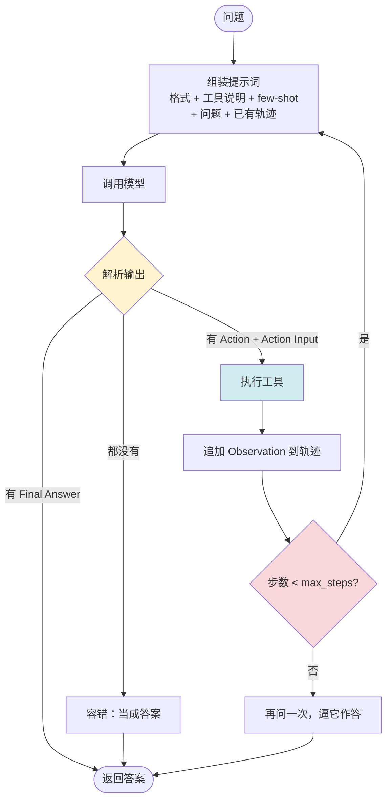
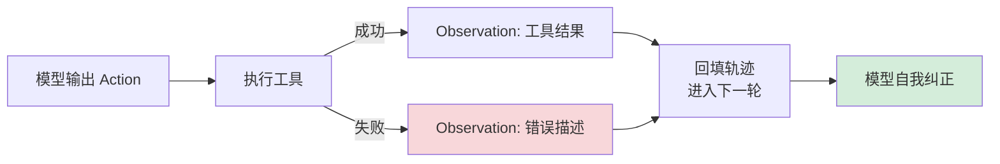
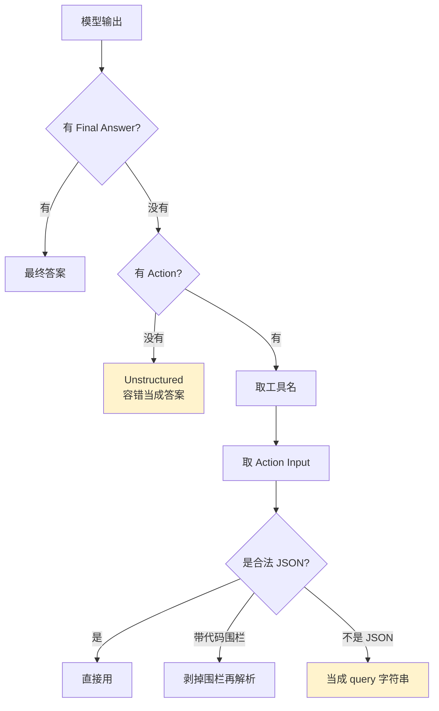
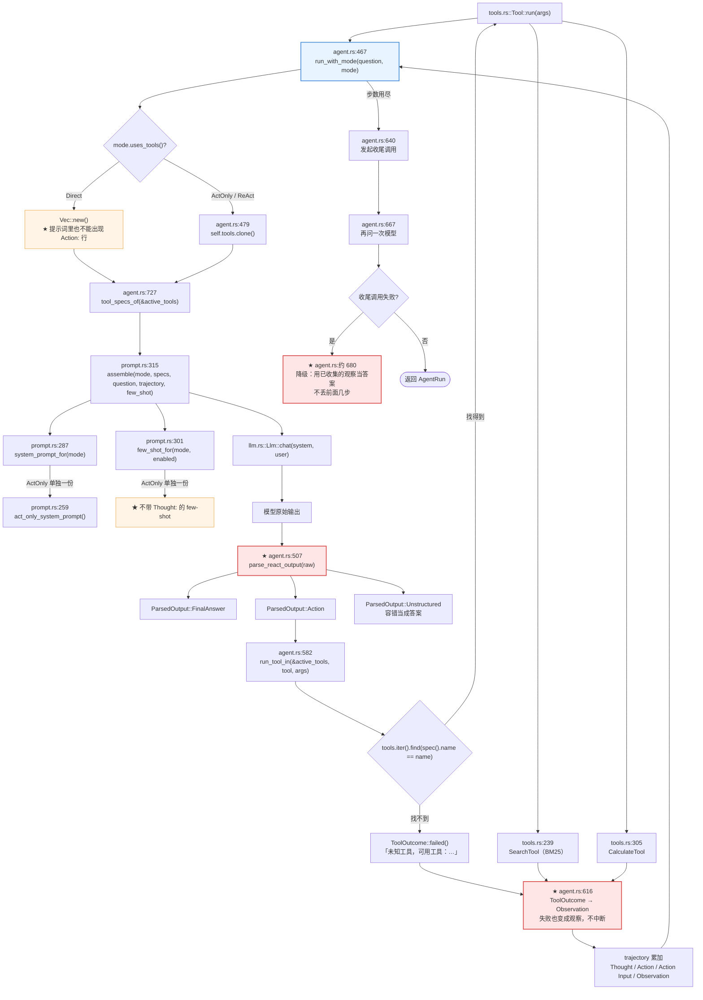
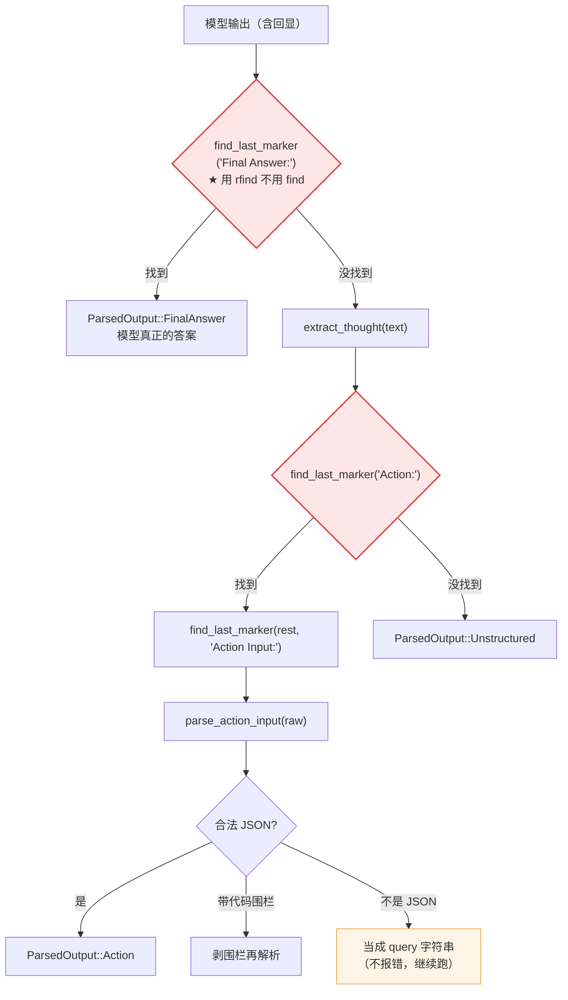
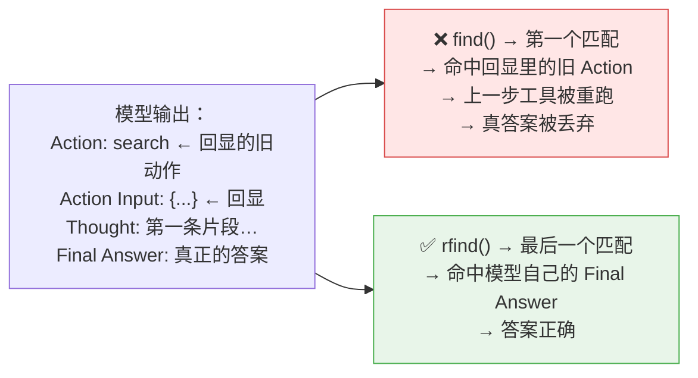
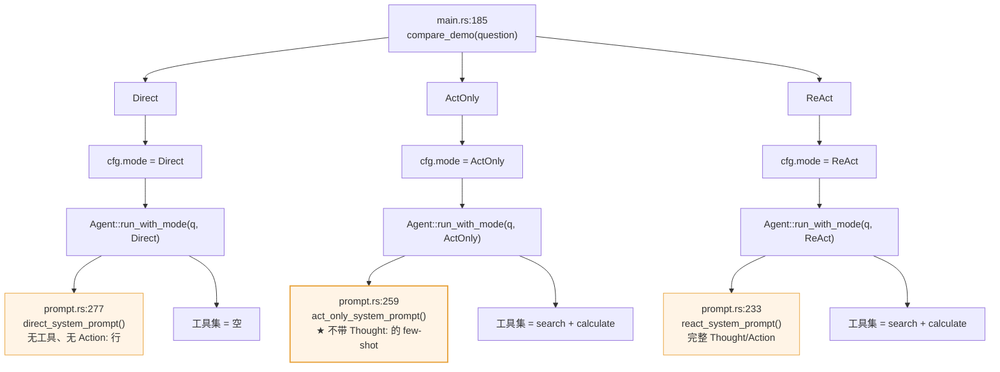
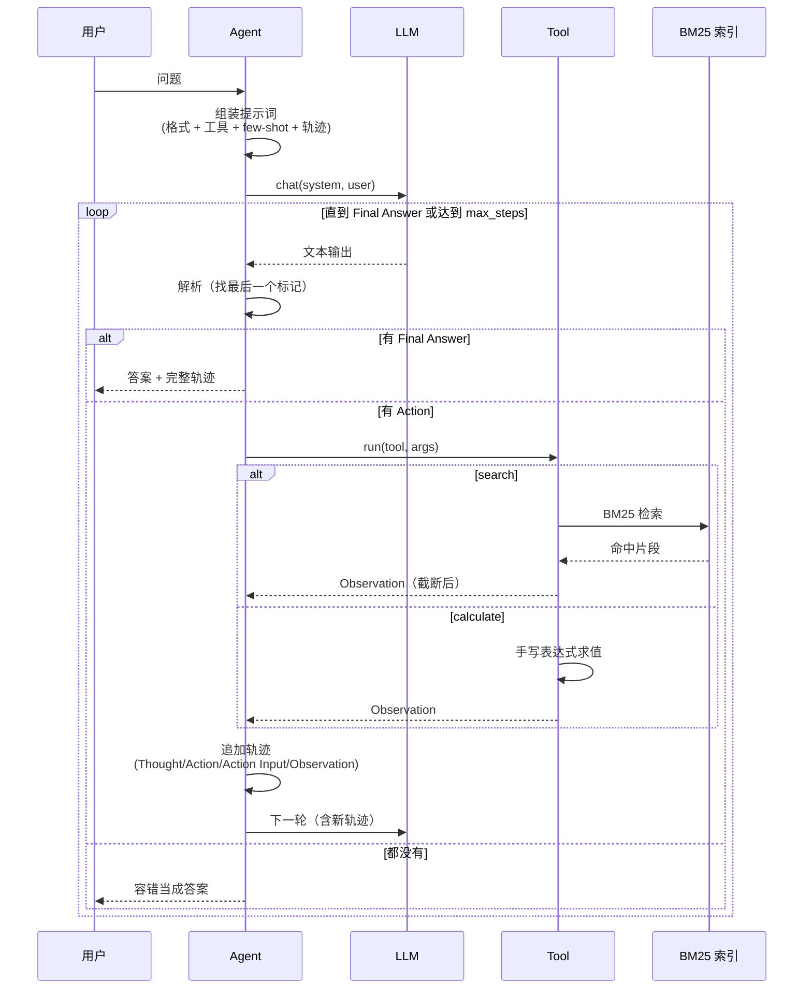
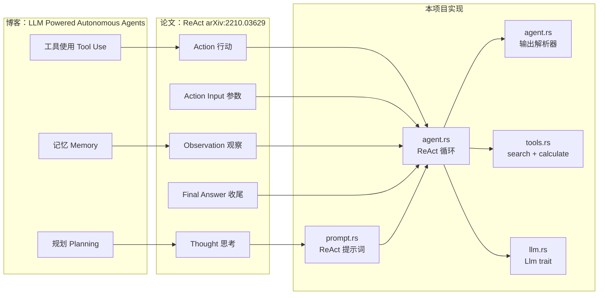
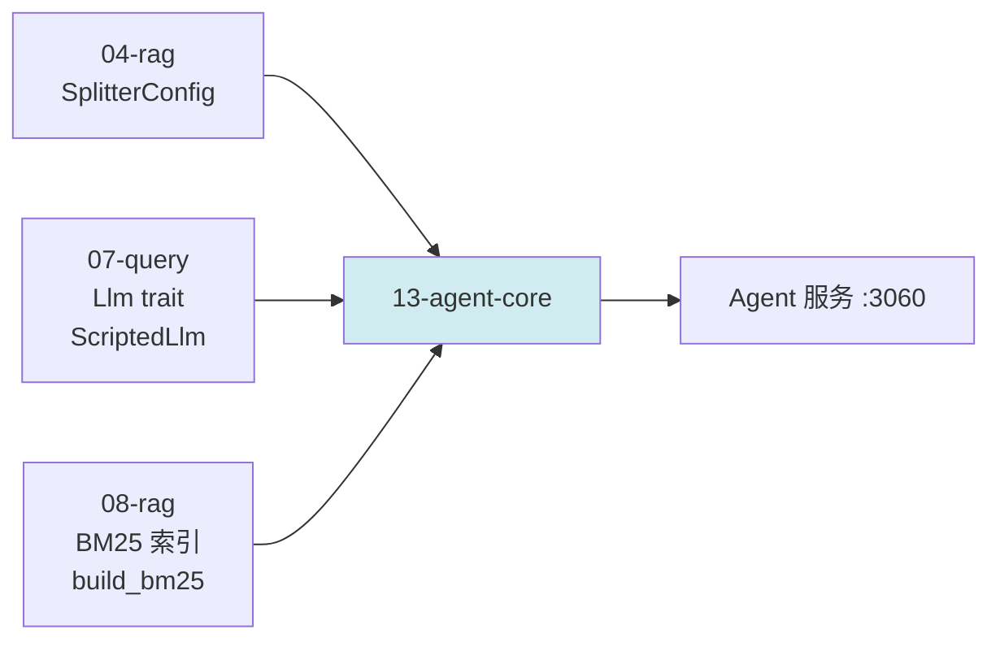

# 13-agent-core —— Agent 核心概念（ReAct + 工具 + 记忆 + 规划）

> **把「一个大模型」变成「一个会自己查资料的 Agent」。**
> 手撕 ReAct 循环、工具协议、输出解析器，并给出**三模式消融实测数据**。

---

## 这个项目解决什么问题

前面 12 个项目全部围绕**「检索增强生成（RAG）」** 展开 —— 流程是**写死**的：

```text
问题 ──> 一定检索 ──> 一定拼 top-k ──> 一定生成
```

用户问什么，就拿什么去检索。要检索几次、检索什么关键词，**代码说了算**。

而 Agent 的流程是**模型决定的**：

```text
问题 ──> 模型判断「我需要查资料吗？」
            ├─ 不需要 ──> 直接回答
            └─ 需要   ──> 模型自己写查询词，调工具
                          ↓
                       拿到 Observation ──> 模型再判断
                          ├─ 还需要 ──> 换查询词再查
                          └─ 够了   ──> 给出最终答案
```

关键差异只有一个：**谁来决定检索的时机和查询词**。

本项目把这个差异**做出来、量出来**。

---

## 参考资料

| 来源 | 内容 |
|---|---|
| [博客：LLM Powered Autonomous Agents](https://lilianweng.github.io/posts/2023-06-23-agent/) | 三大组件：规划 / 记忆 / 工具使用 |
| [论文：ReAct (arXiv:2210.03629)](https://arxiv.org/abs/2210.03629) | 推理与行动交织的循环（ICLR 2023） |
| [MRKL](https://arxiv.org/abs/2205.11435) | LLM 当路由器 + 符号工具 |

---

## 三大组件的对应关系

博客把 Agent 拆成三个组件。本项目逐个落地：

| 博客里的组件 | 本项目的实现 | 模块 |
|---|---|---|
| **工具使用**（Tool Use） | `search`（BM25 检索）+ `calculate`（符号工具） | `tools.rs` |
| **规划 / 自我反思**（Planning） | ReAct 循环的 `Thought` 步骤 | `agent.rs` / `prompt.rs` |
| **短期记忆**（Short-term） | 循环轨迹 —— 每一轮的思考与观察都在上下文里 | `agent.rs` |
| **长期记忆**（Long-term） | `search` 工具背后的 BM25 倒排索引 | `tools.rs` |

> **记忆的三层映射**（博客原文）：
> 感觉记忆 ↔ 原始输入的嵌入表示；短期记忆 ↔ 上下文学习；长期记忆 ↔ 外部向量库。
> 本项目的 `search` 工具就是「长期记忆的读接口」—— Agent 自己决定什么时候「回忆」。

---

## 快速开始

```bash
# ① 命令行跑一次 Agent（ReAct 模式）
cargo run -p agent-13 -- run "Agent 的三大组件是什么"

# ② ★ 三模式消融对照（direct / act_only / react）
cargo run -p agent-13 -- compare "Agent 的三大组件是什么"

# ③ ★ 打印完整 ReAct 轨迹
cargo run -p agent-13 -- trace "Agent 的三大组件是什么"

# ④ 工具说明 + 工具实测（**不调模型，不需要 API key**）
cargo run -p agent-13 -- tools

# ⑤ 只测试输出解析器（不调模型）
cargo run -p agent-13 -- parse

# ⑥ 启动 HTTP 服务（127.0.0.1:3060）
cargo run -p agent-13 -- serve
```

> 需要 `DEEPSEEK_API_KEY` 环境变量（走 `genai` 的 DeepSeek 适配器）。

---

## ReAct 循环

### 论文的原始格式

ReAct 论文里 HotpotQA 任务的提示词长这样：

```text
Answer the following questions as best you can. You have access to the following tools:

{tool_descriptions}

Use the following format:

Question: the input question you must answer
Thought: you should always think about what to do
Action: the action to take, should be one of [{tool_names}]
Action Input: the input to the action
Observation: the result of the action
... (this Thought/Action/Action Input/Observation can repeat N times)
Thought: I now know the final answer
Final Answer: the final answer to the original input question
```

### 本项目的执行引擎



### 三个关键的设计决定

#### 1. `Thought: you should always think about what to do`

「always」是刻意的 —— 它把「先想再做」变成**硬约束**，而不是「建议」。

论文的消融实验证明：去掉 `Thought:` 后模型在 HotpotQA 上明显下降（Act-only 基线）。
本项目用 `act_only` 模式复现这个对照。

#### 2. `Thought: I now know the final answer` —— 收尾信号

模型需要一个明确的「我该停了」的触发器。没有它，模型会在工具循环里反复转 ——
这正是 AutoGPT 最著名的失败模式。

本项目保留了这个设计，但**额外**加了 `Final Answer:` 作为终止标记，
因为 `Final Answer:` 比「我知道了」更容易被程序可靠地解析。

#### 3. 为什么不用 function calling

| | function calling | ReAct 文本协议 |
|---|---|---|
| 可靠性 | 高（provider 保证结构） | 低（要自己解析，可能格式错） |
| 通用性 | 受 provider 支持度限制 | 任何模型都能用 |
| 可解释性 | 低（看不到中间思考） | **高**（`Thought:` 全文可见） |

**可解释性是 ReAct 的全部意义所在** —— 论文的核心主张就是
「推理轨迹让模型更可解释、更可信」。用 function calling，`Thought:` 就丢了。

而且文本协议让**对照实验更干净**：function calling 的结构化输出会「暗示」
模型该调哪个工具，而文本协议下模型完全自由。

---

## 三模式消融 ★

这是本项目的**核心产出**。

| 模式 | 工具 | 思考 | 验证什么 |
|---|---|---|---|
| `direct` | ❌ | ❌ | 模型参数里的知识够不够 |
| `act_only` | ✅ | ❌ | 「行动」本身值多少 |
| `react` | ✅ | ✅ | 「思考」又贡献了多少 |

三者的**变量是单一的** —— 工具集、LLM、配置全都一样，只有模式不同。

```bash
cargo run -p agent-13 -- compare "Agent 的三大组件是什么"
```

### 实测结果（`deepseek-flash`，temp=0）

| 模式 | 工具调用 | 步数 | 耗时 | 答案质量 |
|---|---|---|---|---|
| `direct` | 0 | 1 | 1583ms | ❌ **答错**：说成「感知/决策/执行」 |
| `act_only` | 1 | 2 | 2738ms | ❌ **答错 + 编造数字**：「一次工具调用平均 3 秒，连续调用 7 次共需 21 秒」 |
| `react` | 1 | 2 | 4512ms | ✅ **答对**：规划 / 记忆 / 工具使用，并标注来源 |

### 这组数据说明了什么

**`direct` → `act_only`**：加上工具后，模型仍然答错 —— 而且**编造了一堆数字**
（「平均 3 秒」「7 次」「21 秒」）。这直接印证了博客里的警告：

> 自然语言作为模型与外部组件之间的接口，可靠性有限。

没有工具时，模型会**用参数里的知识硬编**一个看起来合理的答案。

**`act_only` → `react`**：加上 `Thought:` 之后，模型先想清楚「用户问的是三大组件」，
再去检索，读到观察后确认「信息足够」才作答 —— 答案正确。

> ⚠️ **单次运行不能当实验结论。**
> 上表是 1 次实测，方向与论文一致，但样本量 n=1。
> 严谨的做法是跑一个题集、多次重复、统计正确率 —— 那属于 09-rag-eval 的活。
> 本项目提供的是**可复现的对照框架**，不是统计结论。

---

## 工具层

### 两个工具

| 工具 | 类型 | 对应 |
|---|---|---|
| `search` | **稀疏检索**（BM25 倒排索引） | LangChain 示例里的 `Wikipedia` |
| `calculate` | **符号工具**（手写算术求值器） | MRKL 论文里的 `Calculator` |

两个工具正好覆盖两类专家模块：「查资料」和「算数」。

### 为什么 `search` 用 BM25 而不是向量检索

因为这个项目的主角是 **ReAct 的动作空间**，不是检索。

1. **零模型依赖** —— 不需要下载嵌入模型，`cargo run` 立刻能跑
2. **完全确定性** —— 同一查询永远同一结果，测试可复现
3. **关键词精确命中** —— 查「ReAct」这种专有名词时比向量更准

想换成向量检索的话，仓库里 05~12 已有完整实现 —— 换掉 `search` 的实现即可，
**Agent 循环一行都不用改**。

### 工具失败要被模型看见

工具执行失败时，我们**不返回错误**，而是把错误信息当作一条 `Observation`
喂回模型 —— 模型读到「参数不合法」就能自己纠正。



这正是 `AgentError::is_degradable()` 只对**工具错误**返回 `true` 的原因。

### MRKL 的启示：算数必须交给工具

MRKL 论文里的实验正好说明了这类符号工具的价值：

> LLM（7B）**很难可靠地提取出算术运算的正确参数** ——
> 口头表述的算术题比写明式的算术题难得多。

所以本项目的 `calculate` 工具描述里明确写着「**不要自己心算**」，
提示词也重复了一遍。

---

## 输出解析器 —— 「一半的工作量」

博客里那句「几乎所有 Agent 演示代码的一半工作量都花在解析模型输出上」
说的就是这个。本项目的 `parse_react_output` 就是那「一半工作量」。

### 三层容错



### ⚠️ 必须找**最后一个**标记 —— 实测踩到的真坑

这是本项目最值得记录的一个 bug。

模型有时会**回显整个提示词**再继续 —— 因为提示词里带着 few-shot 示例和上一轮的轨迹，
模型会顺手把格式说明、示例、轨迹全抄一遍，然后才输出自己的下一步。

实测输出：

```text
Question: 用户的问题                 ← 回显
Thought: 用户问的是 ReAct 框架...      ← 回显（示例里的）
Action: search                      ← 回显（上一轮的）
Action Input: {"query": "..."}      ← 回显（上一轮的）
Observation: [1] ...                ← 回显（上一轮的）
Thought: 第一条片段已经明确给出了...   ← 模型自己的
Final Answer: 在 ReAct 框架中...      ← 模型自己的
```

如果用 `find`（**第一个**匹配），会匹配到**回显里的旧 `Action:`** ——
于是程序把上一步的工具**再执行一遍**，然后把模型真正的答案当成 observation 丢掉。

**症状**：答案变成完全不相关的内容。修复前实测产出过
「平均每轮调用 3 次工具（计算式：(2 + 4 + 3) / 3 = 3，由 calculate 工具计算得出）」。

**修复**：统一用 `rfind`（**最后一个**匹配）——
模型自己的输出**永远在回显之后**，所以最后一个标记才是它真正想说的。

回归测试锁在 `agent.rs` 的 `echo_does_not_cause_the_previous_action_to_repeat`。

---

## 代码调用详细流程图（函数级）

> 节点写的是**真实函数名**，边上标的是**调用点行号**。全部对着源码。

### ★ `Agent::run_with_mode()` 的完整调用链

**红色节点是「容易写错」的地方。**



### `parse_react_output()`：为什么必须用 `rfind`

**这张图是 13 最值得记住的一张。** 上一步的工具被重跑、真正的答案被丢弃，根因就在这里。



对照一下 `find` 与 `rfind` 的差别：



### 三模式消融：只有一个变量不同

**这是 13 最重要的实验设计** —— 三种模式跑在**同一个 Agent 实例**上，只有 `mode` 变量变。



---

## 时序图



---

## 知识地图



---

## HTTP API

| 方法 | 路径 | 说明 |
|---|---|---|
| GET | `/` | 服务信息 + 工具清单 + 知识库状态 |
| GET | `/health` | 健康检查 |
| POST | `/api/run` | **跑一次 Agent** |
| POST | `/api/compare` | **三模式消融对照** ★ |
| POST | `/api/parse` | **只解析模型输出**（调试解析器） |

```bash
# 跑一次 Agent
curl -s localhost:3060/api/run -H 'Content-Type: application/json' -d '{
  "question": "Agent 的三大组件是什么"
}'

# ★ 三模式对照
curl -s localhost:3060/api/compare -H 'Content-Type: application/json' -d '{
  "question": "Agent 的三大组件是什么"
}'

# 只解析模型输出（不调模型）
curl -s localhost:3060/api/parse -H 'Content-Type: application/json' -d '{
  "output": "Thought: 需要查资料\nAction: search\nAction Input: {\"query\": \"ReAct\"}"
}'
```

### 为什么 `/api/parse` 值得存在

解析器是 Agent 系统里**最容易出错**的部分（见上面那个回显 bug）。
给它一个独立端点，能直接看到「模型这段输出被解析成了什么」。

---

## 项目结构

```text
13-agent-core/
├── Cargo.toml
├── Makefile
├── README.md
├── data/
│   └── kb.md                  # 知识库（search 工具的检索范围）
├── src/
│   ├── lib.rs                 # 库入口
│   ├── main.rs                # 命令行入口（run/compare/trace/tools/parse/serve）
│   ├── agent.rs               # ★ ReAct 循环 + 输出解析器
│   ├── prompt.rs              # ★ ReAct 提示词 + 三模式变体
│   ├── tools.rs               # ★ 工具层（search / calculate）
│   ├── llm.rs                 # LLM 抽象（复用 07 的 Llm trait）
│   ├── config.rs              # 全局配置
│   ├── error.rs               # 统一错误类型
│   └── api/
│       ├── mod.rs
│       ├── handlers.rs
│       ├── models.rs
│       ├── routes.rs
│       └── extract.rs
└── tests/
    └── integration.rs         # 集成测试（用假 LLM，零网络）
```

---

## 复用关系



| 来源 | 复用什么 | 为什么复用 |
|---|---|---|
| `04-rag` | `SplitterConfig` | 建 BM25 索引时要用**同一套**分块配置 |
| `07-query` | `Llm` trait / `GenaiLlm` / `ScriptedLlm` | `ScriptedLlm` 让 Agent 循环能被**确定性测试** |
| `08-rag` | `bm25` / `index::build_bm25` | BM25 倒排索引（`search` 工具的底层） |

**没有复用的部分**（手撕的部分）：

- ReAct 提示词组装
- ReAct 循环引擎
- 输出解析器
- 工具协议（`Tool` trait / `ToolSpec` / `ToolOutcome`）
- 符号工具（手写表达式求值器）

---

## 测试

```bash
cargo test -p agent-13
```

| 层级 | 数量 | 说明 |
|---|---|---|
| 单元测试（lib） | 52 | 提示词组装、解析器、工具、算术求值器、配置 |
| 集成测试 | 15 | 完整 ReAct 循环（用假 LLM，零网络） |
| **属性测试（proptest）** | **10** | **解析器的不变量（任意输入不 panic）** |

### 为什么 Agent 循环可以离线测

Agent 循环是一个**状态机**：每一步的输出决定下一步的输入。
如果 LLM 不可替换，测试就只能靠「真的调一次模型」—— 那意味着慢、不确定、要花钱，
而且**测不了边界**（比如「模型连调 6 次工具」这条路径，靠真实模型根本触发不了）。

有了 `ScriptedLlm`，这些全部变成确定性的单元测试。

### ⭐ 属性测试：解析器的不变量

`parse_react_output` 的输入是**模型的原始输出** —— 这是整个仓库里**最不可信的一段文本**
（模型可能回显整个提示词、可能输出任意 Unicode、可能给出格式完全错误的 JSON）。

单元测试只能覆盖「人想得到的」输入。属性测试（`tests/properties.rs`）让**随机输入**
去撞不变量，失败时自动收缩成最小反例：

| 不变量 | 含义 |
|---|---|
| `never_panics` | 任意输入都不 panic（**最重要的那条**） |
| `final_answer_wins` | 有 `Final Answer:` 时一定解析成最终答案 |
| `action_tool_name_is_sane` | 工具名是纯标识符 |
| `action_args_are_always_an_object` | 参数永远是 JSON 对象 |
| `last_marker_wins` | 多个标记时取**最后一个** |
| `action_without_tool_name_falls_back_to_unstructured` | 没有工具名时回退成 `Unstructured` |

```bash
cargo test -p agent-13 --test properties
```

#### ⚠️ 它真的抓到过两个 bug

**坑 A：Unicode 小写化导致越界 panic**

`find_last_marker` 曾是：

```rust
let lower = text.to_lowercase();
lower.rfind(&marker.to_lowercase())
```

Unicode 小写化**不保证字节长度不变** —— `İ`（U+0130）小写化成 `i` + 组合字符（2 字节 → 3 字节）。
于是 `lower` 的偏移量比 `text` 大，用它切 `text` 直接越界：

```text
text = "İİİAction: x"  →  lower.rfind("action:") = 9
text[9 + 7..]  →  start byte index 16 is out of bounds for string of length 15
```

修法：**在原串的字符边界上做 ASCII 大小写比较**（`char_indices().rev()` + `eq_ignore_ascii_case`）。
⚠️ 关键教训：**不要把 `to_lowercase()` 和 `rfind` 配对使用** —— 前者可能改变字节长度。

**坑 B：工具名没做「标识符截断」**

`Action:Thought:Thought:` 曾被解析出工具名 `Thought:Thought` ——
一个**永远匹配不上任何工具**的名字（`trim_matches` 只削首尾，内部冒号留着）。
修法：「取开头那段连续的字母/数字/下划线」。

⚠️ 回归种子记在 `tests/properties.proptest-regressions`（**已入库**），每次跑都会先重放这些反例。

### 集成测试覆盖的场景

| 场景 | 验证什么 |
|---|---|
| 单次工具调用后作答 | 主路径 |
| 多次工具调用 | 轨迹累积正确 |
| Observation 回填 | 下一轮提示词里必须带观察内容 |
| 工具失败 | 错误作为 Observation 喂回模型，**运行不失败** |
| 未知工具 | 提示可用工具列表，让模型自我纠正 |
| 达到步数上限 | 兜底再问一次，不报错 |
| 收尾调用失败 | **降级**，前面几步的观察不丢（回归测试） |
| 模型输出跑偏 | 容错当成答案 |
| 模式差异 | `direct` 不挂工具、`act_only` 无 `Thought:` |

---

## 踩坑记录

### 坑 1：模型会回显整个提示词

**症状**：答案变成完全不相关的内容（实测产出过「平均每轮调用 3 次工具」）。

**根因**：解析器用 `find` 找**第一个** `Action:`，匹配到了回显里的旧动作。

**修复**：统一用 `rfind`（**最后一个**匹配）。

详见「输出解析器」一节。

### 坑 2：few-shot 示例的问题和真实问题撞了

**症状**：模型在第 2 步说「用户重复了示例里的问题」，然后照着示例的 Observation 编了一个不相关的答案。

**根因**：示例的 `Question` 和真实 `Question` 长得太像，模型分不清
「下面这段 Observation 是我刚查到的」还是「示例里的」。

**修复**：把示例的问题换成**知识库里的另一个话题**（MRKL），
并加了一条回归测试 `few_shot_questions_differ_from_the_common_test_question`。

> 这个坑和坑 1 是**同一个问题的两面** —— 都是因为「提示词里的示例」和
> 「真实上下文」在文本上无法区分。解法都是**让它们在文本上就错开**。

### 坑 3：`ActOnly` 对照组不能共用带 `Thought:` 的示例

如果对照组也带着 `Thought:` 的示例，模型会从示例里学到 `Thought:` 的写法 ——
「思考」这个变量就不是单一的了，消融实验直接作废。

所以 `FEW_SHOT_ACT` 是**单独写的一份**，结构完全相同，只是去掉了 `Thought:` 行。

### 坑 4：收尾调用失败会让整个运行失败

**症状**：达到步数上限 → 兜底再问一次 → 那次调用失败 → `?` 直接传播 → 整个 run 报错。

**后果**：**前面几步辛苦收集的观察全丢了**。

**修复**：降级 —— 收集到的观察本身是有价值的（用户能看到 Agent 查了什么）。

### 坑 5：推理模型 + 小 `max_tokens` = 输出被思考吃光

复用 07 的结论：**推理模型的思考 token 和正文共用 `max_tokens` 预算**。

Agent 的每一步输出都很短（`Thought/Action/Action Input`），思考模式收益极低、
风险极高 —— 所以 `make_llm` 默认**关掉思考**（`LlmOptions::without_reasoning`）。

---

## 技术参考速查

| 概念 | 本项目的实现 | 参考 |
|---|---|---|
| ReAct 循环 | `agent.rs` 的 `Agent::run_with_mode` | [arXiv:2210.03629](https://arxiv.org/abs/2210.03629) |
| ReAct 提示词 | `prompt.rs` 的 `FEW_SHOT_REACT` / `build_react_prompt` | 同上 |
| 工具调用协议 | `tools.rs` 的 `Tool` / `ToolSpec` / `ToolOutcome` | LangChain / OpenAI function calling |
| LLM 抽象 | `llm.rs`（复用 `rag_07::llm::Llm`） | — |
| 短期记忆 | `agent.rs` 的 `trajectory` 字符串 | [博客](https://lilianweng.github.io/posts/2023-06-23-agent/) |
| 长期记忆 | `tools.rs` 的 `SearchTool` + BM25 索引 | 同上 |
| 规划 / 自我反思 | `prompt.rs` 的 `Thought` 步骤 | 同上 |
| 符号工具 | `tools.rs` 的 `calculate` | [MRKL](https://arxiv.org/abs/2205.11435) |
| 混合检索 | 复用 `rag_08::bm25` | 本仓库 08-rag |
| 输出解析 | `agent.rs` 的 `parse_react_output` | 本仓库 06~12 的引用解析可参考 |

---

## 配置

| 变量 | 说明 | 默认 |
|---|---|---|
| `AGENT_DATA_DIR` | 知识库目录 | `13-agent-core/data` |
| `AGENT_BIND_ADDR` | 监听地址 | `127.0.0.1:3060` |
| `AGENT_MODE` | `react` / `act_only` / `direct` | `react` |
| `AGENT_MAX_STEPS` | 最大步数 | `6` |
| `AGENT_MAX_OBSERVATION_CHARS` | 观察文本截断长度 | `1200` |
| `AGENT_SEARCH_TOP_K` | `search` 默认返回条数 | `3` |
| `AGENT_MODEL` | 模型名 | `deepseek-flash` |
| `AGENT_TEMPERATURE` | 温度 | `0.0` |
| `AGENT_MAX_TOKENS` | max tokens | `1024` |
| `AGENT_FEW_SHOT` | 是否带 few-shot 示例 | `true` |
| `AGENT_SHOW_RAW` | 打印模型原始输出（调试） | 未设置 |

---

## 日志

全仓库统一走 `00-logging`（`agent-logging`）。

```bash
RUST_LOG=info cargo run -p agent-13 -- compare "问题"      # 默认
RUST_LOG=debug,agent_13=trace cargo run -p agent-13 -- compare "问题"  # 逐步看 ReAct
```

| 事件 | 级别 | 关键字段 |
|---|---|---|
| 服务启动 | `INFO` | `addr` |
| 每一步组装提示词 / 模型返回 | `DEBUG` | `mode` / `step` / `raw_len` |
| 工具执行 | `DEBUG` | `tool` / `ok` / `observation_len` |
| 工具失败（错误已转观察喂回模型） | `WARN` | `tool` / `observation` |
| 模型输出无法解析（按答案容错） | `WARN` | `mode` / `step` |
| 达到最大步数 | `WARN` | `max_steps` / `tool_calls` |
| 收尾调用失败（降级为观察摘要） | `WARN` | `error` |
| Agent 给出最终答案 / 运行结束 | `INFO` | `mode` / `tool_calls` / `steps` / `elapsed_ms` |

HTTP 层用 `agent_logging::trace_layer()`，每个请求带 `request_id` / `method` /
`path` / `status` / `elapsed_ms`。

---

## 下一步

| 方向 | 说明 |
|---|---|
| **加规划模块** | 博客提到的「任务分解」：把大任务拆成子目标，每步一个子问题 |
| **加长期记忆写入** | 现在的 `search` 只读不写 —— 可以让 Agent 把新观察存进索引 |
| **统计评估** | 把 09-rag-eval 的评估集接过来，跑 n>1 的正确率统计 |
| **换向量检索** | 把 `search` 的实现换成 FAISS / Milvus，Agent 循环不用改 |
| **流式输出** | 把 `genai` 的流式接口接进来，让 `Thought` 边生成边显示 |
