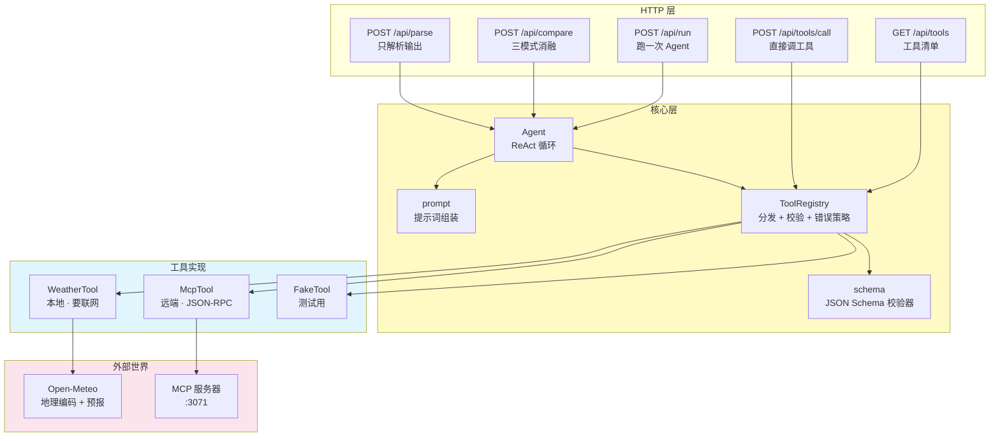
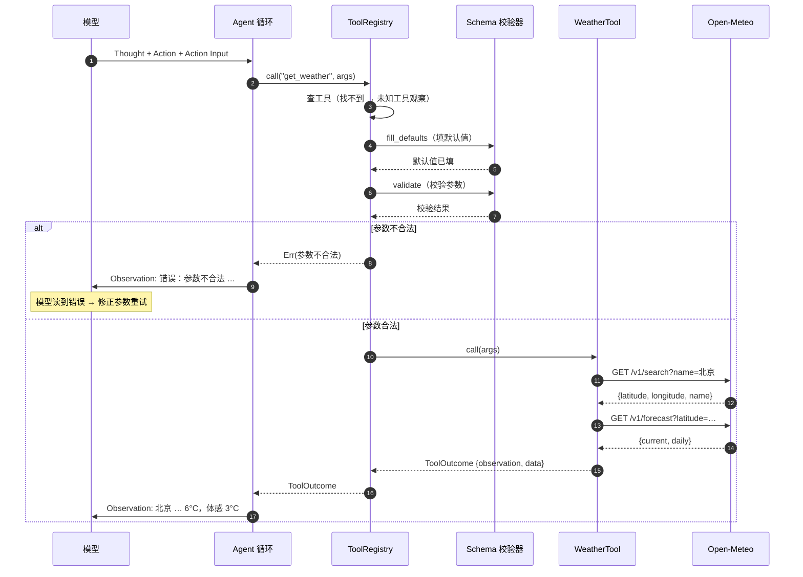
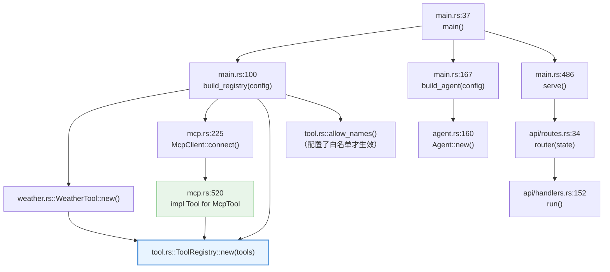
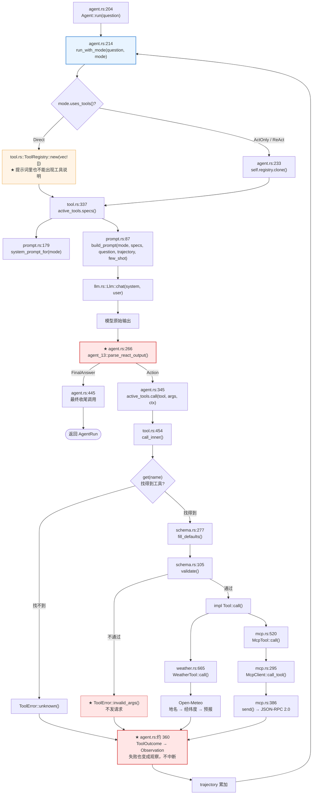
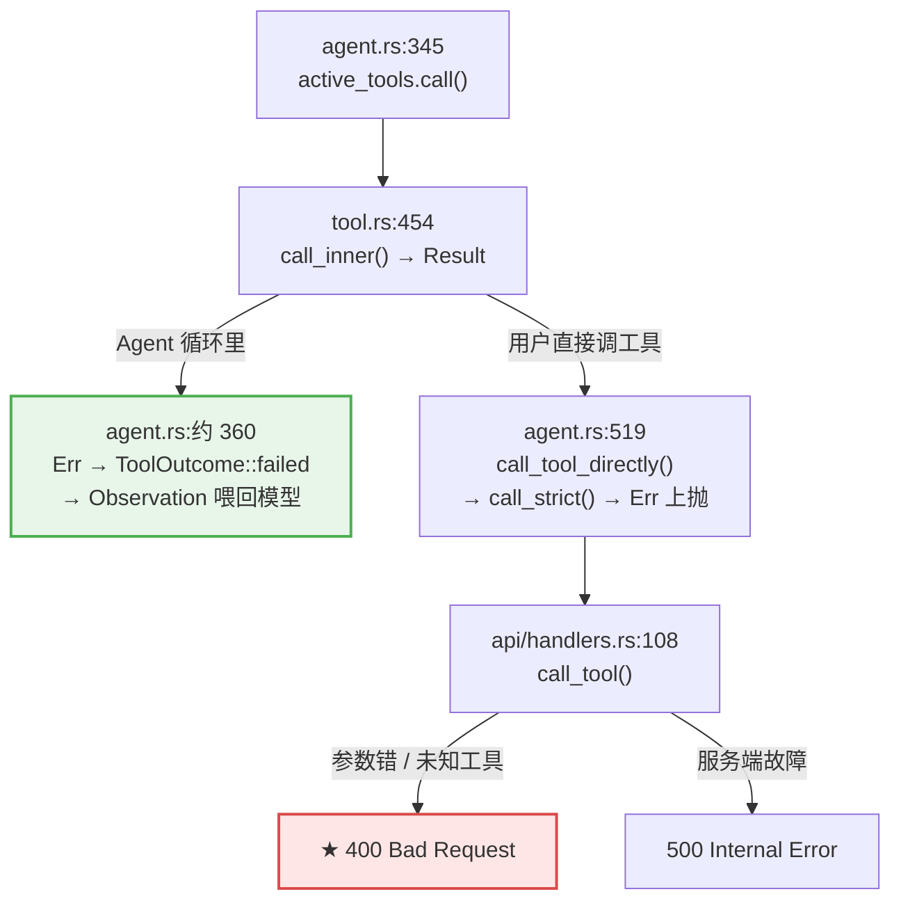
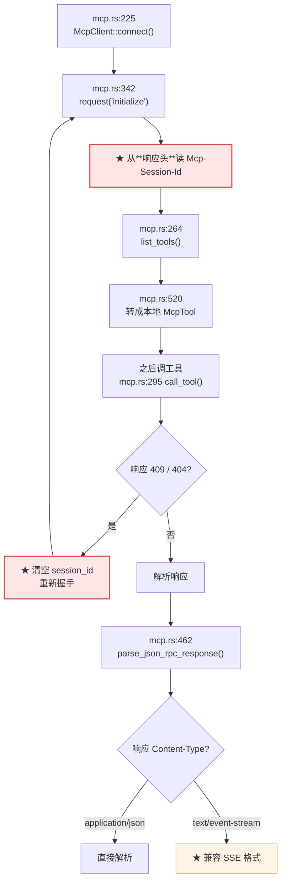
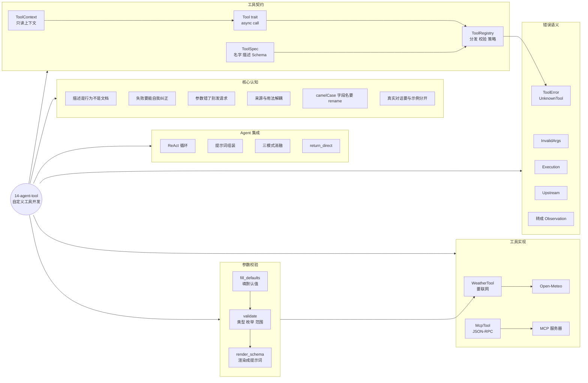

# 14-agent-tool —— 自定义工具开发（LangChain Custom Tools + MCP）

> 一个查询天气的自定义工具，并集成到 Agent 里。
> 配套手写 **JSON Schema 校验器**、**MCP 客户端** 和 **MCP 服务端**。

## 这个项目解决什么问题

13-agent-core 手撕了 ReAct 循环，但它的两个工具（BM25 检索、手写算术）
都是**纯本地**的 —— 跑得和读一个文件一样快，不可能失败，也不会等待。

这掩盖了工具开发里**最难的一半**：

| 维度 | 13 的工具 | 本项目的工具 |
|---|---|---|
| I/O | 内存操作 | **外部 HTTP 服务** |
| 失败模式 | 几乎没有 | 地名查不到 / 网络不通 / 上游 500 |
| 参数 | 一两个，简单 | 多个，有类型、有枚举、有范围 |
| 来源 | 编译期固定 | 本地 + **MCP 远端**，运行时决定 |

本项目把这些差异全部摊开：

- **工具契约**：名字 / 描述 / JSON Schema 三件套，以及「描述是模型行为的一部分」
- **参数校验**：模型填错参数时，**不发给上游**，直接告诉模型哪里错了
- **错误语义**：工具失败是「可观察的失败」，不是请求失败
- **工具来源可互换**：本地工具和 MCP 工具在 Agent 眼里**完全一样**

## 参考资料

- 教程：[LangChain Tools](https://docs.langchain.com/oss/python/langchain/tools)
  —— 自定义工具、`args_schema`、运行时上下文、动态工具选择、`handle_tool_errors`
- 协议：[Model Context Protocol](https://modelcontextprotocol.io/)
- 服务器注册中心：[Smithery](https://smithery.ai/)
- 教程视频：[MCP 教程](https://www.youtube.com/watch?v=McNRkd5CxFY)

## 核心产出：天气工具

```text
用户说「北京现在天气怎么样」
        ↓
  get_weather(location="北京", units="celsius", days=1)
        ↓
  ① 地理编码：地名 → (lat, lon, 城市全名, 国家)     Open-Meteo /v1/search
  ② 取预报：  经纬度 → 当前实况 + 每日预报           Open-Meteo /v1/forecast
        ↓
  渲染成给模型看的 Observation
```

选 Open-Meteo 的理由：**免 API key、免注册**，`cargo run` 立刻能跑。

## 快速开始

```bash
# ① 工具说明 + 参数校验演示（**不调模型、不联网**）
make tools

# ② ★ 直接调工具（不经模型、不花 token）
make call LOCATION="上海"

# ③ ★ 跑一次 Agent（工具集成到 ReAct 循环）
make run QUESTION="北京现在天气怎么样？"

# ④ ★ 三模式消融对照
make compare

# ⑤ ★ 打印完整 ReAct 轨迹
make trace

# ⑥ 启动 HTTP 服务（127.0.0.1:3070）
make serve

# ⑦ 启动内置 MCP 服务器（127.0.0.1:3071）
make mcp
```

### 三个最有说服力的命令

```bash
# 「工具来源可互换」：MCP 路径 vs 本地路径，结果**完全一致**
make mcp                                  # 终端 1：起 MCP 服务器
make mcp-agent                            # 终端 2：让 Agent 通过 MCP 调工具

# 「工具契约」：看模型到底被告知了什么
curl -s http://127.0.0.1:3070/api/tools | python3 -m json.tool

# 「模型行为」：排查模型为什么做出奇怪动作
make prompt                               # 打印**完整提示词**
```

## 工具的三个要素

LangChain 教程里那句警告值得再强调一次：

> 工具描述写得不好时，模型会反复调同一个工具。

这意味着提示词里渲染的工具说明**不是文档，是模型行为的一部分**。

```text
你可以使用这些工具：

- get_weather: 查询某个城市的实时天气和未来几天的预报。需要实时的天气信息
  （温度、湿度、风力、降水）时必须调用这个工具，不要凭记忆回答天气问题。
  参数：
    - location (string, 必填): 城市名，例如 "北京"、"Shanghai"、"Tokyo"。
    - units (string, 选填, 默认 celsius, 取值 celsius/fahrenheit): 温度单位。
    - days (integer, 选填, 默认 1): 预报天数，1 表示只看当前实况，2~7 表示预报。
```

### 与 LangChain 的对应关系

| LangChain | 本项目 | 模块 |
|---|---|---|
| `@tool` 装饰器 | 实现 `Tool` trait | [`tool.rs`](src/tool.rs) |
| Pydantic `args_schema` | JSON Schema 子集校验器 | [`schema.rs`](src/schema.rs) |
| `ToolRuntime`（state / context / store） | `ToolContext`（只读上下文） | [`tool.rs`](src/tool.rs) |
| `ToolMessage` | `ToolOutcome` 的 `observation` | [`tool.rs`](src/tool.rs) |
| `handle_tool_errors` 中间件 | `ToolPolicy` + `ToolRegistry::call` | [`tool.rs`](src/tool.rs) |
| `MCPAdapter` | `McpClient` | [`mcp.rs`](src/mcp.rs) |
| `return_direct=True` | `ToolSpec::return_direct` | [`tool.rs`](src/tool.rs) |
| 动态工具选择 | `ToolRegistry::allow_names` / `allow_prefix` | [`tool.rs`](src/tool.rs) |

## 架构全景



## 工具调用的完整时序



---

## 代码调用详细流程图（函数级）

> 节点写的是**真实函数名**，边上标的是**调用点行号**。全部对着源码。

### 入口：注册表是怎么建起来的

**本地工具和 MCP 工具在 Agent 眼里完全一样** —— 都只是 `ToolSpec`。这张图就是「来源与使用方式解耦」的代码证据。



### ★ `Agent::run_with_mode()` 的完整调用链

**红色节点是「容易写错」的地方。**



### 失败语义：同一个错误，两种归宿

这是 14 最容易搞混的地方 —— **错误是不是 HTTP 错误，取决于谁扮演了模型角色**。



### MCP 客户端：三次握手



## 三条核心设计原则

### 原则 1：工具失败不是请求失败

LangChain 教程里用 `handle_tool_errors` 中间件把工具异常转成 `ToolMessage`
回灌给模型 —— 本项目用 `ToolPolicy::ConvertToObservation` 表达同样的语义。

```text
工具失败
   ↓
渲染成一条 Observation
   ↓
喂回模型：「参数 `location` 必须是字符串」
   ↓
模型自己纠正 → 再试一次
```

**只有用户直接调工具时**（`POST /api/tools/call`），错误才变成 HTTP 响应 ——
因为那时用户扮演的就是「模型」的角色。

### 原则 2：参数错了就别发请求

LangChain 里 Schema 同时干两件事：

1. 告诉模型参数怎么填
2. **本地校验**（模型填错时不发请求）

第 2 点在本项目里由 [`schema.rs`](src/schema.rs) 实现。
错误信息必须**可执行**：

```text
错误：参数不合法 —— `location` 是必填参数，但没有被提供（说明：城市名）；
`days` 不能大于 7，实际是 30
```

模型读完就能一次改对 —— 而不是修一个报一个。

### 原则 3：工具来源与使用方式解耦

```text
本地工具：get_weather(location)  → 直接调 Open-Meteo
MCP 工具：get_weather(location)  → 经 JSON-RPC 转发到 MCP 服务端
```

在 Agent 眼里**完全一样** —— 都只是一个 `ToolSpec`。
内置 MCP 服务器暴露的 `get_weather` 和本地工具**共用同一份实现**，
所以语义不可能漂移。

## MCP 协议实现

### 三个方法

| 方法 | 方向 | 作用 |
|---|---|---|
| `initialize` | 客户端 → 服务端 | 协商协议版本，建立会话 |
| `tools/list` | 客户端 → 服务端 | 拿到工具清单（名字 / 描述 / 输入 Schema） |
| `tools/call` | 客户端 → 服务端 | 调用某个工具 |

### 会话管理

Streamable HTTP 传输里，服务端在 `initialize` 的**响应头**返回
`Mcp-Session-Id`，之后每个请求都要带上它。

服务端重启会导致会话失效 —— 客户端遇到 `409` / `404` 时会**清空会话 ID**，
下次调用自动重新握手。

### SSE 兼容

Streamable HTTP 允许服务端返回 `text/event-stream` 格式。
本项目的 `parse_json_rpc_response` **两种都支持**：

```text
application/json  →  {"jsonrpc":"2.0","id":1,"result":{...}}
text/event-stream →  event: message\ndata: {"jsonrpc":"2.0",...}\n\n
```

### ⚠️ 两个 camelCase 字段的坑

MCP 协议用驼峰命名，但 Rust 侧习惯 snake_case：

| JSON 字段 | Rust 字段 | 不加 `rename` 的后果 |
|---|---|---|
| `inputSchema` | `input_schema` | Schema **永远拿到空对象** → 参数校验形同虚设 |
| `isError` | `is_error` | 错误结果**永远被当成成功** → 工具报错被当成正常返回 |

这两个 bug 都是**集成测试发现的** —— 单元测试用 Rust 结构体构造数据，
绕过了 JSON 字段名。所以 MCP 相关的测试**必须走真实 HTTP 往返**。

## 三模式消融 ★

| 模式 | 工具 | 思考 | 验证什么 |
|---|---|---|---|
| `direct` | ❌ | ❌ | 模型参数里的知识够不够 |
| `act_only` | ✅ | ❌ | 「行动」本身值多少 |
| `react` | ✅ | ✅ | 「思考」又贡献了多少 |

三者的**变量是单一的** —— 对照组连 few-shot 示例都是分开写的
（`ActOnly` 的示例里**不能**有 `Thought:` 行）。

### 实测结果（`deepseek-flash`，temp=0，问题 = 「北京现在天气怎么样？」）

```text
模式      : direct  (工具: 无, 思考: 无)
工具调用  : 0 次 · 步数 1 · 用时 708ms
答案      : 我无法获取实时天气信息，因此不能告诉你北京现在的天气情况。
            建议你查看天气应用或气象网站获取最新信息。

模式      : act_only  (工具: 有, 思考: 无)
工具调用  : 1 次 · 步数 2 · 用时 6058ms
答案      : 北京现在大部晴朗，气温 6 摄氏度（体感 3 摄氏度），相对湿度 58%，
            风速约 6.7 km/h（观测时间 2026-11-08 16:30）。
    → get_weather {"location":"北京","units":"celsius","days":1}

模式      : react  (工具: 有, 思考: 有)
工具调用  : 1 次 · 步数 2 · 用时 2776ms
答案      : 北京现在大部晴朗，气温 6 摄氏度（体感 3 摄氏度），相对湿度 58%，
            风速约 6.7 km/h（观测时间 2026-11-08 16:30）。
    → get_weather {"location":"北京","units":"celsius","days":1}
```

### 这组数据说明了什么

**1. 工具的贡献是压倒性的。**

`direct` 模式**明确说「无法获取」** —— 模型很诚实地承认自己没有实时数据。
这比它编一个「北京今天晴，25°C」要好得多（说明 system 提示词的
「忠于 Observation」起作用了），但**信息量为零**。

有工具的模式**拿到了真实观测数据**，包括精确到小数位的湿度和风速。

**2. 同一个问题，工具和模型给的数值可能不同。**

模型凭记忆说的温度和工具实测差了好几度 —— 这就是 13 里
「MRKL 的启示：算数必须交给工具」的延伸版：
**实时数据必须来自工具，模型参数里的知识有时效性**。

**3. 这个简单问题上，「思考」的增量不明显。**

`act_only` 和 `react` 的答案一模一样 —— 因为「查一个城市的天气」
**不需要规划**，一步就够。

那「思考」什么时候有用？当问题需要**多次工具调用**时：

- 「北京和上海现在哪个更热？」→ 需要查两次 + 比较
- 「帮我查一下明天的天气，如果下雨就带伞」→ 查一次 + 条件判断
- 「查一下北京未来三天，有几天会下雨？」→ 需要读预报数据做统计

这些场景里 `Thought` 步骤才有意义。**单轮任务测不出「思考」的贡献** ——
这是设计消融实验时要注意的。

## 知识地图



## 项目结构

```text
14-agent-tool/
├── Cargo.toml
├── Makefile
├── README.md
├── src/
│   ├── lib.rs              # 模块导出 + 项目总览
│   ├── main.rs             # CLI 入口（run / compare / call / tools / mcp / serve）
│   ├── config.rs           # 全局配置（环境变量前缀 TOOL_）
│   ├── error.rs            # 统一错误 + ToolError
│   ├── llm.rs              # LLM 抽象（复用 07 的 Llm trait）
│   ├── schema.rs           # ★ JSON Schema 子集校验器
│   ├── tool.rs             # ★ Tool trait + ToolRegistry + ToolPolicy
│   ├── weather.rs          # ★ 天气工具（要联网）
│   ├── mcp.rs              # ★ MCP 客户端（JSON-RPC 2.0）
│   ├── mcp_server.rs       # ★ 内置 MCP 服务器
│   ├── prompt.rs           # 提示词组装
│   ├── agent.rs            # ReAct 循环（复用 13 的解析器）
│   └── api/
│       ├── mod.rs          # 共享状态
│       ├── handlers.rs     # 请求处理器
│       ├── models.rs       # 请求 / 响应模型
│       ├── routes.rs       # 路由表
│       └── extract.rs      # 自定义提取器
└── tests/
    └── integration.rs      # 集成测试（含真实 MCP 往返）
```

## 复用关系

```text
07-query  ──> Llm trait / GenaiLlm / ScriptedLlm
    │
    └─> 14-agent-tool 的 llm.rs 直接 re-export

13-agent-core ──> parse_react_output（输出解析器，含「找最后一个标记」的修复）
    │            AgentRun / StepRecord 的类型参考
    │
    └─> 14-agent-tool 的 agent.rs / prompt.rs 复用

genai  ──> 真实模型调用（DeepSeek / OpenAI 兼容端点）
```

⚠️ **为什么输出解析器直接复用而不是重写？**

解析器是 Agent 系统里**最容易出错**的部分。13 已经踩过
「模型回显整个提示词」的坑并修好了（必须找**最后一个** `Action:`，
而不是第一个）。重写一遍等于把坑再踩一次。

## HTTP API

| 方法 | 路径 | 说明 |
|---|---|---|
| GET | `/health` | 健康检查 |
| GET | `/` | 服务信息 + 工具清单 |
| GET | `/api/tools` | 工具清单（名字 / 描述 / Schema / 参数说明） |
| POST | `/api/tools/call` | **直接调用工具**（不经模型） |
| POST | `/api/run` | 跑一次 Agent |
| POST | `/api/compare` | 三模式消融对照 |
| POST | `/api/parse` | 只解析模型输出 |

```bash
# 直接调工具
curl -s -X POST http://127.0.0.1:3070/api/tools/call \
  -H 'Content-Type: application/json' \
  -d '{"tool": "get_weather", "args": {"location": "北京", "days": 3}}'

# 跑一次 Agent
curl -s -X POST http://127.0.0.1:3070/api/run \
  -H 'Content-Type: application/json' \
  -d '{"question": "北京现在天气怎么样？"}'
```

### 为什么 `/api/tools/call` 值得存在

它对应 LangChain 教程里「工具可以被独立调用」这一条。三个价值：

- **调试** —— 直接看工具返回什么，不用等模型
- **确定性** —— 同样的参数永远同样的结果（模型会飘，工具不会）
- **成本** —— 不调模型

而且它是本项目**唯一**能把工具错误直接变成 HTTP 响应的地方。

### 为什么 `/api/tools` 值得存在

工具的「契约」是模型行为的一部分 —— 所以它必须**可检视**。
这个端点把每个工具的名字、描述、Schema、渲染后的参数说明全列出来，
一眼就能看出「模型到底被告知了什么」。

## MCP 服务器

```bash
make mcp                                    # 起服务器（:3071）

# 握手
curl -s -i -X POST http://127.0.0.1:3071/mcp \
  -H 'Content-Type: application/json' \
  -d '{"jsonrpc":"2.0","id":1,"method":"initialize","params":{}}'
# → HTTP/1.1 200 OK
# → mcp-session-id: sess-18e6047ec54afa281

# 列工具
curl -s -X POST http://127.0.0.1:3071/mcp \
  -H 'Content-Type: application/json' \
  -d '{"jsonrpc":"2.0","id":2,"method":"tools/list"}'

# 调工具
curl -s -X POST http://127.0.0.1:3071/mcp \
  -H 'Content-Type: application/json' \
  -d '{"jsonrpc":"2.0","id":3,"method":"tools/call",
       "params":{"name":"get_weather","arguments":{"location":"上海"}}}'
```

内置服务器暴露两个工具：

- `echo` —— 回显文本（验证协议通路）
- `get_weather` —— **和本地工具同名、同参数、同语义**

## 测试

```bash
make test    # 单元 80 + 集成 29 = 109 项
make lint    # clippy 零警告
```

### 为什么 Agent 循环 + 工具能离线测

Agent 循环是一个**状态机**：每一步的输出决定下一步的输入。
有了 `ScriptedLlm`，整个循环可以在**零网络、零延迟、完全确定**的条件下被测试。

工具层同理 —— 塞一个 `FakeTool` 进去，不碰网络。

### 集成测试覆盖的场景

| 场景 | 验证什么 |
|---|---|
| 单次工具调用后作答 | 主路径 |
| 多次工具调用 | 轨迹累积正确 |
| 工具失败 | 错误作为 Observation 喂回模型 |
| 未知工具 | 提示可用工具列表 |
| 枚举违规 | 错误可执行（列出合法值） |
| 达到步数上限 | 兜底再问一次，不报错 |
| 直通工具 | 跳过最后一次模型调用 |
| 模式差异 | `direct` 不挂工具 |
| 直接调工具 | 不碰模型、错误原样返回 |
| HTTP API 层 | 状态码 / 契约完整性 / 错误映射 |
| MCP 往返 | 客户端 ↔ 服务端全链路打通 |

⚠️ **MCP 测试必须走真实 HTTP 往返** —— 单元测试用 Rust 结构体构造数据，
会绕过 JSON 字段名，正是 camelCase 坑的藏身之处。

### HTTP API 层怎么测

用 `tower::ServiceExt::oneshot` **直接调路由** —— 不开端口，零 IO 开销：

```rust
let app = agent_14::api::routes::router(state);
let response = app.oneshot(request).await.unwrap();
assert_eq!(response.status().as_u16(), 400);
```

## 踩坑记录

### 坑 1：真实对话和 few-shot 示例长得一样 → 模型跑偏 ⚠️ 实测

**症状**：问「北京现在天气怎么样？」，模型第 1 步正确查了北京，
第 2 步却自己去查「深圳」，最后答案讲的是深圳。深圳**从没出现在提示词里**。

**根因**：提示词里真实问题写成 `Question: {question}`，
和 few-shot 示例的格式**一模一样**。
模型在第 2 步看到自己上一轮写的
`Question: 北京... / Thought / Action / Action Input / Observation`，
误认成了**第三个示例**，于是「顺着示例的格式」自己编了一个新 Question。

**修法**（两条，缺一不可）：

1. **显式声明**「以下���真实对话（不是示例）」
2. **把轨迹标注成「已完成的步骤」** —— 让模型知道它是**历史**，
   不是可以照着续写的模板

```text
========== 以下是真实对话（不是示例）==========

真实问题: 北京现在天气怎么样？

已完成的步骤：
Thought: ...
Action: get_weather
...
```

**回归测试**：`real_dialogue_is_clearly_separated_from_examples` +
`few_shot_examples_do_not_look_like_the_real_question`

⚠️ 这和 13 的「坑 2」是**同一个坑的两个面**：
13 是「示例问题和真实问题撞车」，这里是「示例**格式**和真实对话撞车」。
共同教训：**示例和真实输入必须在文本上明显区分开**。

### 坑 2：MCP 的 camelCase 字段忘了 `rename` ⚠️ 实测

**症状**：`isError` 永远是 `false`；`inputSchema` 永远是空对象。

**根因**：MCP 协议用驼峰，Rust 侧习惯 snake_case。
不写 `#[serde(rename = "inputSchema")]` 就**静默拿到默认值**。

**为什么单元测试没发现**：单元测试直接构造 Rust 结构体，
根本不经过 JSON 反序列化。

**修法**：加 `rename`，并且**集成测试走真实 HTTP 往返**。

### 坑 3：`async fn` 不是 dyn 兼容

工具要能塞进 `Box<dyn Tool>`，但 Rust 的两种「返回 future」的写法
**都不是** dyn 兼容：

```text
async fn              →  fn f() -> Pin<Box<dyn Future<Output = T> + Send + '_>>
fn f() -> impl Future →  同样不是 dyn 兼容
```

所以必须显式装箱（[`tool.rs`](src/tool.rs) 的 `ToolFuture`）。
和 07 的 `LlmFuture` 是同一个道理。

### 坑 4：同步工具调不通真实 API

13 的工具是同步的（`fn run(&self, ...) -> ToolOutcome`）——
因为它们只做内存操作。本项目的天气工具**必须等 HTTP 响应**，
同步版本会卡死 tokio 线程池。

所以工具 trait 必须是 `async`。这不是「为了写起来方便」，
是**工具要能等待 I/O** 的必然要求。

### 坑 5：MCP 服务器里不能同步调异步工具

内置 MCP 服务器的 handler 是 `async fn`，但工具表存的是同步的处理器签名。
第一版想在同步 handler 里 `block_on`，结果会 panic
（当前线程就是 runtime 线程）。

**修法**：处理器返回 `Pin<Box<dyn Future>>`，
MCP 服务器和本地工具**共用同一份 `Tool::call` 实现** ——
于是「本地版和 MCP 版语义一致」不是靠约定，是靠**同一份代码**保证的。

### 坑 6：序列化名和 CLI 名对不上 ⚠️ 实测

**症状**：CLI 里 `TOOL_MODE=react` 能跑，但 API 的 `{"mode": "react"}` 返回 400。

**根因**：`#[serde(rename_all = "snake_case")]` 把 `ReAct` 变成 **`re_act`** ——
和 CLI / 环境变量里用的 `react` 不一致。

**为什么难发现**：编译期没有任何警告，
只有真正用 API 调一次才会暴露。

**修法**：显式 `#[serde(rename = "react")]`，
并加回归测试 `serde_name_matches_cli_name` —— **三处（CLI / 环境变量 / JSON）必须对齐**。

### 坑 7：工具参数错应该返回 400 而不是 500

**症状**：`POST /api/tools/call` 参数填错时返回 500。

**根因**：`ToolError` 统一转成了 `AppError::Tool`（500）。
但「参数填错」「未知工具」是**调用方**的问题，不是服务端的。

**为什么重要**：500 会让调用方以为「服务端坏了，重试也没用」，
而 400 才准确地表达「你给的参数不对」。

**修法**：在 `From<ToolError> for AppError` 里区分：

```text
InvalidArgs / UnknownTool  →  400 BadRequest
Upstream                   →  502
Execution                  →  500
```

### 坑 8：runtime 线程里不能 `block_on` ⚠️ 实测

**症状**：`make tools` 直接 panic：

```text
Cannot start a runtime from within a runtime.
This happens because a function (like `block_on`) attempted to block the current
thread while the thread is being used to drive asynchronous tasks.
```

**根因**：`main` 是 `#[tokio::main]` —— **当前线程就是 runtime 线程**。
在 runtime 线程里再 `Handle::current().block_on(...)` 就会 panic。

**修法**：demo 里改成走**纯同步**的校验路径（`fill_defaults` + `validate`
都是纯计算），参数合法时只提示「会真的发请求」而不执行。

⚠️ 这条坑的本质和 `mcp_server.rs` 里那条一样：
**同步代码和异步 runtime 混在一起就会出事**。
凡是「不需要等 I/O」的地方，就别用 async。

## 技术参考速查

| 概念 | 定义 | 关键点 |
|---|---|---|
| **ToolSpec** | 工具的三件套 | 名字 / 描述 / JSON Schema |
| **args_schema** | 参数契约 | 既告诉模型怎么填，也用于本地校验 |
| **Observation** | 工具返回给模型的文本 | 失败时是**错误描述**，不是空 |
| **ToolMessage** | 工具结果的载体 | LangChain 里对应 `ToolMessage` |
| **return_direct** | 工具输出直接作为最终答案 | 省一次模型调用；混合并行调用时**不**短路 |
| **动态工具选择** | 运行时筛选可用工具 | 工具太多 → 模型过载 + 出错变多 |
| **MCP** | 工具来源的开放协议 | 客户端 / 服务端解耦 |
| **JSON-RPC 2.0** | MCP 的传输格式 | 请求 / 响应 / 通知 |
| **Streamable HTTP** | MCP 的 HTTP 传输 | 响应头带 `Mcp-Session-Id` |
| **JSON Schema** | 参数的结构化描述 | 本项目实现了工具用得到的子集 |

### 本项目实现的 Schema 子集

| 关键字 | 作用 |
|---|---|
| `type` | `object` / `string` / `number` / `integer` / `boolean` / `array` / `null` |
| `properties` | 子字段定义 |
| `required` | 必填字段 |
| `additionalProperties: false` | 拒绝未知字段 |
| `enum` | 枚举值 |
| `default` | 缺省值（**校验前**填充） |
| `minimum` / `maximum` | 数值范围 |
| `minLength` | 字符串长度 |
| `items` | 数组元素类型 |
| `description` | 字段说明（渲染进提示词） |

⚠️ **刻意不支持** `oneOf` / `allOf` / `$ref` / 条件分支 ——
工具参数用不上，而实现成本是实打实的。

## 配置

环境变量前缀 `TOOL_`（避开 06 的 `RAG_`、13 的 `AGENT_`）：

| 变量 | 说明 | 默认 |
|---|---|---|
| `TOOL_BIND_ADDR` | 主服务监听地址 | `127.0.0.1:3070` |
| `TOOL_MCP_BIND_ADDR` | 内置 MCP 服务器地址 | `127.0.0.1:3071` |
| `TOOL_MODE` | `react` / `act_only` / `direct` | `react` |
| `TOOL_MAX_STEPS` | 最大步数 | `6` |
| `TOOL_MODEL` | 模型名 | `deepseek-flash` |
| `TOOL_TEMPERATURE` | 温度 | `0.0` |
| `TOOL_MAX_TOKENS` | max tokens | `1024` |
| `TOOL_FEW_SHOT` | 是否带 few-shot 示例 | `true` |
| `TOOL_ENABLE_MCP` | 是否连接 MCP 服务端 | `false` |
| `TOOL_MCP_ENDPOINT` | MCP 服务端地址 | `http://127.0.0.1:3071/mcp` |
| `TOOL_WEATHER_DAYS` | 天气默认预报天数 | `1` |
| `TOOL_ALLOWED_TOOLS` | 工具白名单（逗号分隔） | 空（全部） |
| `TOOL_SHOW_RAW` | 打印模型原始输出 | 关 |
| `TOOL_SHOW_PROMPT` | 打印完整提示词 | 关 |

---

## 日志

全仓库统一走 `00-logging`（`agent-logging`）。

```bash
RUST_LOG=info cargo run -p agent-14 -- call get_weather '{"location":"北京"}'
RUST_LOG=debug,agent_14=trace cargo run -p agent-14 -- compare "北京天气"
```

| 事件 | 级别 | 关键字段 |
|---|---|---|
| 工具注册表就绪 | `INFO` | `tool_count` / `tools` / `mcp` |
| MCP 握手完成 / 工具列表拉取 | `INFO` | `endpoint` / `session_id` / `tool_count` |
| MCP 连接失败（本地工具仍可用） | `WARN` | `endpoint` / `error` |
| 参数校验不通过（**不发请求**） | `WARN` | `tool` / `issues` |
| 开始执行工具 | `INFO` | `tool` |
| 工具调用成功 | `DEBUG` | `tool` |
| 工具调用失败（转观察喂回模型） | `WARN` | `tool` / `error` / `policy` |
| `get_weather` 两跳（地理编码 → 预报） | `INFO` | `location` / `units` / `days` / `temperature_c` |
| MCP 服务端收到 JSON-RPC 请求 | `DEBUG` | `method` / `id` |
| 直通工具（`return_direct`） | `INFO` | `tool` |

HTTP 层用 `agent_logging::trace_layer()`；MCP 服务器同样按请求打日志。

---
## 下一步

- **15-agent-memory**（规划中）：把 [`ToolContext`](src/tool.rs)
  从「只读上下文」扩展成「可读写的短期记忆」，
  对应 LangChain 的 `ToolRuntime.state` 和 `store`
- 工具的**流式输出**（`stream_writer`）：本项目的 MCP 客户端
  已能解析 SSE 响应，但还没有把它接进 Agent 循环
- **工具的版本化**：MCP 服务器升级后，客户端的 Schema 变了怎么办
