# 16-agent-function-calling —— 手撕 Function Calling（结构化工具调用）

> **主题**：OpenAI [Function Calling](https://platform.openai.com/docs/guides/function-calling) 实战
> **指南**：OpenAI [GPT Best Practices](https://platform.openai.com/docs/guides/gpt-best-practices)
> **后端**：DeepSeek API（`deepseek-flash` / `deepseek-chat`）
> **端口**：3090

这个项目回答一个问题：**模型到底是怎么「调用函数」的？和 ReAct 的文本协议差在哪？**

13/14/15 三个项目已经手撕了 ReAct 的 `Thought / Action / Observation` 文本协议。
本项目走的是**另一条路** —— OpenAI 的**结构化 Function Calling**：
工具定义放进 API 的 `tools` 字段，模型返回**结构化的 JSON 工具调用**，
你执行完再用 `tool` 角色的消息把结果回传。

**核心产出**：一个真正走结构化协议的 Agent + **四个实测踩出来的坑** +
一组 `tool_choice` 四档消融对照。

---

## 目录

- [一、两种协议的差异](#一两种协议的差异)
- [二、架构全景](#二架构全景)
- [三、核心流程图](#三核心流程图)
- [四、代码调用详细流程图（函数级）](#四代码调用详细流程图函数级)
- [五、时序图](#五时序图)
- [六、四个实测踩出来的坑](#六四个实测踩出来的坑)
- [七、tool_choice 四档消融对照](#七tool_choice-四档消融对照)
- [八、三个工具](#八三个工具)
- [九、strict 模式与本地校验](#九strict-模式与本地校验)
- [十、知识地图](#十知识地图)
- [十一、运行方式](#十一运行方式)
- [十二、HTTP API](#十二http-api)
- [十三、测试](#十三测试)
- [十四、技术参考速查](#十四技术参考速查)

---

## 一、两种协议的差异

| 维度 | 13/14/15（ReAct 文本协议） | **16（Function Calling 结构化协议）** |
|---|---|---|
| 工具定义 | 拼进**提示词文本** | 放进 API 的 **`tools` 字段** |
| 模型输出 | **纯文本**，靠正则解析 `Action:` | **结构化 JSON**，直接读字段 |
| 工具结果回传 | 拼成 `Observation:` 文本 | 一条 **`tool` 角色的消息**（带 `tool_call_id`） |
| 并行调用 | 不支持 | **支持**（一次多个 `tool_calls`） |
| 参数校验 | 事后校验 | Schema 直接参与模型训练 |
| 强制用工具 | 靠提示词说「必须用」 | `tool_choice: "required"` **协议级**支持 |
| 工具数量控制 | 靠提示词措辞 | `allowed_tools` **协议级**支持 |

结构化协议省掉了「正则解析模型输出」这一整个最易错的环节 ——
13 的「模型回显整个提示词导致解析到旧 Action」那个坑，在本项目**不存在**。

---

## 二、架构全景

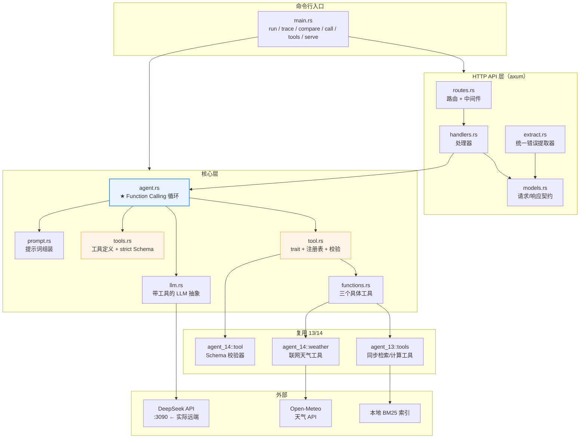

### 模块职责

| 模块 | 职责 | 对应 OpenAI 概念 |
|---|---|---|
| `tools.rs` | 工具定义 + **strict Schema 改写** + 合规自检 | `tools` 参数 / strict mode |
| `tool.rs` | `FunctionTool` trait / 注册表 / 参数校验 / 失败转回执 | 工具执行 + 校验 |
| `functions.rs` | 三个具体工具（天气 / 知识库 / 计算） | function 定义 |
| `agent.rs` | ★ **Function Calling 循环** | 五步调用流程 |
| `llm.rs` | 带 `tools` / `tool_choice` 的 LLM 抽象 | `tool_choice` / `tool_calls` |
| `prompt.rs` | 提示词组装 | Identity / Instructions / Examples |
| `api/` | HTTP 接口（含 **四档对照**） | — |

---

## 三、核心流程图

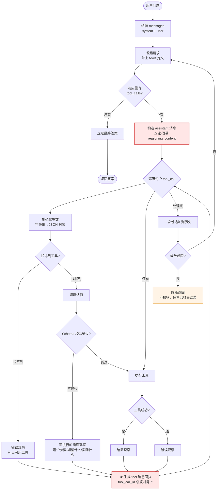

### 五步调用流程对照

OpenAI 文档描述的流程和本项目的实现：

| 文档步骤 | 本项目代码位置 |
|---|---|
| 1. 带上工具定义发起请求 | `llm.rs` → `ChatRequest::with_tools` |
| 2. 收到模型的工具调用 | `agent.rs` → `response.into_tool_calls()` |
| 3. 在应用侧执行代码 | `agent.rs` → `execute_call()` → `registry.call()` |
| 4. 带上工具输出再次请求 | `agent.rs` → `ChatMessage::tool(...)` |
| 5. 收到最终回复 | `agent.rs` → `calls.is_empty()` 分支 |

---

## 四、代码调用详细流程图（函数级）

> 每一张图都对��源码，节点写的是**真实函数名**，边上标的是**调用点行号**。
> 图例：`文件.rs:行号` = 该函数的定义位置，`— 函数名` = 从哪个函数调进去。

### 4.1 入口分发：一条命令是怎么走到 Agent 的

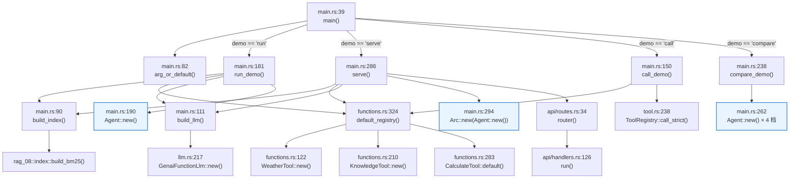

### 4.2 ★ 核心：`Agent::run()` 的完整调用链

这是整个项目最重要的一张图。**红色节点是「容易写错」的地方**。

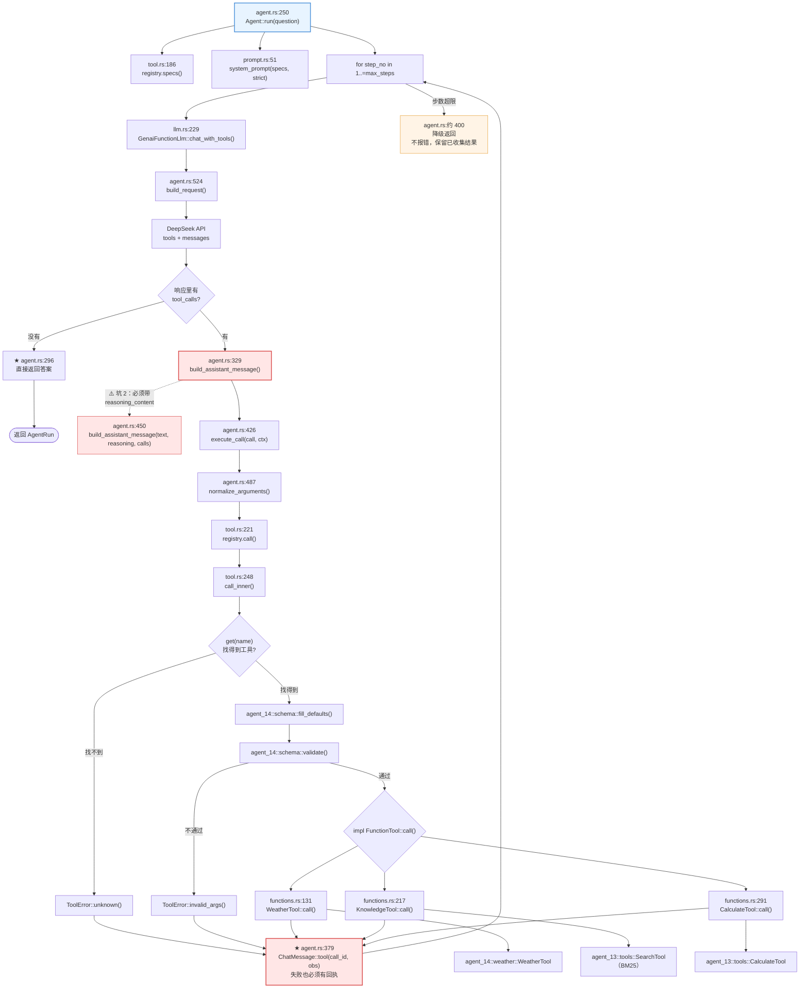

### 4.3 工具调用：参数校验的短路顺序

**顺序错了参数就白填**：`fill_defaults` 必须在 `validate` 之前（否则 `required` 校验会因为缺默认值而误判）。

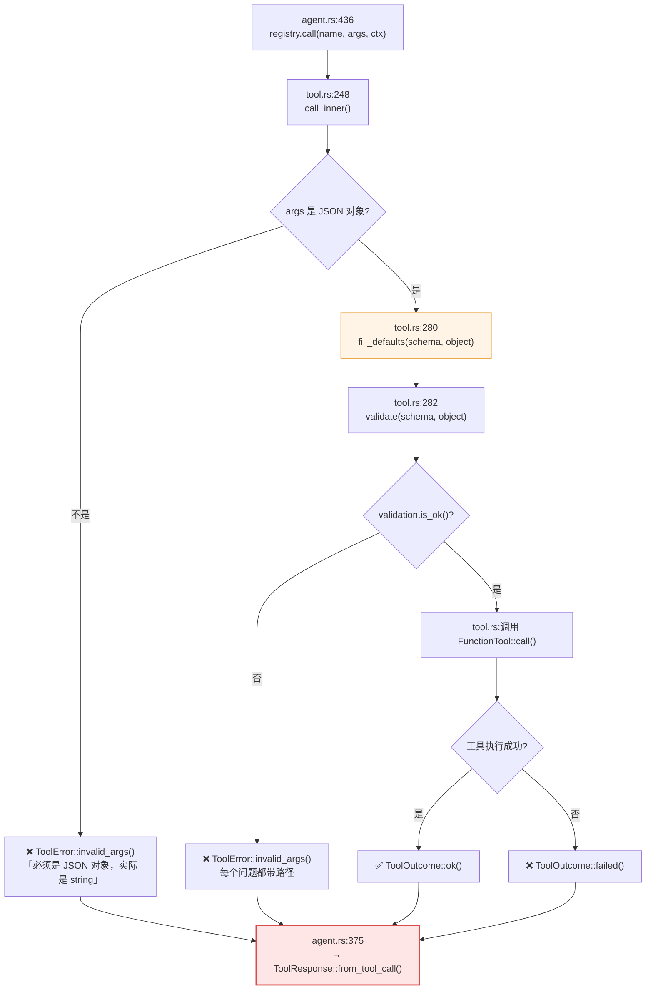

### 4.4 `tool_choice` 四档：同一个 Agent，只有这一个变量变

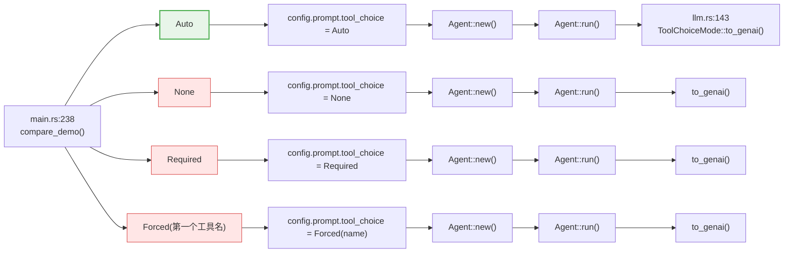

---

## 五、时序图

### 5.1 完整的一次成功调用（含并行）

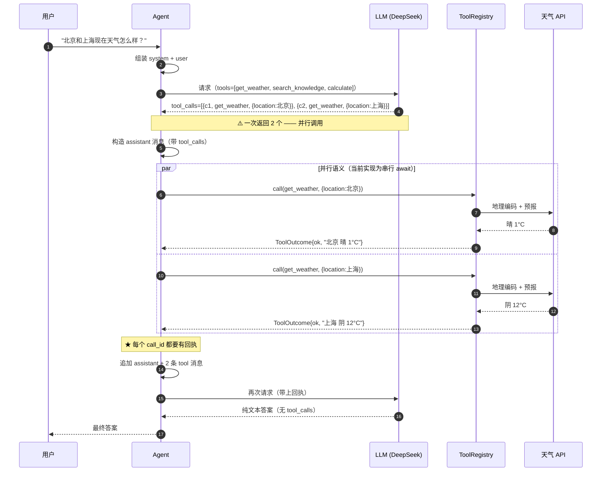

### 5.2 工具失败 → 模型自我纠正

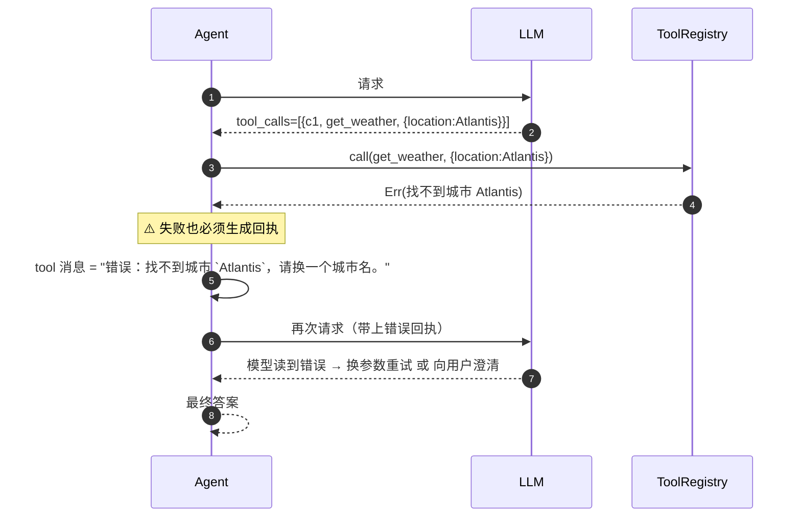

实测（deepseek-flash）：模型读到错误后**没有编造答案**，
而是如实转述错误并主动问「需要我查一下 Atlanta 的天气吗？」。

---

## 六、四个实测踩出来的坑

**这是本项目最有价值的部分** —— 全部来自对 DeepSeek API 的真实探测（`deepseek-flash` / `deepseek-chat`）。

### 坑 1：每个 `tool_call` 都必须有回执，否则**整个请求 400**

DeepSeek 的报错原文：

```text
An assistant message with 'tool_calls' must be followed by tool messages
responding to each 'tool_call_id'.
(insufficient tool messages following tool_calls message)
```

模型一次返回 2 个 `tool_calls`，你就必须回 **2 条** `tool` 消息。
**少一条就是 400** —— 而且错误信息完全没提示你「少了哪一条」。

> **修法**：并行执行所有工具调用，然后**保证**为每个 `call_id`
> 生成**恰好一条** `tool` 消息 —— **包括工具失败的情况**
> （错误文本也是回执）。
>
> 回归测试：`a_failing_tool_still_produces_a_receipt`

### 坑 2：开了思考模式就**必须**回传 `reasoning_content`

DeepSeek 的报错原文：

```text
The `reasoning_content` in the thinking mode must be passed back to the API.
```

`deepseek-v4-pro` 默认开思考，会返回 `reasoning_content`。
下一轮不把它带回，请求直接 400。

> **修法**：把 `reasoning_content` 存进 assistant 消息（作为
> `ContentPart::ReasoningContent`），下一轮原样带回。
> 顺序很重要：**思考内容在前，工具调用在后**。
>
> 本项目默认**关思考**（`disable_reasoning = true`），
> 少一个约束 —— 但循环**已经正确实现了回传**，
> 设 `FC_REASONING=1` 就能体验推理模型。

### 坑 3：`parallel_tool_calls: false` 被 DeepSeek **忽略**

实测传了 `parallel_tool_calls: false`，模型**照样**一次返回 2 个调用：

```text
=== probe 9: parallel_tool_calls=false ===
ERR: None
n_calls: 2      ← 仍然是 2 个！
```

> **修法**：**不能靠 API 参数控制并行度**。
> 想要「一次只调一个」，只能自己在**应用层**限制
> —— 比如一次只把一个工具暴露给模型。
>
> 本项目的循环是**串行 await** 的（虽然语义上是并行的），
> 对单个工具调用来说没有额外开销。

### 坑 4：`strict: true` 被接受但**不强制执行**

实测：`strict: true` + `required` 只写一个字段 → **请求通过**，
模型照样可能不填另一个字段。

OpenAI 文档说 strict 能「确保函数调用可靠地遵守 schema」，
但**那只对 OpenAI 自己成立**。

> **修法**：本项目两道防线都上 ——
> 发 `strict`（讨好 OpenAI）+ **本地 Schema 校验**（真兜底）。
>
> 立场很明确：**参数正确性不能外包给模型**。

### 附加坑 5：Schema 与实现不一致 → 模型陷入拉锯战

这是本项目**开发过程中真实发生**的 bug，修复前后的对比非常惊人。

第一版 Schema 写的是 `city`，而底层实现读的是 `location`：

```text
第 1 步：get_weather({"location":"北京"})
        → 错误：`city` 是必填参数，但没有被提供；`location` 是未知参数
第 2 步：get_weather({"city":"北京"})
        → 错误：`location` 不能为空
第 3 步：get_weather({"city":"北京","location":"北京"})
        → 错误：`location` 是未知参数
第 5 步：模型放弃，输出「工具的参数校验存在自相矛盾的问题」
```

模型试了**三种组合**才放弃 —— 烧掉 **8 次工具调用 + 5 步预算**。

**修复前后对比**（同一个问题「北京和上海现在天气怎么样？」）：

| | 修复前 | 修复后 |
|---|---|---|
| 工具调用 | 8 次 | **2 次** |
| 步数 | 5 步（打满） | **2 步** |
| 输入 token | 6999 | **2291**（↓ 67%） |
| 输出 token | 605 | **191**（↓ 68%） |
| 答案 | 「工具存在自相矛盾的问题」 | 两地天气，准确 |

> **教训**：**Schema 是「对模型的承诺」**。
> 承诺了 `city` 就必须真的读 `city`，否则模型的每一次自我纠正
> 都在撞一堵看不见的墙。
>
> 这个 bug 已被修掉，但教训留在了 `functions.rs` 的注释里。

---

## 七、tool_choice 四档消融对照

`tool_choice` 是 API 的**协议级**参数。OpenAI 文档列了四档：

| 档位 | 行为 |
|---|---|
| `auto` | **默认** —— 模型自己决定调不调、调几个 |
| `none` | 一个都不调 |
| `required` | 至少调一个 |
| `forced:工具名` | 必须调那一个 |

### 实测数据

问题：**「北京和上海现在天气怎么样？」**（模型不可能凭空知道实时天气）
模型：`deepseek-flash`，同一 Agent 实例，**只有 `tool_choice` 这一个变量不同**。

| 档位 | 工具调用 | token | 耗时 | 答案质量 |
|---|---|---|---|---|
| **`auto`** | **2** | **2488** | 3420 ms | ✅ **最优** —— 一次并行拿两地天气 |
| `none` | 0 | 440 | 772 ms | ⚠️ **模型用文本模拟调用**（见下） |
| `required` | 7 | 7176 | 5401 ms | ⚠️ 强制调用的副作用 |
| `forced:get_weather` | 7 | 5828 | 4930 ms | ⚠️ 同上 |

### 三个反直觉的结论

**① `none` 不可靠 —— 模型会用文本模拟工具调用。**

`none` 档实测输出：

```text
我来帮你查询北京和上海的实时天气。

<toolcall>
{"name": "get_weather", "arguments": {"city": "北京"}}
</toolcall>
<toolcall>
{"name": "get_weather", "arguments": {"city": "上海"}}
</toolcall>
```

它**没有**产生结构化的 `tool_calls` —— 而是照着提示词里的工具说明，
用 XML 标签手写了一段「伪调用」。

原因：模型在训练时见过海量这种格式。提示词里出现了工具名和描述，
模型就会试图「模仿」那个格式。

> ⚠️ 所以**不能**用 `none` 实现「禁止用工具」——
> 真正的禁止是**不把 tools 传给模型**。

**② `required` 会诱发「凑数调用」，并让模型丧失判断力。**

`required` 档调了 **7 次**工具，其中只有 2 次是必要的（查两个城市），
另外 5 次是模型为了满足「必须调工具」而硬凑的 —— 包括调 `calculate`
去算风速的差值。

最终答案变成了 `20.1 / 1.8 = 11.166666666666668`
—— 它**只回答了最后一步算式**，完全没回答「天气怎么样」。

> `required` 是「强制工具调用」的开关，**不是**「更好的 auto」。

**③ `auto` 是唯一正确的默认档。**

让模型**自己判断**需不需要工具、该调几个。
实测一次并行拿到两个城市的结果，token 消耗也最低。

### 复现

```bash
make compare                              # CLI
curl -X POST localhost:3090/api/compare \
  -H 'Content-Type: application/json' \
  -d '{"question": "北京和上海现在天气怎么样？"}'
```

---

## 八、三个工具

三个工具覆盖了 Function Calling 的三类典型场景 —— **重点是它们的失败模式不同**。

| 工具 | 类型 | 特点 | 失败语义 |
|---|---|---|---|
| `get_weather` | **联网**（异步） | 真·外部依赖 | 上游超时 / 限流 / 城市不存在 |
| `search_knowledge` | **本地检索**（同步） | 零延迟、确定性、离线 | 「查不到」是**正常结果**，不是失败 |
| `calculate` | **纯计算**（同步） | 零依赖、结果精确 | 只有「表达式非法」一种 |

「查不到」和「工具坏了」必须区分 —— 前者模型该换个查询词，后者模型该停止重试。

### 工具定义的写法（对齐 OpenAI 最佳实践）

```rust
ToolSpec::new(
    "get_weather",
    // ① 描述要说清「目的 + 何时用 + 失败怎么办」
    "查询某个城市的实时天气和未来几天的预报。\
     需要实时的天气信息（温度、湿度、风力、降水）时必须调用这个工具，\
     不要凭记忆回答天气问题。如果工具返回错误，请根据错误提示修正参数后重试。",
    // ② Schema：参数名用模型的词表，用 enum 消灭无效状态
    json!({
        "type": "object",
        "properties": {
            "location": { "type": "string", "description": "城市名，例如 \"北京\"" },
            "days": { "type": "integer", "minimum": 1, "maximum": 7, "default": 1 }
        },
        "required": ["location"],
        "additionalProperties": false
    }),
)
```

OpenAI 最佳实践里的几条，本项目全部落实：

| 最佳实践 | 本项目落实 |
|---|---|
| 「明确描述函数的目的和**每个参数**（及其格式），以及**输出代表什么**」 | 每个 description 都写清三件事 |
| 「在 system 提示词里说明何时（以及何时**不**）该用这个函数」 | `prompt.rs` 的 `# Instructions` 段 |
| 「**使用枚举和对象结构来防止无效状态**」 | `units`/`days` 用 `enum` / 数值范围 |
| 「**不要让模型填你已经知道的参数**」 | `days` 用 `default`，模型不填也能跑 |
| 「保持初始可用函数数量足够少（建议 < 20）」 | 只有 3 个工具 |
| 「通过**实习生测试**：只看你给模型的信息，一个新人能用对吗？」 | 参数说明渲染进 API 的 `/api/tools` |

### 提示词结构（GPT Best Practices）

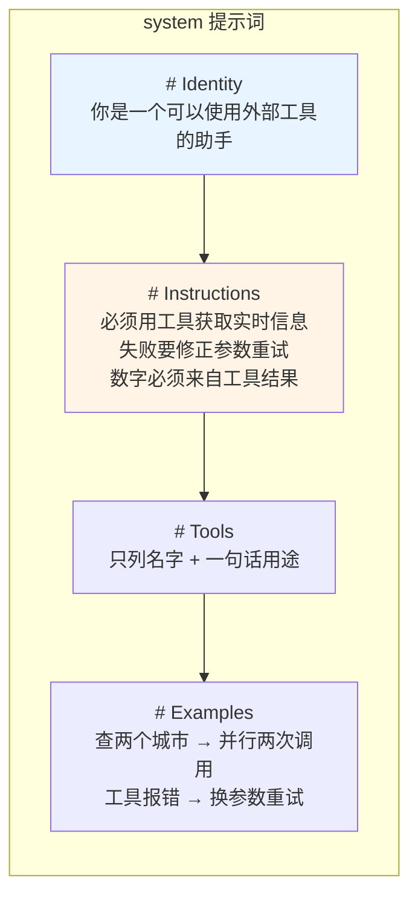

> ⚠️ **关键设计**：工具的**详细参数不在提示词里** ——
> 它们在 API 的 `tools` 字段里，模型结构化地看得到。
> 提示词只负责**行为规则**。
>
> 再塞一遍是重复消耗 token，而且两份描述可能不一致
> （提示词里那份一旦忘了改，模型就会按旧的理解调工具）。

---

## 九、strict 模式与本地校验

### strict 模式的两个硬约束

来自 OpenAI 文档：

1. `additionalProperties` 必须设为 `false`
2. `properties` 里**所有**字段都必须出现在 `required` 里

可选字段的正确写法是 `["string", "null"]`（类型数组里加 `null`）。

### 本项目的策略：**两道防线**

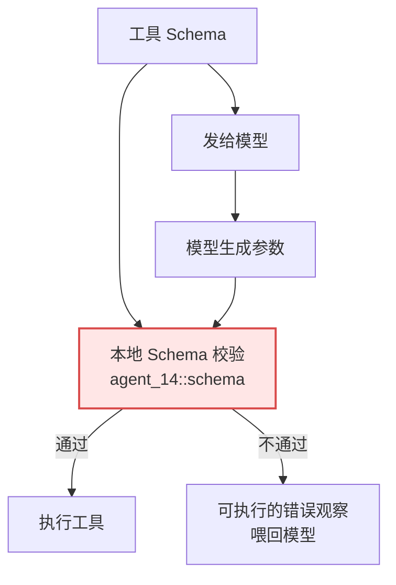

| 防线 | 作用 | 可靠吗 |
|---|---|---|
| `strict: true` | 讨好 OpenAI，让它真的强制执行 | ❌ 对 DeepSeek **不可靠**（实测） |
| 本地 Schema 校验 | 兜底 —— 参数错就**不发请求** | ✅ **可靠** |

`strict_schema()` 负责把 Schema 改写成合规形态，
`check_strict_compliance()` 负责**自检** —— 单元测试里断言我们的 Schema 合规，
避免线上才发现「OpenAI 拒绝了整个请求」。

### ⚠️ 为什么本项目的工具**不开** strict

三个工具都有**带默认值**的可选参数（`days`、`top_k`）。
strict 模式要求「所有字段进 `required`」，一开 strict，
模型就**每次都得填**这些可选字段（strict 不认 `default`）。

> 有回归测试锁住这一点：`optional_parameters_use_defaults_not_strict`

### 本地校验的错误文案必须「可执行」

校验失败时的文案是给**模型**看的，必须说清楚下一步：

```text
`location` 不能为空（说明：城市名，例如 "北京"）
`location` 是未知参数（可用参数: location, days）
```

复用 14 的 `agent_14::schema` —— 它已经把这套错误文案打磨好了。

---

## 十、知识地图

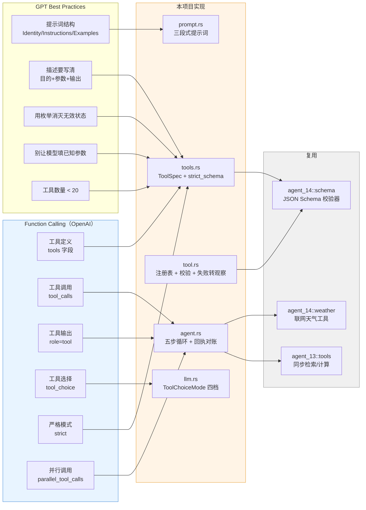

---

## 十一、运行方式

### 快速开始

```bash
# 1. 设置 API key
export DEEPSEEK_API_KEY="sk-..."

# 2. 跑一次
make run

# 3. ★ 四档消融对照
make compare

# 4. 打印工具清单 + Schema（不调模型）
make tools

# 5. 直接调工具（不经模型）
make call TOOL=get_weather ARGS='{"location":"北京"}'

# 6. 启动 HTTP 服务
make serve
```

### 全部目标

```bash
make help
```

| 目标 | 说明 |
|---|---|
| `make run` | 跑一次 Agent |
| `make trace` | 打印完整结构化轨迹（含思考内容） |
| `make compare` | ★ tool_choice 四档对照 |
| `make call` | ★ 直接调工具（不经模型） |
| `make tools` | ★ 打印工具清单 + Schema |
| `make serve` | 启动 HTTP 服务（:3090） |
| `make test` | 跑全部测试 |
| `make lint` | clippy 零警告检查 |
| `make check` | fmt + lint + test |

### 环境变量

| 变量 | 说明 | 默认 |
|---|---|---|
| `FC_BIND_ADDR` | 监听地址 | `127.0.0.1:3090` |
| `FC_MODEL` | 模型名 | `deepseek-flash` |
| `FC_TEMPERATURE` | 温度 | `0.0` |
| `FC_MAX_TOKENS` | max tokens | `2048` |
| `FC_MAX_STEPS` | 最大步数 | `5` |
| `FC_STRICT` | 提示词里强调严格遵守 Schema | `true` |
| `FC_TOOL_CHOICE` | `auto`/`none`/`required`/`forced:工具名` | `auto` |
| `FC_REASONING` | 是否开推理模型思考模式 | `false`（关） |
| `FC_WEATHER_DAYS` | 天气默认预报天数 | `1` |
| `FC_ALLOWED_TOOLS` | 工具白名单（逗号分隔） | 空（全部） |
| `FC_DATA_DIR` | 知识库目录 | `data` |

---

## 十二、HTTP API

| 方法 | 路径 | 说明 |
|---|---|---|
| GET | `/health` | 健康检查 |
| GET | `/` | 服务信息 + 工具清单 |
| GET | `/api/tools` | 工具清单（名字 / 描述 / Schema / strict） |
| POST | `/api/tools/call` | **直接调用工具**（不经模型） |
| POST | `/api/run` | 跑一次 Agent |
| POST | `/api/compare` | ★ **tool_choice 四档对照** |

### 示例

```bash
# 跑一次 Agent
curl -X POST localhost:3090/api/run \
  -H 'Content-Type: application/json' \
  -d '{"question": "北京和上海现在天气怎么样？"}'

# 直接调工具
curl -X POST localhost:3090/api/tools/call \
  -H 'Content-Type: application/json' \
  -d '{"tool": "get_weather", "args": {"location": "北京"}}'

# 四档对照
curl -X POST localhost:3090/api/compare \
  -H 'Content-Type: application/json' \
  -d '{"question": "北京和上海现在天气怎么样？"}'
```

### 状态码约定

| 状态码 | 含义 |
|---|---|
| `400` | 请求参数不合法 / **未知工具** / **工具参数填错** |
| `502` | 模型调用失败 / 上游服务失败 |
| `500` | 内部错误 / 工具执行失败 |

> ⚠️ **参数填错和未知工具是 400，不是 500** ——
> 500 会让调用方以为「服务端坏了，重试也没用」。

---

## 十三、测试

```bash
make test
```

| 测试类型 | 数量 | 覆盖什么 |
|---|---|---|
| 单元测试 | 65 | Schema 改写 / 注册表 / 提示词 / 配置 / 严格模式自检 |
| 集成测试 | 22 | 循环控制流 + HTTP 契约 |
| **合计** | **87** | **零网络、零延迟、完全确定** |

### 被锁住的关键行为

| 测试 | 锁住的坑 |
|---|---|
| `a_failing_tool_still_produces_a_receipt` | **坑 1** —— 失败也必须有回执 |
| `reasoning_content_is_carried_in_the_step_record` | **坑 2** —— 思考内容要带回 |
| `handles_parallel_tool_calls_in_one_turn` | **并行调用** —— 一次多个 `tool_calls` |
| `string_encoded_arguments_are_normalized` | 参数是字符串时要规范化 |
| `invalid_arguments_are_reported_as_a_failure` | 本地校验拦下错误参数 |
| `degrades_when_the_step_limit_is_reached` | 步数超限要**降级**而不是报错 |
| `call_tool_endpoint_returns_400_for_an_unknown_tool` | 错误码语义 |
| `optional_parameters_use_defaults_not_strict` | 有默认值的工具**不能**开 strict |

测试用 `ScriptedFunctionLlm` 把模型输出**钉死** ——
用真实模型测这些行为是**不可靠**的（模型今天返回 2 个调用，
明天返回 1 个，测试就会随机失败）。

---

## 十四、技术参考速查

### 核心概念

| 概念 | 本项目的落地 | 官方文档 |
|---|---|---|
| 工具定义 | `ToolSpec::to_genai_tool()` → `tools` 字段 | [Defining functions](https://platform.openai.com/docs/guides/function-calling#defining-functions) |
| 工具调用 | `response.into_tool_calls()` | [Handling function calls](https://platform.openai.com/docs/guides/function-calling#handling-function-calls) |
| 工具输出 | `ChatMessage::tool(...)` + `tool_call_id` | [Formatting results](https://platform.openai.com/docs/guides/function-calling#formatting-results) |
| 工具选择 | `ToolChoiceMode` → `tool_choice` | [Tool choice](https://platform.openai.com/docs/guides/function-calling#tool-choice) |
| 严格模式 | `strict_schema()` | [Strict mode](https://platform.openai.com/docs/guides/function-calling#strict-mode) |
| 并行调用 | 循环遍历 `calls` | [Parallel function calling](https://platform.openai.com/docs/guides/function-calling#parallel-function-calling) |
| 五步流程 | `agent.rs` 的主循环 | [The tool calling flow](https://platform.openai.com/docs/guides/function-calling#the-tool-calling-flow) |

### genai crate 的对应 API

| genai 类型 | 用途 |
|---|---|
| `ChatRequest::with_tools` | 挂上工具定义 |
| `ChatOptions::with_tool_choice` | 设置 `tool_choice` |
| `ToolChoice::{Auto, None, Required, tool()}` | 四档工具选择 |
| `ChatResponse::tool_calls()` | 读结构化工具调用 |
| `ChatResponse::reasoning_content` | 推理模型的思考内容（**必须回传**） |
| `ContentPart::ToolCall` / `ContentPart::ToolResponse` | 消息里的工具调用/回执 |
| `ContentPart::ReasoningContent` | 思考内容（顺序在工具调用之前） |
| `Tool::with_strict` | strict 模式标记 |

### DeepSeek 实测行为速查

| 行为 | 实测结果 | 本项目的应对 |
|---|---|---|
| 并行调用 | ✅ 支持，一次多个 | 循环遍历，每个都生成回执 |
| `parallel_tool_calls: false` | ❌ **被忽略** | 并行度靠应用层控制 |
| `strict: true` | ⚠️ 接受但**不强制** | 本地 Schema 校验兜底 |
| `tool_choice: none` | ⚠️ 模型会**用文本模拟调用** | 真正的禁止是不传 tools |
| `tool_choice: required` | ⚠️ 会诱发**凑数调用** | 默认用 `auto` |
| `tool_choice: {指定函数}` | ✅ 生效 | 对照实验用 |
| 少一条 tool 回执 | ❌ **400** | 每个 `call_id` 都有回执 |
| 不回传 `reasoning_content` | ❌ **400** | assistant 消息带上思考内容 |

### 相关项目

| 项目 | 关系 |
|---|---|
| `13-agent-core` | ReAct **文本协议**（本项目是**结构化协议**） |
| `14-agent-tool` | 复用了它的 Schema 校验器、天气工具、错误类型 |
| `15-agent-sql` | SQL Agent（护栏 + 文本协议） |
| `10-rag-milvus` | Milvus SDK 的两个必踩的坑（同样的「实测出坑」风格） |
