# 17-agent-memory —— 手撕 Agent Memory（消息状态 + thread_id + checkpointer）

> **主题**：LangChain [Short-term Memory](https://docs.langchain.com/oss/python/langchain/short-term-memory) + [Mem0](https://github.com/mem0ai/mem0)
> **工具**：[ReMe / MemoryScope](https://github.com/agentscope-ai/ReMe) ——「Memory as File, File as Memory」
> **后端**：DeepSeek API（`deepseek-flash`）
> **端口**：3100

这个项目回答一个问题：**Agent 到底怎么记住用户？**

13/14/15/16 四个项目已经把「Agent 怎么**做事**」讲完了（ReAct 循环、工具开发、SQL Agent、Function Calling）。
但它们都缺一块：**每一轮对话之间，那个 Agent 什么都不记得**。

本项目补上这块 —— 并且不是简单地「把消息存起来」，而是分成**两级**：

| | 短期记忆 | 长期记忆 |
|---|---|---|
| 作用域 | **一个线程内** | **跨线程、跨会话** |
| 内容 | 原始对话消息 | **提炼出的事实**（「用户名字是 Bob」） |
| 存取 | 全量读入上下文 | **按需召回**（关键词检索） |
| LangChain 对应 | `AgentState` + `checkpointer` | 长期记忆 store |

**核心产出**：一个真正有记忆的 Agent + **五个实测踩出来的坑** +
一组「线程隔离 / 恢复 / 跨线程共享」的三向对照。

---

## 目录

- [一、两级记忆的分工](#一两级记忆的分工)
- [二、架构全景](#二架构全景)
- [三、核心流程图](#三核心流程图)
- [四、代码调用详细流程图（函数级）](#四代码调用详细流程图函数级)
- [五、时序图](#五时序图)
- [六、五个实测踩出来的坑](#六五个实测踩出来的坑)
- [七、线程隔离 / 恢复 / 共享对照](#七线程隔离-恢复-共享对照)
- [八、提示词的三段式结构](#八提示词的三段式结构)
- [九、事实的幂等合并](#九事实的幂等合并)
- [十、知识地图](#十知识地图)
- [十一、运行方式](#十一运行方式)
- [十二、HTTP API](#十二http-api)
- [十三、测试](#十三测试)
- [十四、技术参考速查](#十四技术参考速查)

---

## 一、两级记忆的分工

### 短期记忆 = 线程内的消息状态

对应 LangChain 的三件套：

| LangChain 概念 | 本项目的对应物 | 代码位置 |
|---|---|---|
| `AgentState.messages` | `ThreadState.messages` | `state.rs:341` |
| `configurable.thread_id` | `ThreadId` | `state.rs:479` |
| `checkpointer` | `Checkpointer` trait | `checkpoint.rs:58` |

### 长期记忆 = 跨线程的事实库

对应 Mem0 的 `memory.add()` / `memory.search()`：

| Mem0 概念 | 本项目的对应物 | 代码位置 |
|---|---|---|
| LLM 事实抽取器 | `FactExtractor` trait | `longterm.rs:204` |
| 向量库 + 过滤器 | `MemoryStore` trait | `longterm.rs:219` |
| `memory.search()` | `MemoryRetriever` trait | `longterm.rs:264` |
| 「只增不覆盖」 | `(owner, subject, predicate)` **合并** + `versions` | `longterm.rs:342` |

### 为什么必须分成两级

因为它们的**性质**完全不同：

```text
短期记忆（原始消息）              长期记忆（提炼事实）
├── 有「谁说的」语义              ├── 没有「谁说的」语义
├── 每次对话都在变                ├── 跨会话稳定
├── 可能几十条                    ├── 通常几条（top_k 限制）
└── 全量进上下文                  └── 按需召回
```

混在一起有两个后果：

1. 模型分不清「Bob 是我现在告诉你的，还是你记得的」
2. 每次召回都把事实重复写进历史 → 历史越来越臃肿

---

## 二、架构全景

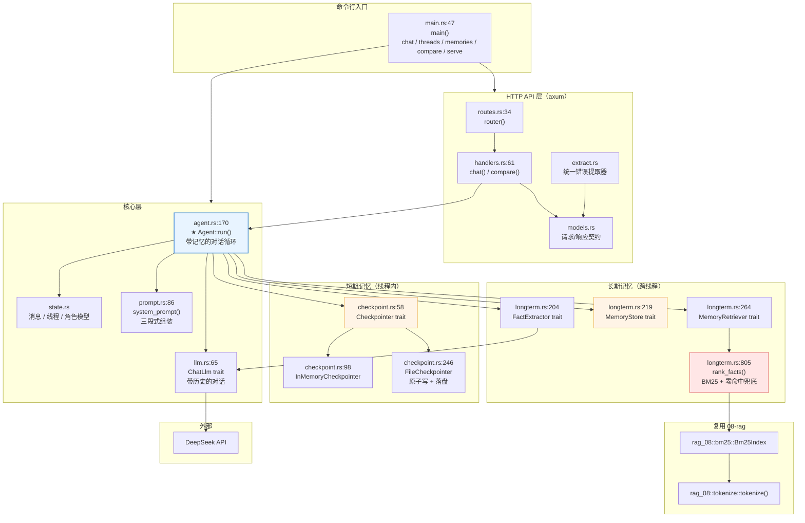

### 模块职责

| 模块 | 行数 | 职责 | 对应概念 |
|---|---|---|---|
| `state.rs` | 697 | 消息 / 线程 / 角色模型 | `AgentState` / `thread_id` |
| `checkpoint.rs` | 567 | 状态持久化（内存 / 文件） | `checkpointer` |
| `longterm.rs` | 1187 | 事实抽取 / 存储 / 检索 | Mem0 / ReMe |
| `prompt.rs` | 455 | 提示词组装（身份 / 规则 / 记忆 / 历史） | `AgentState` → 模型 |
| `agent.rs` | 650 | **带记忆的对话循环** | `agent.invoke()` |
| `llm.rs` | 305 | LLM 抽象（含 `ScriptedChatLlm`） | Model Interface |
| `api/` | 403 | HTTP 接口（含 **隔离 / 恢复对照**） | — |

---

## 三、核心流程图

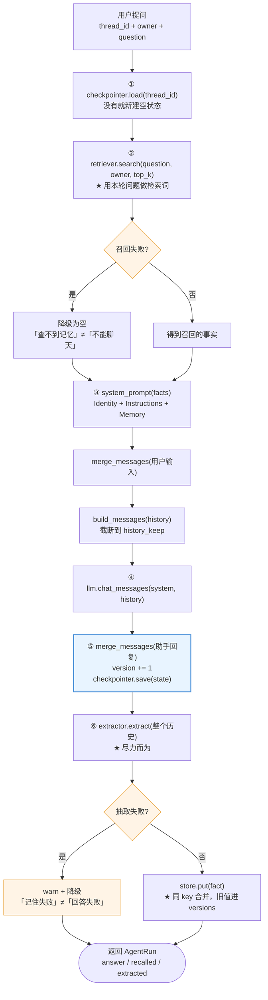

### 三个必须做对的顺序

| 顺序 | 为什么 |
|---|---|
| ① **召回在调模型之前** | 事实要进 system 提示，就必须先召回。反过来做没有意义。 |
| ② **写回状态在拿到回复之后** | 先存「用户输入」再调模型，模型失败就会留下一条**孤儿用户消息**。 |
| ③ **抽取在写回状态之后** | 抽取要基于**完整的这一轮**；而且抽取失败不能影响已经得到的答案。 |

---

## 四、代码调用详细流程图（函数级）

> 每一张图都对着源码，节点写的是**真实函数名**，边上标的是**调用点行号**。
> 图例：`文件.rs:行号` = 该函数的定义位置（少数标注实现步骤的行会直接指向那行代码）；
> `— 函数名` = 从哪个函数调进去。
> ★ 标出「容易写错」的位置。

### 4.1 入口分发：一条命令是怎么走到 Agent 的

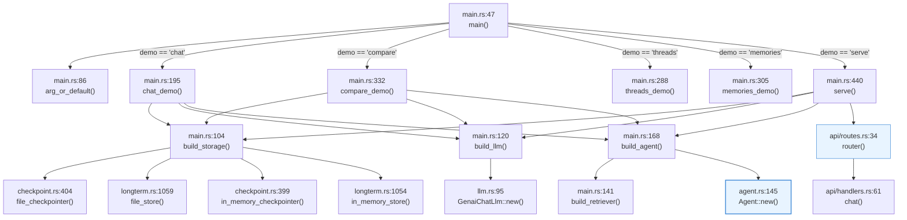

### 4.2 ★ 核心：`Agent::run()` 的完整调用链

这是整个项目最重要的一张图。**红色节点是「容易写错」的地方**。

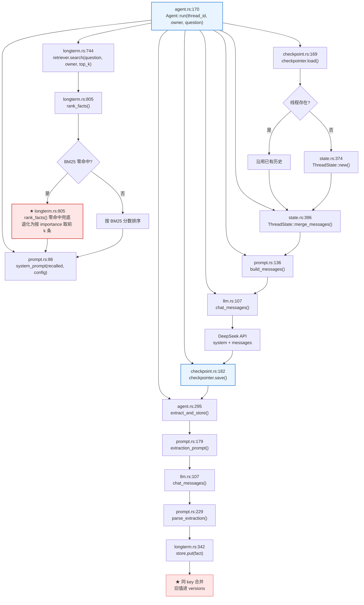

### 4.3 ★ 状态写回：为什么顺序不能反

**先写回再调模型 → 留下孤儿消息**；**先调模型再写回 → 失败时历史不完整**。
正确做法是「调模型 → 拿到回复 → 一次性写回两条」。

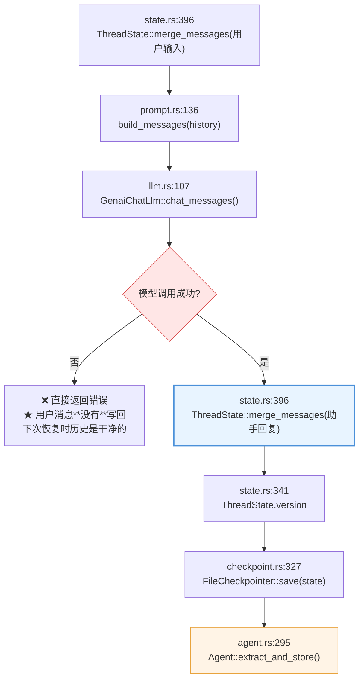

### 4.4 事实抽取：失败降级 vs 成功合并

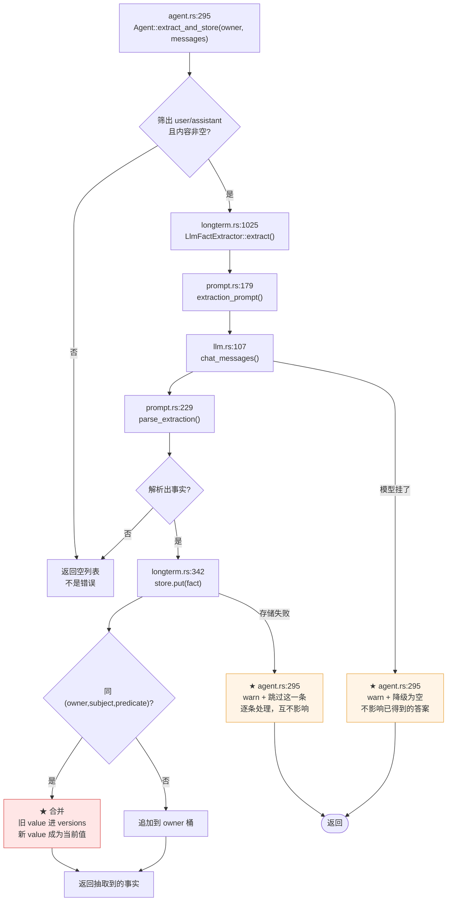

### 4.5 `FileCheckpointer` 的原子写

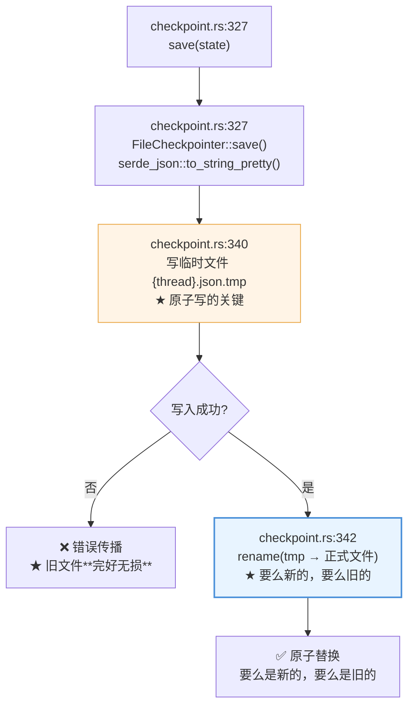

---

## 五、时序图

### 5.1 完整的一轮对话（含长期记忆召回）

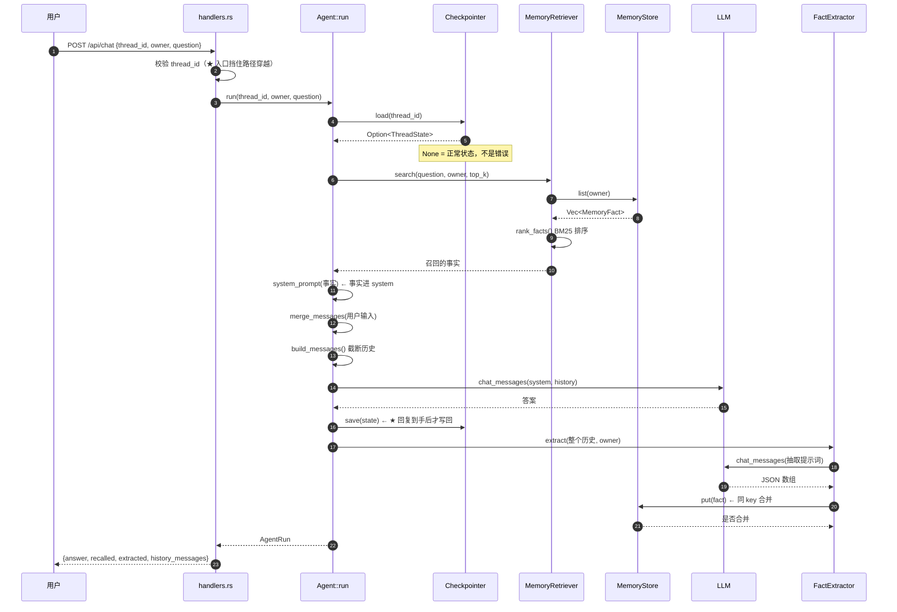

### 5.2 抽取失败 → 降级，不影响答案

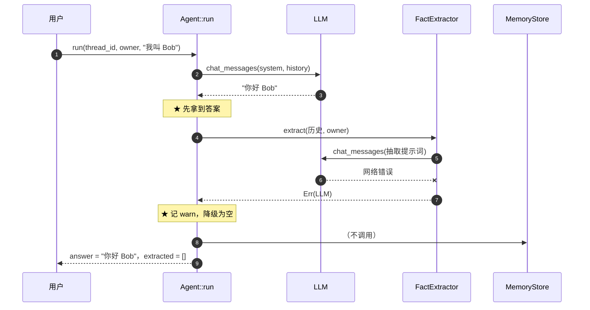

---

## 六、五个实测踩出来的坑

### 坑 1：召回的事实被当成「用户说的话」写进历史

**现象**：几轮之后历史里全是重复事实（「用户的名字：Bob」出现 5 次），上下文被垃圾淹没。

**根因**：把召回的事实当成一条普通消息塞进消息数组。

**修法**：事实**只进 system 提示**（`# Memory` 段），**不进**消息数组。

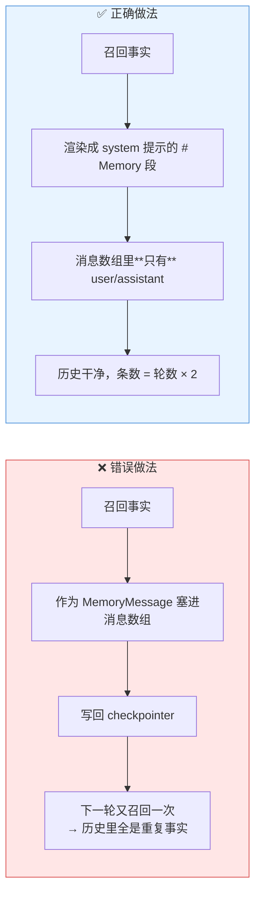

**回归测试**：`recalled_facts_never_enter_the_message_array`（集成测试）

---

### 坑 2：用户改口后，新旧两条事实并存 → 召回时打架

**现象**：用户先说「我叫 Bob」，后说「我改叫 Robert」。记忆库里有两条事实，召回时两条都进 system 提示，模型不知道该用哪个。

**根因**：纯追加式存储 —— Mem0 强调「Memories accumulate; nothing is overwritten」，但纯追加会留下矛盾。

**修法**：**同 `(owner, subject, predicate)` 合并**，旧值进 `versions`，新值成为当前值。

```text
用户 / 名字 / Bob
   ↓ 用户改口
用户 / 名字 / Robert     ← 当前值
   versions: ["Bob"]    ← 旧值不丢，但不再是当前值
```

**为什么去重键不是整条内容**：因为「用户叫 Bob」和「用户名字是 Bob」是**同一件事**。用整条内容做键，模型换个说法就产生重复事实。

**回归测试**：`a_changed_fact_is_merged_not_duplicated`（集成测试）

---

### 坑 3：BM25 零命中 → 模型彻底失忆

**现象**：事实明明存了「用户 / 名字 / Bob」，用户在新线程问「**我叫什么**」，模型答不出来。

**根因**：BM25 是**纯词面**匹配，匹配不了「语义等价」。

```text
查询词元：我 叫 什 么 我叫 叫什 什么
事实词元：用户 名字 bob 用户 户名 名字
交集    ：∅
```

这正是**向量检索**能解决、BM25 解决不了的场景。

**修法**：零命中时**退化为「按 importance 取前 k 条」**。

- 一个 owner 的事实通常只有几条到几十条，全部塞进上下文并不昂贵
- 模型自己会挑 —— 它看到「用户的名字：Bob」就知道这是答案
- 比「什么都不给」好一个量级

**回归测试**：`zero_hit_falls_back_to_importance_ordering`（单元测试）

---

### 坑 4：短期记忆和长期记忆共用一个目录 → 线程列表被污染

**现象**：`GET /api/threads` 返回一堆 `{hash}_{owner}.json` 的垃圾 id。

**根因**：两者都用 `.json` 后缀，放在同一个目录里，`FileCheckpointer::list_threads` 扫描目录时把**记忆文件也当成线程**了。

这是一个**静默**的错 —— 接口不报错，但列表是脏的。

**修法**：两级记忆**分目录**。

```text
data/memory/
├── threads/     ← 短期记忆：{thread_id}.json
└── memories/    ← 长期记忆：{hash}_{owner}.json
```

**回归测试**：`memory_files_are_not_listed_as_threads`（集成测试）

---

### 坑 5：`compare` 端点的隔离判据算错

**现象**：隔离判据写成 `(线程数 + 1) * 2`，随线程数变化 —— 两个线程时算出 6，实际是 4，判据**永远为 false**。

```text
实际：每线程 2 轮 × 2 条消息 = 4 条
错误：(2 + 1) * 2 = 6 条   ← 永远对不上
```

**修法**：轮数是**固定的 2**（代码里明确跑了第一轮 + 第二轮），判据写死 `2 * 2 = 4`。

**顺带修的第二个 bug**：`longterm_shared` 原来用**第一轮**的召回判定，但第一轮时记忆库还是空的（事实是这一轮结束之后才抽取入库的）→ 永远为 false。改成用**第二轮**判定。

**回归测试**：`compare_endpoint_reports_isolation_and_resumption`（集成测试）

---

## 七、线程隔离 / 恢复 / 共享对照

`/api/compare` 和 `make compare` 跑的是同一套逻辑，做**三向对照**：

| 对照项 | 判据 | 证明什么 |
|---|---|---|
| `threads_isolated` | 每个线程的历史**恰好** 4 条（2 轮 × 2 条） | 短期记忆互不串台 |
| `thread_resumed` | 同一线程第二轮的历史**比第一轮多** | checkpointer 真的存下来了 |
| `longterm_shared` | **第二轮**每个线程都召回了 ≥1 条事实 | 长期记忆跨线程共享 |

### 为什么隔离要「实际检查」而不是「声称隔离」

隔离是一个**否定性**性质 ——「不该出现的东西没出现」。
光看响应体看不出来，必须**读回状态**逐条比对。

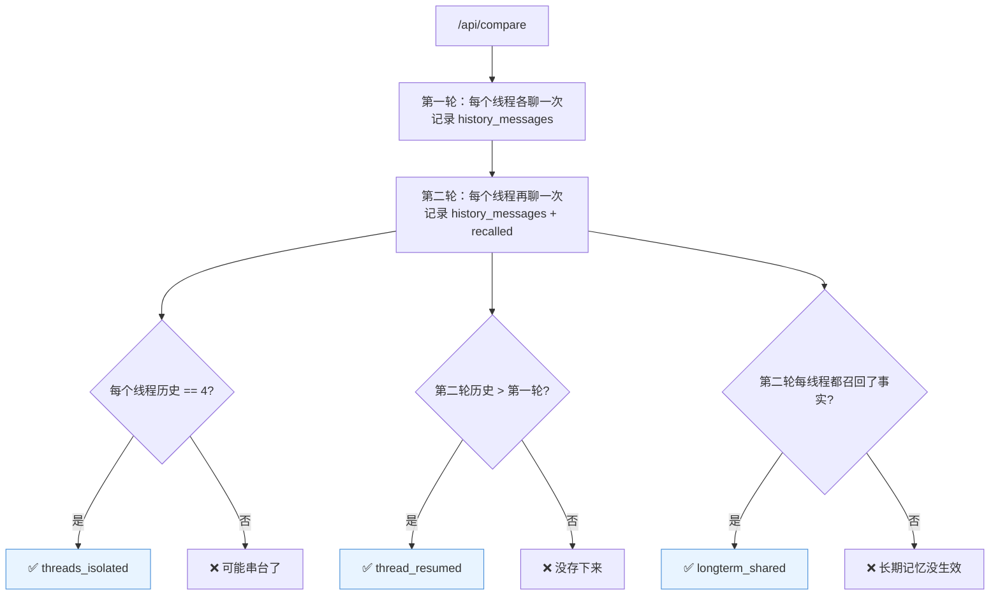

### 实测输出

```text
── 线程 A 第 1 轮 ──
问题: 我叫 Bob
历史条数: 2
  抽取: 用户的名字：Bob

── 线程 B 第 1 轮 ──
问题: 我住在杭州
历史条数: 2
  抽取: 用户的居住城市：杭州

── 线程 A 第 2 轮（同一线程）──
问题: 我叫什么名字？
历史条数: 4
召回的记忆:
  · 用户的名字：Bob

── 线程 C（全新线程）第 1 轮 ──
问题: 我叫什么名字？
历史条数: 2
召回的记忆（跨线程!）:
  · 用户的名字：Bob

── 结论 ──
线程隔离    : ✅（线程 A 4 条 / 线程 B 2 条）
线程恢复    : ✅（2 → 4 条）
长期记忆共享: ✅（新线程召回了 1 条事实）
```

---

## 八、提示词的三段式结构

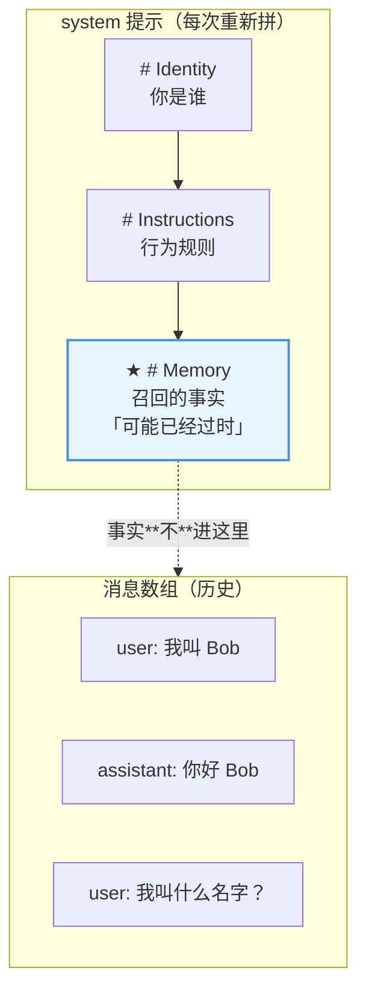

### 关键决策

| 决策 | 理由 |
|---|---|
| 长期记忆和对话历史**分成两段** | 模型分不清「Bob 是你现在说的还是你记得的」 |
| 事实段措辞是「**可能已经过时**」 | 用户可能改口，不写这句模型会用旧记忆纠正用户 |
| 指令写「冲突时**以当前说法为准**」 | 同上 |
| 事实**不进**消息数组 | 见坑 1 |
| 事实段**每次重新拼** | 召回结果每轮可能不同 |

### 记忆抽取的提示词

```text
# Task

从下面的对话里提取**关于用户**的原子事实。

# Rules

- 只提取**事实**，不要提取闲聊、客套、情绪。
- 每条事实是「主语 + 谓语 + 值」三段。
- 谓语要短且稳定（如「名字」「偏好」「职业」「语言」）。
- **没有事实就返回空数组** `[]` —— 不要为了凑数编造。

# Output Format

严格的 JSON 数组，不要 markdown 代码块，不要任何解释文字：

[{"subject": "用户", "predicate": "名字", "value": "Bob", "importance": 0.8}]
```

⚠️ 输出格式**必须**是严格的 JSON 数组 —— 模型很爱用 markdown 代码块包裹，所以解析器要做容错（`extract_json_array` 找第一个 `[` 到配对的 `]`）。

---

## 九、事实的幂等合并

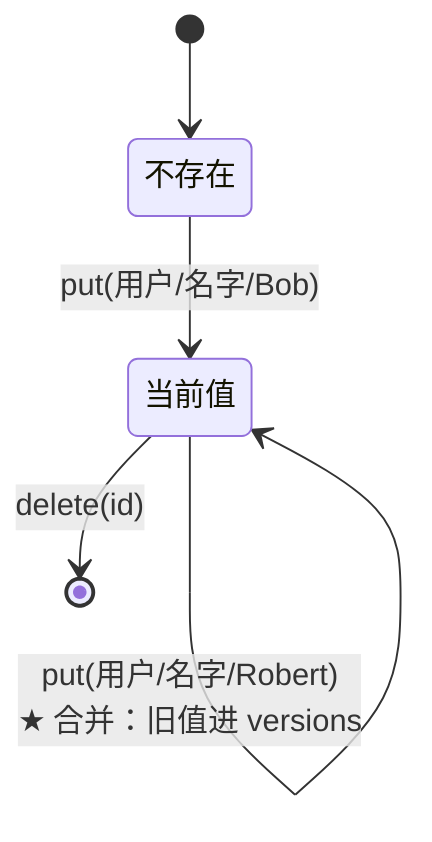

### `MemoryFact` 的字段

| 字段 | 作用 |
|---|---|
| `subject` / `predicate` / `value` | 事实的三段式结构（便于去重和矛盾检测） |
| `owner` | 归属（= Mem0 的 `user_id`），**存储层强制分区** |
| `importance` | 重要度（0~1），召回时的次级排序键 |
| `versions` | 历史值（旧信息不丢，但不再是当前值） |
| `dedup_key()` | `(owner, subject, predicate)` —— 去重键 |

### 为什么 owner 分区在**存储层**做

和线程隔离同一个道理：「先取出全部再 filter」漏一次就是数据泄漏。
`MemoryStore::list(owner)` 直接按 owner 取，物理上不可能串台。

---

## 十、知识地图

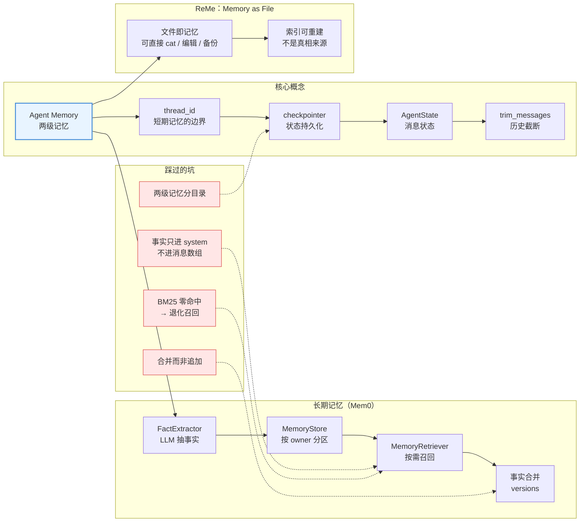

---

## 十一、运行方式

### 快速开始

```bash
# 1. 设置 API key
export DEEPSEEK_API_KEY=sk-xxx

# 2. ★ 跑一次带记忆的对话（两轮：告诉名字 → 问名字）
make chat

# 3. ★ 线程隔离 / 恢复对照
make compare

# 4. 列出所有线程 / 长期记忆
make threads
make memories

# 5. 启动 HTTP 服务
make serve
```

### 全部目标

| 目标 | 说明 |
|---|---|
| `make help` | 显示所有目标 |
| `make build` | 编译 |
| `make chat` | ★ 跑一次带记忆的对话 |
| `make compare` | ★ 线程隔离 / 恢复对照 |
| `make threads` | 列出所有线程 |
| `make memories` | 列出长期记忆 |
| `make history THREAD=xxx` | 查看某个线程的历史 |
| `make serve` | 启动 HTTP 服务（:3100） |
| `make test` | 跑全部测试 |
| `make lint` | clippy 零警告检查 |
| `make fmt` | 格式化 |
| `make check` | fmt + lint + test |

### 环境变量

| 变量 | 说明 | 默认 |
|---|---|---|
| `MEM_BIND_ADDR` | 监听地址 | `127.0.0.1:3100` |
| `MEM_MODEL` | 模型名 | `deepseek-flash` |
| `MEM_TEMPERATURE` | 温度 | `0.0` |
| `MEM_MAX_TOKENS` | max tokens | `2048` |
| `MEM_REASONING` | 是否开思考模式（`1` = 开） | `0`（关） |
| `MEM_CHECKPOINTER` | `memory` / `file` | `file` |
| `MEM_MEMORY_STORE` | `memory` / `file` | `file` |
| `MEM_DATA_DIR` | 存储根目录 | `data/memory` |
| `MEM_MEMORY_TOP_K` | 长期记忆召回条数 | `5` |
| `MEM_HISTORY_KEEP` | 历史保留条数（`0` = 全部） | `20` |
| `MEM_EXTRACT` | 是否启用长期记忆抽取 | `1` |

⚠️ 温度默认 **0.0** —— 记忆场景要**可复现**，温度高会让抽取出的事实飘忽。

---

## 十二、HTTP API

| 方法 | 路径 | 说明 |
|---|---|---|
| GET | `/health` | 健康检查 |
| GET | `/` | 服务信息 + 配置 |
| POST | `/api/chat` | **带记忆的对话**（核心端点） |
| GET | `/api/threads` | 列出所有线程 |
| GET | `/api/threads/{id}` | 查看某个线程的消息历史 |
| DELETE | `/api/threads/{id}` | 清空某个线程的短期记忆 |
| GET | `/api/memories?owner=` | 列出某 owner 的长期记忆 |
| DELETE | `/api/memories?owner=` | 清空某 owner 的长期记忆 |
| POST | `/api/compare` | ★ **线程隔离 / 恢复对照** |

### 示例

```bash
# 跑一次带记忆的对话
curl -s -X POST localhost:3100/api/chat \
  -H 'Content-Type: application/json' \
  -d '{"thread_id": "t1", "owner": "alice", "question": "我叫 Bob"}' \
  | python3 -m json.tool

# 三向对照
curl -s -X POST localhost:3100/api/compare \
  -H 'Content-Type: application/json' \
  -d '{"owner": "alice", "threads": ["thread-a", "thread-b"], "question": "我叫什么名字？"}' \
  | python3 -m json.tool
```

### 状态码约定

| 状态码 | 含义 |
|---|---|
| 200 | 成功 |
| 400 | 参数不合法（thread_id 非法 / 问题为空 / 请求体解析失败） |
| 404 | 线程不存在 |
| 502 | 模型调用失败 |
| 500 | 内部错误 |

---

## 十三、测试

```bash
make test        # 单元 84 + 集成 21
```

### 被锁住的关键行为

| 行为 | 测试 |
|---|---|
| 线程隔离 | `threads_do_not_leak_into_each_other` |
| 线程恢复 | `a_thread_resumes_with_its_previous_history` |
| 进程重启后恢复 | `the_state_survives_a_checkpointer_restart` |
| 跨线程长期记忆 | `a_fact_is_extracted_and_recalled_across_threads` |
| 事实不进消息数组 | `recalled_facts_never_enter_the_message_array` |
| 事实合并而非追加 | `a_changed_fact_is_merged_not_duplicated` |
| owner 隔离 | `owners_are_isolated_in_the_long_term_store` |
| 抽取失败不影响答案 | `a_failing_extractor_does_not_break_the_answer` |
| BM25 零命中兜底 | `zero_hit_falls_back_to_importance_ordering` |
| 两级记忆分目录 | `memory_files_are_not_listed_as_threads` |
| 损坏文件容错 | `a_corrupted_thread_file_is_tolerated` |
| `thread_id` 路径穿越防护 | `chat_endpoint_rejects_an_invalid_thread_id` |
| 隔离判据正确性 | `compare_endpoint_reports_isolation_and_resumption` |

### 为什么全部零网络

整个记忆层的五个依赖**全部从构造时注入**：

```text
ChatLlm      → ScriptedChatLlm（记录每次调用看到的完整历史）
Checkpointer → InMemoryCheckpointer / FileCheckpointer
MemoryStore  → InMemoryMemoryStore / FileMemoryStore
MemoryRetriever → 线性打分检索器
FactExtractor → ScriptedExtractor / NoopExtractor
```

所以测试可以**断言「模型看到了第几轮的什么」**，而不只是断言「返回了什么」。

---

## 十四、技术参考速查

### 核心概念

| 概念 | 本项目 | LangChain | Mem0 |
|---|---|---|---|
| 短期记忆 | `ThreadState` | `AgentState` | — |
| 线程隔离 | `ThreadId` + 分键存储 | `configurable.thread_id` | — |
| 状态持久化 | `Checkpointer` | `Checkpointer` | — |
| 历史截断 | `build_messages` | `trim_messages` | — |
| 事实抽取 | `FactExtractor` | — | `memory.add()` 的 LLM 抽取 |
| 事实存储 | `MemoryStore` | 长期记忆 store | 向量库 + 过滤器 |
| 事实召回 | `MemoryRetriever` | — | `memory.search()` |
| 幂等合并 | `versions` | — | `nothing is overwritten` |
| 记忆即文件 | `FileMemoryStore` | — | ReMe |

### 仓库内的复用关系

| 复用了 | 来自 | 为什么 |
|---|---|---|
| `ChatMessage` / `ContentPart` / `ToolResponse` | `genai` | 消息类型统一 |
| `ToolError` | `agent_16::error` | 错误分类（400 vs 500）已想清楚 |
| `Bm25Index` / `Bm25Document` / `tokenize` | `rag_08` | 中英混排分词 + BM25 打分 |
| `trace_layer` | `agent_logging` | 统一请求追踪 |

### 本项目特有的约定

| 约定 | 说明 |
|---|---|
| 事实用**自己的类型** | 不直接存 `genai::ChatMessage` —— 持久化格式不焊死在第三方类型的内部结构上 |
| `MemoryRole::Fact` | 显式表达「这是召回的背景，不是对话」 |
| `Fact` 映射成 `ChatRole::System` | 事实是权威上下文，不是「某人在说话」 |
| 抽取基于**整个历史** | 「我叫 Bob」可能是十轮之前说的 |
| 抽取基于**整个历史**≠ 写入事实 | 写入走 `store.put()` 的幂等合并 |
| 抽取必须**关思考** | 思考 token 与正文共用 `max_tokens` 预算 |
| 解析失败**不是错误** | 「抽不出事实」是正常结果，返回空列表 |

### 环境变量前缀

| 前缀 | 项目 |
|---|---|
| `RAG_` | 06-rag |
| `QUERY_` | 07-query |
| `AGENT_` | 13-agent-core |
| `TOOL_` | 14-agent-tool |
| `SQL_` | 15-agent-sql |
| `FC_` | 16-agent-function-calling |
| `MEM_` | **17-agent-memory** |

### 相关项目

| 项目 | 主题 |
|---|---|
| [13-agent-core](../13-agent-core/) | ReAct 循环（文本协议） |
| [14-agent-tool](../14-agent-tool/) | 自定义工具开发 + MCP |
| [15-agent-sql](../15-agent-sql/) | SQL Agent + 三层安全防线 |
| [16-agent-function-calling](../16-agent-function-calling/) | 结构化 Function Calling |
| [08-rag](../08-rag/) | BM25 检索（长期记忆的召回底座） |
| [12-rag-summary](../12-rag-summary/) | 摘要式 RAG（向量检索的完整版） |
