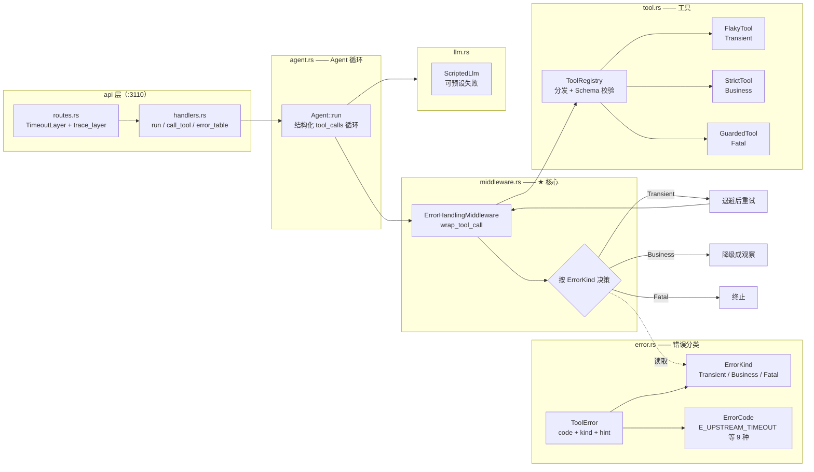
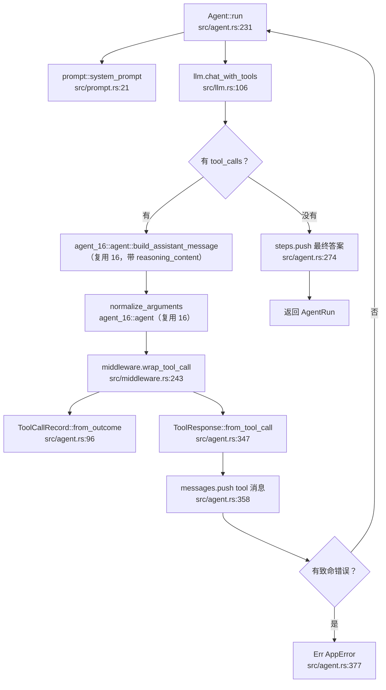
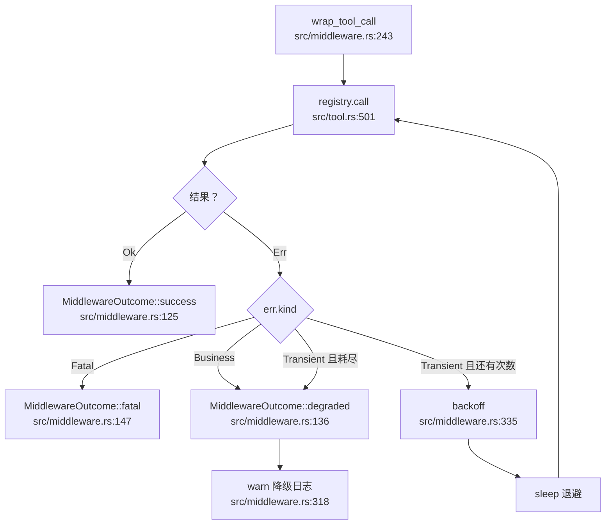
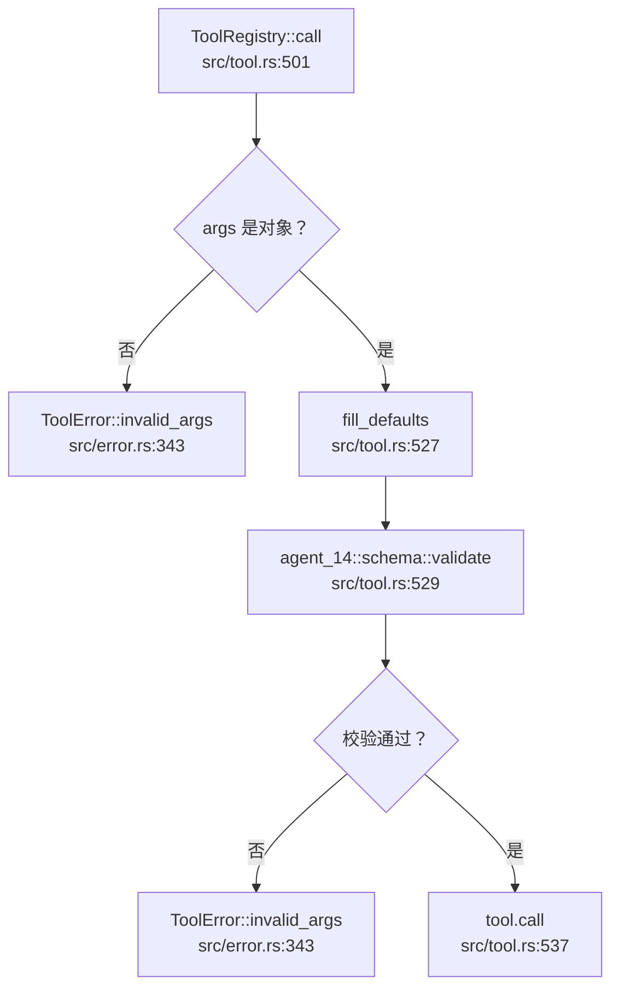
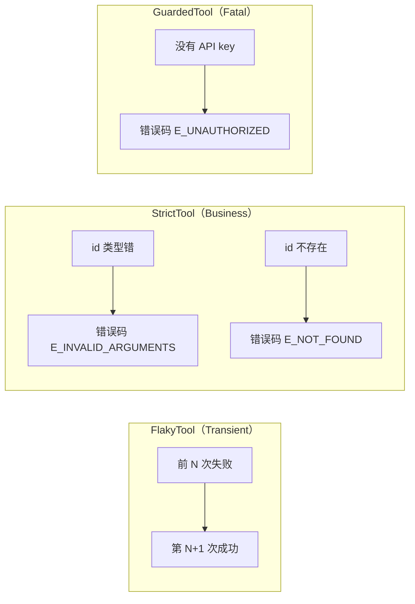

# 18-agent-error —— 手撕 Agent 错误处理

> **这个项目回答一个问题：Agent 里失败了，到底该怎么办？**
>
> 参考：[LangChain Custom middleware](https://docs.langchain.com/oss/python/langchain/middleware/custom) ——
> `wrap_tool_call` 的语义：包住每次工具调用，决定「要不要调、调几次、失败了怎么办」。

---

## 目录

- [核心产出](#核心产出)
- [架构全景](#架构全景)
- [错误分类：三种处置策略](#错误分类三种处置策略)
- [中间件：wrap_tool_call 的实现](#中间件wrap_tool_call-的实现)
- [代码调用详细流程图（函数级）](#代码调用详细流程图函数级)
- [三个实测踩出来的坑](#三个实测踩出来的坑)
- [HTTP API](#http-api)
- [运行方式](#运行方式)
- [知识地图](#知识地图)
- [技术参考速查](#技术参考速查)

---

## 核心产出

一个**错误可诊断**的 Agent：工具失败后，错误不是一句「执行失败」，而是
一段**带稳定错误码、带可执行建议、带处置类别**的观察。

```text
工具失败
   ↓
分类：Transient / Business / Fatal
   ↓
Transient → 指数退避重试 → 耗尽后降级
Business  → 不重试，直接降级
Fatal     → 不重试、不降级，直接终止
   ↓
降级 = 变成一段带错误码的观察喂回模型
       [E_INVALID_ARGUMENTS] 参数不合法：location 必须是字符串，实际是数字。建议：把 location 改成城市名，例如 北京。
```

**关键认知：重试和降级是两个正交的维度。**

| 维度 | 含义 | 谁能修 |
|---|---|---|
| **重试** | 再调一次**同样的**工具 | 等外部条件恢复 |
| **降级** | 把错误变成观察，让模型**换条路** | 改参数 / 换工具 / 如实告知用户 |

Transient 两者都该做（先重试，耗尽再降级）；Business 只该降级；Fatal 两者都不该做。

---

## 架构全景



**依赖关系**：只有 `error.rs`（分类）和 `middleware.rs`（决策）是本项目新写的；
工具 trait、LLM trait、Schema 校验器都复用 16 / 14，
**继承它们踩过的坑**（比如「每个 tool_call 都必须有回执」）。

> ★ **本项目连 assistant 消息的构造也复用 16**
> （`agent_16::agent::build_assistant_message`）——
> 本项目原先自己写了一份**不带 `reasoning_content`** 的版本，
> 思考模式一开就会被 provider 拒（400）。
> 同理，工具参数规整也复用 `agent_16::agent::normalize_arguments`。
> ⚠️ **复用 ≠ 自动生效** —— 复用前一个项目的类型只是第一步，
> **语义字段必须在搬运链上全程保留**。

---

## 错误分类：三种处置策略

### 决策表

| 类别 | 成因 | 重试 | 降级 | HTTP | 例子 |
|---|---|---|---|---|---|
| **Transient** | 外部服务的**临时**状态 | ✅ 是 | ✅ 是 | 503 | 上游超时 / 429 / 5xx |
| **Business** | **调用方**的输入 / 业务规则 | ❌ 否 | ✅ 是 | 400 | 参数非法 / 未知工具 / 查无此记录 |
| **Fatal** | **环境配置** / 权限 | ❌ 否 | ❌ 否 | 500 | 鉴权失败 / 内部缺陷 |

### 为什么要分三类而不是两类

如果只有「可重试 / 不可重试」两类，会出现两种错误做法：

1. **对所有错误一律重试 3 次** → 参数填错时白等 3 次（参数不会因为重试变对）
2. **对所有错误一律不重试** → 上游 503 时白白放弃恢复机会

Business 和 Transient 的**共同点**是「都该降级」（模型可以据此调整），
**区别**是「该不该重试」。所以需要第三个维度 `retryable`，而不是把两者混成一类。

### 错误码表

| 错误码 | 类别 | 说明 |
|---|---|---|
| `E_UPSTREAM_TIMEOUT` | transient | 上游服务响应超时 |
| `E_UPSTREAM_UNAVAILABLE` | transient | 上游服务不可用（连接失败 / 5xx） |
| `E_RATE_LIMITED` | transient | 请求被限流（429） |
| `E_INVALID_ARGUMENTS` | business | 参数不合法（Schema 校验失败） |
| `E_UNKNOWN_TOOL` | business | 调用了不存在的工具 |
| `E_NOT_FOUND` | business | 目标资源不存在 |
| `E_RULE_VIOLATION` | business | 业务规则不满足 |
| `E_UNAUTHORIZED` | fatal | 鉴权失败 |
| `E_INTERNAL_FAULT` | fatal | 内部缺陷 |

### 「可诊断」的三段式

```text
[E_NOT_FOUND] 目标资源不存在：记录 `nope` 不存在。建议：可用的 id 有：rec-1, rec-2。请从列表里选一个，或向用户确认。
└────┬────┘ └───┬───┘ └──────┬──────┘ └──────────────┬──────────────┘
   稳定错误码    简短归类        原始原因              给模型的可执行建议
```

三段各司其职：

- **错误码** —— 机器可读，**稳定契约**（文案会变，码不会）
- **原因** —— 人看日志用
- **建议（hint）** —— **模型**自我纠正用

> ⚠️ 本项目的约定：**没有 hint 的 Business 错误视为缺陷** —— 因为 Business 错误的价值就在于「模型能据此纠正」。

---

## 中间件：wrap_tool_call 的实现

### 核心循环

```text
for attempt in 1..=(1 + max_retries):
    result = registry.call(name, args, ctx)

    match result:
        Ok(outcome)  → 直接返回（成功不需要任何加工）
        Err(err):
            err.kind == Fatal               → 返回 fatal（向上传播）
            err.kind == Transient && 还有次数 → 退避后重试
            err.kind == Business              → 返回 degraded
            err.kind == Transient && 次数耗尽  → 返回 degraded
```

### 指数退避

```text
delay = min(base_delay × 2^(n-1), max_delay)
```

| 尝试次数 | 默认延迟 |
|---|---|
| 第 1 次失败后 | 50 ms |
| 第 2 次失败后 | 100 ms |
| 第 3 次失败后 | 200 ms（上限 2000 ms） |

### 处置结果的三种形态

| 形态 | `ok` | `fatal` | 观察文本 | 后续 |
|---|---|---|---|---|
| `success` | true | false | 工具结果 | 继续循环 |
| `degraded` | false | false | **带错误码的错误文本** | 继续循环（模型可自我纠正） |
| `fatal` | false | **true** | 带错误码的错误文本 | **终止循环**，HTTP 500 |

### ⚠️ 降级必须打 warn

全仓库的硬约定：**静默降级等于埋雷**。中间件在降级时会打 `warn!`，
带上工具名、错误码、类别、尝试次数、原因。

### ⚠️ 致命错误也要产回执

这是 16 实测踩出来的坑：`tool_calls` 里每个 `call_id` 都必须有对应的 `tool` 消息，
**少一条整个请求就 400**（`insufficient tool messages following tool_calls message`）。

所以本项目把「降级」和「终止」分成两步：

1. 先把错误写成一条 `tool` 消息（**保证回执完整**）
2. 再终止循环并把错误上报

这样既不会「少一条回执导致 400」，也不会「把配置问题伪装成模型答案」。

---

## 代码调用详细流程图（函数级）

### ① 一次 Agent 运行的完整调用链



★ `src/agent.rs:347` —— **回执必须恰好一条**。少一条下一轮请求就 400（16 实测）。
★ `agent_16::agent::normalize_arguments` —— 参数可能是 **JSON 字符串**而非对象，必须先规整，否则本地校验直接报错。

### ② 中间件的决策逻辑



★ `src/middleware.rs:291` —— **Business 错误不重试**。这是本项目最核心的一条规则。
★ `src/middleware.rs:283` —— **Fatal 不降级**。降级会让模型以为「工具坏了」，转而编答案。

### ③ 注册表的参数校验



★ `src/tool.rs:529` —— **先填默认值再校验**，顺序不能反。
★ Schema 校验失败属于 **Business**，不是 Transient —— 重试永远不会让参数变对。

### ④ 三个工具的失败语义



---

## 三个实测踩出来的坑

### 坑 1：对所有错误一律重试

**现象**：参数填错了（比如把 `id` 传成数字），中间件重试 3 次，
每次都拿到同样的错误，白等 3 × 退避延迟，模型也拿不到更早的纠正机会。

**根因**：把「重试」当成了「错误处理的唯一手段」，
忽略了**重试的前提是「同样的输入可能有不同的结果」**。

**修法**：把「重试」和「降级」拆成两个正交维度，
按 `ErrorKind` 决策 —— 只有 `Transient` 重试。

回归测试：`business_errors_are_never_retried`（单元）+ `business_failures_are_never_retried`（集成）。

### 坑 2：致命错误也降级

**现象**：支付工具因为没配 API key 返回鉴权失败，
如果降级成观察喂回模型，模型会读到「支付失败」，然后**编一个**
「抱歉，支付服务暂时不可用」这样的答案。

**根因**：以为「降级总是比报错好」。

**修法**：`Fatal` **不降级** —— 降级等于让模型把配置问题翻译成幻觉。
正确的行为是**明确告诉调用方「服务未配置 / 无权限」**。

回归测试：`fatal_errors_propagate_without_retry_or_degradation`。

### 坑 3：致命错误直接 `?` 传播，导致少一条回执

**现象**：致命错误时如果直接 `?` 返回，
下一次请求就少了那个 `call_id` 的 `tool` 消息，
整个请求 **400**（`insufficient tool messages following tool_calls message`）。

**根因**：以为「终止 = 不再发下一轮请求」，但**多工具并行调用**时，
一个失败会让**其他**调用的回执也丢失。

**修法**：终止前**先**把所有回执生成完（包含致命错误的那条），
**再**终止循环。回执完整性和终止是两件事。

回归测试：`every_tool_call_gets_its_own_receipt`（集成）。

---

## HTTP API

| 方法 | 路径 | 说明 |
|---|---|---|
| GET | `/health` | 健康检查 |
| GET | `/` | 服务信息 + 工具清单 |
| POST | `/api/run` | 跑一次 Agent（含错误处理） |
| POST | `/api/tools/call` | 直接调工具（不经模型） |
| GET | `/api/errors/table` | ★ **错误分类速查表** |

### 状态码语义

| 场景 | 状态码 | 理由 |
|---|---|---|
| 参数不合法 / 未知工具 / 查无此记录 | **400** | 是**调用方**的问题 |
| 上游暂时不可用（重试耗尽） | **503** | 标准语义就是「稍后重试可能成功」 |
| 鉴权失败 / 内部缺陷 | **500** | 服务端自己的问题 |
| 模型调用失败 | **502** | 上游返回了非预期结果 |

> ⚠️ Transient 必须是 **503 而不是 500** —— 500 会让调用方以为「重试也没用」，
> 而 503 的标准语义就是「**稍后重试可能成功**」。这正是「可重试错误」在 HTTP 层的落地。

### ⚠️ 「用户直接调工具」的错误不降级

在 Agent 循环里，用户是旁观者，模型是执行者：工具失败 → 降级成观察 → **模型**自我纠正。

但在「用户直接调工具」这个端点里，**用户自己扮演了模型的角色** ——
他指定了工具和参数，他就该看到**真正的错误**（400 / 503 / 500），
而不是一段被包装成「观察」的文本。

这和 14 / 15 / 16 的结论一致：
**工具失败不是请求失败 —— 除非用户直接扮演了模型。**

---

## 运行方式

```bash
cd 18-agent-error

make help          # 查看所有目标
make table         # ★ 错误分类速查表（不调模型）
make compare       # ★ 三类错误对照（不调模型）
make call          # 直接调工具，看错误码
make run           # 跑一次 Agent（需要真实模型）
make serve         # 启动 HTTP 服务（:3110）

make check         # fmt + clippy + test
```

### 三类错误对照的预期输出

```text
── Transient（可重试）──
工具    : flaky_fetch
结果    : ✅ 成功
尝试次数: 3
处置    : 直接返回结果

── Business（业务失败）──
工具    : strict_lookup
结果    : ❌ 失败
尝试次数: 1
错误码  : E_NOT_FOUND
类别    : business
处置    : 直接降级（不重试）
观察    : [E_NOT_FOUND] 目标资源不存在：记录 `nope` 不存在。建议：可用的 id 有：rec-1, rec-2。请从列表里选一个，或向用户确认。

── Fatal（致命）──
工具    : guarded_pay
结果    : ❌ 失败
尝试次数: 1
错误码  : E_UNAUTHORIZED
类别    : fatal
处置    : ★ 终止（不降级）
```

### 错误分类速查表

```text
┌────────────────────────┬───────────┬──────┬──────┬──────┐
│ 错误码                 │ 类别      │ 重试 │ 降级 │ HTTP │
├────────────────────────┼───────────┼──────┼──────┼──────┤
│ E_UPSTREAM_TIMEOUT     │ transient │ ✅   │ ✅   │ 503  │
│ E_UPSTREAM_UNAVAILABLE │ transient │ ✅   │ ✅   │ 503  │
│ E_RATE_LIMITED         │ transient │ ✅   │ ✅   │ 503  │
│ E_INVALID_ARGUMENTS    │ business  │ ❌   │ ✅   │ 400  │
│ E_UNKNOWN_TOOL         │ business  │ ❌   │ ✅   │ 400  │
│ E_NOT_FOUND            │ business  │ ❌   │ ✅   │ 400  │
│ E_RULE_VIOLATION       │ business  │ ❌   │ ✅   │ 400  │
│ E_UNAUTHORIZED         │ fatal     │ ❌   │ ❌   │ 500  │
│ E_INTERNAL_FAULT       │ fatal     │ ❌   │ ❌   │ 500  │
└────────────────────────┴───────────┴──────┴──────┴──────┘
```

> ⚠️ 终端表格混排中文必须按**显示宽度**补空格（汉字和 ✅❌ 都占 2 列），
> 用 `format!("{:<15}")` 会让列越往右越歪 —— 所以本项目有 `src/table.rs`。

---

## 知识地图

```mermaid
graph LR
    subgraph L1["错误语义层"]
        A1["ErrorKind<br/>Transient / Business / Fatal"]
        A2["ErrorCode<br/>9 种稳定错误码"]
        A3["ToolError<br/>code + kind + hint"]
    end

    subgraph L2["决策层"]
        B1["retryable<br/>要不要再调一次"]
        B2["degradable<br/>要不要变成观察"]
        B3["指数退避"]
    end

    subgraph L3["中间件层"]
        C1["wrap_tool_call<br/>LangChain 对应概念"]
        C2["MiddlewareOutcome<br/>success / degraded / fatal"]
    end

    subgraph L4["执行层"]
        D1["ToolRegistry<br/>分发 + Schema 校验"]
        D2["ErrorAwareTool<br/>工具自己声明失败类别"]
    end

    subgraph L5["协议层"]
        E1["结构化 tool_calls<br/>精确知道哪个 call_id 失败"]
        E2["回执完整性<br/>每个 call_id 恰好一条"]
    end

    subgraph L6["边界层"]
        F1["HTTP 状态码<br/>400 / 503 / 500"]
        F2["用户直接调工具<br/>不降级"]
    end

    L1 --> L2 --> L3 --> L4 --> L5 --> L6
```



---

## 技术参考速查

| 概念 | 本项目的做法 | 参考 |
|---|---|---|
| `wrap_tool_call` | `ErrorHandlingMiddleware::wrap_tool_call` | [Custom middleware](https://docs.langchain.com/oss/python/langchain/middleware/custom) |
| 工具异常 → `ToolMessage` | `MiddlewareOutcome::degraded` 的观察文本 | 同上 |
| 重试 | `backoff` + `max_retries`，只对 Transient | 同上（`RetryMiddleware` 例子） |
| `AgentMiddleware` 类 | `ErrorHandlingMiddleware`（struct + 配置） | 同上 |
| 错误分类 | `ErrorKind` 三分类 | 社区通行实践（AWS SDK / OpenAI cookbook） |
| 稳定错误码 | `ErrorCode` 的 `E_*` 标识 | Google API 设计指南 |
| 429 / 503 语义 | `ErrorCode::RateLimited` / `Transient` → 503 | HTTP 状态码语义 |
| 结构化工具调用 | 复用 16 的 `tool_calls` 协议 | [Function Calling](https://platform.openai.com/docs/guides/function-calling) |
| Schema 校验 | 复用 14 的 `agent_14::schema` | JSON Schema draft 2020-12 |
| 指数退避 | `min(base × 2^(n-1), max)` | AWS Architecture Blog |

---

## 与其它项目的关系

| 项目 | 关系 |
|---|---|
| [13-agent-core](../13-agent-core) | ReAct 文本协议；本项目用 16 的结构化协议（要知道**哪个** call_id 失败） |
| [14-agent-tool](../14-agent-tool) | 提供 `agent_14::schema` 校验器；「工具失败不是请求失败」的结论一致 |
| [15-agent-sql](../15-agent-sql) | 「护栏拦截用 `InvalidArgs`（400）」的结论一致 |
| [16-agent-function-calling](../16-agent-function-calling) | **直接复用** `FunctionLlm` / `ToolSpec` / 结构化协议；继承「每个 call_id 都必须有回执」的坑 |
| [17-agent-memory](../17-agent-memory) | 「抽取失败降级、回答失败不降级」的思路一致 |

---

## 本项目的三条硬约定

1. **错误必须带稳定错误码** —— 判断依据是码，不是文案（文案会变）。
2. **Business 错误必须有可执行建议（hint）** —— 没有 hint 的 Business 错误是缺陷，
   因为 Business 错误的价值就在于「模型能据此纠正」。
3. **降级必须打 `warn!`** —— 静默降级等于埋雷（沿用 00-logging 的全仓库约定）。
