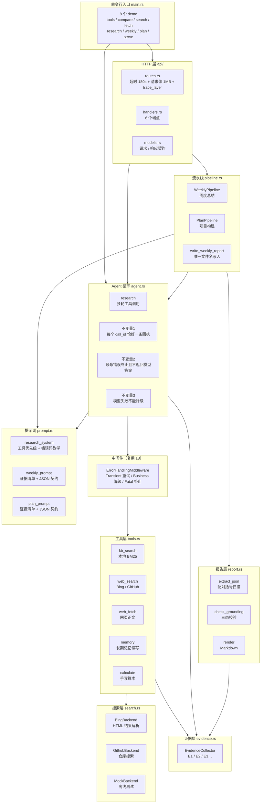
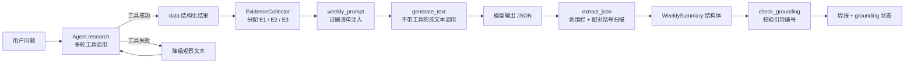
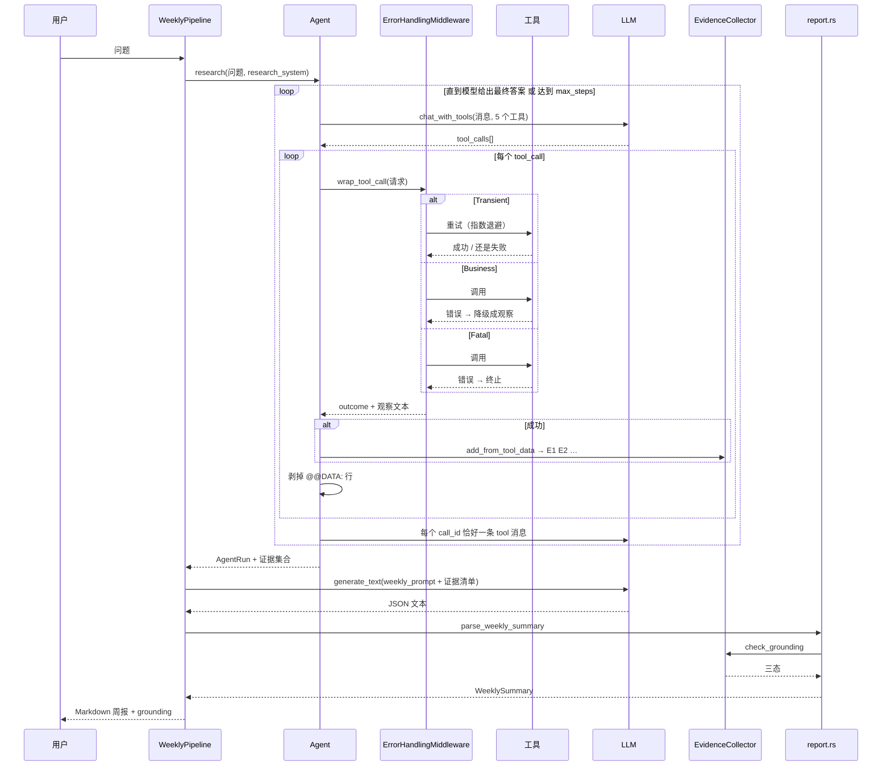
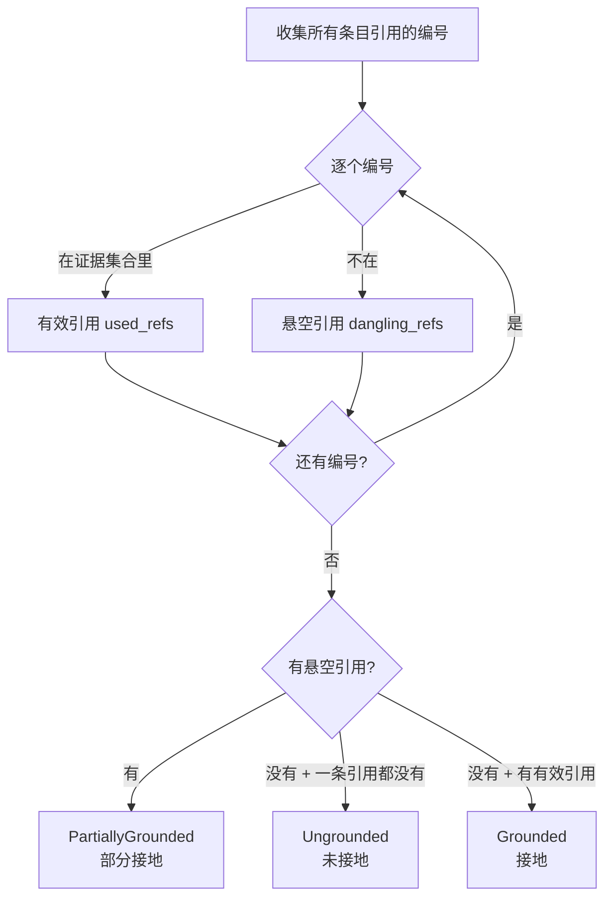
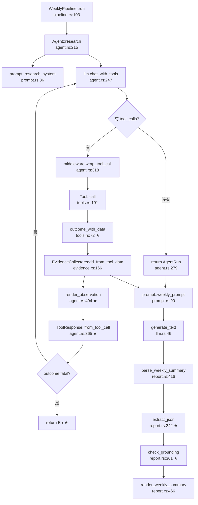
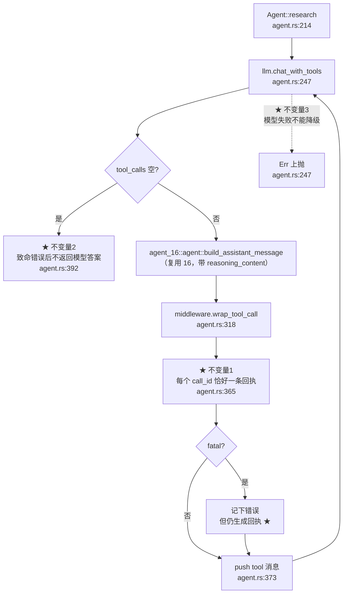
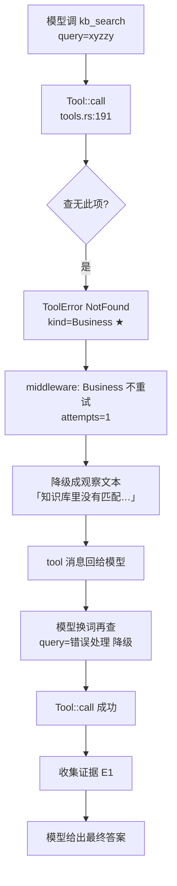
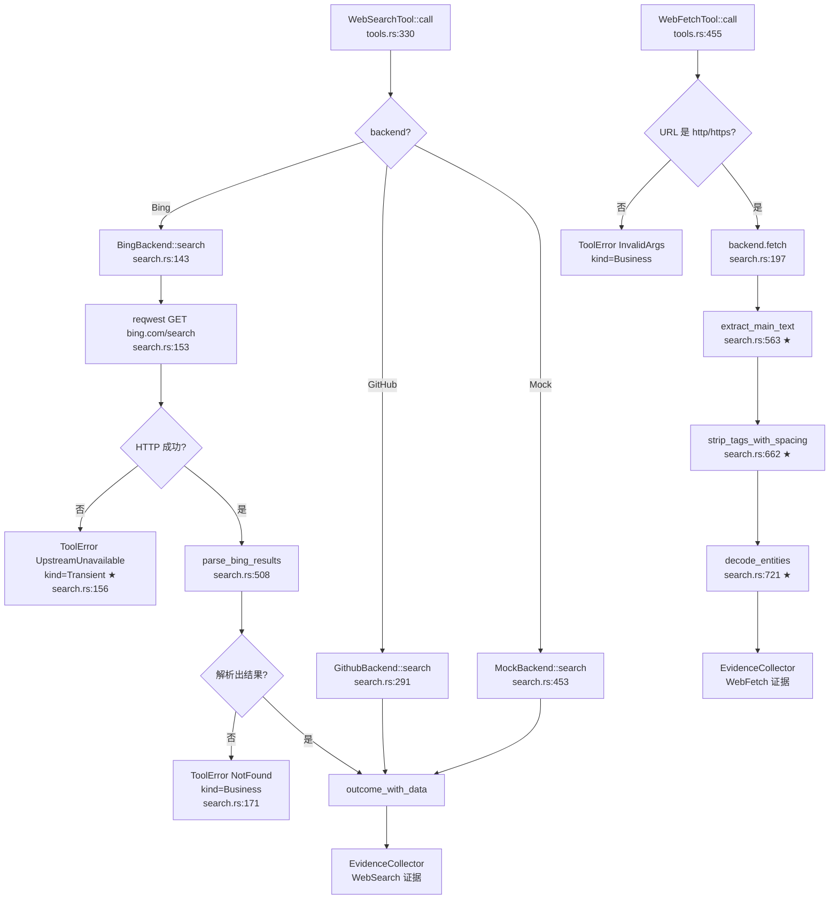
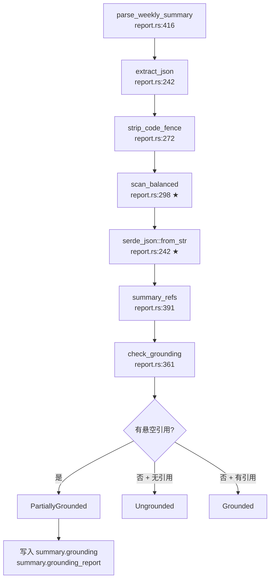
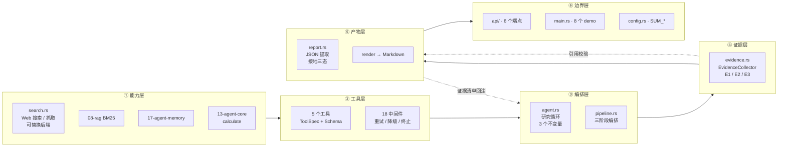

# 19-agent-summary —— 研究助手 Agent（RAG + Web 搜索 + 周报 / 项目构建）

> **一句话**：把「查资料」变成「一份**有据可查**的文档」——
> 研究 → 成文 → **接地校验** 三阶段流水线。

agent-learn workspace 的第 19 个成员，也是**第一个把前面所有项目串起来**的项目。

| | |
|---|---|
| 端口 | `127.0.0.1:3120` |
| 包名 | `agent-19` |
| 环境变量前缀 | `SUM_` |
| 测试 | 单元 79 + 集成 19 = **98 项**，**零网络、零 token** |
| 参考资料 | [OpenAI Function Calling](https://platform.openai.com/docs/guides/function-calling)、[DeepSeek Function Calling](https://api-docs.deepseek.com/guides/function_calling)、[LangChain 中间件](https://docs.langchain.com/oss/python/langchain/middleware/custom)、[Mem0](https://github.com/mem0ai/mem0) |

---

## 目录

- [核心问题](#核心问题)
- [架构全景](#架构全景)
- [三阶段流水线](#三阶段流水线)
- [五个工具](#五个工具)
- [证据与接地校验](#证据与接地校验)
- [代码调用详细流程图（函数级）](#代码调用详细流程图函数级)
- [实测踩过的坑](#实测踩过的坑)
- [复用了哪些项目](#复用了哪些项目)
- [HTTP API](#http-api)
- [配置项](#配置项)
- [快速上手](#快速上手)
- [知识地图](#知识地图)
- [技术参考速查](#技术参考速查)
- [已知局限](#已知局限)

---

## 核心问题

前面 16~18 项目分别解决了：

- **16**：怎么让模型**结构化地**调工具（`tool_calls` 数组）
- **17**：怎么记住跨会话的事实
- **18**：工具失败时**怎么处置**（重试 / 降级 / 终止）

但它们都停在「工具调通了」这一步。

**19 要回答的是下一个问题**：

> 工具调通了，**然后呢**？
>
> 一次真实的研究任务要调 3~8 次工具，产出几十 KB 的观察文本。
> 怎么把这一堆碎片变成**一份人能读、且每句话都能追查来源**的文档？

这个转换有三个难点：

| 难点 | 朴素做法为什么不行 | 本项目的做法 |
|---|---|---|
| **模型会不查就写** | 一个提示词里同时要「查资料」和「写报告」→ 模型先写（写作 token 收益更高），然后**编引用编号** | 拆成两阶段：研究 → 成文。成文时输入**只有证据** |
| **引用编号会被编造** | 提示词说「只能引用给定编号」，模型仍会写 `E99` | **代码里**校验：三态 `grounding` |
| **「没查」和「编了」要分清** | 都判成「未接地」就混在一起了 → **幻觉被掩盖** | 悬空引用优先判 `PartiallyGrounded` |

---

## 架构全景



### 数据流



---

## 三阶段流水线



### 为什么阶段 B 不带工具

带工具的话，模型可能又想调工具 —— 然后**又回到阶段 A**。
阶段 B 传**空 `tools` 列表**，它就只能写。

这在代码里就是 [`llm.rs:generate_text`](src/llm.rs) 和
[`llm.rs:chat_with_tools`](src/llm.rs) 的区别 ——
前者写死传 `&[]` 和 `genai::chat::ToolChoice::None`。

---

## 五个工具

| 工具 | 能力 | 后端 | 确定性 | 失败类别 |
|---|---|---|---|---|
| `kb_search` | 本地知识库检索 | 08-rag 的 BM25 | ✅ 确定性 | 参数错 / 查无 → Business |
| `memory` | 长期记忆读写 | 17-agent-memory | ✅ 确定性 | 参数错 → Business |
| `web_search` | Web 搜索 | Bing / GitHub | ❌ 外部依赖 | 网络故障 → Transient |
| `web_fetch` | 网页正文 | Bing / GitHub | ❌ 外部依赖 | 404 → Business；超时 → Transient |
| `calculate` | 算术求值 | 13-agent-core 手写 | ✅ 确定性 | 表达式错 → Business |

### 工具优先级

提示词里**明确写了**顺序（[`prompt.rs:research_system`](src/prompt.rs)）：

```
1. kb_search  本地知识库 —— 零延迟、结果稳定，最可能是项目内部信息
2. memory     长期记忆   —— 记录过的事实比重新搜索更可信
3. web_search + web_fetch —— 外部信息有时效性，但更慢也可能失败
```

这不是「最佳实践」式的空话 —— 它**同时是省钱策略**：
本地检索不花 token、不花 API 配额、还更快。

### ⚠️ 为什么只有 5 个

OpenAI 最佳实践：「保持初始可用函数的数量足够少 —— 建议一开始少于 20 个」。

16 实测过 `tool_choice=required` 的危害：7 次调用里 5 次是**硬凑的**。
工具越多，模型的选择空间越大，凑数的概率也越高。

---

## 证据与接地校验

### 证据从哪来

每次工具**成功**，就把它的 `data` 里的结构化结果转成一条证据：

| 工具 | 证据的 `source` | 证据的 `text` |
|---|---|---|
| `kb_search` | `notes.md > 错误处理 > 三个类别` | 块正文 |
| `web_search` | `https://rust-lang.org/` | 标题 + 摘要 |
| `web_fetch` | `https://...` | 网页正文开头 |
| `memory` | `用户的��术栈：Rust` | 事实内容 |
| `calculate` | `(120 - 45) / 3 = 25` | 算式与结果 |

### 三态判定



### ⚠️ 悬空引用优先 —— 一个容易搞错的语义

| 情况 | 判定 | 含义 | 该怎么对待 |
|---|---|---|---|
| 引用了 `E1`、`E2`（都存在） | `Grounded` | 有据可依 | ✅ |
| 引用了 `E1`、`E99`（`E99` 不存在） | `PartiallyGrounded` | **编造了引用** | ⚠️ 幻觉 |
| **只**引用了 `E99` | `PartiallyGrounded` | **纯编造** | ⚠️ 幻觉 |
| 一条引用都没有 | `Ungrounded` | 什么都没查 | ℹ️ 诚实（可能真没资料） |

**为什么「只引用伪造编号」也判 `PartiallyGrounded`**：

如果它被判成 `Ungrounded`，就混进「诚实但没资料」里了 ——
**幻觉被掩盖**。这个语义是集成测试 `dangling_reference_is_the_real_hallucination_signal`
锁住的。

### 默认值是 `Ungrounded`

```rust
#[derive(Debug, Clone, Copy, PartialEq, Eq, Default, Serialize, Deserialize)]
pub enum Grounding {
    Grounded,
    PartiallyGrounded,
    #[default]
    Ungrounded,
}
```

「默认接地」是最危险的默认值 ——
模型没引用任何东西时，如果默认是 `Grounded`，校验就形同虚设。
**没引用 = 没接地**，这是唯一安全的默认。

---

## 代码调用详细流程图（函数级）

节点写**真实函数名**，边上标**调用点行号**（格式 `文件.rs:行号`），★ 标出「容易写错」的位置。

### ① 周度总结全链路



★ 标注的三处「容易写错」：

| 位置 | 为什么容易错 |
|---|---|
| `tools.rs:72` `outcome_with_data` | 结构化 `data` 必须**追加在 observation 末尾**，不能塞在中间 —— 中间会被截断逻辑切掉 |
| `agent.rs:494` `render_observation` | 发给模型前必须**剥掉** `@@DATA:` 行，那坨 JSON 会占 token 还干扰模型 |
| `report.rs:361` `check_grounding` | 悬空引用必须**优先**判 `PartiallyGrounded`，否则幻觉被掩盖 |

### ② Agent 循环的三个不变量



**不变量 1 的具体形态**：致命错误也**必须**生成 `tool` 消息 ——
少一条，下一轮请求就是 400（DeepSeek 原文 `insufficient tool messages following tool_calls message`）。

**不变量 3 的形态**：`llm.chat_with_tools` 的错误**直接 `?` 上抛**，
不转成观察 —— 因为「没有模型就没有答案」，没有观察可喂。

### ③ 工具失败 → 降级 → 自我纠正



### ④ 搜索与抓取



★ 三处「容易写错」：

| 位置 | 坑 |
|---|---|
| `search.rs` `parse_bing_results` | Bing 的 `<li class="b_algo">` 里第一个 `<h2>` 可能**没有链接**（相关搜索块），必须跳过而不是崩掉 |
| `search.rs` `strip_tags_with_spacing` | 行内标签（`<a>`）剥掉后**两侧要补空格**，否则「第一个第二个」会粘成一个词组 |
| `search.rs` `decode_entities` | Bing 摘要里有 `&ensp;` `&#0183;` —— 只解固定几个实体会留一堆乱码 |

### ⑤ 接地校验



★ 两处「容易写错」：

| 位置 | 坑 |
|---|---|
| `report.rs:298` `scan_balanced` | JSON **字符串里**可能有 `}` —— `{"text": "a } b"}`。必须跳过字符串字面量 |
| `report.rs:242` | 前言里可能有 `{周报}` 这样的占位 —— 它括号配对但**不是合法 JSON**。所以判据是「能解析」而不是「括号配对」 |

---

## 实测踩过的坑

| # | 坑 | 一句话根因 |
|---|---|---|
| 1 | 一个提示词同时要「查资料」和「写报告」→ 模型先写再编引用 | 写作的 token 收益比查询高 |
| 2 | JSON 外面包围栏，前言里带 `{周报}` | 「括号配对」不等于「是合法 JSON」 |
| 3 | 模型引用不存在的证据编号（`E99`） | 幻觉必须**在代码里**判，不能靠提示词 |
| 4 | 搜索引擎因网络环境而异 | 「HTTP 200」≠「有内容」 |
| 5 | 证据编号按字典序排 → `E1, E10, E2` | `BTreeMap<String, _>` 的键是字符串 |
| 6 | 证据的 `source` 和 `text` 是同一句 | 工具的 `data` 里要带正文 |
| 7 | HTML 提取：脚本没删 / 标签粘连 / 实体没解码 | 三个细节各漏一个 |
| 7b | 搜索路径的实体没解码（只修了抓取路径） | 解码放错了层 |
| 8 | 中间件只保留观察文本，`ToolOutcome.data` 丢了 | 18 的公开 API 不能改 |
| 9 | 中文 BM25 的 unigram 带来噪声命中 | 固有特性，要靠重排根治 |
| 10 | `make serve` 报 `Address already in use` | 上一次的服务没退干净 |
| 11 | `python3 -m json.tool` 把中文转义成 `\uXXXX` | `ensure_ascii` 默认是 `True` |
| 12 | 直接调工具时 `@@DATA:` 那坨 JSON 混在正文里 | 那是证据层的通道，不是给人看的 |

### 坑 1：一个提示词同时要「查资料」和「写报告」→ 模型先写，然后编引用

**症状**：周报看起来很专业，但引用编号全是编的。

**根因**：写作的 token 收益比查询高，模型会先写；
写完再「补」几个看起来合理的编号。

**修法**：拆成两阶段。

```
阶段 A：research(question, research_system)  →  证据集合
阶段 B：generate_text(weekly_prompt + 证据清单)  →  JSON
```

阶段 B 的输入**只有证据**，模型没看到原始资料，编不出细节。

**代码**：[`pipeline.rs:WeeklyPipeline::run`](src/pipeline.rs)

### 坑 2：模型输出的 JSON 外面包着围栏，前言里还带花括号

**症状**：`serde_json::from_str` 直接失败。

**实测的原始输出**：

```text
好的，这是 {周报}：
```json
{ "overview": "..." }
```
```

**两个错**：

1. ` ```json ` 围栏 → 直接 `from_str` 失败
2. 前言里的 `{周报}` → 「找第一个 `{` 到最后一个 `}`」会抓到 `{周报}`

**修法**：逐字符扫描**配对括号**（跳过字符串字面量里的括号），
然后**逐个尝试解析**，取第一个能解析的候选。

「括号配对」不够 —— `{周报}` 括号也配对，但**不是合法 JSON**。
判据必须是「能 `from_str` 成功」。

**代码**：[`report.rs:extract_json`](src/report.rs)

### 坑 3：模型引用了不存在的证据编号

**症状**：周报里出现 `[E99]`，而证据只有 `E1`~`E8`。

**根因**：提示词写了「只能引用给定的编号」，但那是**软约束**，模型可以不听。

**修法**：**代码里**校验 —— `grounding` 三态。

**代码**：[`report.rs:check_grounding`](src/report.rs)

### 坑 4：搜索引擎因网络环境而异

**实测的连通性探测**（本项目开发环境）：

| 端点 | 结果 |
|---|---|
| `html.duckduckgo.com` | ❌ 连接超时 |
| `api.duckduckgo.com` | ❌ 连接超时 |
| `zh.wikipedia.org` / `en.wikipedia.org` | ❌ 连接超时 |
| `api.search.brave.com` | ❌ 连接超时 |
| `searx.be` | ❌ 连接超时 |
| `serpapi.com` | ⚠️ 401（无 key） |
| `www.mojeek.com` | ⚠️ HTTP 200 但正文是「403 Forbidden —— 检测到自动化查询」 |
| **`www.bing.com`** | ✅ HTTP 200，10 条结果，结构稳定 |
| **`api.github.com`** | ✅ HTTP 200，JSON，最稳 |
| **`crates.io`** | ✅ HTTP 200，JSON |

**修法**：搜索抽象成 `WebBackend` trait，上层不依赖任何一家。

```
BingBackend    通用网页搜索（HTML 结果解析）
GithubBackend  技术类搜索（仓库 / 代码）
MockBackend    离线测试 + SUM_SEARCH_BACKEND=offline
```

**顺带发现的**：`mojeek` 那个坑说明**「HTTP 200」不等于「拿到了内容」** ——
所以搜索结果**为空**时判 `NotFound`（Business）而不是「成功但没结果」。

### 坑 5：证据编号按字典序排 → `E1, E10, E11, E2`

**症状**：证据清单变成 `E1, E10, E11, E12, E2, E3...`，模型看到会以为编号本身有含义。

**根因**：`BTreeMap<String, _>` 按字典序排 —— `"E10" < "E2"`（因为 `'1' < '2'`）。

**修法**：存 `(序号, 证据)`，用序号排序。

**代码**：[`evidence.rs:EvidenceCollector`](src/evidence.rs)，
回归测试 `ids_sort_numerically_not_lexicographically`

### 坑 6：证据的 `source` 和 `text` 是同一句

**症状**：证据清单里每条都长这样：

```text
[E1] notes.md > 错误处理 > 三个类别
     notes.md > 错误处理 > 三个类别
```

**根因**：`kb_search` 的 `data` 里只带了 `source` 和 `heading_path`，
没带**块正文** —— 证据层只能拿标题路径当正文。

**修法**：工具的 `data` 里带上 `text`（块正文），证据层区分「来源位置」和「证据内容」。

**代码**：[`tools.rs:KbSearchTool::call`](src/tools.rs)、
[`evidence.rs:add_from_tool_data`](src/evidence.rs)，
回归测试 `kb_evidence_uses_chunk_body_not_heading_path`

### 坑 7：HTML 提取的三个细节

| 细节 | 现象 |
|---|---|
| 脚本 / 样式不删 | 模型看到一堆 `var x = 1; alert("hi")` —— 占 token 还干扰 |
| 行内标签不补空格 | `<a>第一个</a><a>第二个</a>` → 「第一个第二个」，读起来像一句话 |
| 实体不解码 | Bing 摘要里的 `&ensp;` `&#0183;` → 模型看到像乱码 |

**代码**：[`search.rs:extract_main_text`](src/search.rs)

### 坑 7b：搜索摘要的实体没解码（抓取路径解了，搜索路径没解）

**症状**：`make search` 的输出里满是 `&ensp;&#0183;`。

**根因**：实体解码写在 `extract_main_text` 里（抓取路径），
**搜索路径**直接把搜索服务的摘要原样透传了。

**修法**：在 `WebSearchTool::call` 里解码 `title` 和 `snippet`。

**⚠️ 但 URL 绝不能解码** —— URL 里的 `&` 是查询参数分隔符，
解码会破坏链接。

**代码**：[`tools.rs:WebSearchTool::call`](src/tools.rs)，
回归测试 `web_search_decodes_entities_in_snippets`

### 坑 8：中间件只保留观察文本，`ToolOutcome.data` 丢了

**症状**：证据层拿不到结构化结果。

**根因**：18 的 `MiddlewareOutcome` 只保留 `observation` 文本 ——
因为 18 的循环不需要结构化结果。

**修法**：**不改 18 的公开 API**，而是用一个**约定**：
工具把结构化结果编码成 observation 的**最后一行**：

```text
可见文本
@@DATA:{"hits":[...]}
```

循环做两件事：收集证据时**解回来**，发给模型前**剥掉**。

**代码**：[`tools.rs:outcome_with_data`](src/tools.rs)、
[`agent.rs:parse_data_line`](src/agent.rs)

### 坑 9：中文 BM25 的 unigram 会带来噪声命中

**现象**：查「量子计算」返回了「BM25 是关键词检索算法」。

**根因**：08 的中文分词是 **unigram + bigram** ——
「量子计算」里的「算」命中了「算法」。

**这不是 bug**，是中文关键词检索的固有特性（要解决得靠重排 / 向量检索，那是 08/12 的活）。

**对测试的影响**：断言「查无此项」时，查询词必须和语料**完全没有共同字符**。
回归测试 `kb_search_reports_not_found_as_business` 用的是 `xyzzy`。

### 坑 10：`make serve` 报 `Address already in use`

**现象**：

```
Error: Address already in use (os error 48)
make: *** [serve] Error 1
```

**根因**：**上一次的服务还在跑**。

不是「端口被别的程序占了」那么简单 —— 多数情况是
自己刚才 `make serve` 之后没退干净：

- `Ctrl+C` 有时没杀干净（尤其在多标签终端里）
- 用 `&` 后台启动后忘了停
- 测试脚本起了服务没回收

**⚠️ 注意**：错误发生在**建好知识库索引之后**（日志里能看到
「知识库索引已构建 docs=28」），所以看起来「准备都做完了才失败」——
其实和索引无关，纯粹是 bind 冲突。

**修法**：把诊断和清理做成一条命令，不要靠 `lsof` 手敲：

```bash
make port-check    # 诊断：谁占了端口
make port-clean    # 清理：停掉残留进程
```

`port-clean` 会先 `kill`，1 秒后还在就 `kill -9`，最后再验证一次。

**代码**：[`Makefile:port-check`](Makefile) / [`Makefile:port-clean`](Makefile)

**⚠️ 但要先确认那进程确实是自己的** —— `port-clean` 会无条件杀掉占用者，
如果 3120 上跑的是别的项目就误伤了。所以设计成两步：
先 `port-check` 看清楚（会打印 PID + 启动时间 + 完整命令行），
确认无误再 `port-clean`。

### 坑 11：`python3 -m json.tool` 把中文转义成 `\uXXXX`

**现象**：

```json
{
    "observation": "[1] # \u9879\u76ee\u7b14\u8bb0 > \u9519\u8bef\u5904\u7406"
}
```

—— 人眼完全没法读。

**根因**：`json.tool` 的 `ensure_ascii` **默认是 `True`**，
所以所有非 ASCII 字符都被转义成 `\uXXXX`。

**⚠️ 这是个「看起来像 bug 但其实是默认行为」的坑** ——
JSON 规范里 `\uXXXX` 和原始 UTF-8 **完全等价**，两种编码都对。
只是 `json.tool` 默认选了前者。

**⚠️ 而且它只在「经过 json.tool」的时候出现** —— 服务端返回的
原始字节一直是正常中文。所以很容易误判成「服务端编码有问题」
或者「数据库存的是转义过的字符串」，实际都不是。

**修法**：加 `--no-ensure-ascii`。

```bash
curl -s ... | python3 -m json.tool --no-ensure-ascii
```

**⚠️ 兼容性**：`--no-ensure-ascii` 从 **Python 3.9**（2020）就有，
比它更老的版本会报 `unrecognized arguments`。
本仓统一按 3.9+ 写。

**代码**：[`Makefile:api-call`](Makefile) 等所有 `api-*` 目标

> 📌 **这个坑是全仓性的**：12/13/14/15/16/17/18/19 的 Makefile
> 一共 35 处 `json.tool` 都中招了，已全部加上 `--no-ensure-ascii`。

### 坑 12：直接调工具时，`@@DATA:` 那坨 JSON 混在正文里

**现象**：`make api-call` 的输出里，正文后面跟着一坨结构化数据：

```
[4] # 项目笔记 > 工具 > 参数错了别发请求
Schema 本地校验……

@@DATA:{"query":"错误处理 降级","hits":[{"source":"notes.md",...
```

**根因**：`@@DATA:` 是**证据层**的通道 ——
`EvidenceCollector::add_from_tool_data` 靠它把结构化结果解回来。

- Agent 循环里会**在发给模型前剥掉**（`agent.rs:render_observation`）
- 但**直接调工具的 HTTP 端点**返回的是原始 observation，没剥

**修法**：加一个 `scripts/strip_data.py` 专门做这件事，
`api-call` 改用它。

**⚠️ 注意**：脚本用的是**独立实现**（Python），和 Rust 侧的
`render_observation` 是两份逻辑。它们必须**语义一致** ——
但因为只是「剥掉末尾的 `@@DATA:` 行」，改动的风险极低。

**代码**：[`scripts/strip_data.py`](scripts/strip_data.py)

---

## 复用了哪些项目

本项目**没有重写任何基础设施** —— 全部复用前面项目的成果，
因此**自动继承**它们踩过的坑。

| 来源 | 复用什么 | 继承的坑 |
|---|---|---|
| [`agent_18`] | `ErrorAwareTool` / `ToolRegistry` / `ErrorHandlingMiddleware` | 「Business 不重试」「Fatal 不降级」「每个 call_id 一条回执」 |
| [`agent_18`] | `FunctionLlm` / `GenaiFunctionLlm` / `ScriptedLlm` | 「模型调用失败不能降级」 |
| [`agent_16`] | `ToolSpec` / `genai::chat::ToolChoice` / assistant 消息构造 / 参数规整 | 「Schema 是对模型的承诺」「思考内容必须回传」 |
| [`agent_17`] | `MemoryStore` / `MemoryRetriever` / `MemoryFact` | 「同 key 合并、旧值进 versions」 |
| [`agent_14`] | JSON Schema 子集校验器 | 「参数错了别发请求」 |
| [`agent_13`] | `calculate`（手写算术求值器） | 「统计数字不走模型心算」 |
| [`rag_08`] | `Bm25Index` / `build_bm25` | 「BM25 用块正文，不含标题」 |
| [`rag_04`] | `SplitterConfig` | 分块口径与向量索引一致 |
| [`agent_logging`] | `init` / `trace_layer` / `info!` `warn!` `error!` | 「4xx 用 warn、5xx 用 error」「降级必须打 warn」 |

> ⚠️ **本项目原先自己写了一份 assistant 消息构造，丢掉了 `reasoning_content`** ——
> 复用 16 的 `agent_16::agent::build_assistant_message` 之后，
> 思考模式一开就会被 provider 拒（400）这个**潜伏 bug** 才被消掉。
> ⚠️ **复用 ≠ 自动生效**：复用前一个项目的类型只是第一步，
> **语义字段必须在搬运链上全程保留**。

---

## HTTP API

| 方法 | 路径 | 说明 |
|---|---|---|
| `GET` | `/health` | 健康检查 |
| `GET` | `/` | 服务信息 + 工具清单 |
| `POST` | `/api/research` | ★ 只跑研究阶段（拿证据，不成文） |
| `POST` | `/api/weekly` | ★ **周度总结**（研究 + 成文 + 校验） |
| `POST` | `/api/plan` | ★ **项目构建方案**（研究 + 成文 + 校验） |
| `POST` | `/api/tools/call` | 直接调工具（不经模型） |
| `GET` | `/api/evidence` | ★ 证据来源契约 + 不变量清单 |

### 请求 / 响应示例

**`POST /api/weekly`**

```json
{ "question": "错误处理与工具层的进展" }
```

```json
{
  "summary": {
    "overview": "本周聚焦错误处理与工具层……",
    "highlights": [
      { "text": "确立工具失败三分类……", "evidence": ["E3"] }
    ],
    "risks": [],
    "next_steps": []
  },
  "markdown": "## 概览\n\n……\n\n---\n接地状态：**接地**（引用 5 / 证据 20）\n",
  "grounding": "grounded",
  "stats": {
    "tool_calls": 3,
    "retried_calls": 0,
    "degraded_errors": 1,
    "evidence_count": 20,
    "tools_used": ["kb_search"],
    "elapsed_ms": 7277
  }
}
```

### ⚠️ 「用户直接调工具」的错误**不**降级

`POST /api/tools/call` 里，用户自己扮演了「模型」的角色 ——
他指定了工具和参数，他就该看到**真正的错误**：

- 参数错 / 未知工具 → **400**（不是 500 —— 500 会让调用方以为服务端坏了）
- 上游超时 → **503**

而 Agent 循环里，同一个错误会被降级成观察，让模型自我纠正。

---

## 配置项

| 变量 | 说明 | 默认 |
|---|---|---|
| `SUM_BIND_ADDR` | 主服务监听地址 | `127.0.0.1:3120` |
| `SUM_MODEL` | 模型名 | `deepseek-flash` |
| `SUM_TEMPERATURE` | 温度 | `0.0`（周报要可复现） |
| `SUM_MAX_TOKENS` | max tokens | `4096` |
| `SUM_REASONING` | 是否开推理模型的思考模式 | `false`（关） |
| `SUM_MAX_STEPS` | Agent 最大步数 | `6` |
| `SUM_TOOL_CHOICE` | `auto`/`none`/`required`/`forced:工具名` | `auto` |
| `SUM_MAX_RETRIES` | 工具额外重试次数 | `2` |
| `SUM_BASE_DELAY_MS` | 退避基准延迟（毫秒） | `50` |
| `SUM_MAX_DELAY_MS` | 退避上限（毫秒） | `2000` |
| `SUM_KB_DIR` | 本地知识库目录 | `data/kb` |
| `SUM_SEARCH_BACKEND` | `bing`/`github`/`offline` | `bing` |
| `SUM_SEARCH_TOP_K` | 搜索返回条数上限 | `5` |
| `SUM_WEB_TIMEOUT_SECS` | Web 请求超时（秒） | `15` |
| `SUM_GITHUB_TOKEN` | GitHub token（可选） | 无 |
| `SUM_MAX_EVIDENCE` | 每类内容最多保留的证据条数 | `8` |
| `SUM_OUTPUT_DIR` | 周报输出目录 | `data/reports` |

### 环境变量前缀的由来

`SUM_`（Summary）—— 避免和别的项目撞名：

| 项目 | 前缀 |
|---|---|
| 06-rag | `RAG_` |
| 07-query | `QUERY_` |
| 13-agent-core | `AGENT_` |
| 14-agent-tool | `TOOL_` |
| 15-agent-sql | `SQL_` |
| 16-agent-function-calling | `FC_` |
| 17-agent-memory | `MEM_` |
| 18-agent-error | `ERR_` |
| **19-agent-summary** | **`SUM_`** |

---

## 快速上手

### 环境准备

```bash
# 1. API key（LLM 用）
export DEEPSEEK_API_KEY="sk-..."

# 2. 编译
cargo build -p agent-19
```

### 不用网络的（最快）

```bash
cd 19-agent-summary

make tools      # 工具清单
make compare    # 接地校验对照
```

### 用网络的

```bash
make search SEARCH_QUERY="rust async runtime"   # Web 搜索
make fetch  FETCH_URL="https://doc.rust-lang.org/book/"   # 网页抓取
make research                                     # 研究阶段
make weekly                                       # ★ 周度总结
make plan                                         # ★ 项目构建方案
```

### 启动服务

```bash
make serve

# 另开一个终端
make api-root
make api-weekly
make api-plan
make api-evidence
```

> ⚠️ 报 `Address already in use`？先 `make port-check` 看是谁占了端口，
> 确认是自己的残留进程再 `make port-clean`。详见[坑 10](#坑-10make-serve-报-address-already-in-use)。

### 跑测试

```bash
make test    # 98 项，零网络、零 token
make lint    # clippy 零警告
make check   # fmt + lint + test
```

### 知识库

```
data/kb/
├── notes.md      # 项目笔记（架构 / 错误处理 / 工具 / 检索 / 记忆 / 报告 / Web 搜索）
└── protocol.md   # 工具调用协议（Function Calling / 消息历史 / 流式与并行）
```

加自己的文档进去就行 —— `kb_search` 会自动索引（Markdown，按标题分块）。

---

## 知识地图



---

## 技术参考速查

| 主题 | 关键点 |
|---|---|
| **Function Calling** | `tools` 字段进请求，`tool_calls` 数组出响应，`role="tool"` + `tool_call_id` 回传 |
| **回执不变量** | 每个 `tool_call` 恰好一条 `tool` 消息；少一条整个请求 400；致命错误也要生成 |
| **思考模式** | 开思考必须回传 `reasoning_content`，且顺序在工具调用之前 |
| **工具数量** | 初始 < 20 个；本项目 5 个。工具多 → 选择空间大 → 凑数概率高 |
| **`tool_choice`** | `auto` 是唯一正确的默认；`none` 不可靠（模型会用文本模拟调用）；`required` 诱发凑数 |
| **错误三分类** | Transient（重试）/ Business（降级）/ Fatal（终止）。分类由**声明**决定，不由文案决定 |
| **降级语义** | 工具失败 → 渲染成观察喂回模型；模型失败 → 终止（没有观察可喂） |
| **中文 BM25** | unigram + bigram → 「量子计算」的「算」会命中「算法」。噪声命中是固有特性 |
| **接地三态** | Grounded / PartiallyGrounded / Ungrounded。**悬空引用优先**判 PartiallyGrounded |
| **默认接地值** | 必须是 `Ungrounded` —— 「默认接地」会让校验形同虚设 |
| **两阶段分离** | 研究 → 成文。成文阶段**不带工具**、输入**只有证据** |
| **JSON 提取** | 剥围栏 → 逐字符扫配对括号（跳过字符串里的）→ **逐个试解析**取第一个成功的 |
| **HTML 提取** | 删脚本/样式/导航；行内标签两侧补空格；解码数字实体；控制字符换空格 |
| **Web 搜索** | 抽象成 trait。实测受限网络里只有 Bing + GitHub 可靠 |
| **HTTP 200 ≠ 有内容** | 搜索结果为空要判 `NotFound`，不是「成功但没结果」 |
| **确定性** | 温度 0；证据编号按**数值**排序（字典序会给出 `E1, E10, E2`） |
| **端点错误码** | 用户直接调工具：参数错 → 400；上游超时 → 503。**不**降级 |
| **日志约定** | 4xx 用 `warn!`、5xx 用 `error!`；降级必须打 `warn!`；业务逻辑不打 `println!` |

---

## 已知局限

诚实列出本项目**没有**解决的问题：

1. **只有 BM25，没有向量检索和重排**。
   中文 unigram 的噪声命中（坑 9）需要重排才能根治。
   08/12 实现了完整版，但它们需要 Milvus 或本地 ONNX 模型 —— 会破坏「零外部服务依赖」。

2. **`@@DATA:` 是个约定，不是类型安全**。
   工具必须记得把 `data` 编码进 observation，忘了就静默丢证据。
   更好的做法是给 18 的 `MiddlewareOutcome` 加 `data` 字段（会改动 18 的公开 API）。

3. **报告生成是「一次性」的**。
   模型如果第一遍 JSON 解析失败，整个流程就报 `AppError::Report`，
   没有「重试一次成文」的机制。

4. **长期记忆是进程内的**（`InMemoryMemoryStore`）。
   重启就丢。17 实现了文件版存储，本项目没接 —— 因为周报场景的记忆量不大。

5. **周报章节是硬编码的四段**（概览 / 亮点 / 风险 / 下周计划）。
   不同团队需要的章节不一样，这里没有做成可配置。

6. **没有并发上限**。
   研究阶段是串行的工具调用，没有并行 dispatch ——
   16 实测过 `parallel_tool_calls: false` 被 DeepSeek 忽略，并行度只能靠应用层控制，
   这里还没做。

---

## 项目沿革

| 版本 | 状态 |
|---|---|
| 19-agent-summary | ✅ 当前 |

---

[agent_18]: ../18-agent-error
[agent_16]: ../16-agent-function-calling
[agent_17]: ../17-agent-memory
[agent_14]: ../14-agent-tool
[agent_13]: ../13-agent-core
[rag_08]: ../08-rag
[rag_04]: ../04-rag
[agent_logging]: ../00-logging
