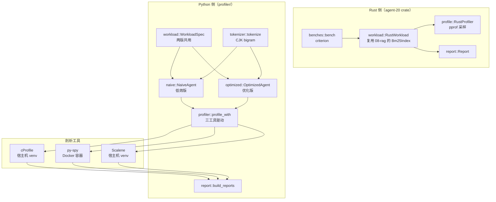
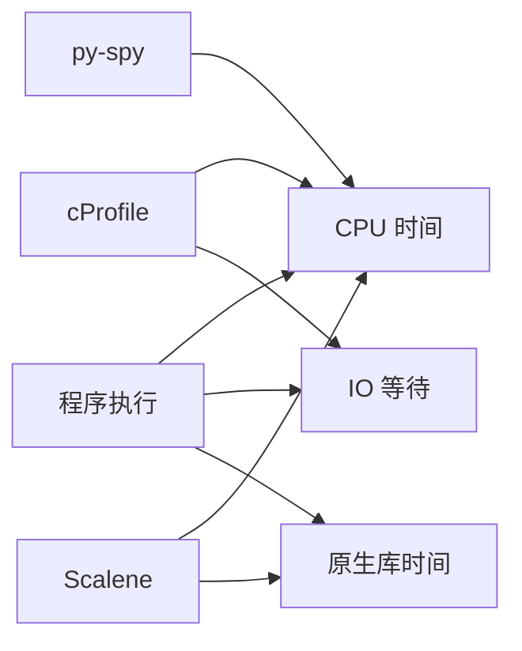
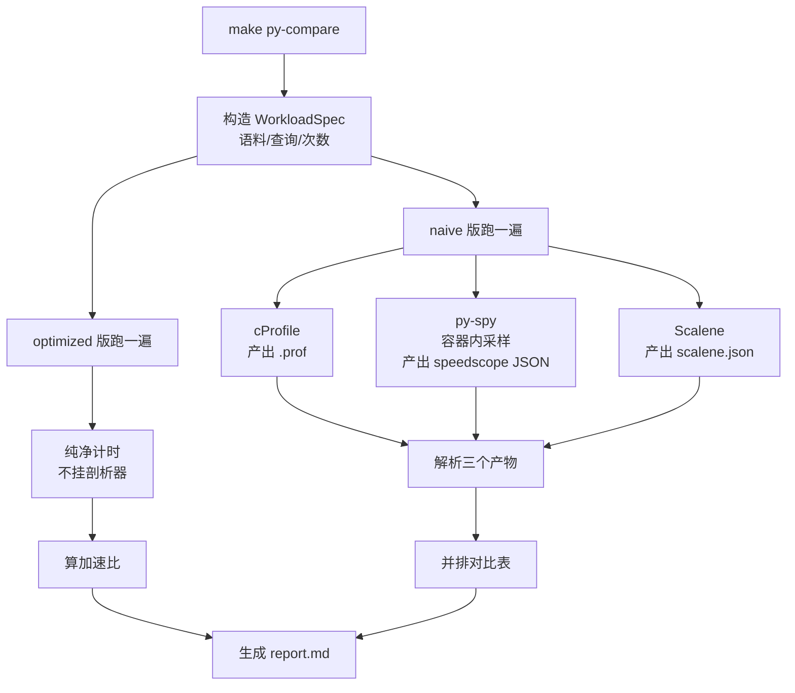
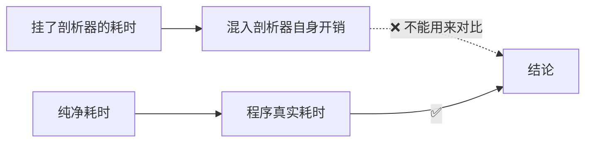
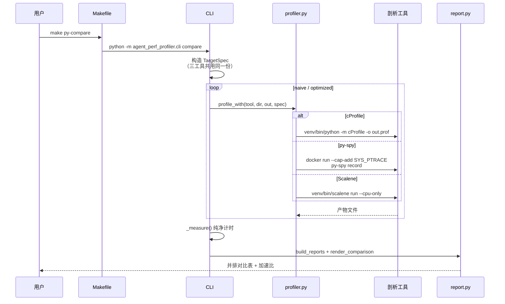
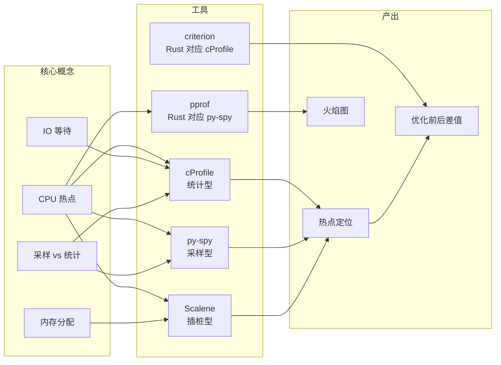
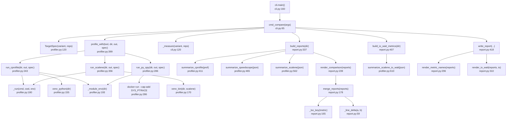
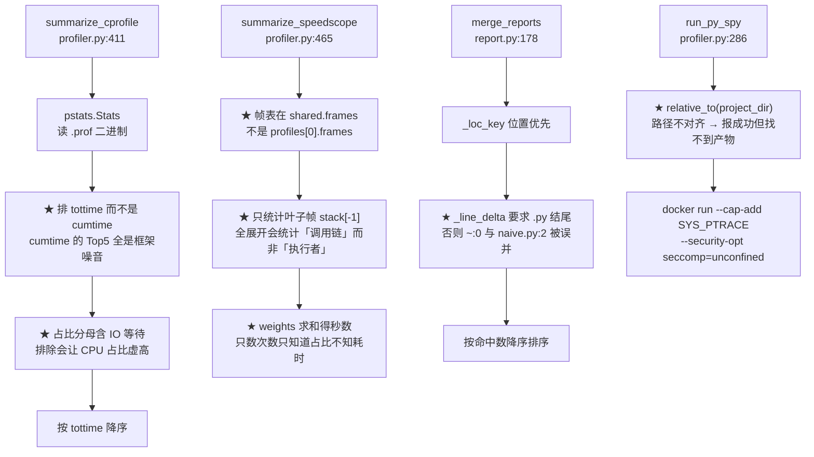
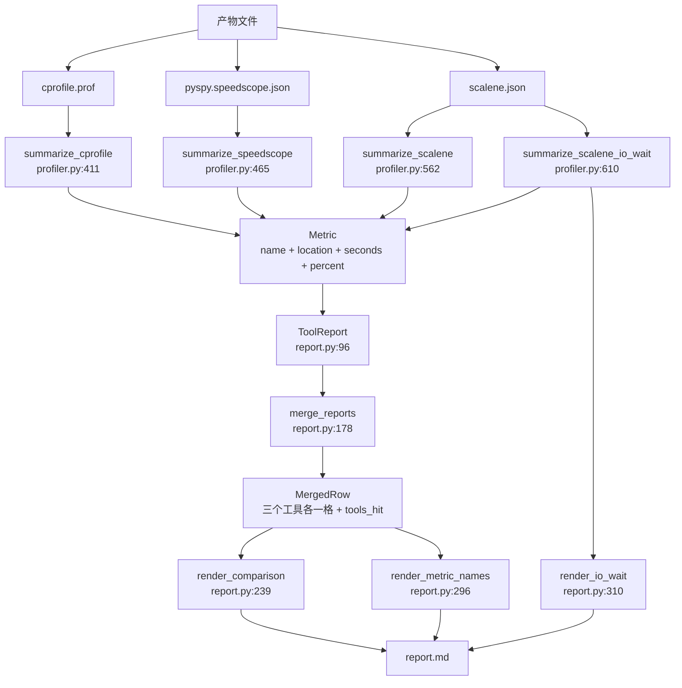
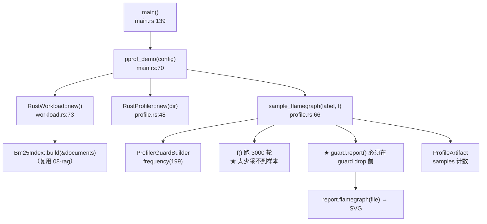

# 20-agent-preformence-analysis —— 性能瓶颈分析

> 学习主题：**性能瓶颈分析**
> 工具：[cProfile](https://docs.python.org/3/library/profile.html) · [py-spy](https://github.com/benfred/py-spy) · [Scalene](https://github.com/plasma-umass/scalene)
> 端口：无（纯离线实验台）

---

## 这个项目回答什么问题

前面 19 个项目把「**功能**」做出来了 —— 检索、工具、记忆、错误处理、接地校验。
但**功能正确 ≠ 跑得快**。

一个真实 Agent 系统的延迟由三部分构成：

```text
总延迟 = CPU 时间 + IO 等待 + 其它
           ↑         ↑
           可优化   优化不了（网络往返、模型生成速度）
```

**分不清这三者，就无法优化。** 你可能花三天优化了一段只占 2% 的 CPU 热点，
而真正的瓶颈是每次 800ms 的 LLM 网络往返。

本项目用**三个剖析工具**分析同一份 Agent 系统，得到**三张不同的「罪魁祸首」名单**——
它们都没错，因为它们量的根本不是同一件事。

---

## 核心产出

### 一、三工具归并对比（实测数据）

同一份程序、**三次独立运行**（每个工具各跑一次）：

| # | 指标名称 | 位置 | cProfile | py-spy | Scalene | 命中 |
|---|---|---|---|---|---|---|
| 1 | `<genexpr>` | `naive.py:135` | 0.710s (50.6%) | 0.855s (84.7%) | — | 2 |
| 2 | `naive_bm25_score` | `naive.py:120` | 0.056s (4.0%) | — | 0.519s (34.4%) | 2 |
| 3 | `<built-in method time.sleep>` | `~:0` | 0.579s (41.3%) | — | — | 1 |
| 4 | `main` | `target.py:72` | — | 0.095s (9.4%) | — | 1 |
| 5 | `NaiveAgent.naive_bm25_score` | `naive.py:141` | — | 0.050s (5.0%) | — | 1 |
| 6 | `<built-in method builtins.sum>` | `~:0` | 0.036s (2.6%) | — | — | 1 |
| 7 | `tokenize` | `tokenizer.py:101` | — | 0.005s (0.5%) | — | 1 |

> ⚠️ **三列秒数不可直接横向比较**：三个工具各自独立运行，采集机制与自身开销不同
> （cProfile 逐调用加钩子 → 开销大且含 IO 等待；py-spy 定时采样 → 开销小但排除空闲线程；
> Scalene 采样 + 系统调用计数 → 单列 IO）。可靠读法是**相对占比**与**命中工具数**。

**三个维度缺一不可**：

| 维度 | 回答的问题 | 为什么不能省 |
|---|---|---|
| **指标名称 + 位置** | 「是谁、在哪」 | 没有名字的表格没法行动 —— 得知道去改哪个函数 |
| **绝对耗时（秒）** | 「吃掉了多少时间」 | 占 87% 但只花 0.1s 的热点，和占 10% 但花 2s 的热点，**优化价值完全不同** |
| **占比（%）** | 「占总时间多少」 | 绝对值会被小而多的项淹没，占比能一眼看出主次 |

**怎么读这张表**（这是本项目最想教会的事）：

| 观察 | 说明 |
|---|---|
| 第 1 行**命中 2 个工具** | cProfile 与 py-spy **指向同一行代码** `naive.py:135` —— 交叉验证，可信度最高 |
| 第 3 名是 `time.sleep` | 它**不是 CPU 瓶颈**，是 **IO 等待**。真实 Agent 里这就是 LLM 网络往返 |
| 第 1 名是 `<genexpr>` | 藏在闭包里的热点 —— 光看函数名 `naive_bm25_score` 还看不出问题 |
| py-spy 完全没有 `time.sleep` | 它**默认排除空闲线程**，所以只看到「谁在烧 CPU」 |
| 第 2 行命中 cProfile + Scalene | 二者口径不同（cProfile 含 IO、Scalene 只算 Python），秒数差 9 倍正常，**看占比**才可比 |

**⭐ 跨工具归并的实现要点**（`report.py`）：

| 要点 | 说明 |
|---|---|
| **位置优先，名字兜底** | cProfile 与 py-spy 对同一函数报的行号可能差几行，用 `文件:行号` 归并最可靠；内建函数没有源码位置，才退回函数名 |
| **行号漂移容差 = 3 行** | `@staticmethod`、装饰器、生成器表达式的 `lineno` 会指向定义行而非执行行 |
| **⚠️ 无源文件的位置判为不可比** | `~:0`（内建函数）行号是 0，`naive.py:2` 行号是 2 —— 行号差只有 2，若只按行号判定会被**误并**。必须要求文件部分以 `.py` 结尾 |
| **排序：命中数优先** | 先按「被几个工具同时指向」降序，再按最大耗时降序 —— 第一行一定是「大家都认为是热点」的地方 |

### 二、优化前后可复现差值

| 指标 | 值 |
|---|---|
| naive | 1.0113s |
| optimized | 0.1207s |
| **加速比** | **8.38x**（节省 0.8905s） |

复现命令：

```bash
cd 20-agent-preformence-analysis
make setup        # 首次：venv + 依赖 + 镜像
make py-compare   # 三工具对比 + 优化前后差值
```

---

## 项目结构

```text
20-agent-preformence-analysis/
├── Cargo.toml              # Rust crate（agent-20）
├── Makefile                # 统一入口
├── src/
│   ├── lib.rs
│   ├── config.rs           # 环境变量前缀 PERF_
│   ├── workload.rs         # Rust 侧靶子（复用 08-rag 的 BM25）
│   ├── profile.rs          # pprof 采样 → 火焰图
│   └── report.rs           # 报告渲染
├── benches/bench.rs        # criterion 基准（对应 cProfile 的角色）
├── tests/integration.rs    # 10 项测试
└── profiler/               # ★ Python 侧实验台
    ├── pyproject.toml      # uv 管理，零运行时依赖
    ├── .python-version     # 固定 3.12
    ├── docker/Dockerfile   # py-spy 专用镜像
    ├── src/agent_perf_profiler/
    │   ├── workload.py     # 工作负载规格（两版共用）
    │   ├── tokenizer.py    # CJK bigram 分词（两版共用）
    │   ├── naive.py        # 低效版（剖析靶子）
    │   ├── optimized.py    # 优化版（对照组）
    │   ├── profiler.py     # 三工具驱动 + 产物解析
    │   ├── report.py       # 对比报告
    │   ├── target.py       # 被剖析程序入口
    │   └── cli.py          # 命令行
    └── tests/              # 21 项 Python 测试
```

---

## 架构全景



---

## 三个工具的分工

| 工具 | 类型 | 量的东西 | 含 IO 等待？ | 侵入性 | 独有价值 |
|---|---|---|---|---|---|
| **cProfile** | 确定性统计 | 每次函数调用的**自耗时** | **含** | 高（挂 `sys.setprofile`，改变时序） | 零依赖、精确计数、**不漏任何短函数** |
| **py-spy** | 采样 | 栈顶帧的采样占比 | **不含**（默认排除空闲线程） | 极低（外部 attach，不改代码） | **可 attach 线上进程**，不用重启 |
| **Scalene** | 插桩 | CPU 占比（分 Python / C） | **不含**（单列 `n_sys_percent`） | 中 | **区分 Python 代码与原生库**、内存分配、异步并发度 |

### ⭐ 怎么把各工具的占比换算成**绝对秒数**

报告里每个指标都同时给「占比」和「绝对耗时」，换算规则各不相同：

| 工具 | 原始字段 | 换算成秒 | 依据 |
|---|---|---|---|
| **cProfile** | `tottime`（本来就是秒） | 直接用 | 产物里**没有**百分比字段，占比要自己算：分母 = 全部函数自耗时之和 |
| **py-spy** | `weights`（每采样的时长，0.005 = 1/采样率） | 某帧耗时 = **Σ 该帧作为叶子帧出现时的 weight** | `profiles[0].weights`，配合 `unit: seconds` |
| **Scalene** | `n_cpu_percent_python`（百分比） | `elapsed_time_sec × pct / 100` | 顶层 `elapsed_time_sec` 是整个剖析过程的墙钟时长 |

⚠️ **cProfile 占比的分母必须包含 IO 等待**：排除掉 `time.sleep` 会让 CPU 热点占比虚高
（分母被压缩），读者会以为「这个函数占了 50% 的 CPU」，实际上整个进程才 1.4s、它只占 0.7s。
IO 等待单独标成「IO 等待」类别，占比照实计入总时间。

### 关键认知：它们量的不是同一件事



所以：

- **cProfile 排第一的 `time.sleep` 不是性能 bug** —— 它是外部约束，优化不了。
- **py-spy 看不到 `time.sleep`** —— 不是漏了，是设计如此。
- **想优化 CPU 热点看 py-spy / Scalene；想算总延迟看 cProfile。**

---

## 流程图

### 剖析全流程



### ⚠️ 为什么耗时要单独测



cProfile 会给**每次函数调用**加钩子，开销极大；
py-spy / pprof 是采样器，开销小但非零。
所以「优化前后差值」必须用**不挂剖析器**的纯净运行来测。

---

## 时序图

### 一次剖析的时序



---

## 知识地图



---

## ⚠️ 实测踩出来的坑（本项目最有价值的部分）

| # | 现象 | 根因 | 修法 |
|---|---|---|---|
| **1** | py-spy 报 `This program requires root on OSX` | 它靠 `task_for_pid` 读目标进程内存，macOS 的 SIP 不允许普通用户 attach 别的进程（官方文档：「OSX always requires running as root」） | **进容器**（Linux 下 attach 自己 spawn 的子进程不需要 root，只需 `SYS_PTRACE`） |
| **2** | 重签名（`codesign` 加 `get-task-allow`）后**仍然**报 requires root | 权益给了**目标解释器**或**py-spy 自己**都不够，macOS 的 `task_for_pid` 限制是硬约束 | 放弃重签名路线，直接上容器 |
| **3** | `scalene prog.py` 打出帮助文本然后退出 | **Scalene 2.x 的 CLI 改了**：旧写法是 `scalene <file>`，新写法是 `scalene run <file>` | 用 `scalene run`；照旧教程抄命令会以为「装错了」 |
| **4** | Scalene 完整模式退出码 **137**（SIGKILL） | 内存追踪在部分 Python 版本上不稳定 | 固定 Python **3.12** + 显式 `--cpu-only` |
| **5** | 检索命中数 = **0** | 中文按「连续字符」切词 → 整句变成**一个 token** → 查询与文档词元交集为空 | 改成 **CJK bigram**（相邻两字一组），两版共用同一份分词 |
| **6** | naive 与 optimized 耗时差 **< 5%**，瓶颈白埋了 | 语料只有 10 条，「线性扫描全量文档」这个瓶颈根本显现不出来 | 语料扩增到 40 块（`corpus_repeat=4`），差值变成 **8.38x** |
| **7** | py-spy 报告 `Samples: 0` | 采样器不是坏了，是**被测程序跑得太快**（秒退） | 程序末尾留 0.5s 采样窗口；Rust 侧同理（200 轮只采到 7 样本 → 3000 轮采到 96） |
| **8** | cProfile 报告 Top 5 全是 `<module>` / `run_module` / `_run_code` | 排的是 **cumtime**（含子函数），顶层框架帧显示的是**同一段时间** | 改排 **tottime**（自耗时），真热点才浮出来 |
| **9** | 解析 speedscope 报 `KeyError: 'frames'` | 帧表在**顶层** `shared.frames`，不在 `profiles[0].frames`（那是另一种变体） | 先读 `shared.frames`，再退化到 `profile.frames` |
| **10** | py-spy 榜单被 `<module>` / `main` 霸榜 | 把**整条栈**的所有帧都展开计数 → 统计的是「谁在调用链上」而不是「谁在执行」 | 只统计**叶子帧**（栈顶） |
| **11** | py-spy 报「成功」但产物找不到 | 容器里写的是 `/work/xxx.json`（挂载点根），宿主机在 `reports/naive/` 下，**路径没对齐** | 用 `relative_to(project_dir)` 算出相对路径，容器内写 `/work/<相对路径>` |
| **12** | 容器内 `ModuleNotFoundError: No module named 'agent_perf_profiler'` | 容器跑的是**裸解释器**，没有 venv 的 site-packages | 显式设 `PYTHONPATH=/work/src` |
| **13** | Docker 镜像构建失败（`Getting requirements to build wheel did not run successfully`） | `python:3.12-slim` 里 **scalene 没有预编译 wheel**，pip 退化成源码编译并失败 | 镜像**只装 py-spy**；scalene 不需要容器，留在宿主机 venv |
| **14** | Rust 侧计时全是 **0** | 一轮工作负载不到 1ms，`as_millis()` 全部取整成 0 | 改用**微秒**（`as_micros`）+ 外层重复放大到毫秒级 |
| **15** | `total_llm_calls` 推算值 40 ≠ 实际值 20 | 公式把**工具调用**也算进了 LLM 调用（tool call 不是 model call） | 公式改为 `rewrite_rounds + 1`，测试直接暴露 |

---

## 代码调用详细流程图（函数级）

### Python 侧：一次 `py-compare` 的完整调用链



★ 标记「容易写错」的位置：



### ⭐ 报告层：从产物到「可对比的指标」（函数级）



★ 归并键的选择顺序（**最容易写错**的地方）：

| 优先级 | 键 | 用于 | 原因 |
|---|---|---|---|
| 1 | `文件:行号` | 有真实源码位置时 | cProfile 与 py-spy 报同一行 = 同一处代码，最可靠 |
| 2 | 函数名 | 内建函数（`~:0`） | 没有源码位置，只能按名字归并 |
| 3 | 行号漂移容差 3 行 | 同名且行号相近 | 装饰器/生成器会让 `lineno` 偏几行 |

⚠️ 第 3 条的前提是**双方都必须是 `.py` 文件**：
`~:0` 行号是 0，`naive.py:2` 行号是 2，差值 2 ≤ 容差 ——
若不校验文件后缀，一个内建函数和一个项目函数会被**误并**。

### Rust 侧：`cargo run -- pprof` 的调用链



---

## 技术参考速查

| 概念 | 一句话定义 | 本项目在哪用 |
|---|---|---|
| **CPU 热点** | 消耗 CPU 时间最多的代码位置 | 三工具共同的排查目标 |
| **IO 等待** | 阻塞在网络/IO 上的时间，**优化不了** | `time.sleep` 模拟的 LLM 往返 |
| **自耗时（tottime）** | 函数**自己**花掉的时间，不含子函数 | cProfile 排序依据 |
| **累计耗时（cumtime）** | 函数 + 全部子函数的耗时 | ⚠️ 排它会被框架帧霸榜 |
| **采样剖析** | 定期抓栈，统计栈顶帧 | py-spy / pprof |
| **统计剖析** | 钩住每次调用，精确计数 | cProfile / criterion |
| **插桩剖析** | 运行时改写代码插桩 | Scalene |
| **SYS_PTRACE** | Linux 允许读取进程内存的能力 | 容器跑 py-spy 的必要条件 |
| **get-task-allow** | macOS 调试权益 | ⚠️ 实测**绕不过** py-spy 的限制 |
| **火焰图（flamegraph）** | 纵轴是调用栈深度，横轴是时间 | pprof / py-spy 的 SVG 产物 |
| **噪声带** | 测量本身的抖动幅度 | 差值小于它就不算收益 |

### 参考链接

- [cProfile 官方文档](https://docs.python.org/3/library/profile.html)
- [py-spy GitHub](https://github.com/benfred/py-spy) —— 特别注意 FAQ 里的「When do you need to run as sudo?」
- [Scalene GitHub](https://github.com/plasma-umass/scalene)
- [pprof-rs](https://github.com/tikv/pprof-rs)
- [criterion.rs](https://github.com/bheisler/criterion.rs)
- [speedscope](https://www.speedscope.app/)

---

## 环境约定

### ⚠️ Python 环境：全部在项目目录内，用 uv 管理

```bash
cd 20-agent-preformence-analysis/profiler

uv venv --python 3.12 .venv   # 创建项目内虚拟环境
uv sync                       # 安装依赖（含 py-spy / scalene）
```

**绝不** `pip install` 到本机 Python —— 本项目的依赖（尤其 scalene，会拖进 pydantic）
只装在 `profiler/.venv` 里。

固定 **Python 3.12**：Scalene 在 3.9 上会 SIGKILL（退出码 137），3.12 稳定。

### 环境变量

| 前缀 | 项目 | 说明 |
|---|---|---|
| `PERF_` | 20-agent-preformence-analysis | `PERF_OUTPUT_DIR` / `PERF_TOOL` / `PERF_REPEATS` / `PERF_INCLUDE_PYTHON` |

---

## 快速开始

```bash
# ── 一次性准备 ──────────────────────────────────────
cd 20-agent-preformence-analysis
make setup          # uv venv + uv sync + docker build

# ── Python 侧（核心产出）────────────────────────────
make py-compare     # ★ 三工具对比 + 优化前后差值
make profile        # 只剖析 naive 版
make report         # 打印已生成的报告

# ── Rust 侧 ─────────────────────────────────────────
make bench          # 计时（多次取中位数）
make pprof          # 采样出火焰图
make compare        # 计时 + 采样 + 报告

# ── 质量 ────────────────────────────────────────────
make test           # 两侧测试（Rust 10 项 + Python 21 项）
make lint           # clippy 零警告
```

### ⚠️ 注意你在哪个目录

Makefile 里的路径都是**相对于项目目录**的，所以在项目目录里跑：

```bash
cd 20-agent-preformence-analysis
make setup          # ✓ 正确

make -C 20-agent-preformence-analysis setup
# ❌ 错：已经在项目目录里了，再加一层相对路径就找不到了
#    报错：make: *** 20-agent-preformence-analysis: No such file or directory.
```

从**仓库根目录**跑则用根 Makefile 的入口：

```bash
cd <仓库根目录>
make setup-20       # ✓ 正确
make py-compare     # ✓ 正确（根 Makefile 已转发）
```

---

## 常见问题

### ⚠️ `make setup` 报「A virtual environment already exists」

`make setup` 是**幂等**的：venv 已存在时会跳过创建并打印提示。
想强制重建：

```bash
rm -rf profiler/.venv && make setup
```

<details>
<summary><b>在项目目录里用 <code>make -C 20-agent-preformence-analysis</code> 报「No such file or directory」？</b></summary>

Makefile 里的路径都**相对于项目目录**，所以在项目目录里直接 `make setup` 即可：

```bash
cd 20-agent-preformence-analysis
make setup          # ✓

make -C 20-agent-preformence-analysis setup
# ❌ 已经在一层了，再加一层就找不到了
```

从仓库根目录跑则用根 Makefile：`make setup-20` / `make py-compare`。
</details>

<details>
<summary><b>py-spy 报 requires root，能用 sudo 吗？</b></summary>

不建议。macOS 上 py-spy **恒需 root**，而本项目有密码 sudo 不可用。
正确做法是**进容器**（`make docker-build` + `make profile`）——
Linux 下 attach 自己 spawn 的子进程不需要 root，只需 `--cap-add SYS_PTRACE`。
</details>

<details>
<summary><b>Scalene 报参数错误 / 打帮助文本？</b></summary>

Scalene **2.x 的 CLI 是 `scalene run`**，不是旧教程里的 `scalene <file>`。
本项目固定用 `scalene==2.4.0` 并在 `profiler.py` 里显式传 `"run"`。
</details>

<details>
<summary><b>报告里 py-spy 一片空白 / Samples: 0？</b></summary>

采样器需要**运行时间**。被测程序秒退时它采不到帧。
本项目在 `target.py` 末尾留了 0.5s 采样窗口（`--no-tail-sleep` 可关）。
Rust 侧同理：200 轮只采到 7 个样本，要跑 3000 轮才有 96 个。
</details>

<details>
<summary><b>Docker 镜像构建失败？</b></summary>

镜像只装 py-spy。scalene 在 slim 镜像里没有预编译 wheel，
pip 源码编译会失败 —— 但 scalene **根本不需要容器**，留在宿主机 venv 即可。
</details>

<details>
<summary><b>为什么 Rust 侧不直接用 py-spy？</b></summary>

py-spy 是**为 CPython 写的**：它读 `PyInterpreterState` / `PyFrameObject`，
Rust 进程里根本没有这些结构。
⚠️ 在 macOS 上它会先报「requires root」，让你以为是权限问题 ——
sudo 之后才发现是「压根不支持 Rust」，**权限问题掩盖了能力问题**。
Rust 侧用 `pprof`（语言无关的采样器）。
</details>
