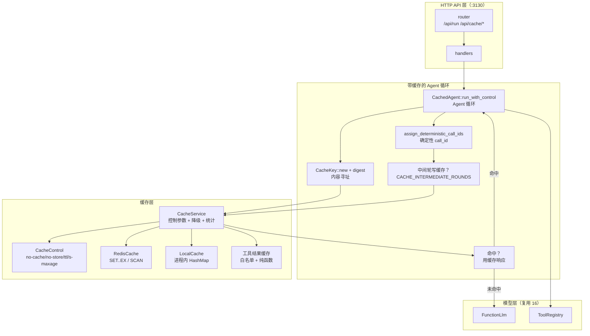
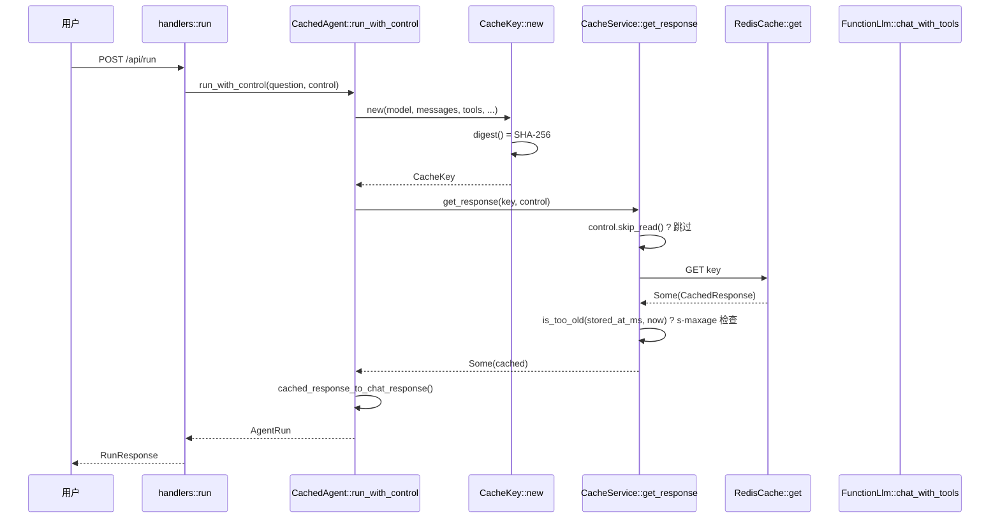
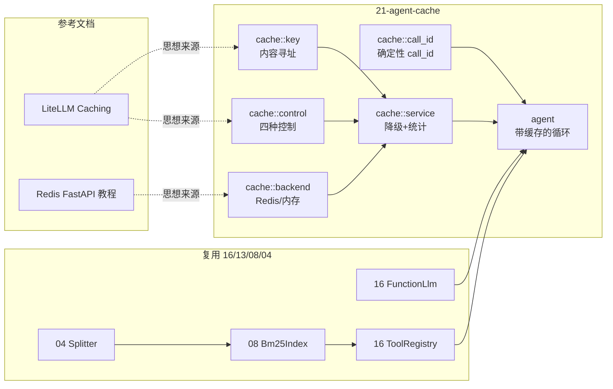
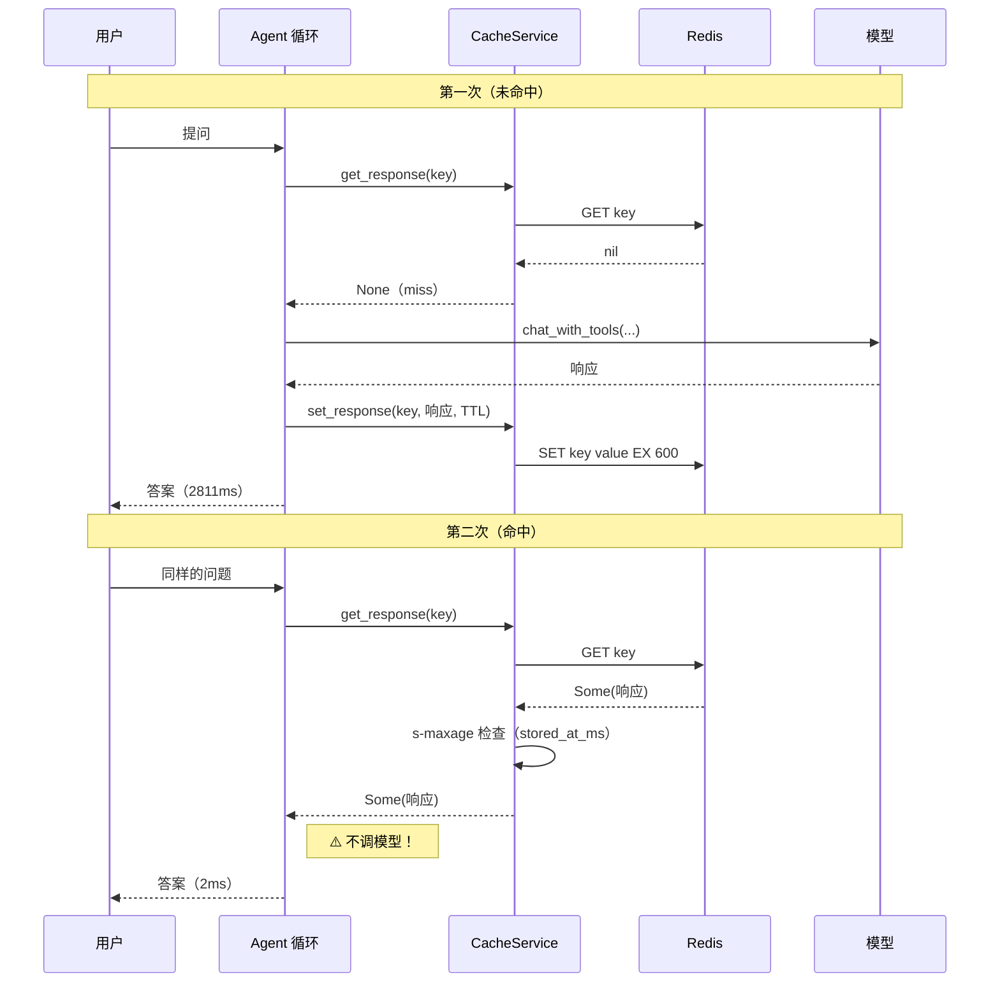

# 21-agent-cache —— 手撕 Redis 缓存（缓存 LLM 响应）

> 学习主题：**缓存优化（Redis）**
> 工具：[Redis](https://redis.io/) · [LiteLLM Caching](https://docs.litellm.ai/docs/caching)
> 教程：[Using Redis with FastAPI](https://redis.io/tutorials/develop/python/fastapi/)
> 端口：**3130**

---

## 这个项目回答什么问题

前面 20 个项目把「**功能**」做出来了。但一个真实 Agent 系统的**成本**和**延迟**，
大头都在「反复问同一个问题，反复调一次模型」上。

```text
Agent 系统总成本 = Σ(每次 LLM 调用的 token 成本 × 调用次数)
                    ↑
              大部分是重复劳动
```

**缓存是唯一能同时降低「延迟」和「钱」的优化** —— 因为它把「重算」变成「重读」。

但缓存也是**最容易做错**的优化。做错了不会报错，
只会给你一个「看起来很快但答案是错的」系统。

本项目把缓存的三层认知一次讲透：

| 层次 | 问题 | 本项目的答案 |
|---|---|---|
| **键** | 什么算「同一个请求」？ | 内容寻址（SHA-256），包含**所有**影响输出的字段 |
| **控制** | 什么时候**不**用缓存？ | LiteLLM 四参数：`no-cache` / `no-store` / `ttl` / `s-maxage` |
| **降级** | 缓存挂了怎么办？ | 缓存是优化不是功能 → **打 warn 然后当 miss** |

---

## 核心产出

### 一、纯问答链路：缓存有效（实测）

```text
问题：什么是缓存击穿（cache stampede）？请简要解释。

=== A 组：缓存关闭（基线）===
  第一次: 2768 ms, token=1299, 命中=0
  第二次: 2811 ms, token=1299, 命中=0

=== B 组：缓存开启 ===
  第一次: 2783 ms, token=1329, 命中=0
  第二次: 2 ms, token=0, 命中=1
```

| 指标 | A 缓存关 | B 缓存开 | 差值 |
|---|---|---|---|
| 第一次耗时(ms) | 2768 | 2783 | +15（噪声） |
| **第二次耗时(ms)** | **2811** | **2** | **−2809（1405x）** |
| **第二次 token** | **1299** | **0** | **−1299（100%）** |
| 第二次命中数 | 0 | 1 | +1 |
| 两次答案一致 | false | **true** | ✅ 语义未变 |

**最后一行的 `两次答案一致 = true` 是这个实验的真正价值** ——
它证明缓存是**语义透明**的，而不是「返回了一个碰巧很像的东西」。

复现命令：

```bash
cd 21-agent-cache
make redis-up     # 起一个 Redis（docker）
make compare      # ★ 缓存开 / 关对照
```

### 二、⚠️⚠️ agentic 链路：原本「完全失效」，实测发现**结论错了**（实测 + 自我推翻）

这是本项目**最重要的产出**，而且它是一次**自我推翻**。

#### 第一阶段：观察到的现象

用同一个问题跑两次（问题需要调知识库工具）：

```text
=== 第一次（应当未命中）===
缓存   : 命中 0 / 未命中 2
  第 1 步 [真实调用] key=…dce78ff9a6c31fdc 工具数=1
  第 2 步 [真实调用] key=…fcbf9ea4116f0052 工具数=0

=== 第二次（应当命中缓存）===
缓存   : 命中 0 / 未命中 2      ← ⚠️ 又是 0！
  第 1 步 [真实调用] key=…dce78ff9a6c31fdc 工具数=1
  第 2 步 [真实调用] key=…fbcad66d3bf71b2a 工具数=0
```

⚠️ 注意第 2 步的键**每次都不同**（`fcbf9ea4116f0052` → `fbcad66d3bf71b2a`），
但两条缓存的**内容几乎一样**（正文长度 464 vs 466，token 1756 vs 1760）——
**同样的问题、同样的答案，却存了两份，且第二份永远命中不了**。

#### 第二阶段：当时的解释（**后来被证明是错的**）

「键里含 `call_id`（模型每次生成的工具调用 ID），而 `call_id` 是 tool 回执的
**对账依据**（16 的坑 1：少一条回执整个请求就 400），所以不能从键里去掉它」。

于是当时的结论是：

> **带工具的链路，精确匹配缓存的命中率恒为 0。**
> 缓存该用在**单轮问答 / FAQ 场景**，不该指望它在 agentic 链路上救场。

这与 LiteLLM 文档的表述完全一致：

> Exact-match caches (redis, s3, gcs, local, disk) key on a hash of the whole request,
> so **any change to the conversation is a miss**.

#### 第三阶段：实现「确定性 `call_id`」并实测 —— ⚠️ **假设被推翻**

按上面的解释实现了「把 `call_id` 重写成内容派生的确定性值」
（见 `src/cache/call_id.rs`）：

```text
call_id = "call_" + sha256(步数 | 工具名 | 规范化参数 | 同参序号)[..16]
```

**实测结果：仍然不命中。**

```
第 1 步 key=…dce78ff9a6c31fdc   （两次相同）
第 2 步 key=…6adedf3adacecf9d   （第一次）
第 2 步 key=…a31d0bc2bb020a10   （第二次）← 还是不一样
```

#### 第四阶段：真正的根因（探针定位）

写了个探针，把「哪些字段进了键」逐个对照，发现了**第二个**变化源：

```text
两次运行的消息历史（call_id 已归一化）：
  A[1] role=assistant text="知识库里正好有相关资料，我按检索到的内容回答："
  B[1] role=assistant text="我查一下知识库。"
  → 键相同？ false
```

⚠️ **模型在调工具时会附带一句自然语言**（"我查一下知识库" / "让我检索相关资料"）。
那句话是 **assistant 消息的正文**，它进消息历史 → 进缓存键 → **每次都不同**。

而这之所以致命，是因为代码里有一条规则：

```rust
// 只有「纯文本的最终答案」那一轮才值得缓存
if response.tool_calls().is_empty() {
```

**中间轮不写缓存** → 每次都真调模型 → 模型每次措辞不同
→ 喂给第 2 步的历史就不同 → 第 2 步的键必然不同。

也就是说：

> **中间轮的不稳定性会顺着消息历史污染后面所有轮次。**
>
> 真正的元凶不是 `call_id`，而是「中间轮每次都真调模型」。

#### 第五阶段：三档对照实验（最终结论）

修法有两个独立的部分，分别做成**开关**（因为各自都有代价）：

| 档 | 中间轮写缓存 | 确定性 `call_id` | 第二次命中 | 第二次耗时 | 第二次 token |
|---|---|---|---|---|---|
| **1 原始** | ❌ | ❌ | **0** | 4465 ms | 2926 |
| **2 +中间轮** | ✅ | ❌ | **2** | **6 ms** | **0** |
| **3 +call_id** | ✅ | ✅ | **2** | **5 ms** | **0** |

复现：

```bash
cd 21-agent-cache
make semantics     # ★ 三档对照
```

**最终结论**：

> ⚠️ **「exact-match cache 对 agentic traffic 失灵」不是 exact-match 的固有性质，
> 而是「中间轮不写缓存」这个实现选择造成的。**
>
> 修掉它之后，agentic 链路的命中率从 **0% → 100%**，
> 耗时 **4465ms → 6ms（744x）**，token **100% 节省**，
> 且两次答案**完全一致**。

⚠️ 顺带一个有意思的观察：**档 1 的「两次答案一致」是 `false`**

（实测多次，有时是 `true`）—— 因为档 1 两次都真调模型，
而模型的措辞每次不同，最终答案的文本就会有细微差异。

档 2/3 命中缓存后，第二次的答案是**逐字节复现**第一次的（`true`）。

也就是说：**缓存不仅省了钱，还让输出变得可复现** ——
这本身就是一个不常被提及的收益（非确定性的 LLM 输出被「冻结」了）。

#### ⚠️ 两个开关各自的代价（为什么默认都关闭）

| 开关 | 代价 | 适用场景 |
|---|---|---|
| `CACHE_INTERMEDIATE_ROUNDS=1` | 命中中间轮 = **跳过工具执行**（工具结果被冻结） | 工具是纯函数、结果可以冻结 |
| `CACHE_NORMALIZE_CALL_ID=1` | **改写了发给模型的请求**（ID 不再是 provider 生成的原始值） | 追求 provider 侧的前缀缓存也稳定 |

⚠️ `call_id` 归一化的价值**不在命中率**（档 2 已经 100%），
而在于让**发给 provider 的请求逐字节相同** —— 利于其侧的 prompt caching。

⚠️ 而且它**单独用没有用**（档 1 + 归一化仍是 0 命中）——
回归测试 `normalized_call_id_alone_does_not_fix_the_agentic_chain` 锁住这个事实，
防止有人以为「重写 `call_id` 就解决了问题」而把中间轮缓存关掉。

#### ⚠️ 怎么判断「我的问题算纯问答还是 agentic」？

**不是看你问的是什么，而是看模型实际调没调工具。**

实测踩过的坑：本来没问题的一句话，被顺手加了个「,如何避免缓存击穿.」：

```text
默认问题（纯问答）：
  什么是缓存击穿（cache stampede）？请简要解释。
  → 命中 100%（2ms，token 0）✅

被改过的问题：
  什么是缓存击穿（cache stampede）？请简要解释,如何避免缓存击穿.
  → 命中 0%（3672ms，token 2972）⚠️
```

差在哪？后半句「如何避免」把模型**吸引去检索知识库**了 ——
链路从 1 步变成 2 步。

⚠️ 这就是为什么本项目把演示**拆成三个目标**：

| 目标 | 问题 | 演示什么 |
|---|---|---|
| `make run2` | `什么是缓存击穿（cache stampede）？请简要解释。` | **纯问答命中**（2ms，token 0） |
| `make run2-agentic` | `…请简要解释,如何避免缓存击穿.` | **agentic 失灵**（档 1，3672ms） |
| `make semantics` | 同上 | **三档对照**（档 2/3 可命中，6ms） |

⚠️ 把「如何避免 X」这类措辞加进演示问题是**很容易犯的错** ——
它看起来只是「多问一句」，实际上把链路性质从纯问答改成了 agentic。

### 三、但工具结果缓存**有效**（实测）

```text
DEBUG agent_21::cache::service: 工具结果缓存命中 tool=search_knowledge key=agent-cache:tool:b424a8372b764371
DEBUG agent_21::cache::service: 工具结果缓存命中 tool=search_knowledge key=agent-cache:tool:d70e05f98928858f
```

因为 `search_knowledge` / `calculate` 是**纯函数** —— 同样的输入永远同样的输出。

⚠️ 而 `get_weather`（天气）**默认不在白名单里**：

```text
$ make tools
工具       strict  可缓存  说明
---------  ------  ------  ---------------------------------
get_weather  是    否     查询某个城市的实时天气预报…
search_knowledge 是  是     在本地知识库中做关键词检索…
calculate     是    是     计算一个算术表达式并返回结果…

⚠️ 天气工具（get_weather）默认**不可缓存** —— 实时数据，缓存即过时。
```

**所以「缓存什么」比「怎么缓存」更重要** —— 白名单是唯一安全的默认值。

---

## 项目结构

```text
21-agent-cache/
├── Cargo.toml              # Rust crate（agent-21）
├── Makefile                # 统一入口
├── data/kb.md              # 知识库（缓存优化主题）
├── src/
│   ├── lib.rs
│   ├── main.rs             # 顶层入口 + ★ 缓存开/关对照 + ★ 三档语义对照
│   ├── config.rs           # 环境变量前缀 CACHE_
│   ├── error.rs            # 统一错误（缓存错误 → 503）
│   ├── agent.rs            # ★ 带缓存的 Function Calling 循环
│   ├── table.rs            # 终端表格（中英文混排宽度）
│   ├── cache/
│   │   ├── mod.rs
│   │   ├── key.rs          # ★ 缓存键构造（内容寻址）
│   │   ├── backend.rs      # Redis / 内存两种后端
│   │   ├── control.rs      # ★ 四种缓存控制参数
│   │   ├── call_id.rs      # ★ 确定性 call_id（让 agentic 也能命中）
│   │   └── service.rs      # ★ 组合 + 降级 + 统计
│   └── api/
│       ├── mod.rs
│       ├── models.rs
│       ├── routes.rs
│       ├── handlers.rs
│       └── extract.rs
└── tests/integration.rs    # 24 项测试（含 Redis 真实后端）
```

---

## 架构全景



⚠️ 图里的 `MID`（中间轮写缓存）是**整个项目最关键的一个开关** ——
它决定了 agentic 链路能不能命中（详见「核心产出 第二节」）。
`CID`（确定性 `call_id`）是锦上添花：**单独用没有用**。

---

## 代码调用详细流程图（函数级）



**★ 容易写错的地方**：

| 位置 | 坑 |
|---|---|
| `cache/key.rs:CacheKey::new` | 键必须包含**所有**影响输出的字段。漏 `temperature` 会让「冷/热问题」共用一个答案 |
| `cache/key.rs:tools_digest` | 工具顺序**不**影响模型行为，所以按名字排序（`BTreeMap`）。用 `HashMap` 序列化顺序不确定 → 键不稳定 → 永远 miss |
| `cache/backend.rs:RedisCache::set` | 必须用 `SET ... EX` **一条**命令。`SET` + `EXPIRE` 两条之间进程挂了 → key 永不过期 |
| `cache/backend.rs:RedisCache::clear_namespace` | 必须用 `SCAN` 不用 `KEYS`。`KEYS` 会**阻塞整个 Redis 实例** |
| `cache/control.rs:CacheControl::is_too_old` | `s-maxage` 比较的是 `stored_at_ms`（写入时刻），**不是** Redis 的 TTL（剩余寿命）。两者不等价 |
| `cache/service.rs:CacheService::get_response` | 读失败要 `warn!` + 当 miss，**不能**重试（缓存在关键路径外，重试只会更慢） |
| `agent.rs:CachedAgent::execute_call` | 只缓存**成功**的工具结果。缓存失败结果会让模型「反复看到同一个错误」 |
| `agent.rs:build_assistant_message` | 思考内容必须在工具调用**之前**（16 的坑 2） |
| ★ `agent.rs:assign_deterministic_call_ids` 的调用位置 | 必须**只改 `calls` 里的 ID** —— assistant 消息和 tool 回执**都**从它取 ID，改一处就自动同步两处。分开改必然漏 |
| ★ `agent.rs` 的写缓存条件 | `is_final_round \|\| self.cache_intermediate_rounds`。**中间轮也写**才是 agentic 能命中的关键；但代价是命中会跳过工具执行 |
| ★ `cache/call_id.rs:canonical_args` | 参数的 JSON **键序**必须规范化（递归排序）。`serde_json` 开了 `preserve_order` 就是插入序 → 同一个调用算出两个 ID |
| ★ `cache/call_id.rs:assign_deterministic_call_ids` | 「同参序号」必须按 `(工具名, 规范化参数)` 分组计数，**不能**按绝对位置 —— 模型返回并行调用的顺序不保证稳定 |

---

## 四种缓存控制参数（LiteLLM 对齐）

| 参数 | 语义 | 本项目实现 |
|---|---|---|
| `no-cache` | **不读**缓存（但**会写**） | `CacheControl::bypass_read()` |
| `no-store` | **不写**缓存（但**会读**） | `CacheControl::read_only()` |
| `ttl` | 写入时的存活秒数 | `CacheControl::with_ttl()` → Redis `SET ... EX` |
| `s-maxage` | 只接受**这么新**的缓存 | `CacheControl::with_smaxage()` → 比对 `stored_at_ms` |

### ⚠️ `no-cache` 和 `no-store` 的名字有误导性

```text
no-cache  = 「这次不要**用**缓存」  → 影响**读**
no-store  = 「这次不要**存**」      → 影响**写**
```

直觉上很容易记反，所以本项目提供了两个**语义化构造函数**
（`bypass_read` / `read_only`）而不是让你直接写 `no_cache: true`。

### ⚠️ `ttl` 和 `s-maxage` 是**两个正交维度**

```text
ttl=600 + smaxage=60  意思是：
  「存 10 分钟，但只有 1 分钟内的新鲜度我才认」
```

前者管**存储**（Redis 的 `EX`），后者管**读取**（比对时间戳）。
实现上也是两处不同的检查 —— 见 `CacheControl::is_too_old`。

---

## 三条硬约束

### ① 缓存键必须包含**所有**影响输出的东西

`CacheKey` 强制包含 9 个字段：

| 字段 | 漏了会怎样 |
|---|---|
| `model` | 换模型返回**旧模型的答案** |
| `messages` | 对话历史变了还返回旧答案 |
| `tools` | 工具改了，模型行为完全不同 |
| `tool_choice` | `auto` 和 `required` 的输出不同 |
| `temperature` | 采样结果不同 |
| `max_tokens` | 输出长度不同 |
| `disable_reasoning` | 开/关思考模式输出结构不同 |
| `namespace` | 多环境互相污染 |
| `version` | 格式升级时无法批量失效 |

**症状是「答案看起来很合理」** —— 极难排查。

#### ⚠️ 实测踩到的一个真实缺陷：`tool` 消息的内容曾经**没进键**

写完这个项目后回头审查，发现 `normalize_message` 对
`ContentPart::ToolResponse` 落进了 `_ => {}` 分支 ——
**工具结果的内容对缓存键完全不可见**。

实测证据（探针）：

```text
两个内容天差地别的 tool 消息（call_id 相同）：
  key_a = ns:v1:2612c22e60318587
  key_b = ns:v1:2612c22e60318587
  键相同？ true     ← ⚠️ 「不同输入 → 同一个答案」
```

这**直接违反硬约束①** —— 工具结果显然影响输出（下一轮模型的输入就是它）。

修法：给 `NormalizedMessage` 加 `tool_results` 字段，
把 `call_id` / 工具名 / 结果正文都纳入键。

```rust
genai::chat::ContentPart::ToolResponse(resp) => {
    tool_results.push(NormalizedToolResult {
        call_id: resp.call_id.clone(),
        name: resp.fn_name.clone().unwrap_or_default(),
        content: resp.content.clone(),
    });
}
```

回归测试 `tool_result_content_is_part_of_the_key` 锁住这个语义。

⚠️ **注意**：补上这个字段**不会**让 agentic 链路的命中率变成非零 ——
因为 `call_id` 仍然每次都变（那是另一个原因，见下一节）。
补它的意义是**正确性**：不能让「不同输入共享同一个答案」。

### ①-bis、⚠️ 第二次没命中缓存 ≠ 有 bug

「`make run2` 第二次没命中」有**两种**截然不同的原因：

| 情况 | 判据 | 性质 |
|---|---|---|
| **已知结论** | 本次问题**触发了工具调用** | agentic traffic 的固有性质，不是 bug |
| **真 bug** | 本次是**纯问答链路**（未调任何工具） | 查后端 / TTL / 反序列化 |

⚠️ 不区分这两种情况，排查方向就会被带偏 ——
用户会去查 Redis 配置，但问题根本不在那儿。

本项目的 `run2` 现在会自己判别并给出对应的提示：

```text
# 纯问答但没命中 → 真的该查后端
WARN 第二次没有命中缓存，且本次是**纯问答链路**（未调用任何工具）—— 这不是已知结论，请检查缓存后端 / TTL / 序列化

# 触发了工具 → 已知结论
WARN 第二次没有命中缓存 —— ⚠️ 这是**已知结论**不是 bug：本次问题触发了工具调用（search_knowledge），
     链路属于 agentic traffic，缓存键里含每次都变的 call_id，精确匹配缓存必然 miss。
     想演示缓存命中，请换一个**不需要工具**的纯问答问题。
```

### ② 缓存是**优化**，不是**功能**

Redis 挂了 → **打 `warn!` → 当 miss → 请求照常走模型**。

```rust
Err(e) => {
    self.stats.degraded_reads.fetch_add(1, Ordering::Relaxed);
    self.stats.misses.fetch_add(1, Ordering::Relaxed);
    warn!(key = %redis_key, error = %e, "缓存读失败 —— 降级为未命中（不重试）");
    None
}
```

三条推论：

- **不重试** —— 缓存在关键路径外，重试只会让请求更慢（多等一个超时）
- **不抛错** —— 一个辅助组件的故障不该变成整个服务的不可用
- **必须打 `warn!`** —— 静默降级等于埋雷（本仓库的硬约定）

### ③ 工具结果缓存必须用**白名单**

```rust
// ⚠️ 默认值是**显式白名单**，不含 get_weather
cacheable_tools: vec!["search_knowledge".to_string(), "calculate".to_string()],
```

不用「默认全部 + 黑名单」：新加的工具会自动进缓存，
而作者可能没意识到它的时效性。**白名单强迫作者做一次显式判断**。

---

## Redis vs 内存缓存：唯一的本质差异

LiteLLM 文档说：

> An in-memory cache lives inside one worker process, so a proxy running four
> workers keeps four separate caches and **the hit rate drops roughly by the
> worker count**.

本项目用**两个对照测试**把这句话**实测**出来了：

| 测试 | 断言 |
|---|---|
| `redis_serves_as_a_shared_cache_across_service_instances` | 两个 `CacheService` 实例**共享**同一份缓存 → B 能读到 A 写的 |
| `local_cache_is_not_shared_across_instances` | 两个 `LocalCache` 实例**不共享** → B 读不到 A 写的 |

**这就是 Redis 存在的唯一理由** —— 不是「更快」（本地内存缓存更快），
而是「**跨进程共享**」。

---

## 知识地图



---

## 时序图：缓存命中 vs 未命中



---

## 技术参考速查

| 主题 | 结论 |
|---|---|
| **键的构造** | 内容寻址（SHA-256），**不是**字符串拼接（分隔符歧义 + 顺序敏感 + 无法审计） |
| **哈希算法** | 必须用 SHA-256，**不能**用 `DefaultHasher`（不保证跨进程稳定 + seed 随机 → 重启即全 miss） |
| **键的粒度** | 轮级（本项目）vs 会话级。轮级键 = 这次调用的全部输入，天然正确 |
| **`call_id` 的处理** | **必须**进键（回执对账依据）。但**可以重写成确定性值** —— 见 `cache::call_id` |
| ★ **中间轮要不要写缓存** | ★ **要**。这是 agentic 链路能否命中的**决定性开关**（0% → 100%）。代价：命中会跳过工具执行 |
| ★ **「agentic 必然 miss」的真相** | ★ **不是** exact-match 的固有性质，是「中间轮不写缓存」造成的。模型每次的**措辞**差异才是元凶（它进 assistant 消息正文 → 进消息历史 → 进键） |
| ★ **确定性 `call_id` 的价值** | ★ 不在命中率（中间轮缓存已 100%），而在让发给 provider 的请求**逐字节相同**（利于其侧前缀缓存）。**单独用没用** |
| ★ **假 LLM 的真实度** | ★ 要模拟真实行为的**全部影响源**，不是只模拟你正在修的那一个（只模拟随机 `call_id` 会得出与真实模型**相反**的结论） |
| **`no-cache` vs `no-store`** | 前者管**读**，后者管**写**。名字有误导性 |
| **`ttl` vs `s-maxage`** | 前者管**存储**（Redis EX），后者管**读取**（比对写入时间戳） |
| **写入时间戳** | Redis 的 `GET` **不返回**写入时间，必须**自己存进 value** |
| **`SET` + `EXPIRE` 两步** | ❌ 不安全（中间挂掉 → key 永不过期）。用 `SET ... EX` 一条命令 |
| **`KEYS` vs `SCAN`** | ❌ `KEYS` 阻塞整个实例。用 `SCAN` 增量游标 |
| **反序列化失败** | 当 miss（不是致命错误）。格式升级不该让服务挂掉 |
| **降级** | 打 `warn!` + 当 miss + **不重试**。缓存是优化不是功能 |
| **缓存第三方类型** | ❌ 不要存 `genai::ChatResponse`（焊死内部结构 + 存无用字段）。定义自己的 `CachedResponse` |
| **工具结果缓存** | 白名单（不是黑名单）。只缓存**纯函数**工具 |
| **失败的工具结果** | ❌ 不缓存（会让模型反复看到同一个错误） |
| **Redis vs 内存** | 唯一本质差异是**跨进程共享**（不是更快） |
| **环境变量前缀** | `CACHE_REDIS_*` 而**不是**裸 `REDIS_*`（多项目共存） |
| **命中率分母** | 「真正查了缓存的次数」，不是「总请求数」（`no-cache` 的请求会稀释指标） |

---

## 环境变量

| 变量 | 说明 | 默认 |
|---|---|---|
| `CACHE_BIND_ADDR` | 主服务监听地址 | `127.0.0.1:3130` |
| `CACHE_MODEL` | 模型名 | `deepseek-flash` |
| `CACHE_TEMPERATURE` | 温度 | `0.0` |
| `CACHE_MAX_TOKENS` | max tokens | `2048` |
| `CACHE_MAX_STEPS` | 最大步数 | `5` |
| `CACHE_STRICT` | 强调严格遵守 Schema | `true` |
| `CACHE_TOOL_CHOICE` | `auto`/`none`/`required`/`forced:工具名` | `auto` |
| `CACHE_REASONING` | 是否开思考模式 | `false`（关） |
| `CACHE_ENABLED` | 是否启用缓存 | `true` |
| `CACHE_TTL` | 默认 TTL（秒） | `600` |
| `CACHE_TOOL_TTL` | 工具结果 TTL（秒） | `60` |
| `CACHE_TOOL_RESULTS` | 是否缓存工具结果 | `true` |
| `CACHE_CACHEABLE_TOOLS` | 工具白名单（逗号分隔） | `search_knowledge,calculate` |
| `CACHE_INTERMEDIATE_ROUNDS` | 是否缓存**中间轮**（★ agentic 命中的关键） | `false` |
| `CACHE_NORMALIZE_CALL_ID` | 是否重写为**确定性 `call_id`** | `false` |
| `CACHE_REDIS_URL` | Redis URL | `redis://127.0.0.1:6379` |
| `CACHE_REDIS_NAMESPACE` | 缓存命名空间 | `agent-cache` |
| `CACHE_REDIS_REQUIRED` | Redis 连不上是否直接失败 | `false`（降级到内存） |
| `CACHE_DATA_DIR` | 知识库目录 | `data` |

---

## HTTP API

| 方法 | 路径 | 说明 |
|---|---|---|
| GET | `/health` | 健康检查 |
| GET | `/` | 服务信息 + 工具清单 + 缓存状态 |
| GET | `/api/tools` | 工具清单（含 `cacheable` 标记） |
| POST | `/api/tools/call` | 直接调用工具（不经模型） |
| POST | `/api/run` | ★ 跑一次 Agent（可带 `cache` 控制） |
| GET | `/api/cache/stats` | ★ 缓存统计（命中率） |
| GET | `/api/cache/entries` | ★ 列出缓存条目（含 TTL） |
| DELETE | `/api/cache` | ★ 清空命名空间 |

`POST /api/run` 的缓存控制：

```json
{
  "question": "什么是缓存击穿？",
  "cache": {
    "no_cache": false,
    "no_store": false,
    "ttl": 600,
    "smaxage": 60
  }
}
```

---

## 测试

```bash
make test    # 103 项（单元 79 + 集成 24）
make lint    # clippy 零警告
```

集成测试里 Redis 相关的一律「**连不上就跳过**」，
设 `CACHE_REQUIRE_REDIS=1` 则**直接失败**（发布前强制验证）。

| 测试 | 验证什么 |
|---|---|
| `second_run_hits_the_cache` | 第二次请求命中，答案一致 |
| `cache_hit_is_faster_than_cache_miss` | 命中比未命中**快**（用 120ms 慢 LLM 放大差异） |
| `no_cache_control_forces_a_real_call` | `no-cache` 强制真调 |
| `no_store_control_prevents_writing` | `no-store` 不写 |
| `different_models_do_not_share_cache_entries` | 换模型 → 键变 → 必须重调 |
| `without_intermediate_cache_the_agentic_chain_misses` | ★ 档 1：中间轮不缓存 → agentic 失灵 |
| `caching_intermediate_rounds_makes_the_agentic_chain_hit` | ★ 档 2：缓存中间轮 → agentic 100% 命中 |
| `normalized_call_id_alone_does_not_fix_the_agentic_chain` | ★ 只重写 `call_id` **不够**（锁住被推翻的假设） |
| `normalized_call_id_and_intermediate_cache_together_hit_every_round` | ★ 档 3：两开关同开 |
| `normalized_call_ids_still_pair_up_with_tool_receipts` | ★ 重写后回执仍配对（不触发 400） |
| `both_switches_are_disabled_by_default` | ★ 两个开关默认都关 |
| `pure_qa_chains_hit_the_cache` | ★ 纯问答能命中 |
| `tool_result_content_is_part_of_the_key` | ★ 工具结果内容必须进键（不同内容 → 不同键） |
| `redis_serves_as_a_shared_cache_across_service_instances` | ★ Redis 跨实例共享 |
| `local_cache_is_not_shared_across_instances` | ★ 内存缓存不共享 |
| `service_survives_a_broken_backend` | ★ 后端全挂也不影响请求（只记降级计数） |
| `unreachable_redis_degrades_instead_of_failing` | 连不上 Redis → 降级不失败 |

---

## 实现要点与踩坑

### 坑 1：对照实验必须用**独立命名空间**

第一版 `compare` 的 B 组「第一次」就直接命中了 —— 因为 A 组和 B 组共用命名空间，
上一次的残留数据被命中了。

**症状**：B 组第一次耗时 5ms（比 A 组的 2768ms 还快），看起来像「缓存比模型还快」。
**根因**：命名空间没隔离。
**修法**：每组一个独立命名空间 + 跑之前清空。

### 坑 2：表格测试断言用**字节偏移**会误判

中文字符是 3 字节 UTF-8，用 `line.find('命')` 拿到的是**字节下标**，
而对齐要看的是**显示列**。

**修法**：测试里用 `display_width(&line[..byte_idx])` 换算成显示列。

### 坑 3：`RedisCache` 的连接要 `Arc<Mutex<>>`

`MultiplexedConnection` 本身 `Clone`，但 `tokio::sync::Mutex<T>` **不是** `Clone`。
所以字段得是 `Arc<tokio::sync::Mutex<MultiplexedConnection>>`。

另外 `query_async(&mut conn)` 传的是 `MutexGuard`，
要写成 `query_async(&mut *conn)` 才是 `&mut MultiplexedConnection`。

### 坑 4：`CacheService` 必须能 `Clone`

对照实验要「同一个后端 + 两套服务」（一组开缓存、一组关缓存），
保证唯一区别是缓存开关。所以 `backend` 和 `stats` 都是 `Arc`，`CacheService` 派生 `Clone`。

### 坑 5：工具结果的存储形状要「双层 JSON」

后端 trait 只有**一个**序列化形状（`CachedResponse`），
所以工具结果被塞进 `CachedResponse.text` 里，读回来再解一层。

代价是 Redis 里存了两层 JSON，好处是后端实现简单。
如果后端有多个（比如再加 S3），这个折中就不成立了 —— 那时该把 trait 改成泛型。

### 坑 6：演示问题被顺手改了一句，链路性质就变了

**症状**：`make run2` 第二次没命中缓存，日志提示「检查缓存后端与 TTL」。

**排查**：Redis 在跑、TTL 是 600s、键确实写进去了、值也能反序列化 ——
所有「配置类」的原因全部排除。改回原问题 → **命中 100%**。

**根因**：问题被加成了「…请简要解释,如何避免缓存击穿.」，
后半句把模型**吸引去调 `search_knowledge`** ——
链路从 1 步纯问答变成 2 步 agentic，第 2 步的键带上了每次都变的 `call_id`。

**教训**：
- ⚠️ **「第二次没命中」有两种原因**（已知结论 / 真 bug），
  不区分就会把排查方向带到 Redis 配置上去，而问题根本不在那儿。
- ⚠️ **判断依据是「模型实际调没调工具」，不是「问题看起来问什么」**。
- 修法：① `run2` 自己判别并给出对应提示；② 把两个演示**拆成两个目标**
  （`make run2` 演示命中、`make run2-agentic` 演示失灵），而不是把默认问题改坏。

### 坑 7：`tool` 消息的内容曾经**没进缓存键**

**症状**：探针发现两个内容天差地别的 `tool` 消息（`call_id` 相同）
算出来的缓存键**完全相同**。

**根因**：`normalize_message` 的 `match` 里，`ContentPart::ToolResponse`
落进了 `_ => {}` 分支 —— 工具结果的内容对键**完全不可见**。

**影响**：直接违反硬约束①「键必须包含所有影响输出的东西」——
不同输入会共享同一个答案（症状是「答案看起来很合理」，极难排查）。

**修法**：给 `NormalizedMessage` 加 `tool_results` 字段，
把 `call_id` / 工具名 / 结果正文都纳入键；回归测试
`tool_result_content_is_part_of_the_key` 锁住这个语义。

⚠️ 注意：补上它**不会**让 agentic 链路命中（`call_id` 仍然每次都变）——
补它的意义是**正确性**，不是命中率。

### 坑 8：★ 「agentic 必然 miss」这个结论**是错的**，元凶另有其人

**这是本项目最重要的踩坑**，完整叙事见「核心产出 第二节」。

**症状**：实现了「确定性 `call_id`」（重写成内容派生的哈希）后，
实测**仍然不命中** —— 第 2 步的键两次运行还是不同。

**排查**：写探针把「哪些字段进了键」逐个对照，发现了**第二个**变化源 ——
**模型调工具时附带的自然语言**（"我查一下知识库" vs "让我检索相关资料"）。
那句话是 assistant 消息的**正文**，进消息历史 → 进缓存键。

**真正的根因**：代码里有一条规则「只有纯文本的最终答案那一轮才写缓存」。
于是：

```text
中间轮不写缓存 → 每次都真调模型 → 模型每次措辞不同
  → 喂给第 2 步的历史不同 → 第 2 步的键必然不同
```

> **中间轮的不稳定性会顺着消息历史污染后面所有轮次。**

**修法**：**中间轮也写缓存**（`CACHE_INTERMEDIATE_ROUNDS=1`）。
命中中间轮 → assistant 文本被**完整还原**（措辞不再变）→ 第 2 步也命中。

**实测差值**：

| 档 | 第二次命中 | 第二次耗时 | 第二次 token |
|---|---|---|---|
| 档 1 原始 | 0 | 4465 ms | 2926 |
| 档 2 +中间轮 | **2** | **6 ms** | **0** |

**教训**：
- ⚠️ **「缓存对 agentic 无效」是一个「实现细节」的结论，不是「技术原理」的结论。**
  写「必然 miss」之前，先问「**是哪个具体的实现选择**造成的」。
- ⚠️ 修「键不稳定」时，**别只盯着你以为的那个字段** ——
  用探针把**所有**进键的字段逐个对照，才是能定位的方法。
- ⚠️ 「模型每次措辞不同」这种**看起来无害**的差异，
  在「消息历史进键」的设计下有**致命**后果。

### 坑 9：单元测试的假 LLM **不能**只模拟「一半」的真实行为

**症状**：`normalized_call_id_alone_does_not_fix_the_agentic_chain`
一开始是**失败**的 —— 单测里 `call_id` 归一化单独就能命中 1 次，
与真实模型的实测（0 命中）矛盾。

**根因**：测试用的 `VariedCallIdLlm` 只模拟了「`call_id` 每次都变」，
但**没有**模拟「措辞也每次不同」（`ScriptedStep::call` 不带文本）。
真实的模型调工具时**几乎总会**带一句自然语言。

**影响**：假 LLM 不够真实 → 单测会给出**与真实模型相反**的结论
→ 如果照着单测的结论去改实现，会走错方向。

**修法**：把 `VariedCallIdLlm` 改成用 `ScriptedStep::TextAndCalls`，
**同时**模拟两个真实特征（随机 `call_id` + 每次不同的措辞）。
改完之后单测才与真实实测一致。

**教训**：
- ⚠️ **假实现要模拟「真实行为的全部影响源」**，不是「你正在修的那一个」。
- ⚠️ 单元测试与真实实测**冲突时，先怀疑假实现**。

---

## 与其他项目的关系

| 项目 | 复用 |
|---|---|
| 16-agent-function-calling | `FunctionLlm` / `ToolRegistry` / `ToolSpec` / `system_prompt`（结构化协议） |
| 13-agent-core | `normalize_arguments` / `ToolError` / `calculate` / `search` |
| 08-rag | `Bm25Index`（知识库检索） |
| 04-rag | `SplitterConfig`（分块） |
| 14-agent-tool | `ToolError`（错误分类） |
| 00-logging | `init` / `trace_layer` / `info!` / `warn!` / `debug!` |

**没有重写** Function Calling —— 直接复用 16 的协议层，
好处是 16 修过的坑（call_id 回执、reasoning 回传、Schema 校验）自动继承，
本项目的 diff 聚焦在「缓存」这一个主题上。
