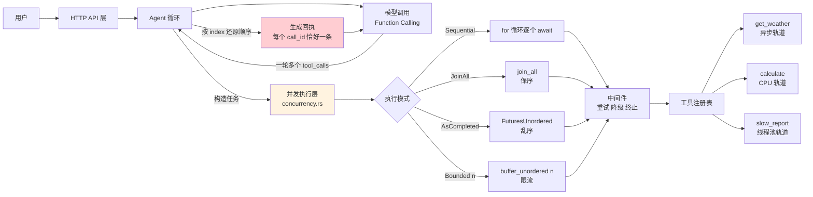
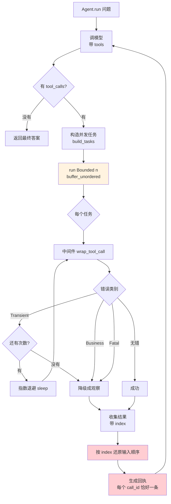
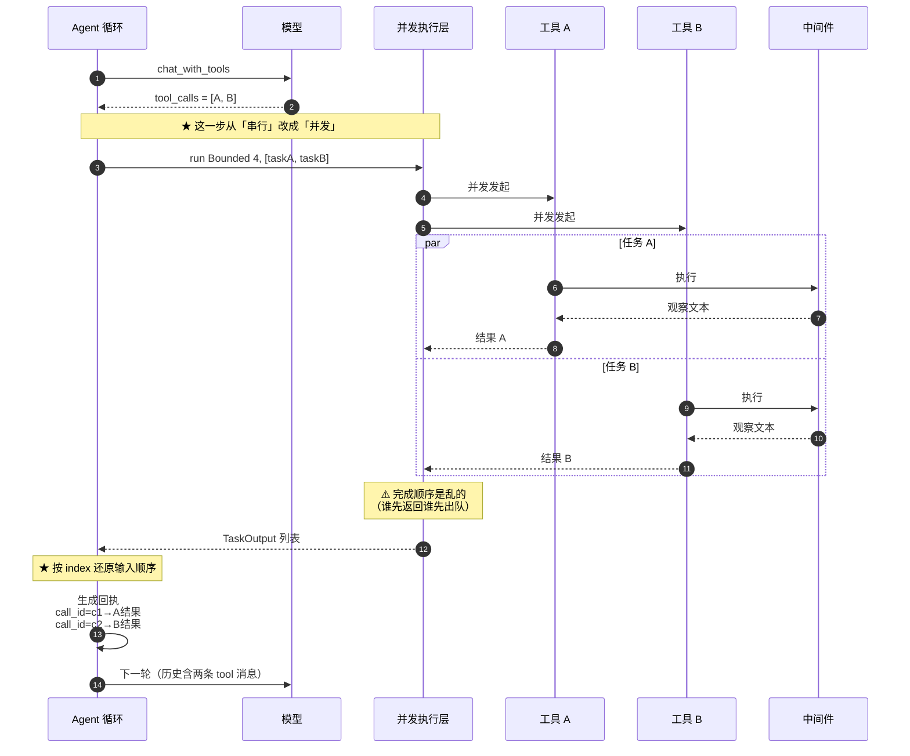
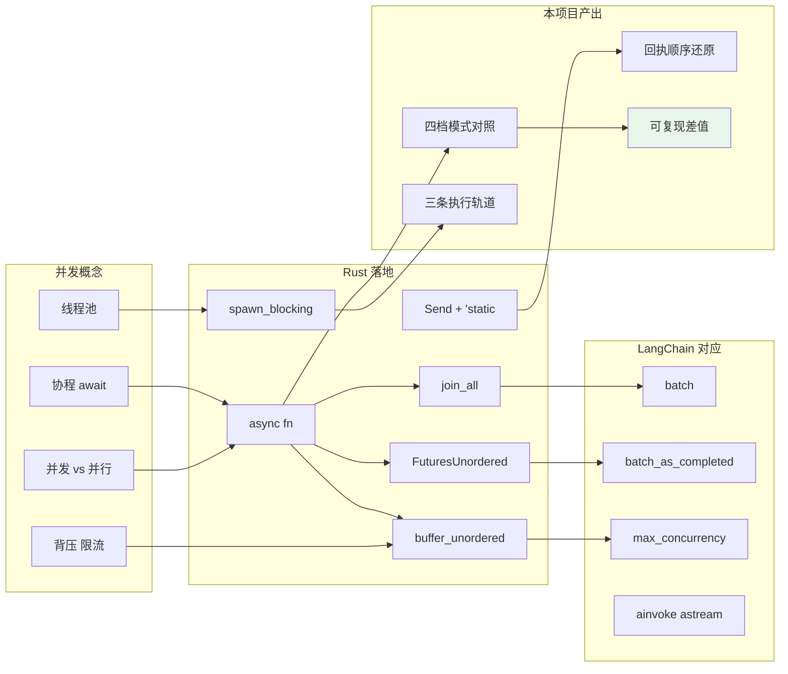
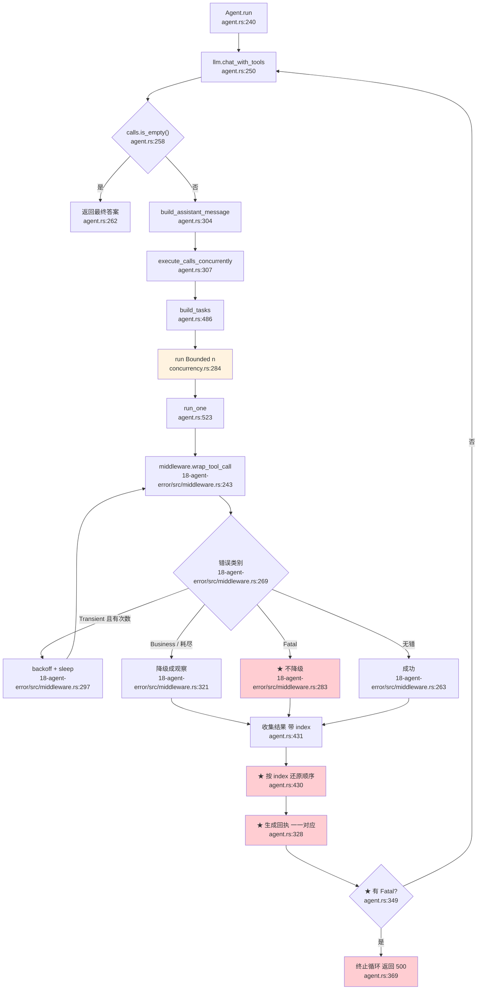
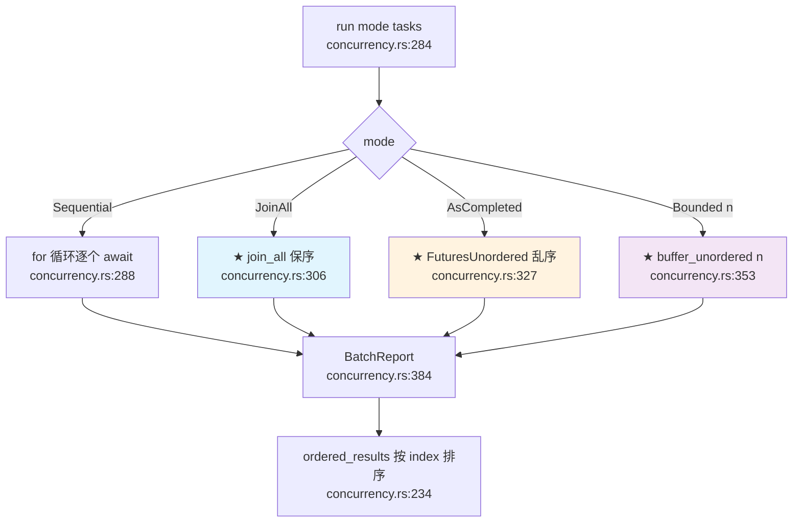
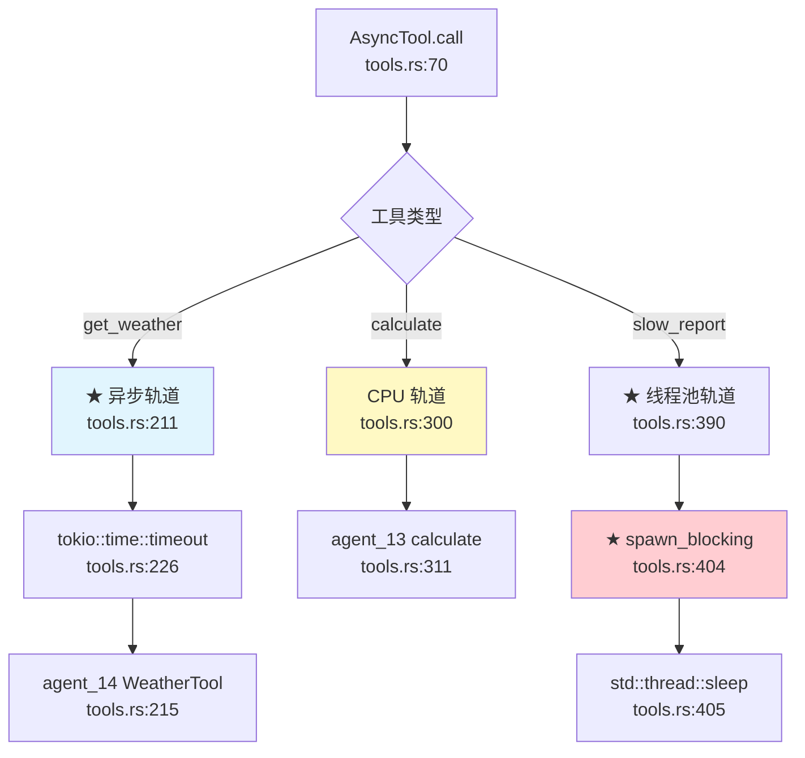

# 22-agent-async：手撕异步处理（Async）

> **学习主题**：异步处理（Async）
>
> **目标**：把系统中 I/O 密集型操作（如 API 调用）改造为异步
>
> **参考资料**：
> - 教程：[FastAPI Async](https://fastapi.tiangolo.com/async/) —— 「并发 vs 并行」「In a hurry?（`async def` vs `def`）」
> - 示例：[LangChain Models](https://docs.langchain.com/oss/python/langchain/models) —— `invoke` / `stream` / `batch` / `batch_as_completed` / `max_concurrency`

---

## 目录

- [一句话结论](#一句话结论)
- [架构全景](#架构全景)
- [四种并发模式](#四种并发模式)
- [三条执行轨道](#三条执行轨道)
- [实测差值：并发到底快多少](#实测差值并发到底快多少)
- [流程图](#流程图)
- [时序图](#时序图)
- [知识地图](#知识地图)
- [核心产出：六个实测踩出来的坑](#核心产出六个实测踩出来的坑)
- [代码调用详细流程图（函数级）](#代码调用详细流程图函数级)
- [HTTP 接口](#http-接口)
- [环境变量](#环境变量)
- [技术参考速查](#技术参考速查)

---

## 一句话结论

> **Agent 一轮里的多个工具调用，不该一个接一个等 —— 它们之间没有依赖，应该并发跑。**
>
> 本项目把这一步从「串行 for 循环」改成「限流并发」，并用**可复现的对照实验**证明：
> 模拟 I/O 负载下 **4.08x**，真实天气接口下最高 **4.20x**。
>
> ⚠️ 但「并发」本身不是全部 —— **并发层的任务结果类型决定了上层能不能做对决策**：
> 用「够用的最小类型」（`Result<String, ToolError>`）会丢掉
> 「重试次数」和「错误类别」，导致致命错误被降级成观察（坑 5）、
> 重试统计恒为 0（坑 6）。**语义字段必须在搬运链上全程保留。**

---

## 架构全景



### 模块职责

| 模块 | 职责 | 对应概念 |
|---|---|---|
| [`concurrency`](src/concurrency.rs) | **核心**：四种并发模式 + 限流 + 报告 | `batch` / `batch_as_completed` / `max_concurrency` |
| [`tools`](src/tools.rs) | 三条执行轨道的工具 + 适配器 | `async def` vs `def` |
| [`agent`](src/agent.rs) | 并发执行工具调用的 Agent 循环 | 并发工具执行 |
| [`bench`](src/bench.rs) | 并发对照实验（四档模式） | 可复现差值 |
| [`prompt`](src/prompt.rs) | 教模型**怎么读并行工具结果** | — |
| [`api`](src/api/) | HTTP 接口 | — |
| [`table`](src/table.rs) | 终端表格（按**显示宽度**补空格） | — |

### 复用了什么（继承了前面项目的坑）

| 来源 | 复用什么 | 自动继承的坑 |
|---|---|---|
| [`agent_18`] | 错误三分类 + 中间件 + 工具注册表 | 「每个 `call_id` 恰好一条回执」「Fatal 不降级」「Business 不重试」 |
| [`agent_16`] | `ToolSpec`、参数规整 | 「Schema 是对模型的承诺」 |
| [`agent_14`] | 天气工具（真 HTTP）+ Schema 校验器 | 「参数错了别发请求」 |
| [`agent_13`] | 算术求值器 | 「精确数字不走模型心算」 |

⚠️ **「继承」不等于「自动生效」** —— 本项目曾**声称**继承了 18 的「Fatal 不降级」，
但因为并发层把错误类别丢在了半路，这条其实**没生效**（坑 5）。
**复用类型只是第一步，还要保证语义字段在搬运链上全程保留。**

> ⚠️ **不重写 Function Calling** —— 16 修过的坑（回执缺失 400、`reasoning_content` 回传、`tool_choice` 四档消融）自动继承。

---

## 四种并发模式

FastAPI 教程讲的是「异步 vs 同步」，LangChain 讲的是「怎么批量调用模型」。
两者在本项目里合成一张表：

| 模式 | Rust 原语 | LangChain 对应 | 结果顺序 | 总耗时 |
|---|---|---|---|---|
| **串行** | `for` + `.await` | （手写循环） | 输入顺序 | 各任务耗时**之和** |
| **全并发保序** | `futures::future::join_all` | `batch()` | **输入顺序** | ≈ 最慢的那个任务 |
| **全并发乱序** | `FuturesUnordered` | `batch_as_completed()` | **完成顺序** | ≈ 最慢的那个任务 |
| **限流并发** | `StreamExt::buffer_unordered(n)` | `max_concurrency=n` | 完成顺序 | 分批排队 |

### 为什么要「乱序」这一档

LangChain 的 `batch_as_completed()` 文档里明说：

> 「结果可能乱序到达，**每条结果带上输入的下标**用于对账。」

本项目照做 —— 每条 [`TaskOutput`] 都带 `index`，
用 `BatchReport::ordered_results()` 还原输入顺序。

⚠️ **这是本项目坑 1 的根因**：并发执行后结果到达顺序是乱的，
但**回执必须按 `call_id` 对应**（16 实测：少一条整个请求 400）。

### 限流为什么必要

| 风险 | 后果 |
|---|---|
| 上游限流（429） | 全部请求失败 |
| socket / fd 耗尽 | 服务起不来 |
| 内存里同时挂着 N 份响应体 | OOM |

所以 `ASYNC_MAX_CONCURRENCY` 默认取 **4**。

⚠️ **限流组只有在「任务数 > 限流数」时才和全并发有差别** —— 否则会得出「限流没用」的错误结论。

---

## 三条执行轨道

FastAPI 教程的「In a hurry?」一节说：

> 如果第三方库支持 `await`，就用 `async def`；
> 如果它**不支持**（大多数数据库库），就用普通 `def` ——
> FastAPI 会把它放进**外部线程池**再等待。

这在 Rust 里**完全对应**：

| 轨道 | FastAPI | Rust / tokio | 本项目的样本 | 说明 |
|---|---|---|---|---|
| **异步** | `async def` | `async fn` + `.await` | `get_weather` | 真 HTTP，等网络 |
| **线程池** | `def` | `spawn_blocking` | `slow_report` | 真阻塞，占住 OS 线程 |
| **CPU** | `def` + 多进程 | `rayon` | `calculate` | 纯计算，**并发无收益** |

### ⚠️ 最容易踩的坑：把阻塞代码塞进 `async`

```rust
// ❌ 阻塞整个事件循环
async fn bad() {
    let rows = blocking_db_query();
}
```

这段时间里**整个 tokio 运行时都卡住** —— 别的 HTTP 请求全部排队。

正确做法是 `tokio::task::spawn_blocking` —— 把同步代码丢到**独立的阻塞线程池**。

本项目的 `slow_report` 工具用 `std::thread::sleep`（**真阻塞**），
并用回归测试 `blocking_tool_does_not_stall_the_event_loop` 锁住「它不会卡住事件循环」。

---

## 实测差值：并发到底快多少

### 负载 A：模拟 I/O（`sleep 120ms`）—— 稳定、可复现

```text
执行模式                 总耗时(ms)   加速比    成功  失败  完成顺序
------------------------  ----------  -------  ----  ----  --------
串行（一个接一个等）                       489    1.00x     4     0  0,1,2,3
全部并发 · 保序返回                      120    4.08x     4     0  0,1,2,3
全部并发 · 谁先完成谁先返回                  121    4.04x     4     0  0,1,2,3
限流并发（最多 4 个同时跑）                  121    4.04x     4     0  0,1,2,3
```

⚠️ **为什么默认用模拟负载**：真实天气接口有网络抖动和限流，
跑对照实验时用假的更稳定、更可复现（20 项目的教训：
「差值必须用不挂剖析器的纯净运行测」）。

⚠️ **限流组在这里和全并发完全等价** —— 因为任务数（4）= 限流数（4），根本没有排队。

### 负载 B：真实天气接口（Open-Meteo）—— 能看到真实网络的抖动

```text
执行模式                 总耗时(ms)   加速比    成功  失败  完成顺序
------------------------  ----------  -------  ----  ----  --------
串行（一个接一个等）                     11503    1.00x     4     0  0,1,2,3
全部并发 · 保序返回                      6953    1.65x     4     0  0,1,2,3
全部并发 · 谁先完成谁先返回                  2742    4.20x     4     0  3,0,2,1
限流并发（最多 4 个同时跑）                  11966    0.96x     4     0  3,2,0,1
```

### ⚠️ 三个必须读懂的结论

**① 加速比在 1.65x ~ 4.20x 之间浮动是正常的。**

真实网络下每个请求的延迟差异很大（DNS、TLS、路由），
所以哪一组最快是**运气**。**稳定可复现的结论是「相对关系」**：
并发组 ≪ 串行组。

**② 限流组（0.96x）实测比串行组（1.00x）还慢 —— 这是真实的现象，不是 bug。**

原因是真实的 HTTP 请求在**争抢同一份带宽**：
4 个请求同时发出去，每个都变慢了一点；
而 `buffer_unordered` 在**限流边界**上还要多做一次调度。

⚠️ 这说明**限流不是免费的** —— 它在「保护上游」和「本机吞吐」之间做权衡。
真实负载下要不要限流，取决于**上游的承受力**。

**③ 「全部并发 · 谁先完成谁先返回」最快，但它是运气。**

它的完成顺序是 `3,0,2,1` —— 说明第 3 个请求最先返回。
这不是「它更快」，而是「这次它运气好」。

### 复现方式

```bash
cd 22-agent-async

# 模拟负载（稳）
make bench

# 真实负载
make bench-real
```

或从仓库根目录：

```bash
make bench-22          # 模拟负载
make bench-real-22     # 真实负载
```

---

## 流程图



---

## 时序图

### 并发执行一轮里的多个工具调用



---

## 知识地图



---

## 核心产出：六个实测踩出来的坑

### 坑 1：并发执行后结果乱序，回执跟着乱

**现象**：一轮里并发跑了 3 个工具，回执按「完成顺序」排，
模型收到的 `tool` 消息和它发出的 `tool_calls` 对不上号。

**为什么致命**：16 实测 —— **每个 `call_id` 必须有恰好一条 `tool` 消息**，
少一条整个请求就 400（`insufficient tool messages following tool_calls message`）。

**修法**：每条结果带 `index`（输入下标），
`BatchReport::ordered_results()` 按 `index` 排序**还原输入顺序**后再生成回执。

**回归测试**：`parallel_tool_calls_keep_input_order_in_receipts`
（故意让第二个工具先完成，如果实现退化成「按完成顺序排」，顺序就会乱）。

⚠️ **真实网络下已被验证**：实测两个 `get_weather` 并发跑，
日志里的完成顺序是「上海 → 北京」（与输入顺序相反），
但终端打印的回执顺序仍是「北京 → 上海」——
说明「按 `index` 还原」这段逻辑在**真实模型 + 真实网络**下同样成立，
不是只在单测里成立。

### 坑 2：同步阻塞的工具塞进 `async` → 整个事件循环卡住

**现象**：`slow_report` 工具直接 `std::thread::sleep(500ms)`，
这 500ms 内**整个 tokio 运行时都停摆** —— 别的 HTTP 请求全部排队。

**修法**：`spawn_blocking` 把同步代码丢到**独立的阻塞线程池**，
事件循环继续跑别的任务。

**回归测试**：`blocking_tool_does_not_stall_the_event_loop` ——
用一个 50ms 的「心跳任务」监视事件循环是否被拖慢。

### 坑 3：`buffer_unordered(0)` → 请求永远挂住

**现象**：把并发上限配成 0，HTTP 请求**一直挂着不返回**，
既没有响应也没有错误日志。

**为什么**：`buffer_unordered(0)` 的内部信号量永远不会释放令牌，
stream 一次都不 poll。

**修法**：**三道防线** ——
1. 配置层 `max_concurrency.clamp(1, 64)`
2. 执行层 `ExecutionMode::Bounded(limit)` → `limit.max(1)`
3. API 层的 `to_execution_mode` 也 clamp 一次

**回归测试**：`bounded_with_zero_limit_does_not_hang`（用 `tokio::time::timeout` 卡住它）。

### 坑 4：以为「并发 = 更快」→ CPU 密集任务并发零收益

**现象**：给纯计算的任务也套上并发框架，测出来**一点都没快**。

**为什么**：并发提升的是**「等待」的吞吐**（I/O 期间线程空出来干别的），
而 CPU 密集任务本来就在**满负荷**跑 —— 并发只是让多个任务抢同样的 CPU。

**这正是 FastAPI 教程的核心论点**：

> 并发 ≠ 并行。并发是「多任务交替推进」，并行是「多任务同时推进」。

**修法**：本项目把工具分成**三条轨道**（异步 / 线程池 / CPU），
并在提示词与 README 里说清「并发 ≠ 并行」。

### 坑 5：致命错误被降级成观察（**自测时发现**）

⚠️ **这是「继承 18 的坑」时漏掉的一处** ——
本项目 README 一直写着「继承 18 的『Fatal 不降级』」，
但代码里其实**根本没实现**。

**现象**：中间件把 Fatal 错误（鉴权失败 / 内部缺陷）降级成了观察文本，
Agent 循环把它当普通错误喂回模型。

**为什么致命**：18 明确警告过 —— 降级后模型会以为「工具坏了」，
于是转而**编一个答案**，把配置问题（没配 key）掩盖成**幻觉**。
真实可达路径：`translate_tool_error`（`tools.rs`）把 14 的 `Execution` 错误
映射成 `ToolError::internal` → `kind = Fatal`。

**根因**：`run_one` 的返回类型是 `Result<String, ToolError>`，
**只带观察文本**，把错误的 `kind`（Fatal / Business / Transient）**丢在了并发层**。
上层拿到的是一段字符串，没法判断「该不该终止」。

**修法**：并发层的任务结果换成 [`TaskResult`](src/concurrency.rs) ——
带 `observation` + `attempts` + `error`（**原始错误对象**）。
Agent 循环据此判断：

```text
Fatal → 终止循环，返回 500（不返回模型的答案）
Business / Transient → 降级成观察，喂回模型
```

⚠️ **终止发生在回执生成之后** —— 16 的坑 1 优先级更高：
少一条回执整个请求就 400，**包括致命错误这一条**。

⚠️ **并发下的终止不能「取消」别的任务** —— 两个任务是同时跑的，
终止只是「不再等结果」，已经跑起来的那个**照样跑完**。

**回归测试**：`fatal_tool_error_terminates_the_agent_loop`（Fatal → 500）、
`fatal_tool_error_still_produces_one_receipt_per_call_id`（另一个并发调用照样执行）、
`business_tool_error_is_still_degraded_into_an_observation`（**对照组** ——
Business 仍必须降级，否则就变成「所有错误都终止」）。

### 坑 6：重试次数被写死成 1（**自测时发现**）

**现象**：终端永远显示「1 次尝试」，`retried_calls` **恒为 0**。

**根因**：同坑 5 —— `run_one` 返回 `Result<String, ToolError>`，
中间件的真实重试次数在 `outcome.attempts` 里，**被丢掉了**。
`execute_calls_concurrently` 里写死 `attempts: 1`。

**后果**：`tool_calls`（本意是「实际调用次数」）也永远是「逻辑调用数」，
重试根本没被计入统计 —— 可观测性直接失真。

**修法**：`TaskResult` 带 `attempts`，一路原样搬运到
`ToolCallRecord.attempts` / `.retried`。

**回归测试**：`retried_calls_are_counted_and_recorded`（Transient 重试 2 次 → `attempts == 3`）、
`successful_call_reports_one_attempt`（对照组 —— 没重试仍是 1 次）。

### 附带的一条：并发任务要求 `'static`

`Task` 里装的是 future，并发原语（`join_all` / `FuturesUnordered` / `buffer_unordered`）
会**自由地持有**它 —— 所以 future 必须 `'static`。

本项目的做法：
- 中间件用 `Arc` 包住（`Arc<ErrorHandlingMiddleware>`）—— 它本身是只读的，多个并发任务共享**安全**
- `Agent` 的方法签名改成 `self: &Arc<Self>`，任务里 `self.clone()`
- ⚠️ `tokio::spawn` 也要求 `'static`，但它会**夺走所有权**；
  本项目的工具调用要借用 `&str` 提示词，所以只能用**就地组合**的并发原语。

### 附带的一条：「结果类型」不是随便选的

⚠️ 坑 5 与坑 6 是**同一个根因**的两面：
**并发层是「搬运工」，它搬运的东西里不能缺字段**。

本项目最初用 `Result<String, ToolError>` 作为任务输出，
看起来「够用」——但它只保留了「文本 + 错误」，
把「重试次数」和「错误类别」丢在了半路。

**教训**：当并发层要搬运一个**有语义的对象**时，
不要用「够用的最小类型」——
**语义字段必须在搬运链上全程保留**，
否则上层要么统计不到，要么判断不了。


---

## 代码调用详细流程图（函数级）

> 节点写真实函数名，边上标调用点行号（格式 `文件.rs:行号`），★ 标出「容易写错」的位置。

### ① Agent 主循环



### ② 并发执行层



### ③ 三条执行轨道



---

## HTTP 接口

服务端口：**3140**（`ASYNC_BIND_ADDR` 可改）

| 方法 | 路径 | 说明 |
|---|---|---|
| GET | `/` | 服务信息 + 工具清单 + 并发上限 |
| GET | `/health` | 健康检查 |
| GET | `/api/modes` | ★ 四种并发模式说明（含 LangChain 对应） |
| POST | `/api/run` | ★ 跑一次 Agent（**并发**执行工具） |
| POST | `/api/tools/call` | 直接调工具（不经模型） |
| POST | `/api/bench` | ★ ★ 并发对照实验（四档模式） |

### 例子

```bash
# 启动服务
make serve

# 并发对照实验
curl -s -X POST http://127.0.0.1:3140/api/bench \
  -H 'Content-Type: application/json' \
  -d '{"cities":["北京","上海","广州","深圳"],"max_concurrency":4,"simulated":true}' \
  | python3 -m json.tool --no-ensure-ascii

# 跑一次 Agent
curl -s -X POST http://127.0.0.1:3140/api/run \
  -H 'Content-Type: application/json' \
  -d '{"question":"北京和上海现在天气怎么样？请分别说明。"}' \
  | python3 -m json.tool --no-ensure-ascii
```

⚠️ **`--no-ensure-ascii`**：`json.tool` 的 `ensure_ascii` 默认是 `True`，
会把中文转义成 `\uXXXX`（人眼不可读）。这**只**发生在经过 `json.tool` 时，
服务端返回的原始字节一直是正常中文。

---

## 环境变量

前缀 **`ASYNC_`**（避开其它项目：`AGENT_` / `TOOL_` / `SQL_` / `FC_` / `MEM_` / `ERR_` / `SUM_` / `CACHE_`）。

| 变量 | 说明 | 默认 |
|---|---|---|
| `ASYNC_BIND_ADDR` | 监听地址 | `127.0.0.1:3140` |
| `ASYNC_MODEL` | 模型名 | `deepseek-flash` |
| `ASYNC_TEMPERATURE` | 温度 | `0.0`（可复现） |
| `ASYNC_MAX_TOKENS` | max tokens | `4096` |
| `ASYNC_REASONING` | 开推理模型思考模式（`1` = 开） | 关 |
| `ASYNC_MAX_STEPS` | Agent 最大步数 | `6` |
| `ASYNC_TOOL_CHOICE` | `auto`/`none`/`required`/`forced:工具名` | `auto` |
| `ASYNC_MAX_RETRIES` | 工具**额外**重试次数 | `2` |
| `ASYNC_BASE_DELAY_MS` | 退避基准延迟 | `50` |
| `ASYNC_MAX_DELAY_MS` | 退避上限 | `2000` |
| `ASYNC_MAX_CONCURRENCY` | ★ **并发上限**（必须 ≥ 1） | `4` |
| `ASYNC_TOOL_TIMEOUT_SECS` | 单个工具调用超时 | `10` |
| `ASYNC_REQUEST_TIMEOUT_SECS` | 整个请求超时 | `120` |

---

## 技术参考速查

### 概念速查

| 概念 | 一句话定义 | 本项目的落点 |
|---|---|---|
| **并发** | 多任务**交替**推进（I/O 等待时线程空出来） | `async fn` + `join_all` |
| **并行** | 多任务**同时**推进（多核 / 多进程） | `rayon` / 独立进程（本项目未用） |
| **协程** | 可挂起 / 恢复的函数 | Rust 的 `async fn` |
| **背压** | 下游慢时上游自动减速 | `buffer_unordered(n)` 的限流 |
| **限流** | 同时最多跑 n 个任务 | `ExecutionMode::Bounded(n)` |
| **线程池轨道** | 同步阻塞代码丢到独立线程池 | `spawn_blocking` |
| **保序 / 乱序** | 结果按输入顺序 / 完成顺序返回 | `join_all` / `FuturesUnordered` |

### Rust API 速查

| API | 作用 | 保序？ | 限流？ |
|---|---|---|---|
| `futures::future::join_all` | 等全部完成 | ✅ 保序 | ❌ |
| `FuturesUnordered` | 谁先完成谁先出 | ❌ 乱序 | ❌ |
| `StreamExt::buffer_unordered(n)` | 限流并发 | ❌ 乱序 | ✅ |
| `StreamExt::buffer_unordered(n)`（`n=0`） | ⚠️ **永远挂住** | — | — |
| `tokio::task::spawn_blocking` | 同步代码丢线程池 | — | — |
| `tokio::time::timeout(d, fut)` | 超时（只对异步有效） | — | — |

### 工具对照表（FastAPI ↔ Rust）

| FastAPI | Rust / tokio | FastAPI 的坑 |
|---|---|---|
| `async def` + `await` | `async fn` + `.await` | 阻塞代码塞进来会卡死事件循环 |
| `def`（同步库） | `spawn_blocking` | 不丢线程池会卡死事件循环 |
| `asyncio.gather` | `join_all` / `FuturesUnordered` | `gather` 不保序（除非用 `return_exceptions`） |
| `asyncio.Semaphore` | `buffer_unordered(n)` | 限流值不能是 0 |
| `StreamingResponse` | `Sse` / `Body::from_stream` | — |

### 测试数量

| 类别 | 数量 |
|---|---|
| 单元测试 | 42 |
| 集成测试 | 21 |
| **合计** | **63** |

核心回归测试：

| 测试 | 锁住的语义 |
|---|---|
| `parallel_tool_calls_run_concurrently` | 两个 200ms 工具并发跑 → 总耗时 < 350ms |
| `parallel_tool_calls_keep_input_order_in_receipts` | ★ 回执按**输入顺序**，不是完成顺序 |
| `every_call_id_gets_exactly_one_receipt` | ★ 每个 `call_id` 恰好一条回执（16 的坑 1） |
| `concurrency_limit_is_respected` | ★ 限流成 1 → 4 个任务真的串行 |
| `tool_failure_becomes_observation_not_crash` | 工具失败不崩 Agent（18 的结论） |
| `blocking_tool_does_not_stall_the_event_loop` | ★ 阻塞工具不卡事件循环 |
| `bounded_with_zero_limit_does_not_hang` | ★ `Bounded(0)` 不挂住 |
| `join_all_preserves_input_order` | `join_all` 保序 |
| `as_completed_returns_in_completion_order` | `FuturesUnordered` 乱序 |
| `fatal_tool_error_terminates_the_agent_loop` | ★ **Fatal 不降级** → 终止 + 500（坑 5） |
| `fatal_tool_error_still_produces_one_receipt_per_call_id` | ★ 致命错误也**必须**产回执（16 的坑 1 优先） |
| `business_tool_error_is_still_degraded_into_an_observation` | ★ **对照组**：Business 仍必须降级（坑 5） |
| `retried_calls_are_counted_and_recorded` | ★ 重试次数不被丢（坑 6） |
| `successful_call_reports_one_attempt` | ★ **对照组**：没重试仍是 1 次（坑 6） |
| `attempts_are_preserved_through_the_concurrency_layer` | 并发层原样搬运 `attempts` |
| `fatal_errors_are_recognized` | 并发层能识别 Fatal |

### 常用命令

```bash
cd 22-agent-async

make help          # 所有目标
make tools         # 工具清单 + 三条执行轨道
make modes         # 四种并发模式说明
make bench         # ★ 并发对照实验（模拟负载）
make bench-real    # ★ 并发对照实验（真实天气接口）
make run           # 跑一次 Agent
make serve         # 启动 HTTP 服务（:3140）
make test          # 63 项测试
make lint          # clippy 零警告
make check         # fmt + lint + test
```

---

## 实现要点与踩坑

### 1. 为什么中间件要用 `Arc` 包住

18 的中间件是**只读**的（工具注册表是 `Vec<Arc<dyn Tool>>`），
所以多个并发任务共享一个实例是**安全**的。

但并发任务要求 future 是 `'static`，
而 `self.middleware` 是借用 —— 所以必须 `Arc` + `clone`。

### 2. 为什么工具注册表复用 18 而不是自己写

18 的注册表已经把三件事做对了：
按名字分发 → 填默认值 → **Schema 校验**（参数错了别发请求）。

自己写第二遍 = 两个版本的校验规则不一致 = 隐患。

本项目只加了一层薄薄的适配器 [`AsyncToolAdapter`](src/tools.rs)，
把「本项目的异步工具」翻译成「18 的工具」—— 只翻译类型，不加逻辑。

### 3. 为什么提示词要专门写「并行结果怎么读」

16/18 的提示词是针对「串行工具执行」写的。
本项目一轮里可能有**多个**工具结果同时回来，所以要额外说清：

- 多个工具结果是**并行**的，它们之间**没有先后依赖**
- 每条结果对应一个工具调用，要**全部读完**

⚠️ 沿用 16 的教训：**不重复工具的详细参数** ——
它们在 `tools` 字段里，模型结构化看得到；
提示词里再写一遍 = 两份描述不一致 = 模型拉锯战。

### 4. 为什么默认温度是 0

对照实验要**可复现**。温度 > 0 会让同一问题的答案每次不同，
差值就归因不到「执行模式」上了。

### 5. 终端表格的中文宽度

Rust 的 `format!("{:<15}")` 按**字符数**补空格，
而中文占 **2 列** —— 中英混排的表格会歪，而且越往右偏得越多。

本项目用 [`table.rs`](src/table.rs) 的 `display_width` / `render_row`
按**显示宽度**补空格。

⚠️ 断言也要用**显示列**而不是**字节下标** ——
中文是 3 字节 UTF-8，`line.find('命')` 拿的是字节下标。
