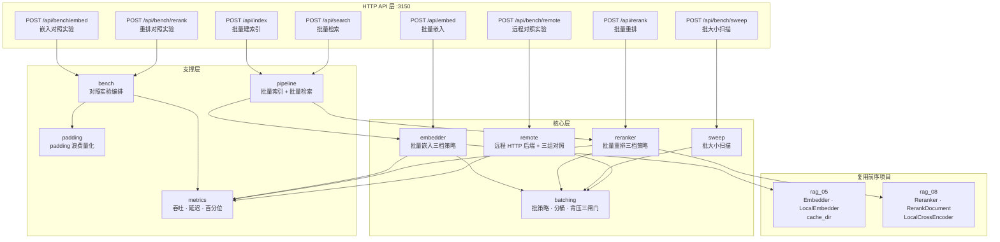
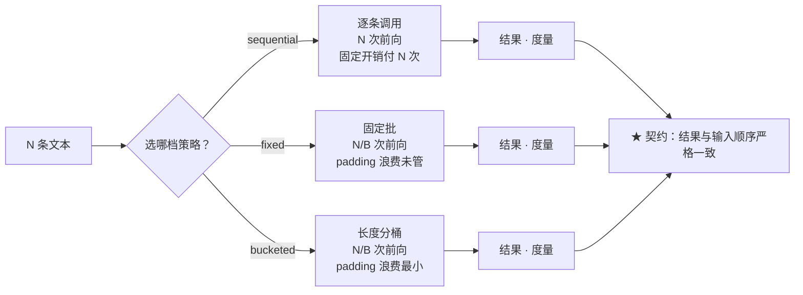
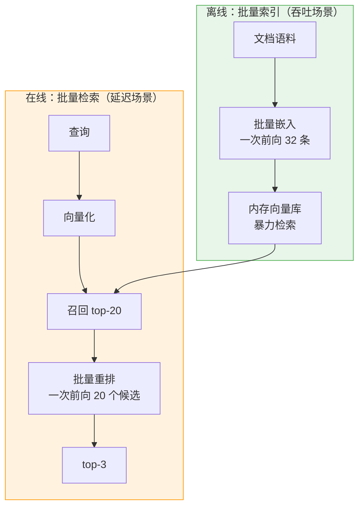
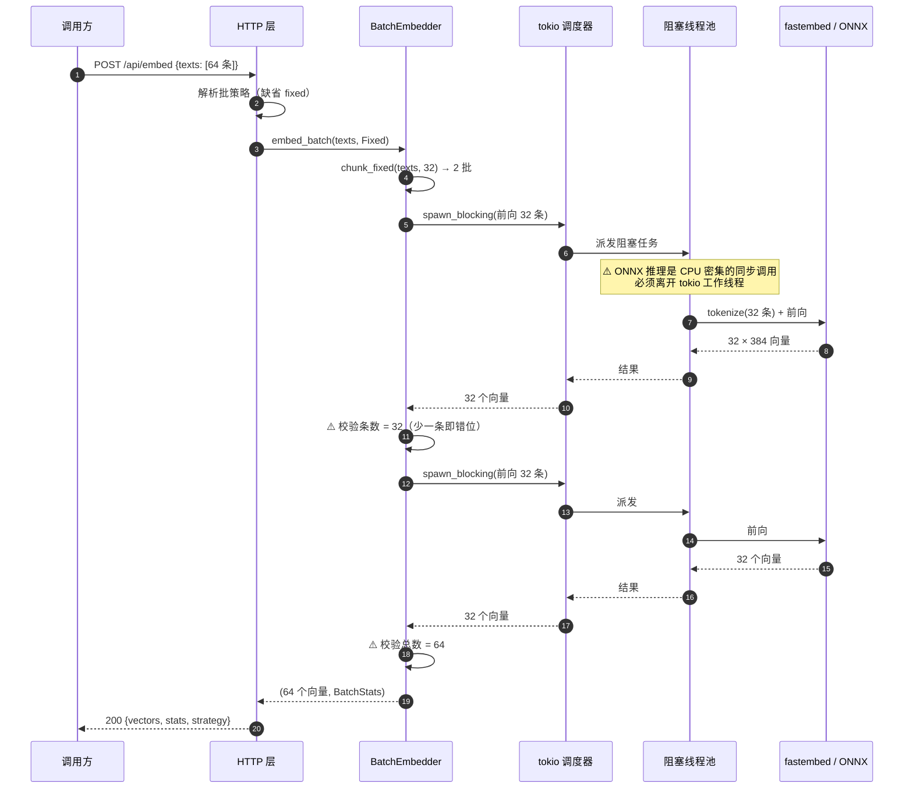
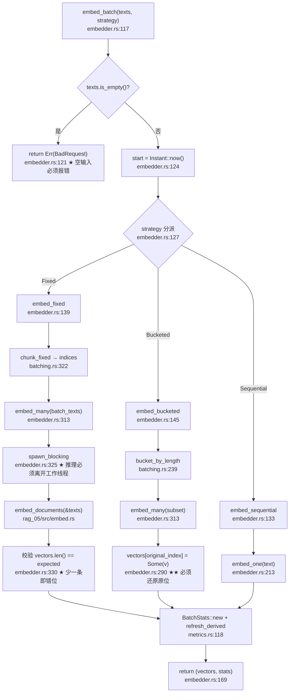
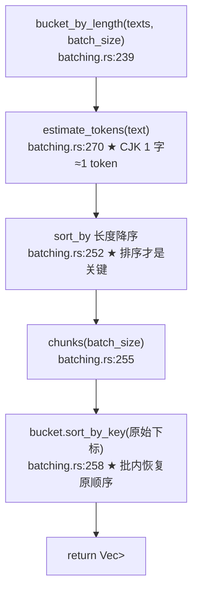
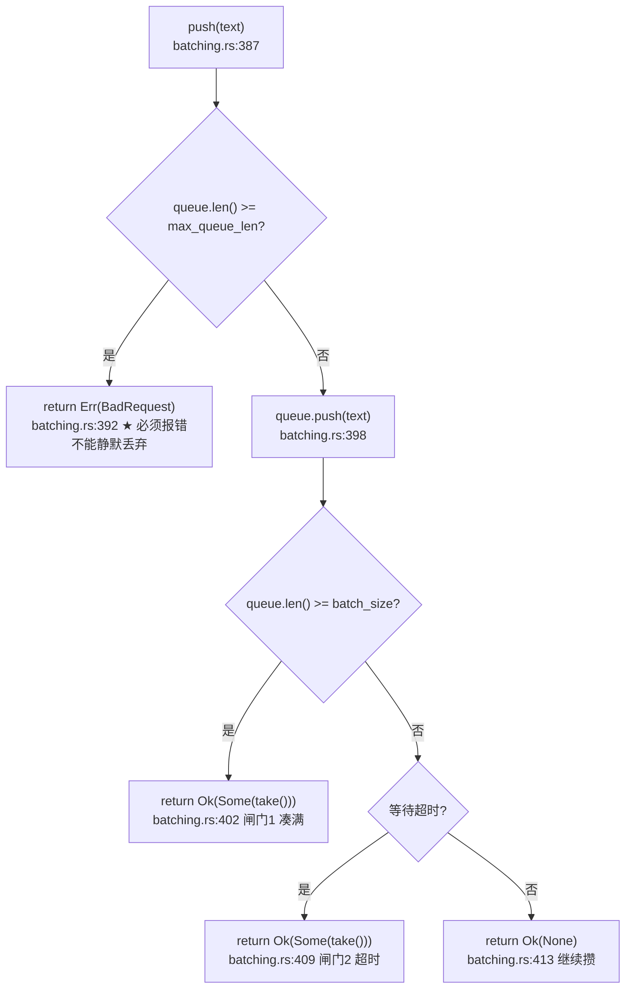
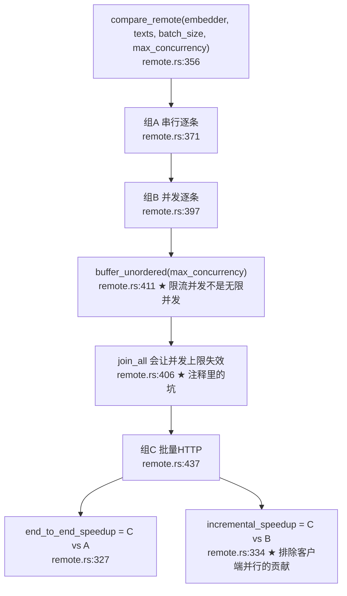

# 23-agent-batch —— 手撕批处理优化（Batching）

> **学习主题**：批处理优化（Batching）
> **参考资源**：[LangChain Models — batch](https://docs.langchain.com/oss/python/langchain/models#batch)
> **核心目标**：实现 **Embedding** 和 **Reranker** 的批处理，提升吞吐量

---

## 一、这个项目回答什么问题

「批处理能提升多少吞吐？」——这个问题看起来简单，但一旦动手做，会连续撞上五个反直觉的事实：

| # | 你以为的 | 实测的 |
|---|---|---|
| 1 | 批处理「全面更快」 | 吞吐涨了，但**单条延迟涨了 17~27 倍** |
| 2 | 批越大越好 | 批大小是**两难**，要扫才知道最优 |
| 3 | 固定批就行 | 一条长文本会拖慢同批**所有**短文本（padding 浪费） |
| 4 | LangChain 的 `batch()` 就是「批处理」 | 它是**客户端并行**，不是「合并进一次请求」 |
| 5 | 远程批量一定更快 | **实测 0.98x —— 一点也没快** |

本项目的产出不是「一个更快的 embedding 函数」，而是**三档批策略 + 一套能量化收益的对照实验 + 五个踩过的坑**。

### 1.1 与 24-agent-vllm 的关系（别搞混）

两个项目都叫「批处理优化」，但**层次完全不同**：

| | **23-agent-batch（本文）** | **24-agent-vllm** |
|---|---|---|
| 层次 | **客户端**：怎么把 N 条请求**打包**发出去 | **服务端**：怎么在 GPU 上**调度**这些请求 |
| 对象 | Embedding / Reranker（**无**自回归生成） | LLM 生成（**有**自回归解码） |
| 核心技术 | 固定批 / 长度分桶 / padding 量化 / 背压 | continuous batching / `max_num_seqs` / TTFT / GOODPUT |
| 负载 | 无状态批（一次进一次出） | 有状态请求（KV cache 复用） |
| 关键指标 | 吞吐 / 单条延迟 | 吞吐 / **TTFT** / **GOODPUT** |

一句话：**23 管「怎么打包」，24 管「怎么调度」**。
23 的结论（padding 浪费、背压三闸门、长度分桶）对 24 同样成立，但 24 还要额外处理 KV cache 与 TTFT。

---

## 二、核心结论（先看数字）

### 2.1 嵌入批处理（本地 ONNX，`intfloat/multilingual-e5-small`，64 条，批大小 32，3 轮取中位数）

| 策略 | 批次 | 总耗时(ms) | 吞吐(条/秒) | 单条 p50(ms) | 加速比 |
|---|---|---|---|---|---|
| 逐条调用（基线） | 64 | 655 | 97.7 | 9 | 1.00x |
| 固定批 | 2 | 504 | 127.0 | **241** | 1.30x |
| **长度分桶** | 2 | **417** | **153.5** | **152** | **1.57x** |

### 2.2 重排批处理（本地 ONNX，`BAAI/bge-reranker-base`，64 个候选，批大小 32，3 轮取中位数）

| 策略 | 批次 | 总耗时(ms) | 吞吐(条/秒) | 单条 p50(ms) | 加速比 |
|---|---|---|---|---|---|
| 逐条调用（基线） | 64 | 2412 | 26.5 | 32 | 1.00x |
| 固定批 | 2 | 1816 | 35.2 | **881** | 1.33x |
| **长度分桶** | 2 | **1595** | **40.1** | **708** | **1.51x** |

### 2.3 ⚠️ 最重要的一行数字

**长度分桶的加速比是 1.57x，但它的单条 p50 延迟是基线的 16.9 倍。**

```text
逐条调用   : 总耗时 655 ms，单条 p50   9 ms  ← 在线查询可用
长度分桶   : 总耗时 417 ms，单条 p50 152 ms  ← 离线灌库可用
```

所以本项目**从不单独报「总耗时」**——它总是同时报吞吐和延迟两个维度。

### 2.4 远程 HTTP 对照（Ollama `qwen3-embedding:0.6b`，64 条，批大小 32，并发上限 8）

| 组 | 做法 | 总耗时(ms) | 吞吐(条/秒) | 对应 LangChain |
|---|---|---|---|---|
| A | 串行逐条 HTTP | 3902 | 16.4 | （无） |
| B | **并发**逐条 HTTP | 3773 | 17.0 | **`batch()`** |
| C | **批量** HTTP（一次 32 条） | 3867 | 16.6 | provider 的 Batch API |

```text
客户端并行的收益 (B vs A) : 1.03x
合并请求的增量收益 (C vs B): 0.98x   ← ⚠️ 批量在这里**没有**收益
端到端收益     (C vs A) : 1.01x
```

**为什么 C 没有收益？** 因为 Ollama 服务端收到 32 条后**仍然逐条跑模型** —— 批量只省了网络往返，模型计算一分不省。

> 这就是「远程批处理是否划算**完全取决于上游**」的实测证据。
> 换成会并行的上游，C 就会明显快于 B。

---

## 三、架构全景



---

## 四、批处理为什么能提升吞吐量

一次 transformer 前向的耗时**不是**与输入条数线性相关的：

```text
单条前向：  [权重加载] [tokenize] [前向计算] [取输出]
                   ↑ 固定开销（与条数无关）

批处理前向： [权重加载] [tokenize × N] [前向计算] [取输出]
                   ↑ 固定开销只付一次，被 N 条数据分摊
```

固定开销里最大的一块是**权重复制到计算设备**（CPU 上是内存带宽，GPU 上是 PCIe 传输）。N 条数据共享这一次复制，**单位成本随 N 下降**。

---

## 五、三档批策略



| 策略 | 做法 | 对应 LangChain | 关键特性 |
|---|---|---|---|
| `sequential` | 逐条调用（每条一次前向） | （基线） | 固定开销付 N 次 |
| `fixed` | 每 N 条一次前向 | `batch()`（部分对应） | 简单，但有 padding 浪费 |
| `bucketed` | **先按长度排序**再切批 | `batch()` + 自行分桶 | 同批长度接近，padding 浪费最小 |

### 5.1 ⚠️ 「长度分桶」的正确实现

常见的误解是「按长度分成若干个**桶**，每桶再切批」—— 但那样**桶的边界**上仍然会混进长短不一的文本。

真正有效的是**长度排序**：

```text
排序后（长 → 短）：
  [100, 98, 97, 95, 10, 9, 8, 3]
        ├── 批 1（批大小 4）──┤   ← 全是长的
                ├── 批 2 ──┤       ← 全是短的
```

每批内部的长度**天然接近**，padding 到该批最长条时的浪费**最小**。

### 5.2 padding 浪费的量化（本项目的核心指标之一）

| 指标 | 定义 | 意义 |
|---|---|---|
| **padding 系数** | `Σ(批内最长 × 批内条数) / Σ(实际长度)` | 1.0 = 零浪费；2.0 = 算了两倍 |
| **浪费占比** | `1 - 1/系数` | 浪费掉的比例 |

用本项目的真实语料（64 条，长度从 20 到 130 token 不等）算：

| 批大小 | 固定批 padding 系数 | 浪费 | 分桶 padding 系数 | 浪费 | 改善 |
|---|---|---|---|---|---|
| 2 | 1.037 | 3.7% | 1.000 | 0.0% | 3.6% |
| 4 | 1.111 | 11.1% | 1.000 | 0.0% | 10.0% |
| 8 | 1.259 | 25.9% | 1.037 | 3.7% | **17.6%** |
| 16 | 1.556 | 55.6% | 1.111 | 11.1% | **28.6%** |
| 32 | 1.556 | 55.6% | 1.259 | 25.9% | **19.0%** |

**这就是「长度分桶比固定批快 1.57x vs 1.30x」的根因** —— 在批大小 32 时，padding 浪费从 55.6% 降到 25.9%。

---

## 六、五个实测踩出来的坑

### 坑 1：只看总耗时 → 以为批处理「全面更快」

**现象**：基线 655ms / 单条 p50 9ms；分桶 417ms / 单条 p50 152ms。总耗时快了 1.57x，但单条延迟涨了 **16.9 倍**。

**为什么致命**：如果用户是**逐条等结果**（而不是攒一批一起要），体验反而**变差**了。

**修法**：`BatchStats` **强制同时**报告两个维度：

- 吞吐：`throughput_per_sec`（用 `总耗时` 算，**不是**「单条延迟之和」）
- 延迟：`p50` / `p95` / `max_latency`

⚠️ 另一个度量陷阱：`总耗时 ≠ 单条延迟之和`。批处理下 N 条**共享**一次前向的时间，所以「单条延迟之和」远大于「总耗时」。本项目把 `sum_of_item_latencies_ms` 和 `sharing_factor` 也报出来，就是为了让这个差值**显式可见**。

### 坑 2：固定批里一条长文本拖慢同批所有短文本

**现象**：批大小 32 时固定批的 padding 浪费高达 **55.6%** —— 一半以上的算力花在补零上。

**根因**：神经网络要求 tensor 形状规整，短文本必须 padding 到该批最长条。

**修法**：长度分桶（见 5.1）+ `padding` 模块把浪费**量化出来**。

### 坑 3：分桶排序打乱输入顺序 → 结果**静默错位**

**现象**：分桶内部按长度排序，如果直接按排序后的顺序返回，调用方**无法把结果映射回输入**。

**为什么最危险**：这是**静默的数据错误** —— 不报错，但每条向量都挂到了错误的文档上。

**修法**：每批记录**原始下标**，返回前还原到原位：

```text
bucket.iter().zip(batch_vectors) → vectors[original_index] = Some(vector)
```

回归测试 `bucketed_results_match_input_order` + `bucketed_order_matches_fixed_order` 锁住。

### 坑 4：攒批没有背压 → 请求被无限期压住

**现象**：「攒够 32 条再发」听起来很好，但如果上游只有 1 QPS，攒批就变成了「把请求无限期压住」。

**修法**：**三个闸门**同时生效（`BatchAccumulator`）：

| 闸门 | 字段 | 触发时 |
|---|---|---|
| 最大批大小 | `batch_size` | 凑满 → 立即发出去 |
| 最大等待时间 | `max_wait_ms` | 超时 → 立即发出去（哪怕不满） |
| 最大队列长度 | `max_queue_len` | 队列满 → **返回错误**（不静默丢弃） |

⚠️ 队列满了要「返回错误」而不是「丢掉最老的」：静默丢弃 = 请求凭空消失 = 调用方永远等不到 = **挂死**。

### 坑 5：远程批量**不一定**更快

**现象**：第一版对照实验只有两组（串行逐条 vs 批量 HTTP），实测 **0.99x**。看起来像「远程批量没用」—— 但这个结论是**错的**。

**根因**：漏掉了「客户端并行」这一档。LangChain 的 `batch()` 的定义是「**客户端并行**发 N 个独立请求」，所以它的真正对照不是「串行逐条」，而是「**并发**逐条」。

**修法**：改成**三组**对照：

```text
A（串行逐条）
  ↓ 客户端并行（省网络往返的墙钟时间）        ← LangChain batch() 在这一层
B（并发逐条）
  ↓ 合并进一次请求（省每次请求的固定开销）    ← provider Batch API 在这一层
C（批量 HTTP）
```

⚠️ **两个维度是正交的**。只做前者（B）通常比两者都做（C）更快 —— 因为服务端并行度才是瓶颈。

---

## 七、批大小扫描

批大小不是越大越好，它是一个**两难**：

```text
批大小 ↑  → 固定开销分摊更多（吞吐 ↑）但 padding 浪费更多（吞吐 ↓）
         → 内存占用更大（可能 OOM）→ 单条延迟更高（在线不可接受）
```

所以「最优批大小」是**数据相关**的，必须实测。

**实测（64 条样本，3 轮取中位数）：**

| 批大小 | 批次 | 总耗时(ms) | 吞吐(条/秒) | 吞吐倍数 | 单条 p50(ms) |
|---|---|---|---|---|---|
| 1 | 64 | 602 | 106.3 | 1.00x | 8 |
| 2 | 32 | 671 | 95.4 | 0.90x | 19 |
| 4 | 16 | 613 | 104.4 | 0.98x | 35 |
| 8 | 8 | 536 | 119.4 | 1.12x | 72 |
| 16 | 4 | 590 | 108.5 | 1.02x | 144 |
| 32 | 2 | 590 | 108.5 | 1.02x | 292 |
| **64** | 1 | **498** | **128.5** | **1.21x** | 498 |
| 128 | 1 | 781 | 81.9 | 0.77x | 781 |

**最优批大小：64**（吞吐最高）。

⚠️ 曲线的形状和教科书里的「倒 U」不同 —— **右侧确实下降了**（128 档掉到 0.77x），这就是 padding 浪费 + 内存压力的体现。但中段（2/4/16/32）有抖动，所以：

⚠️ **可复现的结论是「相对关系」**（大批 ≫ 小批），**不是某个固定的倍数**。加速比本身会浮动（标准差 0.09~0.17），换语料/换模型/换硬件都要重新扫。

---

## 八、端到端链路



### ⚠️ 两个位置的优化目标**相反**

| 位置 | 场景 | 优化目标 | 批处理的影响 |
|---|---|---|---|
| **批量索引** | 离线灌库 | **吞吐** | 吞吐大幅提升，延迟无所谓 |
| **批量检索** | 在线查询 | **延迟** | 吞吐提升但**单条延迟被抬高** |

所以「批量检索」只在**一次要精排很多候选**时才划算 —— 比如「一次查询召回 100 条再精排」。典型的 top-20 → top-3 场景，批处理的收益有限。

### 为什么向量检索用**暴力**而不是 FAISS

因为本项目要测的是**批处理**的收益。引入 FAISS 会带来索引构建、参数调优等额外变量，差值就无法**归因**到批处理这一个维度。

（FAISS 的用法见 05-rag。）

---

## 九、时序图：一次批量嵌入



---

## 十、代码调用详细流程图（函数级）

> 节点写真实函数名，边上标调用点行号，★ 标出容易写错的位置。

### 10.1 批量嵌入主路径



### 10.2 长度分桶（★ 坑 3 的修复点）



### 10.3 背压三闸门



### 10.4 远程三组对照



---

## 十一、模块划分

| 模块 | 文件 | 职责 | 关键行数 |
|---|---|---|---|
| `batching` | `src/batching.rs` | **核心**：批策略 / 分桶 / 背压三闸门 | ~500 |
| `embedder` | `src/embedder.rs` | 批量嵌入（三档策略） | ~400 |
| `reranker` | `src/reranker.rs` | 批量重排（三档策略） | ~400 |
| `remote` | `src/remote.rs` | 远程 HTTP 后端 + 三组对照 | ~500 |
| `metrics` | `src/metrics.rs` | 度量（吞吐 / 延迟 / 百分位 / 派生指标） | ~250 |
| `padding` | `src/padding.rs` | **padding 浪费量化** | ~200 |
| `sweep` | `src/sweep.rs` | 批大小扫描 | ~250 |
| `bench` | `src/bench.rs` | 对照实验编排 + 多轮中位数 | ~300 |
| `pipeline` | `src/pipeline.rs` | 批量索引 + 批量检索 | ~300 |
| `api` | `src/api/` | HTTP 接口（8 个端点） | ~450 |
| `table` | `src/table.rs` | 终端表格（按**显示宽度**补空格） | ~180 |
| `testkit` | `src/testkit.rs` | 测试替身（零网络、零模型、确定性） | ~250 |

---

## 十二、HTTP API

| 方法 | 路径 | 说明 |
|---|---|---|
| GET | `/health` | 健康检查 |
| GET | `/` | 服务信息 + 三档策略说明 |
| POST | `/api/embed` | ★ 批量嵌入 |
| POST | `/api/rerank` | ★ 批量重排 |
| POST | `/api/bench/embed` | ★ ★ 嵌入批处理对照实验 |
| POST | `/api/bench/rerank` | ★ ★ 重排批处理对照实验 |
| POST | `/api/bench/remote` | ★ ★ 远程 HTTP 三组对照 |
| POST | `/api/bench/sweep` | ★ ★ 批大小扫描 |
| POST | `/api/index` | ★ 批量建索引 |
| POST | `/api/search` | ★ 批量检索（召回 + 批量重排） |

### 错误码

| 错误码 | HTTP | 含义 |
|---|---|---|
| `E_BAD_REQUEST` | 400 | 调用方参数错（空输入、未知策略、队列满） |
| `E_UPSTREAM` | 503 | 上游服务问题（远程后端不可用、限流） |
| `E_INFERENCE` | 500 | 推理失败 |
| `E_INTERNAL` | 500 | 本项目缺陷 |

⚠️ 上游超时/不可用映射成 **503** 而不是 500 —— 503 的标准语义是「稍后重试可能成功」（18 项目的教训）。

---

## 十三、配置

环境变量前缀 **`BATCH_`**（13 用 `AGENT_`，14 用 `TOOL_`，15 用 `SQL_`，16 用 `FC_`，17 用 `MEM_`，18 用 `ERR_`，19 用 `SUM_`，21 用 `CACHE_`，22 用 `ASYNC_`）。

| 变量 | 说明 | 默认 |
|---|---|---|
| `BATCH_BIND_ADDR` | 监听地址 | `127.0.0.1:3150` |
| `BATCH_EMBED_MODEL` | 嵌入模型 | `multilingual-e5-small` |
| `BATCH_RERANK_MODEL` | 重排模型 | `bge-reranker-base` |
| `BATCH_SIZE` | 固定批大小 | `32` |
| `BATCH_BUCKET_SIZE` | 分桶批大小 | `32` |
| `BATCH_MAX_WAIT_MS` | 最大等待时间（毫秒） | `50` |
| `BATCH_MAX_QUEUE_LEN` | 队列上限（背压） | `1024` |
| `BATCH_MAX_CONCURRENCY` | 客户端并行上限 | `8` |
| `BATCH_SAMPLE_SIZE` | 对照实验样本条数 | `64` |
| `BATCH_ROUNDS` | 对照实验轮数 | `3` |
| `BATCH_REMOTE` | 是否启用远程对照 | `false` |
| `BATCH_OLLAMA_ENDPOINT` | Ollama 地址 | `http://127.0.0.1:11434` |
| `BATCH_OLLAMA_MODEL` | Ollama 模型 | `qwen3-embedding:0.6b` |

---

## 十四、快速上手

```bash
# ── 在项目目录下 ─────────────────────────────
cd 23-agent-batch

make help          # 查看所有目标
make modes         # ★ 三档批策略说明
make bench         # ★ ★ ★ 嵌入对照实验（release 构建）
make bench-rerank  # ★ ★ ★ 重排对照实验
make sweep         # ★ ★ ★ 批大小扫描
make serve         # 启动 HTTP 服务（:3150）

# ── 远程对照（需要 Ollama 在跑）──────────────
ollama serve                                  # 另开一个终端
make bench-remote
```

⚠️ **`make bench` 用的是 `--release`** —— debug 构建的 ONNX 推理慢到会淹没批处理的收益差异。

### HTTP 调用

```bash
# 批量嵌入
curl -s -X POST http://127.0.0.1:3150/api/embed \
  -H 'Content-Type: application/json' \
  -d '{"texts":["第一条","第二条","第三条"],"strategy":"fixed"}' \
  | python3 -m json.tool --no-ensure-ascii

# 嵌入对照实验
curl -s -X POST http://127.0.0.1:3150/api/bench/embed \
  -H 'Content-Type: application/json' \
  -d '{"sample_size":64,"rounds":3}' \
  | python3 -m json.tool --no-ensure-ascii
```

⚠️ `json.tool` 的 `ensure_ascii` 默认是 `True`，会把中文转义成 `\uXXXX`（人眼不可读）—— 全仓统一加 `--no-ensure-ascii`。

---

## 十五、复用关系（继承了前序项目的坑）

| 来源 | 复用什么 | 继承的坑 |
|---|---|---|
| `rag_05` | `Embedder` trait / `LocalEmbedder` / `cache_dir` | 「fastembed 缓存目录必须**绝对路径**」（相对路径会跟随 CWD，重复下载 470MB） |
| `rag_08` | `Reranker` trait / `RerankDocument` / `LocalCrossEncoder` | 「ONNX 推理是 CPU 密集同步调用，必须走 `spawn_blocking`」 |
| `agent_07` | `LlmFuture` 式的 dyn 兼容 future | 「`async fn` 在 trait 里不是 dyn 兼容，要显式装箱」 |
| `agent_22` | `buffer_unordered` 限流并发 / `join_all` 就地组合 | 「`spawn` 要求 `'static`，只能就地组合」 |
| `agent_18` | 错误分类与状态码映射 | 「上游问题 → 503 而不是 500」 |
| `agent_21` | 「不缓存第三方类型」 | 本项目自定义 `BatchStats` / `DerivedMetrics`，不暴露 `genai` 类型 |

---

## 十六、测试

```bash
make test    # 94 项（单元 79 + 集成 15）
make lint    # clippy -D warnings 零警告
make check   # fmt + lint + test
```

**全部零网络、零模型、确定性** —— 用 `testkit` 里的替身。

### 关键回归测试

| 测试 | 锁住什么 |
|---|---|
| `bucketed_results_match_input_order` | 分桶后结果**对回原输入**（坑 3） |
| `bucketed_order_matches_fixed_order` | 分桶与固定批的**结果完全相同** |
| `bucketed_embed_produces_identical_results_to_fixed` | 批处理只影响耗时，不影响结果 |
| `bucketed_rerank_produces_identical_results_to_sequential` | 同上（重排侧） |
| `accumulator_rejects_when_the_queue_is_full` | 队列满 → **报错**而非静默丢弃（坑 4） |
| `padding_comparison_shows_bucketing_reduces_waste` | 分桶降低 padding 系数（坑 2） |
| `incremental_speedup_is_measured_against_the_concurrent_group` | 增量收益要相对**并发组**算（坑 5） |
| `concurrent_group_also_uses_one_request_per_item` | 并发组与串行组请求形状相同（坑 5） |
| `sequential_uses_one_request_per_item` | 逐条组真的逐条 |
| `fixed_strategy_really_batches_the_underlying_calls` | 固定批真的批了（探针记录调用形状） |

---

## 十七、技术参考速查

| 概念 | 本项目的实现 | 参考 |
|---|---|---|
| `batch()` | 三档批策略的 `fixed` 档 | [LangChain Models — batch](https://docs.langchain.com/oss/python/langchain/models#batch) |
| `batch_as_completed()` | 本项目**不需要**（批处理返回顺序 = 输入顺序） | 同上 |
| `max_concurrency` | `BATCH_MAX_CONCURRENCY`（远程组 B） | 同上 |
| provider Batch API | 远程组 C（一次 N 条） | OpenAI Batch API |
| `PaddingStrategy::BatchLongest` | fastembed 内置，padding 模块量化其浪费 | fastembed 源码 |
| 长度分桶 | `bucket_by_length` | Sentence Transformers / FAISS 社区实践 |
| 背压三闸门 | `BatchAccumulator` | Reactive Streams / Akka |
| 最近秩百分位 | `metrics::percentile` | — |
| 中位数抗离群 | `bench::median_stats` | — |
| `Pin<Box<dyn Future>>` | `RemoteEmbedFuture` | 07 `LlmFuture` / 14 `ToolFuture` |
| `buffer_unordered(n)` | 远程组 B 的限流并发 | 22 项目 |

---

## 十八、已知局限

1. **向量检索用暴力而非 FAISS** —— 为了把变量锁死在「批处理」这一个维度。生产环境应换成 FAISS（见 05-rag）。
2. **padding 浪费是理论估算** —— 用「CJK 1 字 ≈ 1 token」的启发式，不是真实 tokenizer 的输出。它能**归因**组间差异，但不是精确值。
3. **加速比本身会浮动** —— 加速比标准差 0.09~0.17，受机器负载影响。可复现的结论是**相对关系**，不是某个固定倍数。
4. **远程对照只测了 Ollama** —— 它恰好是「服务端不并行」的例子。换成会并行的上游（如 vLLM / TEI），组 C 会明显快于组 B。
5. **`/api/search` 用的是临时索引** —— 每次请求现建一个索引。真实服务应该维护常驻索引（本项目的重点是批处理，不是索引生命周期）。
6. **没有实现流式批处理** —— `bucketed` 策略必须**先收齐全部输入**才能排序，所以不适合流式场景。

---

## 十九、下一步

- **23 → 21（缓存）**：批处理与缓存是**正交**的两个维度 —— 缓存省「重复计算」，批处理省「每次计算的固定开销」。两者叠加才是完整的吞吐优化。
- **23 → 22（并发）**：并发（省网络往返）与批处理（省请求固定开销）是**正交**的。本项目的远程三组对照已经把这两层拆开了。
- **23 → 20（性能剖析）**：本项目的「差值必须用 release 纯净运行测」和 20 项目的「差值不能挂剖析器」是同一条纪律。
