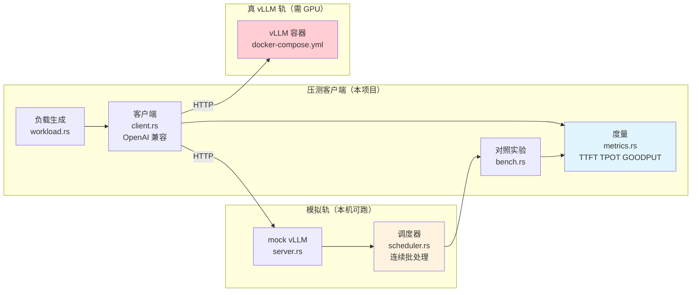
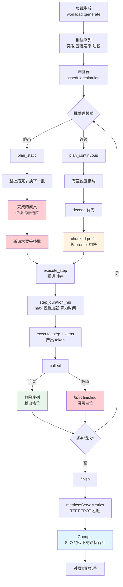
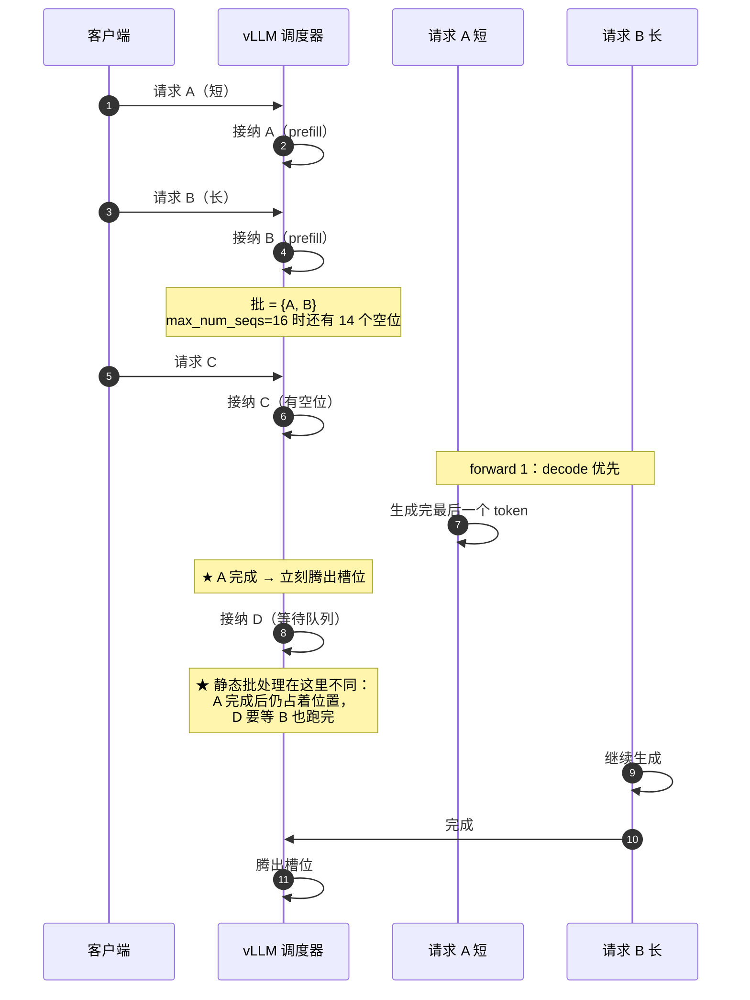
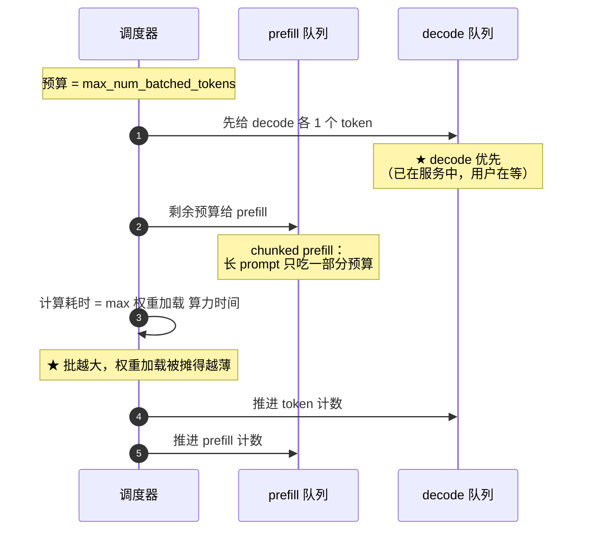
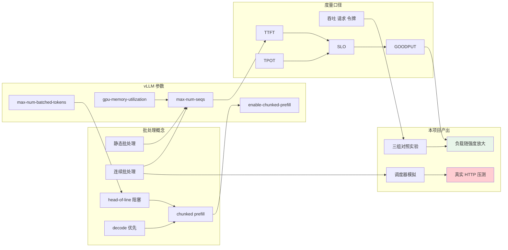
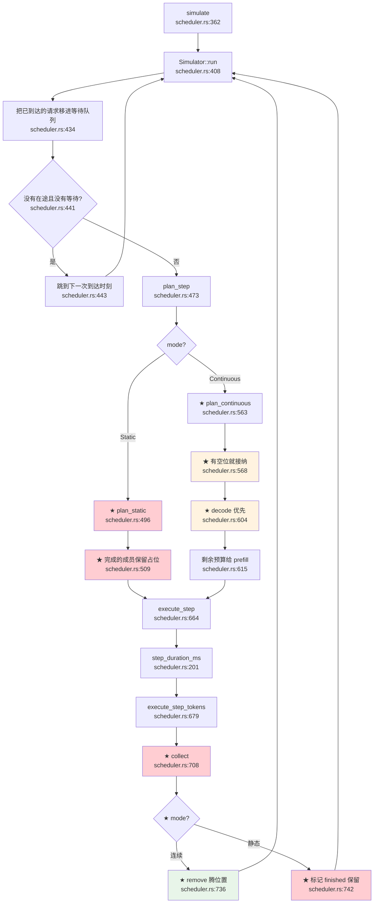
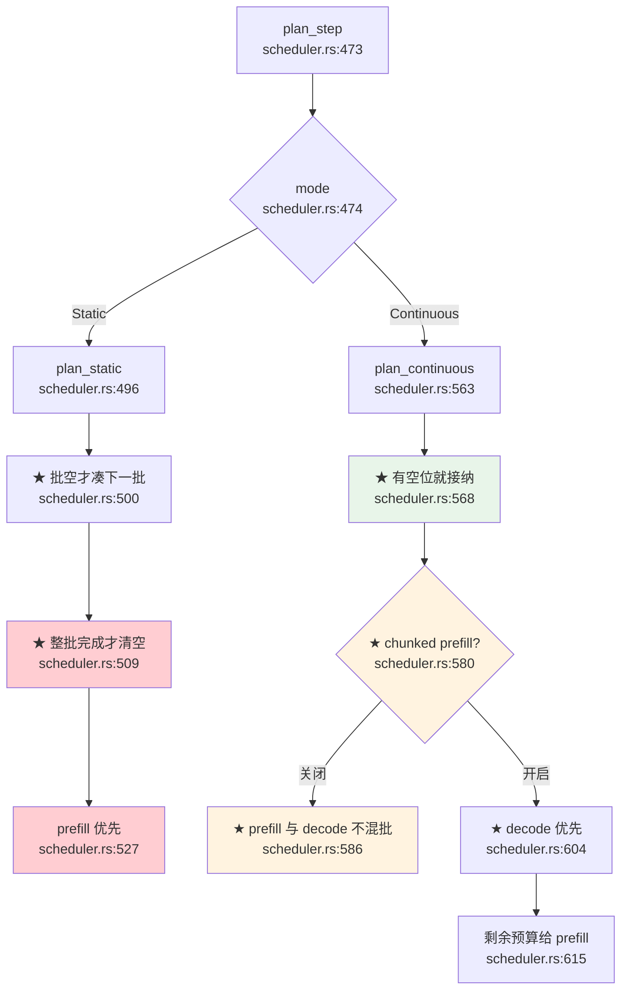
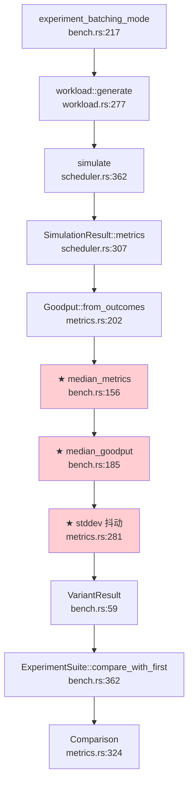
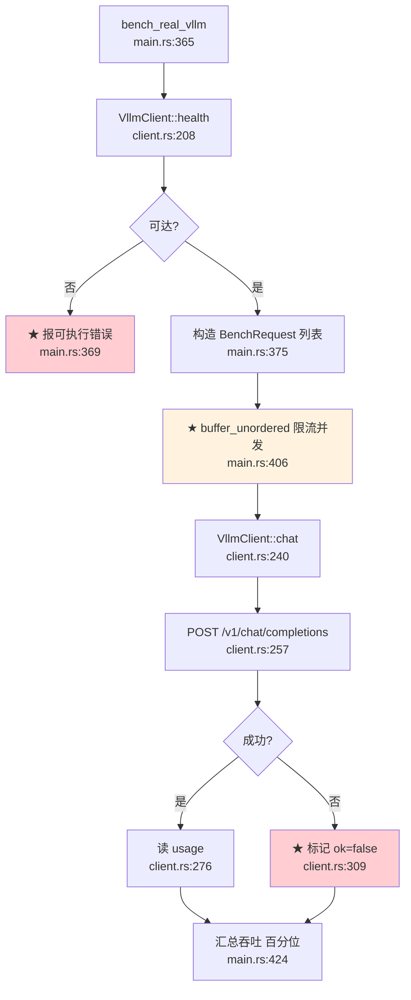

# 24-agent-vllm：手撕批处理优化（Batching）

> **学习主题**：批处理优化（Batching）
>
> **目标**：用 Docker 部署 vLLM 跑一个开源模型，并量化测试它的吞吐量
>
> **参考资料**：
> - 教程：[vLLM Quickstart](https://docs.vllm.ai/en/latest/getting_started/quickstart.html)
> - 替代方案对比：[SGLang](https://github.com/sgl-project/sglang) · [TensorRT-LLM](https://github.com/NVIDIA/TensorRT-LLM) · [LMDeploy](https://github.com/InternLM/lmdeploy)

---

## 目录

- [一句话结论](#一句话结论)
- [⚠️ 前置说明：本机跑不了真 vLLM](#-前置说明本机跑不了真-vllm)
- [架构全景](#架构全景)
- [批处理的两种模式](#批处理的两种模式)
- [三个关键调参](#三个关键调参)
- [实测差值：三组对照实验](#实测差值三组对照实验)
    - [流程图](#流程图)
    - [时序图](#时序图)
- [知识地图](#知识地图)
- [核心产出：四个实测踩出来的坑](#核心产出四个实测踩出来的坑)
- [代码调用详细流程图（函数级）](#代码调用详细流程图函数级)
- [真 vLLM 部署与压测](#真-vllm-部署与压测)
- [HTTP 接口](#http-接口)
- [环境变量](#环境变量)
- [技术参考速查](#技术参考速查)

---

## 一句话结论

> **连续批处理（continuous batching）的价值不是「快一点」，而是「负载越高、差距越大」——
> 它的 GOODPUT 相对静态批处理从 1.7x 一路放大到 57.8x。**
>
> 但同时：**只看吞吐会选出一个延迟不可用的服务** ——
> 实测 `max_num_seqs` 从 64 调到 256，吞吐还在涨（47→53 req/s），
> **GOODPUT 却从 7.36 掉到 5.28**。
>
> 所以批处理优化必须**同时**看三个维度：**吞吐 / TTFT / GOODPUT**。

---

## ⚠️ 前置说明：本机跑不了真 vLLM

vLLM 官方镜像**只支持 Linux + NVIDIA GPU**（基于 PyTorch CUDA 构建）。
而本仓库的开发机是 **Apple M1 Max（ARM64 macOS，无 CUDA）** —— 
「真 vLLM」这条轨**在本机跑不起来**。

如果只写 docker 脚本，项目就变成**不可验证**的。所以本项目分两轨：

| 轨 | 跑在哪 | 能验证什么 | 怎么跑 |
|---|---|---|---|
| **真 vLLM 轨** | 有 NVIDIA GPU 的 Linux | 真实吞吐、真实 TTFT | `make docker-up` → `make bench-vllm` |
| **模拟轨**（本项目主体） | **任何机器**（纯计算、零依赖、零网络） | 调度**机制**与**相对关系** | `make bench` |

⚠️ **模拟轨的绝对数字不代表 vLLM** —— 
真实吞吐取决于 GPU 型号、显存带宽、量化方式、kernel 实现。
模拟轨的价值是：**把「批处理为什么有效」变成可复现的实验**，而不是去猜「能快几倍」。

模拟轨的模型（[`scheduler.rs`](src/scheduler.rs)）：

```text
一次 forward 耗时 = max(权重加载耗时, 总 token 数 / 饱和算力)
                       ↑ 与批大小无关      ↑ 与批大小成正比
```

这是批处理能提速的**根本原因**：GPU 一次前向要先把权重搬上计算单元，
这一步**与批里有几条数据无关** —— N 条数据共享它，单位成本随 N 下降。

---

## 架构全景



### 模块职责

| 模块 | 职责 | 对应 vLLM 概念 |
|---|---|---|
| [`scheduler`](src/scheduler.rs) | **核心**：连续批处理调度器的离散事件模拟 | 连续批处理 / chunked prefill |
| [`workload`](src/workload.rs) | 负载生成（突发 / 固定速率 / **泊松**） | `--request-rate` / `--dataset-name random` |
| [`metrics`](src/metrics.rs) | 度量（TTFT / TPOT / 吞吐 / **GOODPUT**） | `vllm bench serve` 的指标口径 |
| [`bench`](src/bench.rs) | ★ 三组对照实验 | 可复现差值 |
| [`client`](src/client.rs) | 打真 vLLM 的 OpenAI 兼容客户端 | `--backend openai-chat` |
| [`server`](src/server.rs) | 内置 mock vLLM（OpenAI 兼容） | 离线替身 |
| [`api`](src/api/) | HTTP 接口 | — |
| [`table`](src/table.rs) | 终端表格（按**显示宽度**补空格） | — |

---

## 批处理的两种模式

| | **静态批处理**（static batching） | **连续批处理**（continuous batching） |
|---|---|---|
| 组成方式 | **凑够一批**才开始 | **有空位就加入** |
| 批的成员 | 固定，跑完这一批才换下一批 | **动态**，谁先完成谁腾位置 |
| 新请求等待 | 等**整个批**跑完 | 等**一个位置**空出来 |
| 短请求 | 被同批长请求拖着 | 跑完立刻腾位置 |
| 谁在用 | HF `generate` / TGI 老版本 | **vLLM / SGLang / TensorRT-LLM / LMDeploy** |

### ⚠️ 静态批处理的浪费在哪

一个 8 条的批里，如果 7 条先跑完了、只剩 1 条还在跑 —— 
静态批处理里那 **7 个槽位就白白浪费了**（它们已经完成，但还占着位置），
期间新来的请求只能干等。

**连续批处理正是为了消掉这个浪费而生的。**
本项目的 `Seq.finished` 字段（[`scheduler.rs`](src/scheduler.rs)）就是这一点的直接建模。

### ⚠️ 一个反直觉的实测结果

**长度完全一致时，两种模式完全等价**（测不出差异是**正确**行为，不是 bug）。

因为大家一起跑完，谁先完成都一样 —— 
连续批处理的优势**完全来自「长度参差」**。
所以做这个对照实验时，**负载必须用 `uniform` 或 `lognormal` 分布**，
用 `fixed` 会得到「两者一样」的结论 —— 那结论本身没错，但答非所问。

回归测试 `uniform_workload_makes_both_modes_equivalent` 锁住了这个前提。

---

## 三个关键调参

| 参数 | vLLM 命令行 | 作用 | 调大的后果 |
|---|---|---|---|
| **同时处理的序列数上限** | `--max-num-seqs` | 批的大小 | 批更满、吞吐↑；**TTFT↑、显存↑** |
| **单 forward 的 token 预算** | `--max-num-batched-tokens` | 一次前向的算力上限 | 长 prompt 更容易霸占 forward |
| **chunked prefill** | `--enable-chunked-prefill` | 长 prompt 切块 | ★ 避免 head-of-line 阻塞 |

### ⚠️ decode 优先于 prefill

一个 forward 里如果既有 decode（生成 token）又有 prefill（处理 prompt），
**先给 decode**。

理由：decode 的请求**已经在服务中**（用户正在等），
而 prefill 的请求**还没开始**（多等一会儿无感）。

### ⚠️ chunked prefill 为什么重要

一条 4000 token 的 prompt 如果**一次算完**，
这一个 forward 就要几秒 —— 期间**所有正在 decode 的请求全部卡住**
（head-of-line blocking，用户看到的是 TTFT 尖刺）。

**chunked prefill** 把长 prompt 切成若干块，
每块和其它请求的 decode **混在同一个 forward** ——
「长 prompt 的预填充」被摊薄到多个 forward，
decode 请求的停顿变成**许多次很小**的停顿。

---

## 实测差值：三组对照实验

全部用**模拟轨**跑（本机可复现），配置：
200 条请求、突发到达、长度均匀分布（输入 32~512、输出 16~128 token）、3 轮取中位数。

### 实验 A：静态批处理 vs 连续批处理

```text
批处理模式  请求吞吐  token吞吐  TTFT p50  TTFT p95  TPOT p50  排队    GOODPUT
----------  --------  ---------  --------  --------  --------  ------  -------
静态批处理  18.82     1411.4     5075.4    9346.6    5.354     4730.7  1.51
连续批处理  27.57     2067.5     3209.2    6316.6    7.142     3200.9  2.76

相对「静态批处理」的倍数：
档位        请求吞吐  token吞吐  TTFT p95  GOODPUT
----------  --------  ---------  --------  -------
连续批处理  1.46x     1.46x      0.68x     1.83x
```

### ★★ 实验 A 的真正结论：**差距随负载放大**

换不同到达速率重跑同一组对照（泊松负载）：

| 到达速率 | 静态 GOODPUT | 连续 GOODPUT | **GOODPUT 倍数** | 吞吐倍数 |
|---|---|---|---|---|
| 10 req/s | 6.05 | 10.27 | **1.70x** | 1.04x |
| 50 req/s | 1.88 | 26.76 | **14.24x** | 2.14x |
| 200 req/s | 0.16 | 9.26 | **57.88x** | 2.19x |

**这是本项目最重要的实测结论：**

> **连续批处理的价值不是「快一点」，而是「负载越高、差距越大」。**
>
> 低负载时两种模式差不多（1.70x）；
> 高负载时静态批处理的 GOODPUT **崩到 0.16**（几乎所有请求都超时违约），
> 而连续批处理还有 9.26。
>
> 原因：负载越高，静态批处理「等整批跑完」造成的**槽位浪费**被放大得越厉害。

⚠️ 注意**吞吐倍数只有 2.19x，而 GOODPUT 倍数是 57.88x** ——
差 26 倍。这说明**只报吞吐会严重低估连续批处理的价值**。

### 实验 B：`max_num_seqs` 扫描（找甜点）

```text
max_num_seqs  请求吞吐  token吞吐  TTFT p50  TTFT p95  TPOT p50  排队     GOODPUT
------------  --------  ---------  --------  --------  --------  -------  -------
1             2.57      192.5      37918.7   73473.5   5.064     38677.9  0.03
4             9.47      710.5      10018.1   19553.9   5.429     10213.8  0.28
16            27.57     2067.5     3209.2    6316.6    7.142     3200.9   2.76
64            47.46     3559.6     1706.6    3437.6    15.349    1550.2   7.36
256           52.77     3957.7     1433.6    2867.2    27.235    0.0      5.28
```

### ★ 实验 B 的结论：**吞吐的甜点和 GOODPUT 的甜点不是一个**

- **吞吐**一路涨到 256（52.77 req/s）
- **GOODPUT 在 64 达到峰值 7.36，到 256 **掉回 5.28**
- **TPOT 从 5.06ms 涨到 27.24ms（5.4x）** —— 每个 token 都要等更久

所以**只看吞吐**，会选出一个「用户等 27ms/token」的服务。
**GOODPUT 才是该用来做决策的那个数字。**

⚠️ 256 那一档的「排队 0.0ms」不是优化得好 ——
是**所有请求一开始就被全接纳了**（`max_num_seqs=256` > 请求数 200），
于是「等待」变成了「全部一起慢」。

### 实验 C：chunked prefill 对照

```text
chunked prefill  请求吞吐  token吞吐  TTFT p50  TTFT p95  TPOT p50  排队    GOODPUT
---------------  --------  ---------  --------  --------  --------  ------  -------
关闭             25.22     1891.3     3497.1    6953.6    7.866     3513.3  2.40
开启             27.57     2067.5     3209.2    6316.6    7.142     3200.9  2.76

相对「关闭」的倍数：
档位  请求吞吐  token吞吐  TTFT p95  GOODPUT
----  --------  ---------  --------  -------
开启  1.09x     1.09x      0.91x     1.15x
```

⚠️ **这里的收益看起来不大（1.09x）** —— 
因为默认负载的 prompt **最长只有 512 token**，一条 prompt 一次就能算完，
没有触发「霸占 forward」。

**要看出差异必须加长 prompt**。同一条命令换成长 prompt 负载：

```bash
VLLM_LENGTH_DIST=uniform VLLM_MIN_INPUT_TOKENS=16 VLLM_MAX_INPUT_TOKENS=4096 \
  make bench-chunked
```

```text
chunked prefill  请求吞吐  token吞吐  TTFT p50  TTFT p95  TPOT p50  排队     GOODPUT
---------------  --------  ---------  --------  --------  --------  -------  -------
关闭             6.32      878.2      14810.5   28597.4   16.362    14572.4  0.00
开启             6.54      909.9      14290.5   27540.2   15.997    14043.6  0.10
```

⚠️ 注意**两档的 TTFT 都爆了（14~28 秒）** —— 
因为 4096 token 的 prompt 一次性算完会霸占整个 forward。
开启 chunked prefill 后 TTFT p95 从 **28597ms 降到 27540ms（3.7% 改善）**。

⚠️ **改善幅度不大不是实现问题** —— 这里的瓶颈是「**长 prompt 本身就要算很久**」，
chunked prefill 解决的是「**长 prompt 别把别人卡住**」，
而不是「让长 prompt 本身变快」。
真正该看的是**其它请求**（短 prompt）的 TTFT：
回归测试 `chunked_prefill_reduces_the_tail_latency_spike`
专门用「一条 4000 token 长 prompt + 7 条 16 token 短请求」的负载，
断言**短请求**的 TTFT 合计显著改善。

### 复现方式

```bash
cd 24-agent-vllm

make bench                    # ★ ★ ★ 三组对照实验
make bench-mode               # ★ 实验 A
make bench-seqs               # ★ 实验 B
make bench-chunked            # ★ 实验 C

# 换负载参数
NUM_REQUESTS=500 ARRIVAL_MODEL=poisson make bench-mode
```

或从仓库根目录：

```bash
make bench-24
```

---

## 流程图



---

## 时序图

### 连续批处理：谁先完成谁腾位置



### 一个 forward 内部的调度顺序



---

## 知识地图



---

## 核心产出：四个实测踩出来的坑

### 坑 1：静态批处理**退化**成了连续批处理（自测时发现）

**现象**：写完第一版后，静态批处理和连续批处理的吞吐**完全一样**
（72.115 vs 72.115），排队等待也一样（295.68 vs 295.68）。

**根因**：`collect()` 在每个 step 之后**立即移除**已完成的序列。
于是批的成员被逐个换掉 —— 「等整批跑完」这个语义**根本没生效**，
静态批处理实际上退化成了连续批处理。

**修法**：给 `Seq` 加 `finished` 字段，两种模式**区别对待**：

| 模式 | 完成的序列 |
|---|---|
| 连续批处理 | **立刻移除** → 槽位腾出来 |
| 静态批处理 | **保留在批里**（`finished = true`）→ **继续占着槽位** |

回归测试 `continuous_batching_has_higher_throughput_on_mixed_lengths` 锁住这个差异。

### 坑 2：`collect()` 里的 `remove` 导致**下标越界**

**现象**：改完坑 1 后，一批测试报 `index out of bounds: the len is 4 but the index is 4`。

**根因**：连续批处理分支里 `self.running.remove(i)` 会**缩短** `Vec`，
而外层是 `for i in 0..self.running.len()` —— 
`len()` 每轮重新求值，删掉元素后**后续下标全部前移**，于是越界。

**修法**：改成 `while i < self.running.len()` 循环，
移除后 `continue`（**不递增 `i`**，因为下一个元素已经移到了 `i` 位置）。

### 坑 3：长度一致时**测不出**差异 —— 前提搞错了

**现象**：测试断言「连续批处理排队等待应更少」失败了，
两种模式的数字**一模一样**。

**根因**：测试用的负载是**固定长度**（所有请求 64 token）。
长度一致时，所有请求**一起跑完**，谁先完成都一样 ——
两种模式**完全等价**，这是**正确行为**。

**修法**：① 把测试负载改成**长短混杂**；
② 补一条**对照组**测试 `uniform_workload_makes_both_modes_equivalent`，
显式锁住「长度一致时两者等价」这个前提 ——
以后谁改了调度器导致两者**永远**有差异，这条测试会报警。

**教训**：**「测不出差异」有两种原因 —— 「实现错了」和「实验前提不成立」。**
写测试前要先确认**后者**，否则会去改本来正确的代码。

### 坑 4：`estimate_tokens` 的 CJK 密度算错了

**现象**：`estimate_tokens("中文中文中文中文")` 不大于
`estimate_tokens("abcdabcdabcdabcd")` —— 中文反而「更短」。

**根因**：公式写成 `cjk / 3 + other / 4` ——
把中文估成 **3 个字 1 个 token**，比正确值（~1.5 字/token）**稀疏了 80%**。

**修法**：`ceil(cjk * 2 / 3) + ceil(other / 4)`。

⚠️ 这个错误只影响「服务端没回 `usage` 时的兜底估算」，
真 vLLM 正常会回报 `usage` —— 但它会让**降级路径**的统计全错。

### ⚠️ 附带的一条：mock 服务绑地址要**去掉 scheme**

**现象**：`make mock` 报
`failed to lookup address information: nodename nor servname provided, or not known`。

**根因**：`base_url` 是给客户端用的**完整 URL**（`http://127.0.0.1:8000`），
但 `TcpListener::bind` 要的是**纯地址**（`host:port`）。

**修法**：`strip_scheme()` 剥掉 `http://` / `https://` 前缀。

---

## 代码调用详细流程图（函数级）

> 节点写真实函数名，边上标调用点行号（格式 `文件.rs:行号`），★ 标出「容易写错」的位置。

### ① 调度器主循环



### ② ★ 两种模式的规划差异（同一处代码，两种语义）



### ③ 对照实验与聚合



### ④ 压测真 vLLM 的链路



---

## 真 vLLM 部署与压测

### ⚠️ 前置条件

- **NVIDIA GPU + Linux**（vLLM 官方镜像只支持 CUDA）
- `docker` + `nvidia-container-toolkit`
- 首次启动会**下载模型**（Qwen2.5-1.5B 约 3GB，Llama 3.2 3B 约 6GB）

### 三步走

```bash
cd 24-agent-vllm

# 1. 起容器（首次要下模型，几分钟）
make docker-up
make docker-logs          # 看下载进度

# 2. 检查服务
make health

# 3. ★ 压测吞吐
make bench-vllm
```

### 换成 Llama 3

```bash
# 需要 HF_TOKEN（Llama 3 是授权模型）
export HF_TOKEN=hf_xxx

VLLM_MODEL=meta-llama/Llama-3.2-3B-Instruct \
  make docker-up

VLLM_MODEL=meta-llama/Llama-3.2-3B-Instruct \
  make bench-vllm
```

### 调参示例

```bash
# 把批开到 64（吞吐更高，但延迟变差）
MAX_NUM_SEQS=64 make docker-up

# 把客户端并发开到 128
CONCURRENCY=128 make bench-vllm
```

### ⚠️ 没有 GPU 怎么办

用项目内置的 mock 服务 —— 它真的起 HTTP 服务、真的按 OpenAI 协议收发，
只是**延迟是模型算出来的**：

```bash
make mock       # 起在 127.0.0.1:8000
make health     # 看得见
make bench-vllm # ★ 客户端链路完全可验证
```

⚠️ **mock 的绝对数字没有意义**，它验证的是**客户端与指标口径**。

### 与官方 `vllm bench serve` 对照

vLLM 自带压测工具，本项目的指标口径**刻意与它对齐**：

```bash
docker exec agent-learn-vllm vllm bench serve \
  --backend openai-chat \
  --host 127.0.0.1 --port 8000 \
  --model Qwen/Qwen2.5-1.5B-Instruct \
  --endpoint /v1/chat/completions \
  --dataset-name random \
  --num-prompts 100 \
  --random-input-len 512 --random-output-len 128
```

⚠️ 用 `--backend openai-chat` 时**必须**显式给
`--endpoint /v1/chat/completions`（默认是 `/v1/completions`）。

---

## HTTP 接口

服务端口：**3160**（`VLLM_BIND_ADDR` 可改）

| 方法 | 路径 | 说明 |
|---|---|---|
| GET | `/` | 服务信息 + 三个替代方案 + 环境变量清单 |
| GET | `/health` | 健康检查 |
| GET | `/api/modes` | ★ 两种批处理模式的说明 + 关键参数 |
| GET | `/api/env` | 当前生效的配置 |
| POST | `/api/simulate` | ★ 用调度器模拟跑一次负载 |
| POST | `/api/bench` | ★ ★ ★ 三组对照实验 |

### 例子

```bash
make serve

# ★ 三组对照实验
curl -s -X POST http://127.0.0.1:3160/api/bench \
  -H 'Content-Type: application/json' \
  -d '{"num_requests":200,"arrival_model":"burst","length_distribution":"uniform","rounds":3}' \
  | python3 -m json.tool --no-ensure-ascii

# ★ 模拟一次负载
curl -s -X POST http://127.0.0.1:3160/api/simulate \
  -H 'Content-Type: application/json' \
  -d '{"mode":"static","num_requests":100,"arrival_model":"burst"}' \
  | python3 -m json.tool --no-ensure-ascii
```

⚠️ **`--no-ensure-ascii`**：`json.tool` 的 `ensure_ascii` 默认是 `True`，
会把中文转义成 `\uXXXX`（人眼不可读）。这**只**发生在经过 `json.tool` 时，
服务端返回的原始字节一直是正常中文。

---

## 环境变量

前缀 **`VLLM_`**（避开其它项目：`AGENT_` / `TOOL_` / `SQL_` / `FC_` / `MEM_` / `ERR_` / `SUM_` / `CACHE_` / `ASYNC_` / `BATCH_`）。

| 变量 | 说明 | 默认 |
|---|---|---|
| `VLLM_BIND_ADDR` | 本项目服务监听地址 | `127.0.0.1:3160` |
| `VLLM_BASE_URL` | vLLM 服务地址 | `http://127.0.0.1:8000` |
| `VLLM_MODEL` | 模型名 | `Qwen/Qwen2.5-1.5B-Instruct` |
| `VLLM_API_KEY` | API key | `EMPTY` |
| `VLLM_TIMEOUT_SECS` | 单请求超时（秒） | `120` |
| `VLLM_CONCURRENCY` | ★ 客户端并发度 | `32` |
| `VLLM_MAX_NUM_SEQS` | ★ 服务端同时处理的序列数上限 | `16` |
| `VLLM_MAX_BATCHED_TOKENS` | ★ 单 forward 的 token 预算 | `2048` |
| `VLLM_CHUNKED_PREFILL` | 是否启用 chunked prefill | `1` |
| `VLLM_WEIGHT_LOAD_MS` | 每次 forward 的权重加载耗时（模拟用） | `5.0` |
| `VLLM_COMPUTE_TPS` | 饱和算力（token/秒，模拟用） | `20000` |
| `VLLM_NUM_REQUESTS` | 请求条数 | `100` |
| `VLLM_ARRIVAL_MODEL` | `burst` / `constant` / `poisson` | `poisson` |
| `VLLM_REQUEST_RATE` | 平均到达速率（请求/秒） | `20` |
| `VLLM_LENGTH_DIST` | `fixed` / `uniform` / `lognormal` | `lognormal` |
| `VLLM_MIN_INPUT_TOKENS` | 最短输入长度 | `32` |
| `VLLM_MAX_INPUT_TOKENS` | 最长输入长度 | `512` |
| `VLLM_MIN_OUTPUT_TOKENS` | 最短输出长度 | `16` |
| `VLLM_MAX_OUTPUT_TOKENS` | 最长输出长度 | `256` |
| `VLLM_SEED` | 随机种子（**保证可复现**） | `42` |
| `VLLM_ROUNDS` | 对照实验轮数 | `3` |
| `VLLM_SLO_TTFT_MS` | goodput 的 TTFT 上限 | `500` |
| `VLLM_SLO_TPOT_MS` | goodput 的 TPOT 上限 | `50` |

---

## 技术参考速查

### 四个替代方案怎么选

| 方案 | 核心特点 | 适合 |
|---|---|---|
| **vLLM** | 连续批处理 + PagedAttention，生态最全 | **通用首选** |
| **SGLang** | RadixAttention **前缀缓存** + 结构化生成 | 多轮对话、前缀复用多 |
| **TensorRT-LLM** | NVIDIA 定制 kernel，**单机极致性能** | 锁定 NVIDIA 硬件 |
| **LMDeploy** | TurboMind 引擎 + persistent batch，部署简单 | 快速上线、量化需求 |

（本项目按参考文档选用 **vLLM**，其余三家作为**对照阅读**。）

### 概念速查

| 概念 | 一句话定义 | 本项目的落点 |
|---|---|---|
| **静态批处理** | 凑够一批再跑，跑完才换 | `BatchingMode::Static` |
| **连续批处理** | 有空位就加入，谁先完成谁腾位置 | `BatchingMode::Continuous` |
| **TTFT** | 到达 → 第一个输出 token | `Outcome::ttft_ms` |
| **TPOT** | 首 token 之后每个 token 的平均间隔 | `Outcome::tpot_ms` |
| **E2EL** | 到达 → 全部生成完 | `Outcome::e2e_ms` |
| **GOODPUT** | **SLO 约束下**达标请求的吞吐 | `Goodput::goodput_per_sec` |
| **chunked prefill** | 长 prompt 切块，与 decode 混批 | `enable_chunked_prefill` |
| **head-of-line 阻塞** | 一个长请求把整批卡住 | 实验 C 测的就是它 |

### vLLM 关键命令速查

| 命令 | 作用 |
|---|---|
| `vllm serve <model>` | 起 OpenAI 兼容服务 |
| `--max-num-seqs N` | 同时处理的序列数上限 |
| `--max-num-batched-tokens N` | 单 forward 的 token 预算 |
| `--enable-chunked-prefill` | 长 prompt 切块 |
| `--gpu-memory-utilization 0.9` | 显存利用率 |
| `--generation-config vllm` | 不用模型仓库的采样默认值 |
| `vllm bench serve` | 官方压测工具 |
| `--backend openai-chat` | ★ 配合 `--endpoint /v1/chat/completions` |

### 四个替代框架的批处理做法对照

| 方案 | 批处理机制 | 独有能力 |
|---|---|---|
| vLLM | 连续批处理 + chunked prefill | PagedAttention |
| SGLang | 连续批处理 | **RadixAttention 前缀缓存** |
| TensorRT-LLM | 连续批处理 + in-flight batching | **NVIDIA 定制 kernel** |
| LMDeploy | **persistent batch**（持久批） | TurboMind 引擎 + AWQ 量化 |

### 测试数量

| 类别 | 数量 |
|---|---|
| 单元测试 | 68 |
| 集成测试 | 14 |
| **合计** | **82** |

核心回归测试：

| 测试 | 锁住的语义 |
|---|---|
| `continuous_batching_has_higher_throughput_on_mixed_lengths` | ★ 连续批处理吞吐更高（坑 1） |
| `uniform_workload_makes_both_modes_equivalent` | ★ **对照组**：长度一致时两者等价（坑 3） |
| `continuous_batching_has_lower_queue_wait_than_static` | ★ 排队等待更短 |
| `chunked_prefill_reduces_the_tail_latency_spike` | ★ chunked prefill 降低 TTFT 尖刺 |
| `max_num_seqs_scan_has_a_sweet_spot` | ★ 存在甜点，不是越大越好 |
| `simulation_is_deterministic` | 模拟完全确定性（可断言） |
| `goodput_only_counts_requests_meeting_the_slo` | ★ GOODPUT 只算达标的 |
| `a_tighter_slo_never_yields_more_goodput` | SLO 越严 → GOODPUT 越低（单调） |
| `token_throughput_reflects_output_length_not_request_count` | ★ token 吞吐 ≠ 请求吞吐 |
| `estimate_tokens_counts_cjk_denser_than_latin` | ★ CJK 密度（坑 4） |
| `rng_seed_zero_does_not_collapse` | ★ 种子 0 不退化 |
| `mock_vllm_serves_an_openai_compatible_response` | ★ OpenAI 协议字段一字不差 |
| `client_reports_a_clear_error_when_the_server_is_unreachable` | ★ 错误信息可执行 |

### 常用命令

```bash
cd 24-agent-vllm

make help          # 所有目标
make modes         # ★ 两种批处理模式的说明
make bench         # ★ ★ ★ 三组对照实验
make bench-mode    # ★ 实验 A
make bench-seqs    # ★ 实验 B
make bench-chunked # ★ 实验 C
make simulate      # ★ 跑一次负载
make mock          # 启动 mock vLLM（:8000）
make health        # 检查 vLLM 可达性
make bench-vllm    # ★ ★ ★ ★ 打真 vLLM 压测
make docker-up     # ★ 启动真 vLLM 容器（需 GPU）
make serve         # 启动 HTTP 服务（:3160）
make test          # 82 项测试
make lint          # clippy 零警告
make check         # fmt + lint + test
```

---

## 实现要点与踩坑

### 1. 为什么模拟器不 sleep

模拟器在内存里推进一个**虚拟时钟**，不消耗墙钟时间。
好处：
- 跑 200 条请求只要几毫秒，测试可以零网络、零等待地跑
- 结果**完全确定性**（同样的输入 → 同样的输出），可以写断言

回归测试 `simulation_is_deterministic` 锁住了这一点。

### 2. 为什么自己写 PRNG 而不是用 `rand`

① **可复现**：同样的种子 → 同样的序列，跨版本稳定
② **零依赖**：不往 workspace 引入新的依赖
③ **够用**：生成负载只需要「均匀分布的随机数」

⚠️ `rand` 的 `SmallRng` / `StdRng` 在**版本升级时可能改变算法**，
而这里的随机性直接决定负载形状 —— 必须锁死。

⚠️ 种子 0 会让 xorshift **永远输出 0** —— 必须避开
（回归测试 `rng_seed_zero_does_not_collapse`）。

### 3. 泊松模型为什么最真实

真实用户行为是**独立到达**的 —— 每个用户什么时候来互不相关，
于是到达间隔服从**指数分布**（泊松过程的定义）。

这有实际后果：
- **突发**会测出「队列堆积」的最坏情况，TTFT 尖刺很夸张
- **固定速率**太平滑，测不出排队效应
- **泊松**既有平均速率，又有随机性，**尾延迟**最真实

vLLM 官方 `vllm bench serve` 的 `--request-rate` 就是**泊松**。

⚠️ 指数分布用**反变换法**生成：间隔 = `-ln(U) / λ`。

### 4. 百分位为什么用最近秩法

与 23 项目一致：小样本下插值会产生「样本里根本不存在的值」
（「p95 = 37.5ms」但从没测出 37.5ms）。
最近秩法保证结果**一定是某个真实测到的值**。

回归测试 `percentile_never_exceeds_the_max_observed` 锁住。

### 5. 为什么每组实验都跑多轮取中位数

单轮的数字会被抖动污染。本项目默认跑 **3 轮**，报告**中位数**，
同时给出**标准差**和**相对抖动**（CV = 标准差/均值）。

⚠️ 取**中位数**而不是平均值 —— 
平均值会被一次极端抖动拉偏，而中位数不会。

⚠️ 本仓库的经验是**加速比本身会浮动**，
可复现的结论是**相对关系**而不是绝对值。

### 6. 终端表格的中文宽度

Rust 的 `format!("{:<15}")` 按**字符数**补空格，
而中文占 **2 列** —— 中英混排的表格会歪，而且越往右偏得越多。

本项目用 [`table.rs`](src/table.rs) 的 `display_width` / `render_row`
按**显示宽度**补空格。

⚠️ 断言也要用**显示列**而不是**字节下标** ——
中文是 3 字节 UTF-8，`line.find('命')` 拿的是字节下标。

### 7. 为什么客户端并发是一个「显式变量」

**客户端并发 = 1 的话，服务端永远攒不出批** ——
连续批处理再先进，服务端也只有一个请求可批。

所以本项目把客户端并发（`VLLM_CONCURRENCY`）和
服务端批大小（`VLLM_MAX_NUM_SEQS`）**分开**，
前者用 `buffer_unordered` 限流，后者是 vLLM 的启动参数。

⚠️ 用 `buffer_unordered` 而不是 `tokio::spawn` ——
`spawn` 要求 future 是 `'static`，而这里要借用 `&client`。
