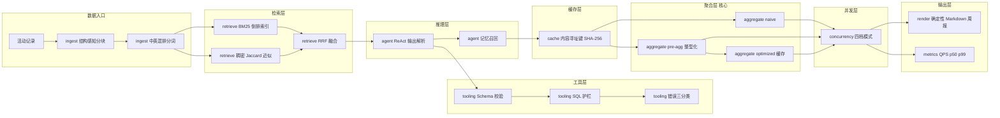
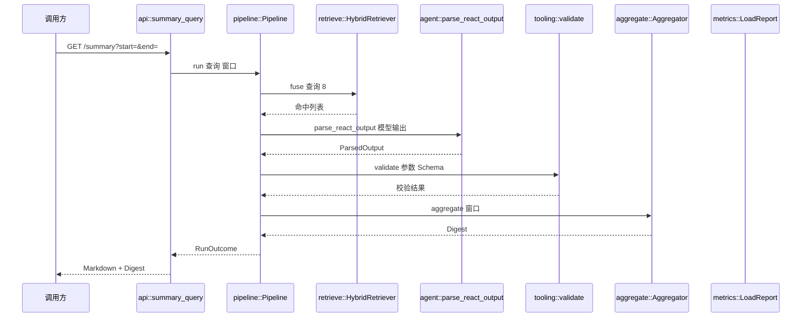
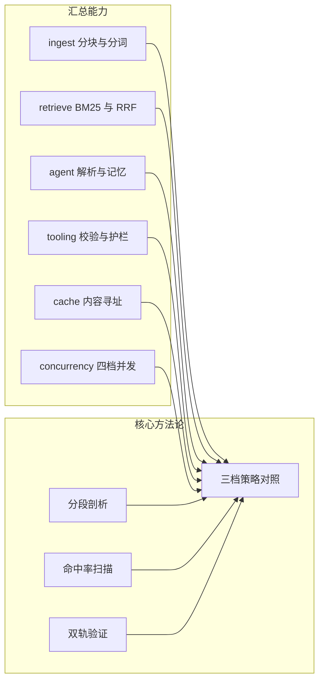

# 25-agent-summary —— Agent 全链路汇总与压测台

> **端口 3170** ｜ 环境变量前缀 `WK_` ｜ 测试 121 项（单元 109 + 集成 12），全部零网络零模型确定性

## 这个项目回答什么问题

前面 24 个项目是**逐步演进**的：

```
04 分块 → 08 混合检索 → 13 ReAct → 16 结构化工具调用 → 17 记忆
→ 18 错误处理 → 21 缓存 → 22 并发 → 23 批处理 → 24 服务端调度
```

但它们是**十一个独立的 crate**，各写各的 `main.rs`。没有任何一处能回答：

- 「**整个 Agent 系统一共有哪些零件？**」
- 「**这些零件串起来，是谁在拖后腿？**」
- 「**我优化了 X，到底快了多少？**」

**本项目就是那个「汇总处」。**

---

## ⚠️ 一个关键的设计决定：它**不依赖**其它项目

本项目**自己实现**了历史项目的核心能力，形成一个自洽的统一体。
它**不引用** `04-rag`、`08-rag`、`13-agent-core` …… 任何一个 crate。

### 为什么

| 理由 | 说明 |
|---|---|
| **它是「演进」的终点** | 不是「引用」，是「长出来」。每个模块都能独立读懂、独立运行、独立压测 |
| **压测口径可控** | 一旦依赖别人的 crate，对方改个内部实现就会让你的**基线漂移**，差值就不可归因了 |
| **零外部依赖** | 不引入 faiss / fastembed / Milvus / Redis / ONNX —— 换机器就能跑 |

### 七个模块各自汇总了什么

| 模块 | 职责 | 汇总了哪些历史能力 |
|---|---|---|
| [`ingest`](src/ingest.rs) | 数据入口 | 04 的结构感知分块、08 的中英混排分词 |
| [`retrieve`](src/retrieve.rs) | 检索 | 08 的 BM25 倒排索引 + RRF 融合 |
| [`agent`](src/agent.rs) | 推理与记忆 | 13 的 ReAct 解析 + 算术求值、17 的线程记忆 + 事实召回 |
| [`tooling`](src/tooling.rs) | 工具与护栏 | 14 的 JSON Schema 校验、15 的 SQL 词法护栏、18 的错误三分类 |
| [`cache`](src/cache.rs) | 缓存 | 21 的内容寻址缓存键 + 四参数控制 |
| [`concurrency`](src/concurrency.rs) | 并发 | 22 的四档并发模式 + 限流 |
| [`aggregate`](src/aggregate.rs) | **聚合（核心）** | **三档策略 —— 本项目最重要的产出** |

---

## ★ 核心产出：三档策略

| 变体 | 做了什么 | 验证什么 |
|---|---|---|
| `naive` | 每次全量扫描 + 每条记录的派生计算 | 基线 |
| `pre-agg` | 建索引时把派生计算**预聚合**并**整型化** | **算法收益** |
| `optimized` | `pre-agg` + 内容寻址**结果缓存** | **缓存收益** |

### 为什么是**三档**而不是两档

只比 `naive` vs `optimized`（含缓存），差距被「命中缓存直接返回」**完全主导**
—— 数字很漂亮，但**说不出是谁的功劳**。

加了中间的 `pre-agg` 档（预聚合 + 整型化但**不缓存**），
才能拆出「**算法赚了多少**」与「**缓存赚了多少**」。

### 实测（5000 条记录 / 500 次请求 / 并发 8）

```
变体       QPS       p50(ms)  p99(ms)  max(ms)  成功率
---------  --------  -------  -------  -------  ------
naive      1556.8    0.6167   4.3769   5.2098   100.0%
pre-agg    3278.4    0.3009   2.1635   2.6368   100.0%
optimized  378083.8  0.0024   0.0199   0.0369   100.0%
```

| 对照 | QPS 倍数 | p50 倍数 | p99 倍数 |
|---|---|---|---|
| `pre-agg` vs `naive` | **2.11x** | 0.488x | 0.494x |
| `optimized` vs `naive` | 242.87x | 0.004x | 0.005x |

**算法收益 2.11x，缓存收益还要再乘 115x。**

但 ⚠️ **242.87x 这个数字不能直接拿去汇报** —— 原因见下一节。

---

## ★ 四个最值得记住的结论

### ① 「减少扫描量」这个直觉优化，实测只值 **1.00x**

第一版 `optimized` 只做「按天预聚合」（**减少扫描量**），实测 **1.00x** —— 完全没有收益。

**分段剖析**（`make profile-25`）给出了答案：

```
环节                                   耗时(ms)       占比
------------------------------------------------------
按天（字符串格式化）                           12.941    57.2%
统计（BTreeMap 增量插入）                     5.567    24.6%
去重（字符串 hash）                          3.731    16.5%
过滤（全量扫描）                              0.327     1.4%
亮点（clone + 排序）                        0.048     0.2%
```

**「过滤（全量扫描）」只占 1.4%** —— 所以「减少扫描量」当然没用。
真正贵的是**每条记录的派生计算**（合计 **98.6%**）：

- 字符串 clone
- 字符串 hash（去重时）
- `day_label()` 的字符串格式化
- `BTreeMap<String>` 的增量插入（统计时）

**修法**是**把派生计算搬到建索引时并整型化**：

| 原来 | 整型化后 | 省下的 |
|---|---|---|
| `String`（模块名 / 作者 / 类型） | `u16` 下标 | 字符串 hash + 比较 |
| `BTreeMap<String>` 计数 | `Vec<u32>` 计数器数组 | 增量插入 + 树维护 |
| `day_label()` 返回 `String` | `i64`（天序号） | 字符串格式化 |

这才换来 **2.11x**。

> **教训（可推广到全仓）**：
> 「测不出差异」有两种原因 ——「**实现错了**」和「**优化点选错了**」。
> 必须靠**分段剖析**才能分清，否则会去改本来正确的代码。

---

### ② 缓存收益**完全由命中率决定** —— 而命中率是**工作负载的属性**

`optimized` 的 242.87x 看着吓人，但它是**同一个窗口请求 500 次**测出来的 ——
命中率接近 100%（warm-up 把所有键都填了）。

**真实场景里查询窗口是发散的**。所以本项目扫了「不同键的数量」：

```
$ make cache-sweep-25
1 个不同键    → 实测命中率 99.8% → 缓存档 139113 QPS vs 无缓存 3729 QPS（37.31x）
8 个不同键    → 实测命中率 98.4% → 缓存档 111268 QPS vs 无缓存 2490 QPS（44.69x）
64 个不同键   → 实测命中率 87.2% → 缓存档  17235 QPS vs 无缓存 2303 QPS（ 7.48x）
512 个不同键  → 实测命中率  0.0% → 缓存档   2296 QPS vs 无缓存 2376 QPS（ 0.97x）
5000 个不同键 → 实测命中率  0.0% → 缓存档   2323 QPS vs 无缓存 2312 QPS（ 1.00x）
```

**结论**：缓存不是「万能加速」——
它的收益**完全由键分布决定**。键分布发散的系统上，缓存带来的可能只有个位数百分比，
甚至因为缓存的**簿记开销**而略慢（0.97x）。

> ⚠️ 实验设计上有个坑：**warm-up 会把命中率拉满**。
> 所以这个扫描**故意不 warm-up 缓存档**，让第一个请求就是「冷的」，
> 命中率随键数自然变化。实测命中率是从聚合器里**读**出来的，不是估算。

---

### ③ 归因到哪一层，取决于你在**哪一层测**

同一个系统，两条轨测出来的倍数**不一样**：

| 轨 | `naive` QPS | `pre-agg` QPS | `optimized` QPS | 算法收益 |
|---|---|---|---|---|
| **进程内**（归因用） | 1556.8 | 3278.4 | 378083.8 | **2.11x** |
| **HTTP**（验证用） | 715.2 | 1065.3 | 1719.3 | **1.49x** |

**这不矛盾。** 根因是 HTTP 栈开销（**1~4ms**）比被测逻辑（**0.1ms**）大了一个数量级 ——
进程内测出的 2.11x 里，有一部分被 HTTP 的固定开销「摊平」了。

> **归因到哪一层，取决于你在哪一层测。**
>
> - **进程内轨** → 用来**归因**（差值归因到具体环节）
> - **HTTP 轨** → 用来**验证**（外部视角的真实表现）
>
> ⚠️ **这两条轨不能混着比。**

---

### ④ 排队效应需要「**有限的并发资源**」才能出现

只有「模拟服务时间」没有「worker 上限」时，
`buffer_unordered(N)` 让 N 个任务**同时**进入 sleep，谁也没排队 ——
测出来的是一条**平线**（并发 8 的 p50 ≈ 并发 1 的 p50）。

加上 `Semaphore` 模拟服务端 worker 池后（8 个 worker）：

```
并发  QPS    p50(ms)   p99(ms)   成功率
----  -----  --------  --------  --------
c1    19.2   52.0475   55.4307   100.0%
c2    38.6   52.0259   53.1112   100.0%
c4    76.8   52.0568   55.3055   100.0%
c8    153.9  52.1154   52.8277   100.0%
c16   153.7  103.7071  109.8280  100.0%
c32   153.8  208.1011  209.9649  100.0%
c64   154.1  414.3830  417.6837  100.0%
```

**读法**：

- **并发 1→8**：QPS 线性涨（19.2 → 153.9），p50 **持平**（52ms）——
  worker 没满，**没有排队**。
- **并发 8→16**：QPS **停涨**（153.9 → 153.7），p50 **翻倍**（52 → 104ms）——
  worker 满了，开始**排队**。
- **并发 32→64**：QPS 依然停涨，p50 涨到 **414ms**（**8 倍**）。

> ★ **QPS 不再涨但 p50 暴涨** —— 这正是限流决策的依据。
> 盲目加并发只会让**每一个请求都变慢**，而吞吐一点不涨。

回归测试 `without_worker_limit_there_is_no_queueing` 锁住了「没有 worker 上限就没有排队」这个前提。

---

## 架构全景



---

## 一次完整运行的流程（函数级）



★ 标出容易写错的位置（详见各模块文档注释）：

| 位置 | 坑 | 修法 |
|---|---|---|
| `agent.rs:parse_react_output` | 找**第一个** `Action:` 会匹配到模型回显的旧动作 | 用 `rfind` 找**最后一个** |
| `agent.rs:take_identifier` | `Action:Thought:Thought:` 解析出工具名 `Thought:Thought` | 取开头连续的标识符 |
| `agent.rs:parse_action_input` | 「第一个 `{` 到最后一个 `}`」会抓到 `{周报}` | 逐字符扫配对括号 + 试 `from_str` |
| `tooling.rs:check_sql` | `contains("DROP")` 误伤字符串里的 `DROP TABLE` | 真词法分析，黑名单只匹配**裸词** |
| `tooling.rs:check_sql` | 简单数 `SELECT` 会把 CTE 误判成多语句 | 按括号深度 + `WITH` 允许两个 |
| `aggregate.rs:aggregate_preaggregated` | 回查原始记录要再扫一遍（O(n)） | 用 `source_idx` **直接回查** |
| `concurrency.rs:run` | `buffer_unordered(0)` 让请求**永远挂住** | clamp 到 ≥ 1 |
| `loadtest.rs:run_inprocess` | 计时从抢 permit **之后**开始 → 漏掉排队时间 | 计时从**抢之前**开始 |

---

## 快速开始

### 你在哪个目录

⚠️ 本仓库的 Makefile 目标用 `-C` 进子目录，**`-C` 是相对路径**。
如果你**已经在** `25-agent-summary/` 里，就**直接** `make bench-25`，
**不要**再写 `-C 25-agent-summary`（会拼成不存在的路径）。

```bash
# 从仓库根目录
make bench-25          # 三档对照（进程内轨）
make profile-25        # 分段剖析
make cache-sweep-25    # 缓存命中率扫描
make sweep-25          # 并发度扫描
make serve-25          # 起服务（:3170）

# 已经在 25-agent-summary/ 目录里
make bench
make profile
make cache-sweep
```

### 直接跑二进制

```bash
cargo build --release -p agent-25

./target/release/agent-25 help
./target/release/agent-25 bench
./target/release/agent-25 profile
./target/release/agent-25 cache-sweep
./target/release/agent-25 sweep
./target/release/agent-25 report
```

⚠️ **必须用 `--release`** —— debug 构建慢到淹没优化前后的差值。

### HTTP 接口

```bash
make serve-25   # 另开一个终端

curl "http://127.0.0.1:3170/health"
curl "http://127.0.0.1:3170/modules"
curl "http://127.0.0.1:3170/summary?start=1700000000&end=1700604800"
curl -X POST http://127.0.0.1:3170/search \
  -H 'content-type: application/json' -d '{"query":"cache","limit":5}'
curl -X POST http://127.0.0.1:3170/strategy \
  -H 'content-type: application/json' -d '{"strategy":"naive"}'
```

### 环境变量（前缀 `WK_`）

| 变量 | 默认 | 说明 |
|---|---|---|
| `WK_PORT` | 3170 | 监听端口 |
| `WK_ACTIVITIES` | 5000 | 活动记录数 |
| `WK_REQUESTS` | 500 | 压测请求数（P99 需要足够样本） |
| `WK_CONCURRENCY` | 16 | 压测并发度 |
| `WK_SERVICE_TIME_MS` | 0 | 模拟的服务端时间 |
| `WK_SERVER_WORKERS` | 8 | 服务端 worker 数（**排队效应的关键**） |
| `WK_STRATEGY` | optimized | 默认策略 |
| `WK_TARGET_URL` | `http://127.0.0.1:<port>` | `bench-http` 的目标 |

---

## 知识地图



---

## 技术参考速查

| 主题 | 本项目的做法 | 关键约束 |
|---|---|---|
| **分词** | CJK 同时产出 unigram + bigram | 只切连续字符会让整句变成一个 token，检索命中数 = 0 |
| **检索融合** | RRF，`k = 60` | 排名必须是**路内**排名，否则退化成「第一路说了算」 |
| **ReAct 解析** | `rfind` 找最后一个标记 | 找第一个会匹配到模型回显的旧动作 |
| **Schema 校验** | 一次性报全所有问题 | 逐个报错会让模型来回试，烧掉 8 次工具调用 |
| **SQL 护栏** | 真词法分析 + 裸词黑名单 | `contains` 会误伤字符串里的关键字；误伤优先于漏放 |
| **错误分类** | Transient / Business / Fatal | 只有 Transient 重试；Fatal 不能降级（否则模型编答案） |
| **缓存键** | 结构化 → 规范化 JSON → SHA-256 | 不能用 `DefaultHasher`（跨进程不稳定）；不能用字符串拼接 |
| **缓存收益** | 由**命中率**决定 | warm-up 会把命中率拉满，扫不出真实关系 |
| **并发** | `buffer_unordered(n)` + `Semaphore` | `n = 0` 会永远挂住；没有 worker 上限就没有排队 |
| **度量** | 最近秩法算 P99 | 插值会产出「样本里根本不存在的值」 |
| **表格对齐** | 按**显示宽度**补空格 | 汉字占 2 列，`format!("{:<15}")` 会让中英混排越往右越歪 |
| **成文** | 确定性规则，不用 LLM | LLM 的 token 数 / 上游负载会淹没优化前后的差值 |

---

## 硬约定

### 日志（三条）

1. **4xx 用 `warn!`、5xx 用 `error!`** —— 告警不能被 4xx 淹没
2. **降级必须打 `warn!`** —— 静默降级等于埋雷
3. **业务逻辑里不打 `println!`** —— 没法按模块关掉

### 状态码

| 类别 | 状态码 | 为什么 |
|---|---|---|
| Business（参数错） | **400** | 调用方的问题 |
| Transient（上游超时） | **503** | 503 的语义是「稍后重试可能成功」；500 会让调用方以为重试没用 |
| Fatal（鉴权/内部缺陷） | **500** | 服务端的问题 |
| 模型调用失败 | **502** | 「没有模型就没有答案」 |

### 其它

- `AppError` **自己实现 `IntoResponse`** —— 写成 `Result<_, Response>` 会让 Err 变体至少 128 字节，触发 clippy `result_large_err`
- 集成测试用 `tower::ServiceExt::oneshot` **直接调路由** —— 不开端口，零时序问题
- `clippy -D warnings` **零警告**是门槛

---

## 踩坑记录

### ① 「优化后反而更慢」—— 指纹每次重算

第一版 `optimized` 的 QPS 只有 **111**，比 `naive` 的 **597** 还慢。

**根因**：缓存键要用数据集指纹（SHA-256 over 全部记录），而我**每次调用都重算** ——
指纹本身就是 O(n)，**优化档反而成了瓶颈**。

**修法**：数据集是**不可变**的，指纹在构造时算一次。

> **可推广**：缓存键的**构造成本**必须算进预算。
> 一个「O(1) 查找」的设计，如果键本身是 O(n)，总体还是 O(n)。

### ② `day_key` 用字符串格式化 —— 占了一半的时间

按天分组时用了 `chrono` 的 `format!("%Y-%m-%d")`，实测占 **57.2%**。

**修法**：用 Howard Hinnant 的**纯整数算法**（`ts.div_euclid(86400)`），只有**展示时**才格式化。

### ③ 标题栈的层级语义写错了

`heading_stack.truncate(level-1) + push` 的写法，遇到 `###` 时会把 `##` 的标题挤掉 ——
标题路径变成「`###` 的标题挂在 `##` 的标题下面」这种错误嵌套。

**修法**：标题栈**按层级索引**（`stack[level-1]` 就是该层的标题）。

### ④ 检索文本不含模块名 —— 命中数为 0

分块后的 `Chunk.text` 是**正文**（`- 类型：feature`），模块名在**标题**里。
我用 `text` 建索引 → 搜「cache」一个字都搜不到（命中数 = 0）。

**修法**：检索文本 = **标题路径 + 正文**。

> ⚠️ 这和 12-rag-summary 的教训是同一类：
> **「块正文」和「嵌入文本」是两个不同的东西**，
> 哪个用于哪个环节，必须想清楚。

### ⑤ 两档结果不一致 —— 「先取再排序」vs「先排序再取」

`naive` 档写的是「先 `take(5)` 再排序」，`pre-agg` 档写的是「先排序再 `take(5)`」。
两者选出的**不是同一个集合** —— 前者是「前 5 条里权重最高的」，后者是「权重最高的 5 条」。

**修法**：两档统一成「先排序再取」。由 `naive_and_preagg_produce_identical_digests` 锁住。

> ★ **这是三档对照实验的**前提条件**：
> 两档必须产出**完全一致**的结果，否则测的是「不同的功能」而不是「优化」。

---

## 测试

```bash
make test-25     # 121 项，全部零网络零模型确定性
```

| 类别 | 数量 | 代表性测试 |
|---|---|---|
| 单元测试 | 109 | `naive_and_preagg_produce_identical_digests`、`bounded_zero_does_not_hang`、`without_worker_limit_there_is_no_queueing`、`guard_ignores_keywords_inside_strings` |
| 集成测试 | 12 | API 层的 400/404/405 状态码、`summary` 返回 Markdown |

**全部确定性**：不连网、不下模型、不睡真实时间（用 `tokio::time::pause` 语义等价物）。

---

## 与其它项目的关系

| 项目 | 25 汇总了它的什么 | 25 做了什么新的 |
|---|---|---|
| 04-rag | 结构感知分块、Token 计数 | 整型化预聚合 |
| 08-rag | BM25、RRF、中英分词 | 与分块耦合的检索文本 |
| 13-agent-core | ReAct 解析、算术求值 | — |
| 14-agent-tool | Schema 校验、工具失败降级 | — |
| 15-agent-sql | SQL 词法护栏 | — |
| 16/17/18 | 工具调用、记忆、错误分类 | 统一到一个流水线里 |
| 21-agent-cache | 内容寻址键、缓存控制 | **命中率扫描**（新） |
| 22-agent-async | 四档并发、限流 | **与排队效应结合**（新） |
| 23/24 | 批处理、服务端调度 | 未纳入（不在本项目范围） |

---

## 目录结构

```
25-agent-summary/
├── Cargo.toml              # 依赖版本在根 workspace 管理
├── Makefile                # help/build/test/lint/fmt/clean + 6 个专属目标
├── examples/
│   └── profile_segments.rs # ★ 分段剖析示例
├── src/
│   ├── lib.rs              # 模块索引 + 四个核心结论
│   ├── main.rs             # 7 个子命令
│   ├── model.rs            # 活动记录 / 窗口 / Digest
│   ├── ingest.rs           # 数据入口：分块 + 分词
│   ├── retrieve.rs         # 检索：BM25 + RRF
│   ├── agent.rs            # 推理：ReAct 解析 + 算术 + 记忆
│   ├── tooling.rs          # 工具：Schema + 护栏 + 错误分类
│   ├── cache.rs            # 缓存：内容寻址键
│   ├── concurrency.rs      # 并发：四档模式
│   ├── aggregate.rs        # ★ 核心：三档策略
│   ├── pipeline.rs         # 流水线：把七个子系统串起来
│   ├── loadtest.rs         # 压测：进程内轨 + HTTP 轨
│   ├── metrics.rs          # 度量：QPS / p50 / p99（最近秩法）
│   ├── bench.rs            # 对照实验：剖析 + 三档 + 命中率扫描
│   ├── render.rs           # 渲染：确定性 Markdown
│   ├── table.rs            # 终端表格（按显示宽度对齐）
│   ├── api.rs              # HTTP 路由与处理器
│   ├── error.rs            # 统一错误与状态码映射
│   └── config.rs           # 环境变量配置
└── tests/
    └── api.rs              # API 集成测试（oneshot，不开端口）
```
