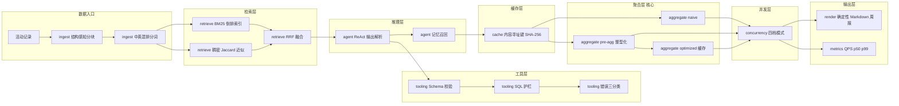
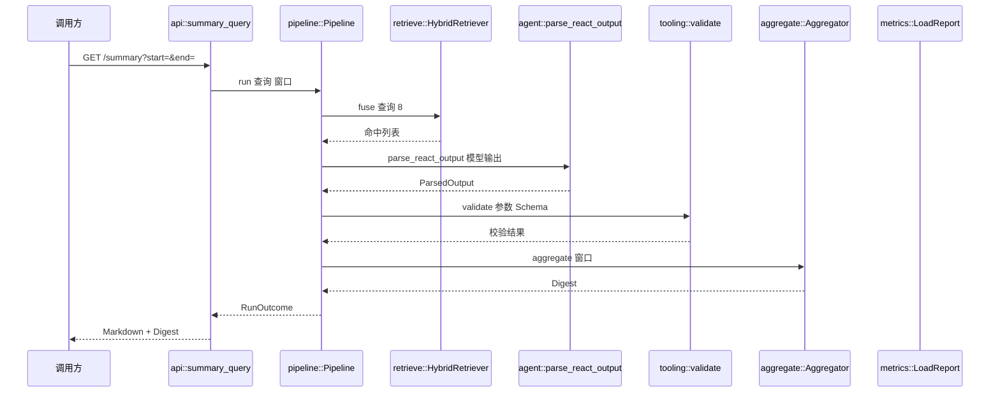
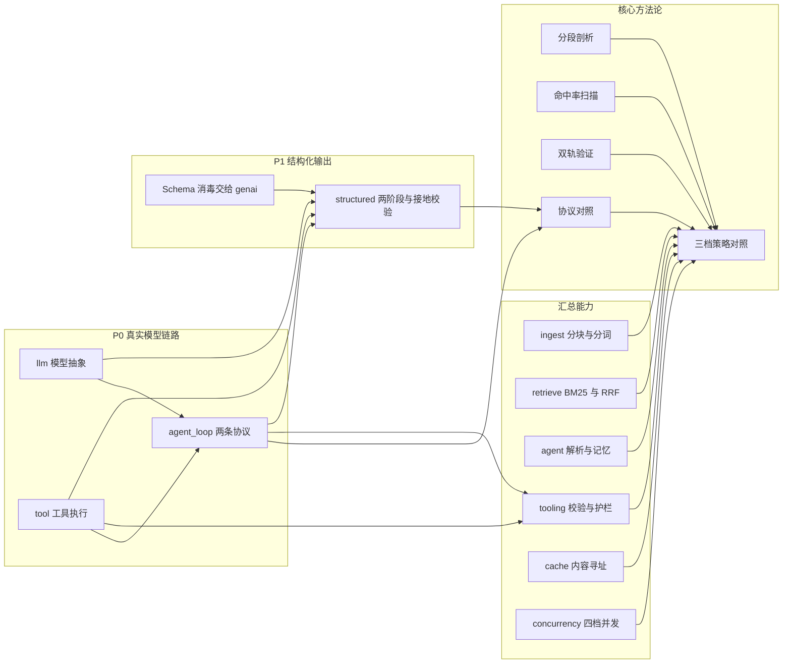

# 25-agent-summary —— Agent 全链路汇总与压测台

> **端口 3170** ｜ 环境变量前缀 `WK_` ｜ 测试 **213 项**（单元 190 + 集成 23），全部零网络零模型确定性
> ｜ **P0 已接入真实 LLM**（`DEEPSEEK_API_KEY`）—— Agent 循环、工具执行、协议对照
> ｜ **P1 已接入 `genai-agentprism` 的结构化输出 / Schema 消毒 / token 计量 / 截断检测**

## 这个项目回答什么问题

前面 24 个项目是**逐步演进**的：

```
04 分块 → 08 混合检索 → 13 ReAct → 16 结构化工具调用 → 17 记忆
→ 18 错误处理 → 21 缓存 → 22 并发 → 23 批处理 → 24 服务端调度
```

但它们是**十一个独立的 crate**，各写各的 `main.rs`。没有任何一处能回答：

- 「**整个 Agent 系统一共有哪些零件？**」
- 「**这些零件串起来，是谁在拖后腿？**」
- 「**我优化了 X，到底快了多少？**」

**本项目就是那个「汇总处」。**

---

## ★ P0：把「拼出来的假模型输出」换成「真调模型」

### 之前的缺口

P0 之前，25 的 `Pipeline::run` 里的「模型输出」是**代码拼出来的字符串**：

```ignore
let raw = format!(
    "Thought: 我需要查资料并汇总\nAction: module_stats\nAction Input: {{\"scope\": \"{query}\"}}"
);
```

后果是：

| 缺口 | 后果 |
|---|---|
| **没有 Agent 循环** | 零件串起来对不对**没有证据** |
| **工具从不执行** | `check_tool_call` 只把 SQL 拼出来扔给护栏检查，**从不跑** —— 「护栏保护了什么」没有可执行证据 |
| **解析器没被真模型验证过** | `parse_react_output` 解析的是**自己写的字符串**，而模型输出恰恰是最不可控的部分 |

### P0 补上了什么

| 新增 | 位置 | 说明 |
|---|---|---|
| **LLM 抽象层** | [`llm.rs`](src/llm.rs) | `Llm`（文本协议）/ `FunctionLlm`（结构化协议）+ 真实实现 + 测试替身 |
| **工具层** | [`tool.rs`](src/tool.rs) | `Tool` trait + `ToolRegistry` + **四个真的能执行的工具** |
| **Agent 循环** | [`agent_loop.rs`](src/agent_loop.rs) | 两条协议各一套循环，共用同一个工具注册表 |
| **HTTP 端点** | [`api.rs`](src/api.rs) | `/agent`、`/tools`、`/tools/call` |
| **CLI 子命令** | [`main.rs`](src/main.rs) | `agent`（真调模型）、`compare`（协议对照） |

### 四个工具（**只有四个**）

工具多了会让模型**凑数调用**（16 实测 7 次调用里 5 次是硬凑的），
所以四个正好覆盖四类语义：

| 工具 | 用途 | 走哪条路 |
|---|---|---|
| `module_stats` | 按模块统计 | **聚合**（三档策略） |
| `search_activities` | 开放式检索 | **混合检索**（BM25 + RRF） |
| `query_stats` | 条件查询 | **SQL 护栏** |
| `calculate` | 算术 | **纯计算** |

### 两条协议并行

| 维度 | ReAct 文本协议 | Function Calling 结构化协议 |
|---|---|---|
| 工具定义 | 拼进提示词文本 | 放进 API 的 `tools` 字段 |
| 模型输出 | 纯文本，要**正则解析** | 结构化 JSON，**不用解析** |
| 回执 | 拼成 `Observation:` 文本 | 一条 `role="tool"` 的消息 |
| 并行调用 | 不支持 | 支持 |

**两条路跑同一个工具注册表** —— 这样才能做**协议对照实验**：
同样的问题、同样的工具、同一个模型，只换协议，差值归因到协议本身。

```bash
make compare   # 需要 DEEPSEEK_API_KEY
```

---

## ★★ P1：接入 `genai-agentprism` 的六项能力

P1 对齐 [docs.rs/crates/genai-agentprism/0.7.0-beta.19.1-agentprism](https://docs.rs/crate/genai-agentprism/0.7.0-beta.19.1-agentprism)，
把「工具调用」与「结构化输出」这两块补齐。

### 六项能力与本项目的落点

| 能力 | genai API | 本项目落点 | 解决的问题 |
|---|---|---|---|
| **Schema 消毒** | `chat::sanitize_json_schema(schema, dialect)` | [`tool.rs`](src/tool.rs) `ToolSpec::to_genai_tool` | 手写版**只改根层**，嵌套对象漏了 |
| **结构化输出** | `ChatResponseFormat::JsonSpec` / `JsonMode` | [`structured.rs`](src/structured.rs) | 结论从「一段文本」变成「可校验的 JSON」 |
| **token 计量** | `ChatResponse.usage` | [`llm.rs`](src/llm.rs) `LlmUsage` | 耗时**不是好度量** —— token 才是 |
| **截断检测** | `StopReason::is_max_tokens()` | `LlmReply.truncated` / `AgentRun.truncated` | 截断的答案**看起来是完整的** |
| **思考内容回传** | `ContentPart::ReasoningContent` | [`agent_loop.rs`](src/agent_loop.rs) `build_assistant_message` | 少回传一条 → **整个请求 400** |
| **提示词缓存键** | `ChatOptions::with_prompt_cache_key` | `LlmOptions::prompt_cache_key` | Agent 循环的**稳定前缀**无法命中 provider 缓存 |

### ★ ① Schema 消毒：手写版最大的缺陷是「只改根层」

**第一版** `tool.rs` 自己实现 `strict_schema`，只做两件事：
根对象加 `additionalProperties: false`、根对象 `required` 补齐。

⚠️ **嵌套对象完全没处理** —— 而 OpenAI 的 strict 方言要求**每一层**都满足。
手写版的实测后果是：模型传了带嵌套结构的参数时，
provider 侧的 constrained decoding 直接拒绝。

**修法**：**不自己改写**，把 Schema 原样交给 genai，由适配器按 provider 方言改写：

```rust
// tool.rs —— 只透传，消毒由适配器做
genai::chat::Tool::new(self.name.clone())
    .with_description(self.description.clone())
    .with_schema(self.schema.clone())
    .with_strict(self.strict)
```

genai 内部按方言处理：

| 方言 | 处理 |
|---|---|
| `OpenAiStrictTool` | 所有 `properties` 进 `required`、**递归**补 `additionalProperties: false`、内联 `$ref` |
| `OpenAiStrict` | 同上但不内联根 `$ref`（结构化输出用） |
| `AnthropicStructured` | 只补 `additionalProperties: false`（不强制全必填） |

> **可推广**：**自己改写 Schema = 与 provider 的校验规则漂移**。
> provider 升级规则后，本地手写版就过时了 ——
> 而这类 bug 的症状是「provider 报了一个看不懂的 400」。

回归测试 `genai_sanitizer_recurses_into_nested_objects` 锁住「递归」这一点。

### ★ ② 结构化输出：provider 能力**分层**，不是一刀切

`genai` 的 `ChatResponseFormat` 有两档：

| 档位 | 含义 | 支持的 provider |
|---|---|---|
| `JsonSpec` | **强制**符合给定 Schema | OpenAI / Anthropic / Gemini |
| `JsonMode` | 只保证「输出是 JSON」 | DeepSeek（**不支持** `json_schema`） |

⚠️ **无条件传 `JsonSpec` 是错的** —— DeepSeek 侧拿到
`response_format: {"type": "json_schema"}` 会不认，
可能直接报错，也可能**静默忽略**（那就等于没约束）。

所以 [`llm.rs`](src/llm.rs) `GenaiStructuredLlm` **显式分层**：

```rust
let response_format = if self.model.contains("deepseek") {
    ChatResponseFormat::JsonMode          // DeepSeek：只保证是 JSON
} else {
    ChatResponseFormat::JsonSpec(spec)    // 其余：强制符合 Schema
};
```

### ★ ③ 两阶段「研究 → 成文」

**一个提示词里同时要「查资料」和「写报告」时，模型会**先写**
（写作的 token 收益更高）然后**编引用编号**。

所以 [`structured.rs`](src/structured.rs) 拆成两阶段：

| 阶段 | 挂工具 | 输入 | 输出 |
|---|---|---|---|
| **A 研究** | ✅ | 问题 | 工具观察（证据） |
| **B 成文** | ❌ | **只有证据** | 符合 Schema 的 JSON |

⚠️ 成文阶段**带工具** → 模型又想调 → 回到阶段 A。

### ★ ④ 接地校验：把「数字必须来自工具结果」从软约束变成**机制**

25 的硬约束写着「数字必须来自工具结果，**不要心算**」——
但那只是**提示词里的软约束**，模型可以不听。

15-agent-sql 实测过这个坑：模型**不查库就作答**，
数字是编的，而且「答案看起来很专业但数字是编的」**极难从答案本身发现**。

所以成文阶段要求模型额外输出**数字断言清单**，
然后**本地核对**每个数字是否能在证据里找到：

```json
{"answer": "cache 模块共 12 条",
 "numbers": [{"value": "12", "context": "活动条数"}]}
```

三条硬约定：

1. **本地 Schema 校验是必需品** —— `json_mode` 只保证「是 JSON」，**不保证符合 Schema**
2. **接地校验的默认是「不通过」** —— 「默认接地」是最危险的默认值
3. **数字按**数值**比，不是按字符串比** —— `10` vs `10.0` vs `1,000`

### ★ ⑤ token 用量：比耗时更稳定的归因依据

⚠️ **耗时不是一个好度量** —— 它受上游负载、网络抖动影响，
同一次实验前后差 200ms 就可能让结论翻转。

token 数是**确定性**的：同样的输入必然产生同样的 prompt token。

现在 `AgentRun` 带 `usage` 字段，协议对照表里多了三行：

```
指标          ReAct      Function Calling   结构化输出
输入 token    1234       1180               2410
输出 token    210        180                260
总 token      1444       1360               2670
```

### ★ ⑥ 截断检测：被截断的答案**看起来是完整的**

`max_tokens` 截断的答案**有头有尾**，只是少了尾巴。
不检查的话，就会把「半截结论」当成正常答案返回，
而且**症状极隐蔽**：数字少了，但读起来完全通顺。

`LlmReply.truncated` / `AgentRun.truncated` 把它变成**显式字段**，
终端也会打 `⚠️ 输出被 max_tokens 截断`。

### ★ ⑦ 思考内容必须回传 —— 少一条就是 400

推理模型（DeepSeek / Kimi）**要求**把上一轮的思考内容原样回传：

```text
The reasoning_content in the assistant message must be passed back to the API
```

⚠️ **P0 的实现把它丢了** —— 一旦有人把 `disable_reasoning` 打开，整个链路直接 400。

**修法**：`build_assistant_message` 把 `reasoning_content` 作为
`ContentPart::ReasoningContent` 放进 assistant 消息，
且**顺序在工具调用之前**（genai 的 OpenAI 适配器会把它提升成
请求体里的 `reasoning_content` 兄弟字段）。

回归测试 `assistant_message_carries_the_reasoning_content` 锁住顺序。

### ★ ⑧ `tool_choice = none` 必须「不传 tools」

16-agent-function-calling 实测：传了 `tool_choice: "none"` 但仍把工具列表传过去，
模型会用**文本**模拟调用：

```text
<toolcall>{"name":"get_weather"}</toolcall>
```

根因是**训练数据里见过海量这种格式** —— 提示词里出现工具名它就会模仿。

所以「真正禁止用工具」= **把 `tools` 字段整个去掉**，
**且**提示词里不出现工具名。P1 两处都改了：

- [`llm.rs`](src/llm.rs) `GenaiFunctionLlm`：`None` 档**不传** `tools`
- [`agent_loop.rs`](src/agent_loop.rs) `function_system_prompt`：`None` 档**不列**工具名

### ★ ⑨ `protocol` 字段原来是个**摆设**

P0 的 `/agent` 端点**无视** `req.protocol`，无条件跑 `FunctionAgent`。
写 `protocol: "react"` 也跑 function。

⚠️ 这会让**协议对照实验彻底作废** —— 两次请求走的是**同一条**链路，
差值恒等于 0，但结论会写成「文本协议 vs 结构化协议没有差别」。

P1 改成**真正分流**（`function` / `react` / `structured`），
未知协议名返回 **400**（不能默默跑默认协议）。

---

## ★★★ P1 实测踩出来的三个真 bug

### ① `hit_max_steps` 被写死成 `false`

`FunctionAgent` 的降级分支里，`hit_max_steps` 写的是 `false`
（`ReactAgent` 的同一位置是对的 `true`）。

**症状**：明明降级返回了，响应里却说「没到步数上限」，
调用方会以为这是一个**正常答案**。

**回归测试**：`function_calling_degrades_when_max_steps_is_hit`。

### ② 提前检查 LLM 可用性，让「只配了 react LLM」的部署永远 503

P1 加了三条协议，`/agent` 的门禁却还是提前检查 `state.llm`：

```rust
// 错：不管什么协议，都先要 function LLM
let Some(llm) = state.llm.clone() else { return Err(...503) };
```

**症状**：`protocol=react` 的部署（只配了 `react_llm`）永远 503 ——
而它本来是能跑的。

**修法**：把可用性检查**下沉到各协议分支**。

### ③ `Arc<&dyn FunctionLlm>` 不是 `Arc<dyn FunctionLlm>`

`run_structured` 需要把研究阶段的 LLM 交给 `FunctionAgent`，
而后者要的是 `Arc<dyn FunctionLlm>`（`'static`）。

第一版写了个 `ResearchLlm<'a>(&'a dyn FunctionLlm)` 薄壳 ——
`Arc::new(ResearchLlm(research_llm))` 因此编译不过：

```text
error: lifetime may not live long enough
coercion requires that `'1` must outlive `'static`
```

⚠️ **debug 构建能过、release 构建挂** —— release 的泛型单态化会额外检查 `'static`。

**修法**：让薄壳**拥有** `Arc` 而不是借用它。

---

## ★★ P0 实测踩出来的四个真 bug —— 全部来自真实模型

这是 P0 最大的产出。

**假模型（`ScriptedLlm`）永远踩不出这些坑** —— 因为它们只在真实模型输出下才暴露。

### ① 「假装成功」比「明确报错」危险得多 ★★★

**第一版**的 SQL 解释器只提取 `scope = '...'` 和 `author = '...'`，遇到
`GROUP BY` / `COUNT(*)` 就**默默忽略**，返回一份原始行列表 ——
**看起来完全成功**。

真实模型（DeepSeek）的实际行为：

```text
第 2 步：query_stats → 「查询命中 834 条记录。」
第 3 步：query_stats → 「查询命中 834 条记录。」
第 4 步：query_stats → 「查询命中 834 条记录。」
```

模型连试三种聚合 SQL，拿到的是**同一份 834 行原始数据**。
它最后在答案里写：

> 「`query_stats` 工具没有按我的 SQL 执行」

⚠️ **模型比人更早察觉工具在骗它** —— 但代价是
**3 次无效工具调用 + 一整轮拉锯战**。

**修法**：不支持的构造 → **明确报错 + 告诉它该用哪个工具**。

> **教训**：「假装成功」时模型会**拿着错的数据继续推理**，
> 而且**无法区分**「数据就是这样」和「工具没执行我的查询」。
> 报错时模型会立刻换写法。

### ② 同一个漏洞的三个实例

修完 ① 之后，**同类 bug 立刻又出现两次**：

| 实例 | 模型写的 | 静默忽略后的结果 |
|---|---|---|
| ① | `GROUP BY scope` | 返回原始行列表 |
| ② | `WHERE risk = 1` | 返回**全部** 239 条 |
| ③ | `WHERE ts > 1700000000` | 返回**全部** 239 条 |

② 和 ③ 是**同一个病**：`risk = 1` 的条件没被识别 → 被忽略 →
返回全部数据。模型在答案里写道：

> 「我传 `risk = 1` 的查询返回了全部 239 条，说明该字段的过滤没有生效」

⚠️ 实例 ③ 暴露了一个更深的坑：**按「条件个数」做判定也会漏** ——
`ts > 1700000000` 用的是 `>` 不是 `=`，压根没被数到，
于是「0 个条件 == 0 个已识别」直接放行。

**最终修法**：**列白名单**（`scope` / `author` / `risk`）。
扫出 `WHERE` 之后的所有列名，与白名单比对 —— 与用什么运算符**无关**，漏不掉。

### ③ 同一份数据两个口径

第一版 `query_stats` **不按时间窗口过滤**，导致：

| 工具 | 返回 |
|---|---|
| `module_stats` | 239 条（窗口内） |
| `query_stats` | 834 条（全量） |

模型两边对比就发现「对不上」，白白多花工具调用去调和。

**修法**：两个工具**共用同一个窗口**，并把时间范围**写进观察文本**
（否则模型只能猜「上周」是哪天到哪天）。

### ④ 中文按字节切片 → panic

```text
panicked at 'end byte index 100 is not a char boundary;
it is inside '—' (bytes 98..101 of string)'
```

`&line[..100]` 是**字节**切片，中文一个字符 3 字节，切在中间直接 panic。
**在中文场景下必然触发** —— 因为观察文本全是中文。

**修法**：按**字符**边界截断。

### 修复前后的可复现差值

同一问题、同一模型、同一工具集：

| 指标 | 修复前 | 修复后 |
|---|---|---|
| 步数 | 6 | **4** |
| 工具调用次数 | 6 | **4** |
| 耗时 | 9114 ms | **7242 ms** |
| 拉锯战 | 有（连续 3 次同样的失败查询） | 无 |

```bash
make agent   # 需要 DEEPSEEK_API_KEY
```

---

## ⚠️ 一个关键的设计决定：它**不依赖**其它项目

本项目**自己实现**了历史项目的核心能力，形成一个自洽的统一体。
它**不引用** `04-rag`、`08-rag`、`13-agent-core` …… 任何一个 crate。

### 为什么

| 理由 | 说明 |
|---|---|
| **它是「演进」的终点** | 不是「引用」，是「长出来」。每个模块都能独立读懂、独立运行、独立压测 |
| **压测口径可控** | 一旦依赖别人的 crate，对方改个内部实现就会让你的**基线漂移**，差值就不可归因了 |
| **零外部依赖** | 不引入 faiss / fastembed / Milvus / Redis / ONNX —— 换机器就能跑 |

### 七个模块各自汇总了什么

| 模块 | 职责 | 汇总了哪些历史能力 |
|---|---|---|
| [`ingest`](src/ingest.rs) | 数据入口 | 04 的结构感知分块、08 的中英混排分词 |
| [`retrieve`](src/retrieve.rs) | 检索 | 08 的 BM25 倒排索引 + RRF 融合 |
| [`agent`](src/agent.rs) | 推理与记忆 | 13 的 ReAct 解析 + 算术求值、17 的线程记忆 + 事实召回 |
| [`llm`](src/llm.rs) | **模型调用（P0）** | 07 的 `Llm` trait、16 的 `FunctionLlm` + 工具选择策略 |
| [`tool`](src/tool.rs) | **工具执行（P0）** | 14 的 `Tool` trait + 注册表、16 的 `ToolSpec` + Schema 校验 |
| [`agent_loop`](src/agent_loop.rs) | **Agent 循环（P0）** | 13 的 ReAct 循环、16 的 Function Calling 循环、18 的重试语义 |
| [`tooling`](src/tooling.rs) | 工具与护栏 | 14 的 JSON Schema 校验、15 的 SQL 词法护栏、18 的错误三分类 |
| [`cache`](src/cache.rs) | 缓存 | 21 的内容寻址缓存键 + 四参数控制 |
| [`concurrency`](src/concurrency.rs) | 并发 | 22 的四档并发模式 + 限流 |
| [`aggregate`](src/aggregate.rs) | **聚合（核心）** | **三档策略 —— 本项目最重要的产出** |

---

## ★ 核心产出：三档策略

| 变体 | 做了什么 | 验证什么 |
|---|---|---|
| `naive` | 每次全量扫描 + 每条记录的派生计算 | 基线 |
| `pre-agg` | 建索引时把派生计算**预聚合**并**整型化** | **算法收益** |
| `optimized` | `pre-agg` + 内容寻址**结果缓存** | **缓存收益** |

### 为什么是**三档**而不是两档

只比 `naive` vs `optimized`（含缓存），差距被「命中缓存直接返回」**完全主导**
—— 数字很漂亮，但**说不出是谁的功劳**。

加了中间的 `pre-agg` 档（预聚合 + 整型化但**不缓存**），
才能拆出「**算法赚了多少**」与「**缓存赚了多少**」。

### 实测（5000 条记录 / 500 次请求 / 并发 8）

```
变体       QPS       p50(ms)  p99(ms)  max(ms)  成功率
---------  --------  -------  -------  -------  ------
naive      1556.8    0.6167   4.3769   5.2098   100.0%
pre-agg    3278.4    0.3009   2.1635   2.6368   100.0%
optimized  378083.8  0.0024   0.0199   0.0369   100.0%
```

| 对照 | QPS 倍数 | p50 倍数 | p99 倍数 |
|---|---|---|---|
| `pre-agg` vs `naive` | **2.11x** | 0.488x | 0.494x |
| `optimized` vs `naive` | 242.87x | 0.004x | 0.005x |

**算法收益 2.11x，缓存收益还要再乘 115x。**

但 ⚠️ **242.87x 这个数字不能直接拿去汇报** —— 原因见下一节。

---

## ★ 四个最值得记住的结论

### ① 「减少扫描量」这个直觉优化，实测只值 **1.00x**

第一版 `optimized` 只做「按天预聚合」（**减少扫描量**），实测 **1.00x** —— 完全没有收益。

**分段剖析**（`make profile-25`）给出了答案：

```
环节                                   耗时(ms)       占比
------------------------------------------------------
按天（字符串格式化）                           12.941    57.2%
统计（BTreeMap 增量插入）                     5.567    24.6%
去重（字符串 hash）                          3.731    16.5%
过滤（全量扫描）                              0.327     1.4%
亮点（clone + 排序）                        0.048     0.2%
```

**「过滤（全量扫描）」只占 1.4%** —— 所以「减少扫描量」当然没用。
真正贵的是**每条记录的派生计算**（合计 **98.6%**）：

- 字符串 clone
- 字符串 hash（去重时）
- `day_label()` 的字符串格式化
- `BTreeMap<String>` 的增量插入（统计时）

**修法**是**把派生计算搬到建索引时并整型化**：

| 原来 | 整型化后 | 省下的 |
|---|---|---|
| `String`（模块名 / 作者 / 类型） | `u16` 下标 | 字符串 hash + 比较 |
| `BTreeMap<String>` 计数 | `Vec<u32>` 计数器数组 | 增量插入 + 树维护 |
| `day_label()` 返回 `String` | `i64`（天序号） | 字符串格式化 |

这才换来 **2.11x**。

> **教训（可推广到全仓）**：
> 「测不出差异」有两种原因 ——「**实现错了**」和「**优化点选错了**」。
> 必须靠**分段剖析**才能分清，否则会去改本来正确的代码。

---

### ② 缓存收益**完全由命中率决定** —— 而命中率是**工作负载的属性**

`optimized` 的 242.87x 看着吓人，但它是**同一个窗口请求 500 次**测出来的 ——
命中率接近 100%（warm-up 把所有键都填了）。

**真实场景里查询窗口是发散的**。所以本项目扫了「不同键的数量」：

```
$ make cache-sweep-25
1 个不同键    → 实测命中率 99.8% → 缓存档 139113 QPS vs 无缓存 3729 QPS（37.31x）
8 个不同键    → 实测命中率 98.4% → 缓存档 111268 QPS vs 无缓存 2490 QPS（44.69x）
64 个不同键   → 实测命中率 87.2% → 缓存档  17235 QPS vs 无缓存 2303 QPS（ 7.48x）
512 个不同键  → 实测命中率  0.0% → 缓存档   2296 QPS vs 无缓存 2376 QPS（ 0.97x）
5000 个不同键 → 实测命中率  0.0% → 缓存档   2323 QPS vs 无缓存 2312 QPS（ 1.00x）
```

**结论**：缓存不是「万能加速」——
它的收益**完全由键分布决定**。键分布发散的系统上，缓存带来的可能只有个位数百分比，
甚至因为缓存的**簿记开销**而略慢（0.97x）。

> ⚠️ 实验设计上有个坑：**warm-up 会把命中率拉满**。
> 所以这个扫描**故意不 warm-up 缓存档**，让第一个请求就是「冷的」，
> 命中率随键数自然变化。实测命中率是从聚合器里**读**出来的，不是估算。

---

### ③ 归因到哪一层，取决于你在**哪一层测**

同一个系统，两条轨测出来的倍数**不一样**：

| 轨 | `naive` QPS | `pre-agg` QPS | `optimized` QPS | 算法收益 |
|---|---|---|---|---|
| **进程内**（归因用） | 1556.8 | 3278.4 | 378083.8 | **2.11x** |
| **HTTP**（验证用） | 715.2 | 1065.3 | 1719.3 | **1.49x** |

**这不矛盾。** 根因是 HTTP 栈开销（**1~4ms**）比被测逻辑（**0.1ms**）大了一个数量级 ——
进程内测出的 2.11x 里，有一部分被 HTTP 的固定开销「摊平」了。

> **归因到哪一层，取决于你在哪一层测。**
>
> - **进程内轨** → 用来**归因**（差值归因到具体环节）
> - **HTTP 轨** → 用来**验证**（外部视角的真实表现）
>
> ⚠️ **这两条轨不能混着比。**

---

### ④ 排队效应需要「**有限的并发资源**」才能出现

只有「模拟服务时间」没有「worker 上限」时，
`buffer_unordered(N)` 让 N 个任务**同时**进入 sleep，谁也没排队 ——
测出来的是一条**平线**（并发 8 的 p50 ≈ 并发 1 的 p50）。

加上 `Semaphore` 模拟服务端 worker 池后（8 个 worker）：

```
并发  QPS    p50(ms)   p99(ms)   成功率
----  -----  --------  --------  --------
c1    19.2   52.0475   55.4307   100.0%
c2    38.6   52.0259   53.1112   100.0%
c4    76.8   52.0568   55.3055   100.0%
c8    153.9  52.1154   52.8277   100.0%
c16   153.7  103.7071  109.8280  100.0%
c32   153.8  208.1011  209.9649  100.0%
c64   154.1  414.3830  417.6837  100.0%
```

**读法**：

- **并发 1→8**：QPS 线性涨（19.2 → 153.9），p50 **持平**（52ms）——
  worker 没满，**没有排队**。
- **并发 8→16**：QPS **停涨**（153.9 → 153.7），p50 **翻倍**（52 → 104ms）——
  worker 满了，开始**排队**。
- **并发 32→64**：QPS 依然停涨，p50 涨到 **414ms**（**8 倍**）。

> ★ **QPS 不再涨但 p50 暴涨** —— 这正是限流决策的依据。
> 盲目加并发只会让**每一个请求都变慢**，而吞吐一点不涨。

回归测试 `without_worker_limit_there_is_no_queueing` 锁住了「没有 worker 上限就没有排队」这个前提。

---

## 架构全景



---

## 一次完整运行的流程（函数级）



★ 标出容易写错的位置（详见各模块文档注释）：

| 位置 | 坑 | 修法 |
|---|---|---|
| `agent.rs:parse_react_output` | 找**第一个** `Action:` 会匹配到模型回显的旧动作 | 用 `rfind` 找**最后一个** |
| `agent.rs:take_identifier` | `Action:Thought:Thought:` 解析出工具名 `Thought:Thought` | 取开头连续的标识符 |
| `agent.rs:parse_action_input` | 「第一个 `{` 到最后一个 `}`」会抓到 `{周报}` | 逐字符扫配对括号 + 试 `from_str` |
| `tooling.rs:check_sql` | `contains("DROP")` 误伤字符串里的 `DROP TABLE` | 真词法分析，黑名单只匹配**裸词** |
| `tooling.rs:check_sql` | 简单数 `SELECT` 会把 CTE 误判成多语句 | 按括号深度 + `WITH` 允许两个 |
| `aggregate.rs:aggregate_preaggregated` | 回查原始记录要再扫一遍（O(n)） | 用 `source_idx` **直接回查** |
| `concurrency.rs:run` | `buffer_unordered(0)` 让请求**永远挂住** | clamp 到 ≥ 1 |
| `loadtest.rs:run_inprocess` | 计时从抢 permit **之后**开始 → 漏掉排队时间 | 计时从**抢之前**开始 |

---

## 快速开始

### 你在哪个目录

⚠️ 本仓库的 Makefile 目标用 `-C` 进子目录，**`-C` 是相对路径**。
如果你**已经在** `25-agent-summary/` 里，就**直接** `make bench-25`，
**不要**再写 `-C 25-agent-summary`（会拼成不存在的路径）。

```bash
# 从仓库根目录
make bench-25          # 三档对照（进程内轨）
make profile-25        # 分段剖析
make cache-sweep-25    # 缓存命中率扫描
make sweep-25          # 并发度扫描
make serve-25          # 起服务（:3170）

# 已经在 25-agent-summary/ 目录里
make bench
make profile
make cache-sweep
```

### 直接跑二进制

```bash
cargo build --release -p agent-25

./target/release/agent-25 help
./target/release/agent-25 bench
./target/release/agent-25 profile
./target/release/agent-25 cache-sweep
./target/release/agent-25 sweep
./target/release/agent-25 report
```

⚠️ **必须用 `--release`** —— debug 构建慢到淹没优化前后的差值。

### HTTP 接口

```bash
make serve-25   # 另开一个终端

curl "http://127.0.0.1:3170/health"
curl "http://127.0.0.1:3170/modules"
curl "http://127.0.0.1:3170/summary?start=1700000000&end=1700604800"
curl -X POST http://127.0.0.1:3170/search \
  -H 'content-type: application/json' -d '{"query":"cache","limit":5}'
curl -X POST http://127.0.0.1:3170/strategy \
  -H 'content-type: application/json' -d '{"strategy":"naive"}'

# ★ P0 新增
curl "http://127.0.0.1:3170/tools"
curl -X POST http://127.0.0.1:3170/tools/call \
  -H 'content-type: application/json' \
  -d '{"tool":"module_stats","args":{"scope":"cache"}}'
curl -X POST http://127.0.0.1:3170/agent \
   -H 'content-type: application/json' \
  -d '{"question":"cache 模块上周做了哪些事？有没有风险项？"}'

# ★ P1 新增：协议分流（function / react / structured）
curl -X POST http://127.0.0.1:3170/agent \
   -H 'content-type: application/json' \
  -d '{"question":"cache 模块做了什么？","protocol":"react"}'
curl -X POST http://127.0.0.1:3170/agent \
   -H 'content-type: application/json' \
  -d '{"question":"cache 模块做了什么？","protocol":"structured"}'
```

⚠️ `/agent` 需要 `DEEPSEEK_API_KEY` ——
没配时返回 **503**（不是 400 也不是 500），
因为「服务端暂时不可用」正是 503 的语义。

⚠️ `protocol` **真的会分流**（P1 之前是个摆设）：
`function`（默认）/ `react` / `structured`，未知值返回 **400**。

`protocol=structured` 的响应多两个字段：

```json
{
  "protocol": "structured",
  "answer": "cache 模块共 12 条活动",
  "grounding": {"grounded": true, "checked": 1, "unsupported": []},
  "evidence_count": 2
}
```

### 环境变量（前缀 `WK_`）

| 变量 | 默认 | 说明 |
|---|---|---|
| `WK_PORT` | 3170 | 监听端口 |
| `WK_ACTIVITIES` | 5000 | 活动记录数 |
| `WK_REQUESTS` | 500 | 压测请求数（P99 需要足够样本） |
| `WK_CONCURRENCY` | 16 | 压测并发度 |
| `WK_SERVICE_TIME_MS` | 0 | 模拟的服务端时间 |
| `WK_SERVER_WORKERS` | 8 | 服务端 worker 数（**排队效应的关键**） |
| `WK_STRATEGY` | optimized | 默认策略 |
| `WK_MODEL` | `deepseek-flash` | 模型名 |
| `WK_MAX_TOKENS` | 2048 | 最大输出 token |
| `WK_TOOL_CHOICE` | `auto` | 工具选择策略（`auto` / `none` / `required` / `forced:工具名`） |
| `WK_TARGET_URL` | `http://127.0.0.1:<port>` | `bench-http` 的目标 |
| `DEEPSEEK_API_KEY` | —— | **P0 用的** —— 没有它 `/agent` 返回 503 |

⚠️ `WK_TOOL_CHOICE=none` 的语义是「**不把工具传给模型**」——
只传 `tool_choice: "none"` 而仍带工具列表，模型会用**文本**模拟调用。

---

## 知识地图



---

## 技术参考速查

| 主题 | 本项目的做法 | 关键约束 |
|---|---|---|
| **分词** | CJK 同时产出 unigram + bigram | 只切连续字符会让整句变成一个 token，检索命中数 = 0 |
| **检索融合** | RRF，`k = 60` | 排名必须是**路内**排名，否则退化成「第一路说了算」 |
| **ReAct 解析** | `rfind` 找最后一个标记 | 找第一个会匹配到模型回显的旧动作 |
| **Schema 校验** | 一次性报全所有问题 | 逐个报错会让模型来回试，烧掉 8 次工具调用 |
| **SQL 护栏** | 真词法分析 + 裸词黑名单 | `contains` 会误伤字符串里的关键字；误伤优先于漏放 |
| **错误分类** | Transient / Business / Fatal | 只有 Transient 重试；Fatal 不能降级（否则模型编答案） |
| **缓存键** | 结构化 → 规范化 JSON → SHA-256 | 不能用 `DefaultHasher`（跨进程不稳定）；不能用字符串拼接 |
| **缓存收益** | 由**命中率**决定 | warm-up 会把命中率拉满，扫不出真实关系 |
| **并发** | `buffer_unordered(n)` + `Semaphore` | `n = 0` 会永远挂住；没有 worker 上限就没有排队 |
| **度量** | 最近秩法算 P99 | 插值会产出「样本里根本不存在的值」 |
| **表格对齐** | 按**显示宽度**补空格 | 汉字占 2 列，`format!("{:<15}")` 会让中英混排越往右越歪 |
| **成文** | 确定性规则，不用 LLM | LLM 的 token 数 / 上游负载会淹没优化前后的差值 |
| **LLM 抽象** | `Pin<Box<dyn Future>>` 显式装箱 | `async fn` 在 trait 里**不是 dyn 兼容**的 |
| **工具执行** | 失败 → `Observation` 喂回模型 | 工具失败不是请求失败；但**用户直接调工具**时错误要原样返回（400） |
| **工具回执** | 每个 `call_id` **恰好一条** | 少一条整个请求 400（`insufficient tool messages`） |
| **模型失败** | **502**，不降级 | 「没有模型就没有答案」，降级等于让模型编答案 |
| **工具不支持的构造** | **明确报错**，不静默忽略 | 静默忽略会让模型拿着错的数据继续推理 |
| **工具条件判定** | **列白名单**，不数条件个数 | 数个数会漏掉 `>` / `BETWEEN` 等运算符 |
| **跨工具口径** | 两个工具共用同一时间窗口 | 口径不一致时模型会多花工具调用去调和 |
| **中文截断** | 按**字符**边界 | `&s[..100]` 是字节切片，中文必然 panic |
| **Schema 消毒** | 交给 `genai::chat::sanitize_json_schema` | 自己改写 = 与 provider 规则漂移；手写版**只改根层**，嵌套对象漏了 |
| **结构化输出** | DeepSeek 用 `JsonMode`，其余用 `JsonSpec` | 无条件传 `JsonSpec` → DeepSeek 不认，可能**静默忽略**（等于没约束） |
| **本地 Schema 校验** | 成文后**必须**再校验一遍 | `json_mode` 只保证「是 JSON」，**不保证符合 Schema** |
| **接地校验** | 默认**不通过** | 「默认接地」是最危险的默认值 |
| **数字比较** | 按**数值**比 | `10` vs `10.0` vs `1,000` 字符串比会误判 |
| **token 计量** | `ChatResponse.usage` 累加 | 耗时受上游负载影响，**不是好度量**；token 才是 |
| **截断检测** | `StopReason::is_max_tokens()` | 截断的答案**看起来是完整的**（有头有尾，只少尾巴） |
| **思考内容回传** | `ContentPart::ReasoningContent` 放在**工具调用之前** | 少回传一条 → 整个请求 **400** |
| **`tool_choice = none`** | **不传 `tools`** + 提示词不列工具名 | 只传 `tool_choice: "none"` 模型会用**文本**模拟调用 |
| **提示词缓存键** | 固定的**稳定前缀**键 | 键里放进变化的部分 = 每次换分片，缓存永远命中不了 |

---

## 硬约定

### 日志（三条）

1. **4xx 用 `warn!`、5xx 用 `error!`** —— 告警不能被 4xx 淹没
2. **降级必须打 `warn!`** —— 静默降级等于埋雷
3. **业务逻辑里不打 `println!`** —— 没法按模块关掉

### 状态码

| 类别 | 状态码 | 为什么 |
|---|---|---|
| Business（参数错） | **400** | 调用方的问题 |
| Transient（上游超时） | **503** | 503 的语义是「稍后重试可能成功」；500 会让调用方以为重试没用 |
| Fatal（鉴权/内部缺陷） | **500** | 服务端的问题 |
| 模型调用失败 | **502** | 「没有模型就没有答案」 |

### 其它

- `AppError` **自己实现 `IntoResponse`** —— 写成 `Result<_, Response>` 会让 Err 变体至少 128 字节，触发 clippy `result_large_err`
- 集成测试用 `tower::ServiceExt::oneshot` **直接调路由** —— 不开端口，零时序问题
- `clippy -D warnings` **零警告**是门槛

---

## 踩坑记录

### ① 「优化后反而更慢」—— 指纹每次重算

第一版 `optimized` 的 QPS 只有 **111**，比 `naive` 的 **597** 还慢。

**根因**：缓存键要用数据集指纹（SHA-256 over 全部记录），而我**每次调用都重算** ——
指纹本身就是 O(n)，**优化档反而成了瓶颈**。

**修法**：数据集是**不可变**的，指纹在构造时算一次。

> **可推广**：缓存键的**构造成本**必须算进预算。
> 一个「O(1) 查找」的设计，如果键本身是 O(n)，总体还是 O(n)。

### ② `day_key` 用字符串格式化 —— 占了一半的时间

按天分组时用了 `chrono` 的 `format!("%Y-%m-%d")`，实测占 **57.2%**。

**修法**：用 Howard Hinnant 的**纯整数算法**（`ts.div_euclid(86400)`），只有**展示时**才格式化。

### ③ 标题栈的层级语义写错了

`heading_stack.truncate(level-1) + push` 的写法，遇到 `###` 时会把 `##` 的标题挤掉 ——
标题路径变成「`###` 的标题挂在 `##` 的标题下面」这种错误嵌套。

**修法**：标题栈**按层级索引**（`stack[level-1]` 就是该层的标题）。

### ④ 检索文本不含模块名 —— 命中数为 0

分块后的 `Chunk.text` 是**正文**（`- 类型：feature`），模块名在**标题**里。
我用 `text` 建索引 → 搜「cache」一个字都搜不到（命中数 = 0）。

**修法**：检索文本 = **标题路径 + 正文**。

> ⚠️ 这和 12-rag-summary 的教训是同一类：
> **「块正文」和「嵌入文本」是两个不同的东西**，
> 哪个用于哪个环节，必须想清楚。

### ⑤ 两档结果不一致 —— 「先取再排序」vs「先排序再取」

`naive` 档写的是「先 `take(5)` 再排序」，`pre-agg` 档写的是「先排序再 `take(5)`」。
两者选出的**不是同一个集合** —— 前者是「前 5 条里权重最高的」，后者是「权重最高的 5 条」。

**修法**：两档统一成「先排序再取」。由 `naive_and_preagg_produce_identical_digests` 锁住。

> ★ **这是三档对照实验的**前提条件**：
> 两档必须产出**完全一致**的结果，否则测的是「不同的功能」而不是「优化」。

---

## 测试

```bash
make test-25     # 210 项，全部零网络零模型确定性
```

| 类别 | 数量 | 代表性测试 |
|---|---|---|
| 单元测试 | 190 | `naive_and_preagg_produce_identical_digests`、`bounded_zero_does_not_hang`、`without_worker_limit_there_is_no_queueing`、`guard_ignores_keywords_inside_strings`、`unsupported_sql_constructs_fail_instead_of_silently_ignoring`、`query_stats_and_module_stats_use_the_same_window`、`fatal_tool_error_terminates_the_agent_loop`、`genai_sanitizer_recurses_into_nested_objects`、`assistant_message_carries_the_reasoning_content`、`two_phase_run_flags_made_up_numbers` |
| 集成测试 | 23 | API 层的 400/404/405/503 状态码、`summary` 返回 Markdown、`/tools/call` 直接调工具、`unknown_protocol_is_400` |

**全部确定性**：不连网、不下模型、不睡真实时间（用 `tokio::time::pause` 语义等价物）。

⚠️ **真实模型的坑靠单测是踩不出来的** ——
本项目的假模型（`ScriptedLlm` / `ScriptedFunctionLlm`）**只覆盖能预想到的行为**。
P0 那四个 bug 全部是**真调 DeepSeek** 才暴露的。
所以单测的作用是**锁住修复**，而不是**发现 bug**。

---

## 与其它项目的关系

| 项目 | 25 汇总了它的什么 | 25 做了什么新的 |
|---|---|---|
| 04-rag | 结构感知分块、Token 计数 | 整型化预聚合 |
| 08-rag | BM25、RRF、中英分词 | 与分块耦合的检索文本 |
| 13-agent-core | ReAct 解析、算术求值、**Agent 循环骨架** | **两条协议的循环并行**（对照实验） |
| 14-agent-tool | Schema 校验、工具失败降级、**Tool trait + 注册表** | **四个真的能执行的工具** |
| 15-agent-sql | SQL 词法护栏 | 护栏有了**真正的守门对象** |
| 16/17/18 | 工具调用、记忆、错误分类、**重试语义** | 统一到一个流水线里 |
| 21-agent-cache | 内容寻址键、缓存控制 | **命中率扫描**（新） |
| 22-agent-async | 四档并发、限流 | **与排队效应结合**（新） |
| 23/24 | 批处理、服务端调度 | 未纳入（不在本项目范围） |
| **`genai-agentprism`** | **Schema 消毒、结构化输出、token 计量、截断检测、思考回传、缓存键** | **接进 25 的工具层与成文层**（P1） |

### P1 补齐的「结构化输出」缺口

| 历史项目的教训 | 25 怎么落地 |
|---|---|
| 15：模型**不查库就作答**，数字是编的 | 成文阶段强制输出**数字断言清单** + **接地校验** |
| 19：模型输出的 JSON 外面包 ` ```json ` 围栏，前言里有 `{周报}` | [`agent::extract_json_object`](src/agent.rs)：**逐字符扫配对括号后逐个试解析**，判据是「能 `from_str` 成功」 |
| 16：Schema 与实现不一致会让模型陷入拉锯战 | Schema **只写一处**，成文阶段和校验器共用同一份 |
| 16：`strict` 被接受但不强制执行 | **本地 Schema 校验是必需品**，不指望 provider |

---

## 目录结构

```
25-agent-summary/
├── Cargo.toml              # 依赖版本在根 workspace 管理
├── Makefile                # help/build/test/lint/fmt/clean + 8 个专属目标
├── examples/
│   └── profile_segments.rs # ★ 分段剖析示例
├── src/
│   ├── lib.rs              # 模块索引 + 四个核心结论
│   ├── main.rs             # 9 个子命令（含 agent / compare）
│   ├── model.rs            # 活动记录 / 窗口 / Digest
│   ├── ingest.rs           # 数据入口：分块 + 分词
│   ├── retrieve.rs         # 检索：BM25 + RRF
│   ├── agent.rs            # 推理：ReAct 解析 + 算术 + 记忆
│   ├── llm.rs              # ★ P0/P1：模型抽象（三条协议 + token + 截断）
│   ├── tool.rs             # ★ P0：工具执行（四个工具）
│   ├── agent_loop.rs       # ★ P0：Agent 循环（两条协议）
│   ├── structured.rs       # ★ P1：结构化输出 + 接地校验（两阶段）
│   ├── tooling.rs          # 工具：Schema + 护栏 + 错误分类
│   ├── cache.rs            # 缓存：内容寻址键
│   ├── concurrency.rs      # 并发：四档模式
│   ├── aggregate.rs        # ★ 核心：三档策略
│   ├── pipeline.rs         # 流水线：把七个子系统串起来
│   ├── loadtest.rs         # 压测：进程内轨 + HTTP 轨
│   ├── metrics.rs          # 度量：QPS / p50 / p99（最近秩法）
│   ├── bench.rs            # 对照实验：剖析 + 三档 + 命中率扫描
│   ├── render.rs           # 渲染：确定性 Markdown
│   ├── table.rs            # 终端表格（按显示宽度对齐）
│   ├── api.rs              # HTTP 路由与处理器（含 /agent /tools）
│   ├── error.rs            # 统一错误与状态码映射
│   └── config.rs           # 环境变量配置
└── tests/
    └── api.rs              # API 集成测试（oneshot，不开端口）
```
