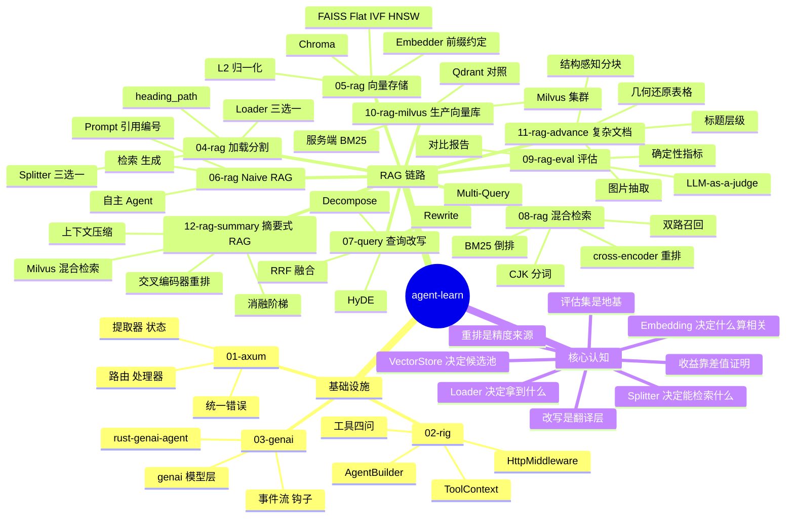
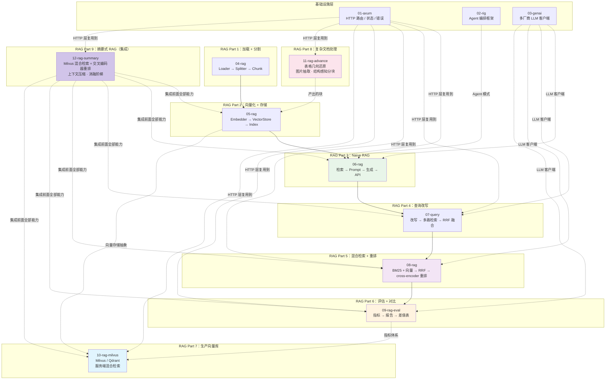
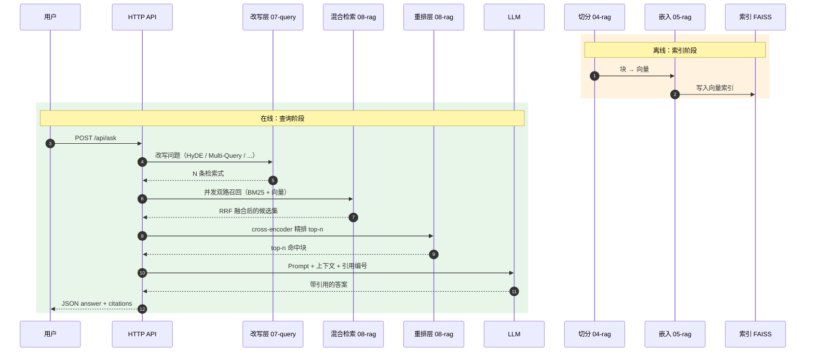

# agent-learn

从零手撕 AI Agent 与 RAG 全链路的 Rust 学习项目。**不依赖 LangChain / LlamaIndex
这类框架** —— 每一层都自己实现，把「框架帮你藏起来的东西」摊开来看。

```text
01-axum   HTTP 服务基础（路由 / 处理器 / 状态 / 错误）
02-rig    Rust 的 AI 编排框架（rig）
03-genai  多厂商 LLM 调用 + 工具 + Agent 循环（genai）
04-rag    RAG Part 1：文档加载 + 文本分块
05-rag    RAG Part 2：向量化 + 向量存储
06-rag    RAG Part 3：完整 Naive RAG 系统 + HTTP 问答 API + 自主 Agent
07-query  RAG Part 4：查询改写（HyDE / Multi-Query / Rewrite / Decompose）+ RRF 融合
08-rag    RAG Part 5：混合检索（BM25 + 向量）+ 重排（cross-encoder / Cohere）
09-rag-eval RAG Part 6：评估指标（RAGAs / FlashRAG）+ 优化前后对比
10-rag-milvus RAG Part 7：生产级向量数据库（Milvus / Qdrant）+ 服务端混合检索
11-rag-advance RAG Part 8：高级文档处理（表格几何还原 / 图片抽取 / 结构感知分块）
12-rag-summary RAG Part 9：摘要式 RAG（混合检索 + Reranker + Milvus + 上下文压缩）
```

## 思维导图：整个仓库



## 全局架构全景



### RAG 主线数据流（离线索引 + 在线查询）



### 增强手段的演进阶梯

```mermaid
graph TB
    subgraph S0["06-rag · Naive 基线"]
        A1[原样检索]
        A2[只有向量]
        A3[无重排]
        A4[无拒答阈值]
    end
    subgraph S1["07-query · 解决 问法"]
        B1["查询改写<br/>HyDE / Multi-Query / Rewrite / Decompose"]
        B2[多路检索 + RRF 融合]
    end
    subgraph S2["08-rag · 解决 检索精度"]
        C1[BM25 关键词路]
        C2[混合 + RRF]
        C3[cross-encoder 重排]
        C4[三个对照组可量化]
    end

    subgraph S3["09-rag-eval · 解决 「有没有用」"]
        D1["确定性指标<br/>recall@k / nDCG / MRR"]
        D2["judge 指标<br/>faithfulness / relevancy"]
        D3["对比报告<br/>差值 + 噪声带"]
    end

    subgraph S4["10-rag-milvus · 解决 「扛不扛得住」"]
        E1["独立向量库服务<br/>Milvus / Qdrant"]
        E2["服务端混合检索<br/>BM25 函数 → 稀疏向量"]
        E3["同题对照<br/>选型有依据"]
    end

    subgraph S5["11-rag-advance · 解决 「文档不规整」"]
        F1["表格几何还原<br/>不跑模型"]
        F2["图片抽取 + 描述"]
        F3["标题层级识别"]
        F4["结构感知分块<br/>表格整块保留"]
    end

    subgraph S6["12-rag-summary · 解决 「怎么攒成一个系统」"]
        G1["Milvus 服务端混合<br/>+ 本地交叉编码器重排"]
        G2["上下文压缩<br/>摘要场景专属"]
        G3["五档消融阶梯<br/>每步收益可归因"]
    end

    S0 -->|"人话 ≠ 文档语言"| S1
    S1 -->|向量对精确词弱| S2
    S2 -->|收益要量化| S3
    S3 -->|指标要能选型| S4
    S4 -->|文档都是规整的?| S5
    S5 -->|能力有了,怎么攒起来?| S6

    style S0 fill:#ffebee
    style S1 fill:#e8f5e9
    style S2 fill:#f3e5f5
    style S3 fill:#fff3e0
    style S4 fill:#e1f5fe
    style S5 fill:#fce4ec
    style S6 fill:#d1c4e9
```



### 知识地图：整个仓库

```mermaid
graph LR
    N1(("agent-learn<br/>手撕 AI Agent 与 RAG"))
    subgraph N2["基础设施"]
        subgraph N3["01-axum"]
            N4["路由"]
            N3 --> N4
            N5["提取器"]
            N3 --> N5
            N6["共享状态"]
            N3 --> N6
            N7["统一错误"]
            N3 --> N7
        end
        N2 --> N3
        subgraph N8["02-rig"]
            N9["Model 调用"]
            N8 --> N9
            N10["AgentBuilder"]
            N8 --> N10
            N11["Tool 四问"]
            N8 --> N11
            N12["ToolContext"]
            N8 --> N12
            N13["HttpMiddleware"]
            N8 --> N13
        end
        N2 --> N8
        subgraph N14["03-genai"]
            N15["genai 模型层"]
            N14 --> N15
            N16["rust-genai-agent"]
            N14 --> N16
            N17["事件流"]
            N14 --> N17
            N18["钩子"]
            N14 --> N18
        end
        N2 --> N14
    end
    N1 --> N2
    subgraph N19["RAG Part 1"]
        subgraph N20["04-rag"]
            subgraph N21["Loader"]
                N22["Markdown"]
                N21 --> N22
                N23["PdfText"]
                N21 --> N23
                N24["Docling"]
                N21 --> N24
            end
            N20 --> N21
            subgraph N25["Splitter"]
                N26["Recursive"]
                N25 --> N26
                N27["Markdown"]
                N25 --> N27
                N28["StructureAware"]
                N25 --> N28
            end
            N20 --> N25
            N29["Chunk 标题路径"]
            N20 --> N29
        end
        N19 --> N20
    end
    N1 --> N19
    subgraph N30["RAG Part 2"]
        subgraph N31["05-rag"]
            subgraph N32["Embedder"]
                N33["fastembed"]
                N32 --> N33
                N34["L2 归一化"]
                N32 --> N34
                N35["前缀约定"]
                N32 --> N35
            end
            N31 --> N32
            subgraph N36["VectorStore"]
                N37["FAISS Flat IVF HNSW"]
                N36 --> N37
                N38["Chroma"]
                N36 --> N38
            end
            N31 --> N36
            N39["持久化"]
            N31 --> N39
        end
        N30 --> N31
    end
    N1 --> N30
    subgraph N40["RAG Part 3"]
        subgraph N41["06-rag"]
            N42["Retriever"]
            N41 --> N42
            N43["Prompt 组装"]
            N41 --> N43
            N44["Generator"]
            N41 --> N44
            N45["Agent"]
            N41 --> N45
            N46["HTTP API"]
            N41 --> N46
        end
        N40 --> N41
    end
    N1 --> N40
    subgraph N47["RAG Part 4"]
        subgraph N48["07-query"]
            N49["HyDE"]
            N48 --> N49
            N50["Multi-Query"]
            N48 --> N50
            N51["Rewrite"]
            N48 --> N51
            N52["Decompose"]
            N48 --> N52
            N53["RRF / MaxScore"]
            N48 --> N53
            N54["降级链"]
            N48 --> N54
        end
        N47 --> N48
    end
    N1 --> N47
    subgraph N55["RAG Part 5"]
        subgraph N56["08-rag"]
            N57["tokenize CJK bigram"]
            N56 --> N57
            N58["BM25"]
            N56 --> N58
            N59["混合检索"]
            N56 --> N59
            N60["cross-encoder 重排"]
            N56 --> N60
            N61["三对照组"]
            N56 --> N61
        end
        N55 --> N56
    end
    N1 --> N55
    subgraph N62["RAG Part 6"]
        subgraph N63["09-rag-eval"]
            N64["评估集标注"]
            N63 --> N64
            N65["章节→块ID 映射"]
            N63 --> N65
            N66["确定性指标"]
            N63 --> N66
            N67["LLM-as-a-judge"]
            N63 --> N67
            N68["对比报告"]
            N63 --> N68
        end
        N62 --> N63
    end
    N1 --> N62
    subgraph N81["RAG Part 7"]
        subgraph N82["10-rag-milvus"]
            N83["MilvusStore"]
            N82 --> N83
            N84["QdrantStore"]
            N82 --> N84
            N85["服务端 BM25"]
            N82 --> N85
            N86["同题对照"]
            N82 --> N86
        end
        N81 --> N82
    end
    N1 --> N81
    subgraph N88["RAG Part 8"]
        subgraph N89["11-rag-advance"]
            N90["几何基础"]
            N89 --> N90
            N91["表格几何还原"]
            N89 --> N91
            N92["图片抽取"]
            N89 --> N92
            N93["标题层级识别"]
            N89 --> N93
            N94["结构感知分块"]
            N89 --> N94
        end
        N88 --> N89
    end
    N1 --> N88
    subgraph N98["RAG Part 9"]
        subgraph N99["12-rag-summary"]
            N100["Retriever trait"]
            N99 --> N100
            N101["Milvus 服务端混合"]
            N99 --> N101
            N102["客户端 BM25 + RRF"]
            N99 --> N102
            N103["交叉编码器重排"]
            N99 --> N103
            N104["上下文压缩"]
            N99 --> N104
            N105["消融阶梯"]
            N99 --> N105
        end
        N98 --> N99
    end
    N1 --> N98
    subgraph N69["核心认知"]
        N70["Loader 决定拿到什么"]
        N69 --> N70
        N71["Splitter 决定能检索什么"]
        N69 --> N71
        N72["Embedding 决定什么算相关"]
        N69 --> N72
        N73["VectorStore 决定候选池"]
        N69 --> N73
        N74["改写是翻译层"]
        N69 --> N74
        N75["重排是精度来源"]
        N69 --> N75
        N76["收益靠差值证明"]
        N69 --> N76
        N77["评估集是地基"]
        N69 --> N77
        N78["差值要有噪声带"]
        N69 --> N78
        N79["失败 ≠ 0 分"]
        N69 --> N79
        N80["裁判不能是选手"]
        N69 --> N80
        N87["集群复杂度来自职责划分"]
        N69 --> N87
        N95["压平即语义丢失"]
        N69 --> N95
        N96["摘要场景上下文越短越好"]
        N69 --> N96
        N97["差值要可归因就得一次只加一样"]
        N69 --> N97
    end
    N1 --> N69
```

## RAG 主线

```text
04-rag                        05-rag                       06-rag
加载 → 分块          ─────→  向量化 → 存储        ─────→  检索 → 生成 → API
 Loader   Splitter             Embedder  VectorStore        Retriever  Generator
                                                         │
                                                         ▼
                                                     07-query
                                              查询改写 → 多路检索 → 融合
                                              Transformer  MultiQuery  RRF
                                                         │
                                                         ▼
                                                      08-rag
                                              双路检索 → RRF 融合 → 重排
                                              BM25  Hybrid  Reranker
                                                         │
                                                         ▼
                                                      09-rag-eval
                                              跑各变体 → 算指标 → 出差值表
                                              Recall  nDCG  Faithfulness
                                                         │
                                                         ▼
                                                     10-rag-milvus
                                              索引搬进独立向量库服务
                                              Milvus  Qdrant  服务端 BM25
                                                         │
                                                         ▼
                                                     11-rag-advance
                                              不规整文档 → 结构化数据
                                              表格几何还原  图片抽取  结构分块
                                                         │
                                                         ▼
                                                     12-rag-summary
                                              全链路集成 → 有据可依的摘要
                                              Milvus 混合  重排  压缩  消融阶梯
```

| 模块 | 解决的问题 | 核心认知 |
|---|---|---|
| [04-rag](04-rag/) | 文档 → 块 | **Loader 决定你拿到什么文本，Splitter 决定模型能检索到什么** |
| [05-rag](05-rag/) | 块 → 可检索的索引 | **Embedding 决定「什么算相关」，VectorStore 决定「在多少候选里找」** |
| [06-rag](06-rag/) | 问题 → 带引用的答案 | **Naive RAG 的链路本身就是基线，每个增强手段都要用实测差值证明它值不值** |
| [07-query](07-query/) | 问法 → 检索式 | **人话和文档不是同一种语言，改写就是中间的翻译层；收益要用对比矩阵量化** |
| [08-rag](08-rag/) | 召回不准 | **向量和关键词的失败模式正好互补；召回只是粗筛，重排才是精度的来源** |
| [09-rag-eval](09-rag-eval/) | 「有没有用」说不清 | **评估集是地基；确定性指标锚定检索、judge 指标衡量答案；差值小于 5% 不算收益** |
| [10-rag-milvus](10-rag-milvus/) | 索引扛不住生产流量 | **把索引搬进独立服务；集群复杂度来自读写职责的清晰划分，而不是组件多** |
| [11-rag-advance](11-rag-advance/) | 文档里有表格和图 | **PDF 里只有坐标没有表格；压平即语义丢失；几何还原比跑模型快且免费** |
| [12-rag-summary](12-rag-summary/) | 能力有了，攒不成系统 | **摘要场景上下文越短越好；差值要可归因就得一次只加一样；服务端融合分数不可拆** |

## 快速开始

```bash
# 依赖（macOS）
brew install faiss          # FAISS 的 C++ 库，05/06/07/08-rag 需要

# Makefile 统一入口（根目录）
make help                   # 查看所有目标
make build                  # 编译全部
make test                   # 跑全部测试
make lint                   # clippy 零警告
make 04                     # 04-rag：加载 + 分割
make 05                     # 05-rag：向量化 + 存储
make demo-06                # 06-rag：端到端问答
make compare-07             # 07-query：多策略改写对比 ★
make compare-08             # 08-rag：多模式检索对比 ★
make serve-08               # 启动 08-rag 服务（:3020）
make compare-09             # 09-rag-eval：优化前后对比 ★
make serve-09               # 启动 09-rag-eval 服务（:3030）

# 10-rag-milvus 需要先起 Milvus 容器
cd 10-rag-milvus && make up        # 启动 Milvus standalone
make compare-10                    # Milvus vs Qdrant 同题对照 ★
make serve-10                      # 启动 10-rag-milvus 服务（:3030）
make compare-11                    # 11-rag-advance：几何还原 vs 压平对照 ★
make serve-11                      # 启动 11-rag-advance 服务（:3040)
make compare-12                    # 12-rag-summary：五档消融阶梯同题对照 ★
make eval-12                       # 12-rag-summary：跑评估集出消融报告 ★
make serve-12                      # 启动 12-rag-summary 服务（:3050）

# 各模块独立运行
cargo run -p axum-01                    # HTTP 服务
cargo run -p rag-04 -- pipeline         # 加载 + 分割
cargo run -p rag-05 -- search           # 向量检索
export DEEPSEEK_API_KEY=sk-...          # 06/07/08-rag 的生成环节需要
cargo run -p rag-06 -- demo             # 完整 RAG 问答
cargo run -p rag-07 -- compare          # 多策略对比（改写收益量化）
cargo run -p rag-08 -- compare          # 多模式对比（混合检索 + 重排收益量化）
cargo run -p rag-09 -- compare          # 优化前后对比（评估 + 差值表）
cargo run -p rag-10 -- compare          # Milvus vs Qdrant 同题对照
cargo run -p rag-11 -- compare          # 几何还原 vs 压平对照
cargo run -p rag-12 -- compare          # 五档消融阶梯同题对照
cargo run -p rag-12 -- eval             # 跑评估集出消融报告

# 测试
cargo test --workspace
```

每个子项目都有自己的 `Makefile`，也可以单独进入使用：

```bash
cd 08-rag && make help
```

## 依赖版本管理

所有成员 crate 的依赖版本在根 `Cargo.toml` 的 `[workspace.dependencies]` 里统一定义，
成员用 `dep = { workspace = true }` 引用 —— 版本只出现一处，避免模块之间版本漂移。

⚠️ 两个已知的版本陷阱（详见各模块 README）：

- `fastembed` 锁 4.x —— 与 `rig` 依赖的 `ort` 精确版本冲突
- `genai` 指向 AgentPrism fork —— 和上游 `genai 0.7` 的类型不互通

---

## 技术参考速查

### 全仓库技术栈总览

| 层 | crate | 关键技术 | 值得学的一课 |
|---|---|---|---|
| HTTP | `axum` 0.8 | `Router` / Extractor / `State` | 提取器消费 body **有且只有一个** |
| Agent 框架 | `rig` 0.46 | `AgentBuilder` / `Tool` / `ToolContext` | 工具的**四问**决定模型调不调它 |
| LLM 客户端 | `genai` | `ChatRequest` / `ChatOptions` / 事件流 | 推理模型思考 token **共用** `max_tokens` |
| 文档加载 | `docling` / `pdf-extract` | `DocumentLoader` trait | Loader 决定你**拿到什么文本** |
| 分割 | `text-splitter` / `tiktoken` | `Splitter` trait | 切分点选在 **token 预算**上，不是字符数 |
| 嵌入 | `fastembed` | 前缀约定 / L2 归一化 | 归一化后**余弦 = 内积** |
| 向量索引 | `faiss` / `chroma` | `IndexFlat` / IVF / HNSW | `IDMap,` 前缀让 ID 随索引持久化 |
| 稀疏检索 | 自实现 | BM25 / 倒排索引 | IDF 保证**永不为负** |
| 融合 | 自实现 | RRF | 只看**排名**才能跨路融合 |
| 重排 | `fastembed` / Cohere | cross-encoder | 精排分和召回分**不可比** |
| 评估 | 自实现 | RAGAs / FlashRAG 指标 | 差值 < 5% **不算收益** |
| 向量库 | `milvus-sdk-rust` / `qdrant-client` | gRPC / hybrid_search | 集群复杂度来自**读写职责划分**；SDK 的 `Bounded` = 字面 ts=2 |
| 文档解析 | `docling-pdf` / `lopdf` | 几何聚类 | PDF 里**只有坐标没有表格** |
| 上下文压缩 | 自实现 | 抽取式 + token 预算 | 摘要场景里**上下文越短越好** |
| 消融实验 | 自实现 | 五档阶梯 | 一次只加一个增强，差值才**可归因** |

### 贯穿全仓库的六条设计原则

| 原则 | 体现在 | 反例（会踩的坑） |
|---|---|---|
| **抽象成 trait 而非枚举** | `Splitter` / `Tool` / `Metric` / `QueryTransformer` / `Reranker` / `VectorStore` | 用枚举 → 依赖判空满天飞 |
| **依赖构造时注入** | `MetricRegistry::new(llm, embedder)` | 全局单例 → 无法测试 |
| **失败 ≠ 0 分** | `CaseResult { scores, errors }` | 失败塞进 scores → 误读成「质量差」 |
| **增强必须是纯增强** | 07 的改写降级回落原问题 | 改写失败就报错 → 整个请求挂掉 |
| **降级链每层都有** | 06~12 全都有 | 向量库抖一下就 500 |
| **结果可复现** | 同分时按 ID 排序 | 依赖 HashMap 迭代顺序 → 每次结果不同 |
| **主键由业务 ID 派生** | 10 的 `stable_pk` / `stable_uuid` | 主键用自增 → 重复灌库堆出重复数据 |
| **分数语义要诚实** | 12 的服务端融合分数标 `None` | 把 RRF 分标成余弦相似度 → 报告误导读者 |

### 核心概念的一句话定义

| 概念 | 定义 | 关键参数 |
|---|---|---|
| **Chunk** | 文档切分后的检索最小单位 | `chunk_size` / `chunk_overlap` |
| **heading_path** | 块所属的标题层级路径 | 给检索加上下文 |
| **Embedding** | 文本 → 稠密向量 | 前缀 / 维度 / 归一化 |
| **召回（Recall）** | 从海量候选里捞出少量相关块 | `top_k` / `per_path_k` |
| **重排（Rerank）** | 对召回候选做精排 | `rerank_candidate_k` |
| **融合（Fusion）** | 多路召回结果合并排序 | `k`（RRF） |
| **Faithfulness** | 答案每句话都能从上下文推出 | 幻觉检测 |
| **Verdict** | 差值是否超过噪声带 | ±5% |

### 各项目的服务端口

| 项目 | 端口 | 启动命令 |
|---|---|---|
| 01-axum | 3000 | `make 01` |
| 06-rag | 3000 | `make serve-06` |
| 07-query | 3010 | `make serve-07` |
| 08-rag | 3020 | `make serve-08` |
| 09-rag-eval | 3030 | `make serve-09` |
| 10-rag-milvus | 3030 | `make serve-10` |
| 11-rag-advance | 3040 | `make serve-11` |
| 12-rag-summary | 3050 | `make serve-12` |

### 常见环境变量前缀

| 前缀 | 项目 | 用途 |
|---|---|---|
| 无 | 04-rag | 分块参数（由上层项目传递） |
| `RAG_` | 06-rag | 检索 / 生成配置 |
| `QUERY_` | 07-query | 改写 / 融合配置 |
| `HYBRID_` | 08-rag | 混合检索 / 重排配置 |
| `EVAL_` | 09-rag-eval | 评估 / judge 配置 |
| `MILVUS_` | 10-rag-milvus | 向量库连接配置 |
| `ADVANCE_` | 11-rag-advance | 文档解析配置 |
| `SUMMARY_` | 12-rag-summary | 检索 / 重排 / 压缩配置 |

### 文档维护

```bash
make check-mermaid    # 校验所有 README 的 mermaid 图能正常渲染
```

⚠️ **mermaid 语法错误不会让 markdown 报错** —— 只会在 GitHub / VSCode 上
显示成一段红字。所以改完 README 一定要跑一遍这个校验。

### 端到端学习路径

```text
① 01-axum    搞懂「HTTP 服务长什么样」
       ↓
② 02-rig     搞懂「Agent 和工具长什么样」
       ↓
③ 03-genai   搞懂「模型调用和事件流长什么样」
       ↓
④ 04-rag     搞懂「文档怎么变成块」
       ↓
⑤ 05-rag     搞懂「块怎么变成可检索的索引」
       ↓
⑥ 06-rag     搞懂「一条完整的 RAG 链路长什么样」
       ↓
⑦ 07-query   搞懂「问法不对怎么救」
       ↓
⑧ 08-rag     搞懂「召回不准怎么救」
       ↓
⑨ 09-rag-eval 搞懂「怎么证明改进有效」
       ↓
⑩ 10-rag-milvus 搞懂「怎么上生产」
       ↓
⑪ 11-rag-advance 搞懂「文档不规整怎么办」
       ↓
⑫ 12-rag-summary 搞懂「能力怎么攒成一个系统」
```
