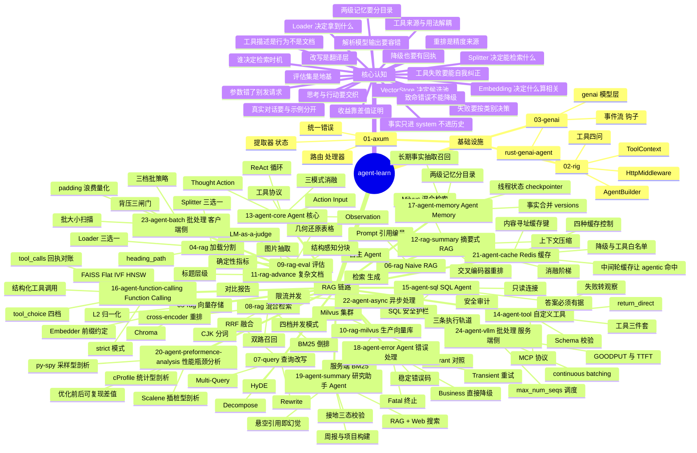
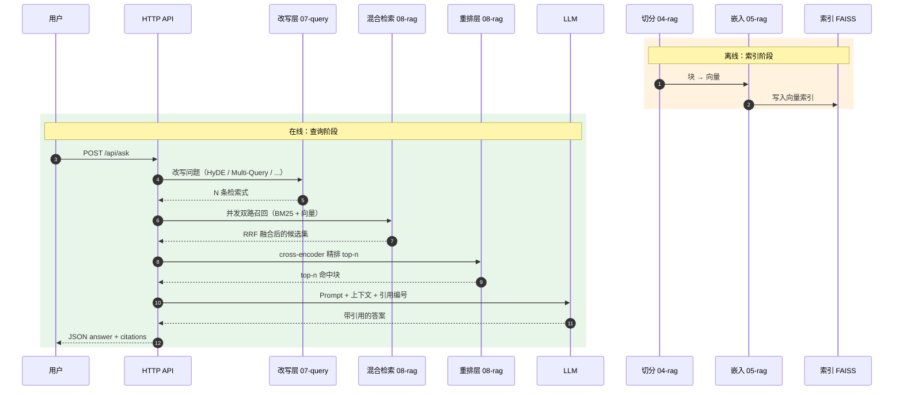

# agent-learn

从零手撕 AI Agent 与 RAG 全链路的 Rust 学习项目。**不依赖 LangChain / LlamaIndex
这类框架** —— 每一层都自己实现，把「框架帮你藏起来的东西」摊开来看。

```text
00-logging  共享日志设施（统一初始化 / 请求追踪 / 结构化宏）
01-axum   HTTP 服务基础（路由 / 处理器 / 状态 / 错误）
02-rig    Rust 的 AI 编排框架（rig）
03-genai  多厂商 LLM 调用 + 工具 + Agent 循环（genai）
04-rag    RAG Part 1：文档加载 + 文本分块
05-rag    RAG Part 2：向量化 + 向量存储
06-rag    RAG Part 3：完整 Naive RAG 系统 + HTTP 问答 API + 自主 Agent
07-query  RAG Part 4：查询改写（HyDE / Multi-Query / Rewrite / Decompose）+ RRF 融合
08-rag    RAG Part 5：混合检索（BM25 + 向量）+ 重排（cross-encoder / Cohere）
09-rag-eval RAG Part 6：评估指标（RAGAs / FlashRAG）+ 优化前后对比
10-rag-milvus RAG Part 7：生产级向量数据库（Milvus / Qdrant）+ 服务端混合检索
11-rag-advance RAG Part 8：高级文档处理（表格几何还原 / 图片抽取 / 结构感知分块）
12-rag-summary RAG Part 9：摘要式 RAG（混合检索 + Reranker + Milvus + 上下文压缩）
13-agent-core Agent 核心概念：ReAct 循环 + 工具协议 + 三模式消融
14-agent-tool 自定义工具开发：工具契约 + Schema 校验 + MCP 协议
15-agent-sql  手撕 SQL Agent：SQL 安全护栏 + 只读连接 + 安全审计
16-agent-function-calling Function Calling 实战：结构化工具调用 + tool_choice 四档消融
17-agent-memory  手撕 Agent Memory：两级记忆（线程状态 + 长期事实）
18-agent-error  手撕 Agent 错误处理：middleware 驱动的可诊断工具失败
19-agent-summary 研究助手 Agent：RAG + Web 搜索 + 周报/项目构建（带接地校验）
20-agent-preformence-analysis 性能瓶颈分析：cProfile / py-spy / Scalene 三工具剖析
21-agent-cache 手撕 Redis 缓存：缓存 LLM 响应（内容寻址 + 四种控制 + 降级）
22-agent-async 手撕异步处理：并发工具执行（四档模式 + 限流 + 线程池轨道）
23-agent-batch 手撕批处理优化（客户端侧）：Embedding / Reranker 批处理（三档策略 + 背压 + 批大小扫描）
24-agent-vllm 手撕批处理优化（服务端侧）：vLLM continuous batching（GOODPUT / TTFT / 调度器）
```

## 思维导图：整个仓库



## 全局架构全景

```mermaid
graph TB
    subgraph L0["基础设施层"]
        LOG["00-logging<br/>统一日志初始化 / 请求追踪"]
        AX["01-axum<br/>HTTP 路由 / 状态 / 错误"]
        RG["02-rig<br/>Agent 编排框架"]
        GN["03-genai<br/>多厂商 LLM 客户端"]
    end

    subgraph L1["RAG Part 1：加载 + 分割"]
        R4["04-rag<br/>Loader → Splitter → Chunk"]
    end

    subgraph L2["RAG Part 2：向量化 + 存储"]
        R5["05-rag<br/>Embedder → VectorStore → Index"]
    end

    subgraph L3["RAG Part 3：Naive RAG"]
        R6["06-rag<br/>检索 → Prompt → 生成 → API"]
    end

    subgraph L4["RAG Part 4：查询改写"]
        R7["07-query<br/>改写 → 多路检索 → RRF 融合"]
    end

    subgraph L5["RAG Part 5：混合检索 + 重排"]
        R8["08-rag<br/>BM25 + 向量 → RRF → cross-encoder 重排"]
    end

    subgraph L6["RAG Part 6：评估 + 对比"]
        R9["09-rag-eval<br/>指标 → 报告 → 差值表"]
    end

    subgraph L7["RAG Part 7：生产向量库"]
        R10["10-rag-milvus<br/>Milvus / Qdrant<br/>服务端混合检索"]
    end

    subgraph L8["RAG Part 8：复杂文档处理"]
        R11["11-rag-advance<br/>表格几何还原<br/>图片抽取 · 结构感知分块"]
    end

    subgraph L9["RAG Part 9：摘要式 RAG（集成）"]
        R12["12-rag-summary<br/>Milvus 混合检索 + 交叉编码器重排<br/>上下文压缩 · 消融阶梯"]
    end

    subgraph L10["Agent 核心概念"]
        R13["13-agent-core<br/>ReAct 循环 + 工具协议<br/>输出解析器 · 三模式消融"]
    end

    subgraph L11["自定义工具开发"]
        R14["14-agent-tool<br/>工具契约 + Schema 校验<br/>天气工具 · MCP 协议"]
    end

    subgraph L12["SQL Agent"]
        R15["15-agent-sql<br/>SQL 安全护栏 + 只读连接<br/>安全审计 · 答案护栏"]
    end

    subgraph L13["Function Calling 实战"]
        R16["16-agent-function-calling<br/>结构化工具调用 + 回执对账<br/>strict 模式 · tool_choice 四档"]
    end

    subgraph L14["Agent Memory"]
        R17["17-agent-memory<br/>线程状态 + checkpointer<br/>事实抽取 · 召回 · 合并"]
    end

    subgraph L15["Agent 错误处理"]
        R18["18-agent-error<br/>错误分类 + 中间件决策<br/>重试 · 降级 · 终止"]
    end

    subgraph L16["研究助手 Agent"]
        R19["19-agent-summary<br/>RAG + Web 搜索 + 报告<br/>接地三态校验"]
    end

    subgraph L17["性能瓶颈分析"]
        R20["20-agent-preformence-analysis<br/>cProfile · py-spy · Scalene<br/>优化前后可复现差值"]
    end

    subgraph L18["Redis 缓存"]
        R21["21-agent-cache<br/>内容寻址缓存键<br/>四种控制 · 降级 · 白名单"]
    end

    subgraph L19["异步处理"]
        R22["22-agent-async<br/>四档并发模式 · 限流<br/>三条执行轨道"]
    end

    subgraph L20["批处理优化"]
        R23["23-agent-batch 客户端侧<br/>三档批策略 · padding 量化<br/>背压三闸门 · 批大小扫描"]
        R24["24-agent-vllm 服务端侧<br/>continuous batching<br/>GOODPUT · TTFT"]
    end

    R18 -.错误决策复用.-> R19
    R8 -.BM25 实现复用.-> R20
    R16 -.Function Calling 复用.-> R21
    R18 -.错误决策复用.-> R22
    R14 -.工具底座复用.-> R22
    R16 -.结构化协议复用.-> R22
    R5 -.嵌入模型复用.-> R23
    R8 -.重排模型复用.-> R23
    R22 -.并发与批处理正交.-> R23
    R23 -.打包策略互补.-> R24

    R4 --> R5 --> R6 --> R7 --> R8 --> R9
    R5 -.向量存储抽象.-> R10
    R9 -.指标体系.-> R10
    R11 -.产出的块.-> R5
    R12 -.集成前面全部能力.-> R5 & R6 & R7 & R8 & R9 & R10
    R13 -.工具底座复用.-> R8
    R13 -.LLM 抽象复用.-> R7
    R14 -.ReAct 引擎复用.-> R13
    R15 -.ReAct 引擎复用.-> R13
    R15 -.工具底座复用.-> R14
    R15 -.LLM 抽象复用.-> R7
    R16 -.工具底座复用.-> R14
    R16 -.Schema 校验复用.-> R14
    R16 -.LLM 抽象复用.-> R7
    R17 -.BM25 检索复用.-> R8
    R17 -.LLM 抽象复用.-> R7
    R18 -.结构化协议复用.-> R16
    R18 -.Schema 校验复用.-> R14
    R14 -.LLM 抽象复用.-> R7
    AX -.HTTP 层复用到.-> R6 & R7 & R8 & R9 & R10 & R11 & R12 & R13 & R14 & R16 & R17 & R18 & R22
    LOG -.日志设施复用到.-> AX & R6 & R7 & R8 & R9 & R10 & R11 & R12 & R13 & R14 & R16 & R17 & R18 & R22
    GN -.LLM 客户端.-> R6 & R7 & R8 & R9 & R13 & R14 & R16 & R17 & R18 & R22
    RG -.Agent 模式.-> R6

    style R6 fill:#e8f5e9
    style R8 fill:#f3e5f5
    style R9 fill:#fff3e0
    style R10 fill:#e1f5fe
    style R11 fill:#fce4ec
    style R12 fill:#d1c4e9
    style R13 fill:#fff9c4
    style R14 fill:#d0ebff
    style R17 fill:#d0ebff
    style R18 fill:#ffe0e0
    style R22 fill:#d0ebff
```



### RAG 主线数据流（离线索引 + 在线查询）



### 增强手段的演进阶梯

```mermaid
graph TB
    subgraph S0["06-rag · Naive 基线"]
        A1[原样检索]
        A2[只有向量]
        A3[无重排]
        A4[无拒答阈值]
    end
    subgraph S1["07-query · 解决 问法"]
        B1["查询改写<br/>HyDE / Multi-Query / Rewrite / Decompose"]
        B2[多路检索 + RRF 融合]
    end
    subgraph S2["08-rag · 解决 检索精度"]
        C1[BM25 关键词路]
        C2[混合 + RRF]
        C3[cross-encoder 重排]
        C4[三个对照组可量化]
    end

    subgraph S3["09-rag-eval · 解决 「有没有用」"]
        D1["确定性指标<br/>recall@k / nDCG / MRR"]
        D2["judge 指标<br/>faithfulness / relevancy"]
        D3["对比报告<br/>差值 + 噪声带"]
    end

    subgraph S4["10-rag-milvus · 解决 「扛不扛得住」"]
        E1["独立向量库服务<br/>Milvus / Qdrant"]
        E2["服务端混合检索<br/>BM25 函数 → 稀疏向量"]
        E3["同题对照<br/>选型有依据"]
    end

    subgraph S5["11-rag-advance · 解决 「文档不规整」"]
        F1["表格几何还原<br/>不跑模型"]
        F2["图片抽取 + 描述"]
        F3["标题层级识别"]
        F4["结构感知分块<br/>表格整块保留"]
    end

    subgraph S6["12-rag-summary · 解决 「怎么攒成一个系统」"]
        G1["Milvus 服务端混合<br/>+ 本地交叉编码器重排"]
        G2["上下文压缩<br/>摘要场景专属"]
        G3["五档消融阶梯<br/>每步收益可归因"]
    end

    subgraph S7["13-agent-core · 解决 「流程写死，模型没话语权」"]
        H1["ReAct 循环<br/>思考与行动交织"]
        H2["工具协议<br/>search + calculate"]
        H3["三模式消融<br/>direct / act_only / react"]
    end

    subgraph S8["14-agent-tool · 解决 「怎么给 Agent 加工具」"]
        I1["工具契约<br/>名字 + 描述 + Schema"]
        I2["参数本地校验<br/>错了别发请求"]
        I3["失败转观察<br/>让模型自我纠正"]
        I4["MCP 协议<br/>来源与用法解耦"]
    end

    subgraph S9["15-agent-sql · 解决 「怎么让 Agent 安全地查库」"]
        J1["SQL 安全护栏<br/>词法分析 + 白黑名单"]
        J2["只读连接<br/>运行时兜底"]
        J3["安全审计<br/>执行过什么 / 拦过什么"]
        J4["答案护栏<br/>没查库就作答 → 退回"]
    end

    subgraph S10["16-agent-function-calling · 解决 「怎么让模型结构化地调工具」"]
        K1["结构化协议<br/>tools 字段 + tool_calls"]
        K2["回执对账<br/>每个 call_id 都要有回执"]
        K3["strict 模式<br/>+ 本地校验兜底"]
        K4["tool_choice 四档<br/>auto / none / required / forced"]
    end

    S0 -->|"人话 ≠ 文档语言"| S1
    S1 -->|向量对精确词弱| S2
    S2 -->|收益要量化| S3
    S3 -->|指标要能选型| S4
    S4 -->|文档都是规整的?| S5
    S5 -->|能力有了,怎么攒起来?| S6
    S6 -->|"检索流程还是写死的?"| S7
    S7 -->|"工具太糙,模型老调错"| S8
    S8 -->|"工具能写数据库了,那安全吗?"| S9

    style S0 fill:#ffebee
    style S1 fill:#e8f5e9
    style S2 fill:#f3e5f5
    style S3 fill:#fff3e0
    style S4 fill:#e1f5fe
    style S5 fill:#fce4ec
    style S6 fill:#d1c4e9
    style S7 fill:#fff9c4
    style S8 fill:#d0ebff
```



### 知识地图：整个仓库

```mermaid
graph LR
    N1(("agent-learn<br/>手撕 AI Agent 与 RAG"))
    subgraph N2["基础设施"]
        subgraph N3["01-axum"]
            N4["路由"]
            N3 --> N4
            N5["提取器"]
            N3 --> N5
            N6["共享状态"]
            N3 --> N6
            N7["统一错误"]
            N3 --> N7
        end
        N2 --> N3
        subgraph N8["02-rig"]
            N9["Model 调用"]
            N8 --> N9
            N10["AgentBuilder"]
            N8 --> N10
            N11["Tool 四问"]
            N8 --> N11
            N12["ToolContext"]
            N8 --> N12
            N13["HttpMiddleware"]
            N8 --> N13
        end
        N2 --> N8
        subgraph N14["03-genai"]
            N15["genai 模型层"]
            N14 --> N15
            N16["rust-genai-agent"]
            N14 --> N16
            N17["事件流"]
            N14 --> N17
            N18["钩子"]
            N14 --> N18
        end
        N2 --> N14
    end
    N1 --> N2
    subgraph N19["RAG Part 1"]
        subgraph N20["04-rag"]
            subgraph N21["Loader"]
                N22["Markdown"]
                N21 --> N22
                N23["PdfText"]
                N21 --> N23
                N24["Docling"]
                N21 --> N24
            end
            N20 --> N21
            subgraph N25["Splitter"]
                N26["Recursive"]
                N25 --> N26
                N27["Markdown"]
                N25 --> N27
                N28["StructureAware"]
                N25 --> N28
            end
            N20 --> N25
            N29["Chunk 标题路径"]
            N20 --> N29
        end
        N19 --> N20
    end
    N1 --> N19
    subgraph N30["RAG Part 2"]
        subgraph N31["05-rag"]
            subgraph N32["Embedder"]
                N33["fastembed"]
                N32 --> N33
                N34["L2 归一化"]
                N32 --> N34
                N35["前缀约定"]
                N32 --> N35
            end
            N31 --> N32
            subgraph N36["VectorStore"]
                N37["FAISS Flat IVF HNSW"]
                N36 --> N37
                N38["Chroma"]
                N36 --> N38
            end
            N31 --> N36
            N39["持久化"]
            N31 --> N39
        end
        N30 --> N31
    end
    N1 --> N30
    subgraph N40["RAG Part 3"]
        subgraph N41["06-rag"]
            N42["Retriever"]
            N41 --> N42
            N43["Prompt 组装"]
            N41 --> N43
            N44["Generator"]
            N41 --> N44
            N45["Agent"]
            N41 --> N45
            N46["HTTP API"]
            N41 --> N46
        end
        N40 --> N41
    end
    N1 --> N40
    subgraph N47["RAG Part 4"]
        subgraph N48["07-query"]
            N49["HyDE"]
            N48 --> N49
            N50["Multi-Query"]
            N48 --> N50
            N51["Rewrite"]
            N48 --> N51
            N52["Decompose"]
            N48 --> N52
            N53["RRF / MaxScore"]
            N48 --> N53
            N54["降级链"]
            N48 --> N54
        end
        N47 --> N48
    end
    N1 --> N47
    subgraph N55["RAG Part 5"]
        subgraph N56["08-rag"]
            N57["tokenize CJK bigram"]
            N56 --> N57
            N58["BM25"]
            N56 --> N58
            N59["混合检索"]
            N56 --> N59
            N60["cross-encoder 重排"]
            N56 --> N60
            N61["三对照组"]
            N56 --> N61
        end
        N55 --> N56
    end
    N1 --> N55
    subgraph N62["RAG Part 6"]
        subgraph N63["09-rag-eval"]
            N64["评估集标注"]
            N63 --> N64
            N65["章节→块ID 映射"]
            N63 --> N65
            N66["确定性指标"]
            N63 --> N66
            N67["LLM-as-a-judge"]
            N63 --> N67
            N68["对比报告"]
            N63 --> N68
        end
        N62 --> N63
    end
    N1 --> N62
    subgraph N81["RAG Part 7"]
        subgraph N82["10-rag-milvus"]
            N83["MilvusStore"]
            N82 --> N83
            N84["QdrantStore"]
            N82 --> N84
            N85["服务端 BM25"]
            N82 --> N85
            N86["同题对照"]
            N82 --> N86
        end
        N81 --> N82
    end
    N1 --> N81
    subgraph N88["RAG Part 8"]
        subgraph N89["11-rag-advance"]
            N90["几何基础"]
            N89 --> N90
            N91["表格几何还原"]
            N89 --> N91
            N92["图片抽取"]
            N89 --> N92
            N93["标题层级识别"]
            N89 --> N93
            N94["结构感知分块"]
            N89 --> N94
        end
        N88 --> N89
    end
    N1 --> N88
    subgraph N98["RAG Part 9"]
        subgraph N99["12-rag-summary"]
            N100["Retriever trait"]
            N99 --> N100
            N101["Milvus 服务端混合"]
            N99 --> N101
            N102["客户端 BM25 + RRF"]
            N99 --> N102
            N103["交叉编码器重排"]
            N99 --> N103
            N104["上下文压缩"]
            N99 --> N104
            N105["消融阶梯"]
            N99 --> N105
        end
        N98 --> N99
    end
    N1 --> N98
    subgraph N106["Agent 核心概念"]
        subgraph N107["13-agent-core"]
            N108["ReAct 循环"]
            N107 --> N108
            N109["Thought / Action"]
            N107 --> N109
            N110["Action Input"]
            N107 --> N110
            N111["Observation"]
            N107 --> N111
            N112["工具协议"]
            N107 --> N112
            N113["输出解析器"]
            N107 --> N113
            N114["三模式消融"]
            N107 --> N114
        end
        N106 --> N107
        subgraph N118["14-agent-tool"]
            N119["工具三件套"]
            N118 --> N119
            N120["Schema 校验器"]
            N118 --> N120
            N121["失败转观察"]
            N118 --> N121
            N122["MCP 客户端"]
            N118 --> N122
            N123["MCP 服务器"]
            N118 --> N123
            N124["return_direct"]
            N118 --> N124
        end
        N106 --> N118
        subgraph N125["16-agent-function-calling"]
            N126["结构化工具调用"]
            N125 --> N126
            N127["回执对账"]
            N125 --> N127
            N128["strict 模式"]
            N125 --> N128
            N129["tool_choice 四档"]
            N125 --> N129
            N130["思考内容回传"]
            N125 --> N130
        end
        N106 --> N125
        subgraph N131["18-agent-error"]
            N132["错误三分类"]
            N131 --> N132
            N133["中间件决策"]
            N131 --> N133
            N134["可诊断观察"]
            N131 --> N134
            N135["回执完整性"]
            N131 --> N135
        end
        N106 --> N131
        subgraph N136["19-agent-summary"]
            N137["RAG + Web 搜索"]
            N136 --> N137
            N138["周报 / 项目构建"]
            N136 --> N138
            N139["接地三态校验"]
            N136 --> N139
            N140["悬空引用即幻觉"]
            N136 --> N140
        end
        N106 --> N136
    end
    N1 --> N106
    subgraph N69["核心认知"]
        N70["Loader 决定拿到什么"]
        N69 --> N70
        N71["Splitter 决定能检索什么"]
        N69 --> N71
        N72["Embedding 决定什么算相关"]
        N69 --> N72
        N73["VectorStore 决定候选池"]
        N69 --> N73
        N74["改写是翻译层"]
        N69 --> N74
        N75["重排是精度来源"]
        N69 --> N75
        N76["收益靠差值证明"]
        N69 --> N76
        N77["评估集是地基"]
        N69 --> N77
        N78["差值要有噪声带"]
        N69 --> N78
        N79["失败 ≠ 0 分"]
        N69 --> N79
        N80["裁判不能是选手"]
        N69 --> N80
        N87["集群复杂度来自职责划分"]
        N69 --> N87
        N95["压平即语义丢失"]
        N69 --> N95
        N96["摘要场景上下文越短越好"]
        N69 --> N96
        N97["差值要可归因就得一次只加一样"]
        N69 --> N97
        N115["思考与行动要交织"]
        N69 --> N115
        N116["谁决定检索时机"]
        N69 --> N116
        N117["解析模型输出要容错"]
        N69 --> N117
        N125["工具描述是行为不是文档"]
        N69 --> N125
        N126["工具失败要能自我纠正"]
        N69 --> N126
        N127["参数错了别发请求"]
        N69 --> N127
        N128["工具来源与用法解耦"]
        N69 --> N128
        N129["真实对话要与示例分开"]
        N69 --> N129
        N136["失败要按类别决策"]
        N69 --> N136
        N137["致命错误不能降级"]
        N69 --> N137
        N138["降级也要有回执"]
        N69 --> N138
    end
    N1 --> N69
```

## 日志约定（贯穿全仓库）

全仓库 14 个项目共用一个 workspace 成员 crate：**`00-logging`（`agent-logging`）**。

```text
00-logging
├── init(service)              初始化全局 subscriber（一次）
├── trace_layer()              HTTP 请求追踪中间件
├── stage_guard(name)          阶段耗时守卫
└── info! / debug! / warn! / error! / trace!   结构化宏再导出
```

### 三个核心能力

| 能力 | 作用 |
|---|---|
| `init("rag-06")` | 一次性设置格式 / 级别 / 来源；`service=` 字段区分多项目日志 |
| `trace_layer()` | 每个 HTTP 请求开一个 span，字段含 `request_id` / `method` / `path` / `status` / `elapsed_ms` |
| `stage_guard("索引构建")` | 阶段耗时守卫 —— 进入时打日志，退出时打耗时 |

### 级别语义（全仓库统一）

| 级别 | 用途 | 典型场景 |
|---|---|---|
| `ERROR` | 请求失败、服务不可用 | LLM 调用失败、索引加载失败 |
| `WARN` | 能兜住但不该发生 | 参数非法、工具执行失败、链路降级 |
| `INFO` | 关键业务节点 | 服务启动、索引就绪、一次请求的最终结果 |
| `DEBUG` | 过程细节 | 召回了哪些块、重排分数、上下文压缩前后对比 |
| `TRACE` | 逐行细节 | 每条候选块的原始分值 |

### 过滤

```bash
RUST_LOG=info                          # 全局 info
RUST_LOG=debug,rag_06=trace            # 某个项目单独开到 trace
RUST_LOG=warn,rag_12::retriever=debug  # 只对某个模块开 debug
```

不设 `RUST_LOG` 时用各项目传入的默认级别（一般是 `info`）。

### 三条硬约定

1. **4xx 用 `warn!`，5xx 用 `error!`** —— 告警不能被 4xx 淹没。
2. **降级必须打 `warn!`** —— 降级是「能兜住但不该发生」，静默降级等于埋雷。
3. **不打 `println!` 混进业务逻辑** —— `println!` 没法按模块关掉，
   debug 输出一旦写进去就永远在生产路径上。

---

## RAG 主线

```text
04-rag                        05-rag                       06-rag
加载 → 分块          ─────→  向量化 → 存储        ─────→  检索 → 生成 → API
 Loader   Splitter             Embedder  VectorStore        Retriever  Generator
                                                         │
                                                         ▼
                                                     07-query
                                              查询改写 → 多路检索 → 融合
                                              Transformer  MultiQuery  RRF
                                                         │
                                                         ▼
                                                      08-rag
                                              双路检索 → RRF 融合 → 重排
                                              BM25  Hybrid  Reranker
                                                         │
                                                         ▼
                                                      09-rag-eval
                                              跑各变体 → 算指标 → 出差值表
                                              Recall  nDCG  Faithfulness
                                                         │
                                                         ▼
                                                     10-rag-milvus
                                              索引搬进独立向量库服务
                                              Milvus  Qdrant  服务端 BM25
                                                         │
                                                         ▼
                                                     11-rag-advance
                                              不规整文档 → 结构化数据
                                              表格几何还原  图片抽取  结构分块
                                                         │
                                                         ▼
                                                     12-rag-summary
                                              全链路集成 → 有据可依的摘要
                                              Milvus 混合  重排  压缩  消融阶梯
```

| 模块 | 解决的问题 | 核心认知 |
|---|---|---|
| [04-rag](04-rag/) | 文档 → 块 | **Loader 决定你拿到什么文本，Splitter 决定模型能检索到什么** |
| [05-rag](05-rag/) | 块 → 可检索的索引 | **Embedding 决定「什么算相关」，VectorStore 决定「在多少候选里找」** |
| [06-rag](06-rag/) | 问题 → 带引用的答案 | **Naive RAG 的链路本身就是基线，每个增强手段都要用实测差值证明它值不值** |
| [07-query](07-query/) | 问法 → 检索式 | **人话和文档不是同一种语言，改写就是中间的翻译层；收益要用对比矩阵量化** |
| [08-rag](08-rag/) | 召回不准 | **向量和关键词的失败模式正好互补；召回只是粗筛，重排才是精度的来源** |
| [09-rag-eval](09-rag-eval/) | 「有没有用」说不清 | **评估集是地基；确定性指标锚定检索、judge 指标衡量答案；差值小于 5% 不算收益** |
| [10-rag-milvus](10-rag-milvus/) | 索引扛不住生产流量 | **把索引搬进独立服务；集群复杂度来自读写职责的清晰划分，而不是组件多** |
| [11-rag-advance](11-rag-advance/) | 文档里有表格和图 | **PDF 里只有坐标没有表格；压平即语义丢失；几何还原比跑模型快且免费** |
| [12-rag-summary](12-rag-summary/) | 能力有了，攒不成系统 | **摘要场景上下文越短越好；差值要可归因就得一次只加一样；服务端融合分数不可拆** |
| [13-agent-core](13-agent-core/) | 检索流程写死，模型没话语权 | **ReAct 把思考与行动交织；谁来决定检索时机才是 RAG 与 Agent 的分水岭；解析模型输出是一半工作量** |
| [14-agent-tool](14-agent-tool/) | 工具太糙，模型老调错 | **工具描述是模型行为的一部分，不是文档；工具失败要能自我纠正；工具来源与使用方式可以解耦** |
| [15-agent-sql](15-agent-sql/) | 让 Agent 查库不安全 | **执行模型生成的 SQL 本身就是高危操作；任何单层防线都有盲区，叠加才可靠；答案必须能被证明有数据支撑** |
| [16-agent-function-calling](16-agent-function-calling/) | 靠提示词让模型「调用工具」不可靠 | **走结构化协议，别靠文本正则；每个 tool_call 都必须有回执；strict 不能替代本地校验；tool_choice=none 不可靠** |
| [17-agent-memory](17-agent-memory/) | Agent 每轮都不记得上一轮 | **短期记忆按 thread_id 隔离、长期记忆按 owner 分区；召回的事实只进 system 不进历史；事实要合并而不是追加** |
| [18-agent-error](18-agent-error/) | 工具失败了不知道怎么办 | **重试和降级是两个正交维度；只有 Transient 该重试；致命错误不能降级；终止前也要把回执发完** |
| [19-agent-summary](19-agent-summary/) | 工具调通了，然后呢 | **把「查资料」和「写文档」拆成两阶段；每条结论都要能追回一条证据；引用不存在的编号就是幻觉，必须在代码里判** |
| [20-agent-preformence-analysis](20-agent-preformence-analysis/) | 功能对了，但不知道慢在哪 | **三个剖析工具量的不是同一件事（IO 等待 vs CPU 热点）；优化前后差值必须单独用纯净运行测；采样器不是坏了，是程序跑太快** |
| [21-agent-cache](21-agent-cache/) | 反复问同一个问题，反复付一次模型的钱 | **缓存键必须包含所有影响输出的东西；no-cache 管读、no-store 管写；缓存在关键路径外所以失败只降级不重试；「agentic 必然 miss」不是 exact-match 的固有性质，而是「中间轮不写缓存」造成的（修掉后命中率 0%→100%）** |
| [22-agent-async](22-agent-async/) | 一轮里的多个工具调用一个接一个等 | **并发执行后结果乱序，回执必须按 call_id 还原输入顺序；同步阻塞的工具塞进 async 会卡死整个事件循环（要 spawn_blocking）；buffer_unordered(0) 会让请求永远挂住；并发 ≠ 并行，CPU 密集任务并发零收益** |
| [23-agent-batch](23-agent-batch/) | 一条一条地调 embedding / rerank，太慢 | **批处理涨吞吐的同时会抬高单条延迟（实测 17~27 倍），只看总耗时必然误判；固定批里一条长文本拖慢同批所有短文本（padding 浪费 55.6%），要按长度排序分桶；分桶排序会打乱输入顺序，必须按原始下标还原；攒批要有背压三闸门；LangChain 的 batch() 是客户端并行不是合并请求，远程批量是否更快完全取决于上游是否真的并行（Ollama 实测 0.98x）** |
| [24-agent-vllm](24-agent-vllm/) | 服务端把请求一条条跑，GPU 闲着 | **连续批处理的价值不是「快一点」而是「负载越高差距越大」——GOODPUT 相对静态批处理从 1.7x 放大到 57.8x（静态批处理高负载下 GOODPUT 直接崩到 0.16）；只看吞吐会选出一个延迟不可用的服务（max_num_seqs 64→256 吞吐还在涨，GOODPUT 却从 7.36 掉到 5.28，TPOT 涨 5.4 倍）；长度一致时两种模式完全等价（连续批处理的优势全部来自长度参差）；客户端并发=1 服务端永远攒不出批** |

## 快速开始

```bash
# 依赖（macOS）
brew install faiss          # FAISS 的 C++ 库，05/06/07/08-rag 需要

# Makefile 统一入口（根目录）
make help                   # 查看所有目标
make build                  # 编译全部
make test                   # 跑全部测试
make lint                   # clippy 零警告
make 04                     # 04-rag：加载 + 分割
make 05                     # 05-rag：向量化 + 存储
make demo-06                # 06-rag：端到端问答
make compare-07             # 07-query：多策略改写对比 ★
make compare-08             # 08-rag：多模式检索对比 ★
make serve-08               # 启动 08-rag 服务（:3020）
make compare-09             # 09-rag-eval：优化前后对比 ★
make serve-09               # 启动 09-rag-eval 服务（:3030）

# 10-rag-milvus 需要先起 Milvus 容器
cd 10-rag-milvus && make up        # 启动 Milvus standalone
make compare-10                    # Milvus vs Qdrant 同题对照 ★
make serve-10                      # 启动 10-rag-milvus 服务（:3030）
make compare-11                    # 11-rag-advance：几何还原 vs 压平对照 ★
make serve-11                      # 启动 11-rag-advance 服务（:3040)
make compare-12                    # 12-rag-summary：五档消融阶梯同题对照 ★
make eval-12                       # 12-rag-summary：跑评估集出消融报告 ★
make serve-12                      # 启动 12-rag-summary 服务（:3050）

# 13-agent-core：ReAct Agent
make compare-13                    # 13-agent-core：三模式消融对照（direct/act_only/react）★
make serve-13                      # 启动 13-agent-core 服务（:3060）

# 14-agent-tool：自定义工具 + MCP
make compare-14                    # 14-agent-tool：三模式消融对照 ★
make serve-14                      # 启动 14-agent-tool 服务（:3070）
make mcp-14                        # 启动内置 MCP 服务器（:3071）★
make call-14 LOCATION="上海"        # 直接调天气工具（不经模型）★

# 15-agent-sql：SQL Agent + 安全护栏
make guard-15                       # 只跑 SQL 护栏（不执行、不调模型）★
make demo-15                        # 15-agent-sql：跑一次 SQL Agent ★
make serve-15                       # 启动 15-agent-sql 服务（:3080）

# 16-agent-function-calling：结构化工具调用
make compare-16                    # tool_choice 四档消融对照 ★
make serve-16                       # 启动 16-agent-function-calling 服务（:3090）
make 16                             # 打印工具清单 + Schema（不调模型）★

# 17-agent-memory：Agent Memory（两级记忆）
make compare-17                    # 线程隔离 / 恢复 / 跨线程共享三向对照 ★
make demo-17                       # 跑一次带记忆的对话（两轮）★
make serve-17                      # 启动 17-agent-memory 服务（:3100）

# 18-agent-error：Agent 错误处理
make compare-18                    # 三类错误对照（Transient/Business/Fatal）★
make demo-18                       # 跑一次带错误处理的 Agent ★
make serve-18                      # 启动 18-agent-error 服务（:3110）

# 19-agent-summary：研究助手 Agent
make compare-19                    # 接地校验对照（接地/部分接地/未接地）★
make demo-19                       # 跑一次周度总结（研究 + 成文 + 校验）★
make demo-19-plan                  # 跑一次项目构建方案 ★
make search-19                     # 直接调 Web 搜索工具（不经模型）★
make serve-19                      # 启动 19-agent-summary 服务（:3120）

# 20-agent-preformence-analysis：性能瓶颈分析
make py-compare                    # ★ 三工具对比 + 优化前后差值（Python 侧）
make profile-20                    # ★ 剖析 naive 版
make pprof-20                      # ★ Rust 侧采样出火焰图
make bench-20                      # Rust 侧计时（多次取中位数）
make setup-20                      # ★ 首次准备（uv venv + uv sync + 镜像）

# 21-agent-cache：Redis 缓存
make redis-up-21                    # 启动 Redis 容器（docker）
make demo-21                       # ★ 连跑两次同一问题（第二次命中缓存）
make compare-21                    # ★ 缓存开 / 关对照实验
make semantics-21                   # ★ ★ 三档缓存语义对照（agentic 能否命中）
make serve-21                      # 启动 21-agent-cache 服务（:3130）

# 22-agent-async：异步处理
make bench-22                      # ★★ 并发对照实验（模拟负载，稳）
make bench-real-22                 # ★★ 并发对照实验（真实天气接口）
make modes-22                      # 四种并发模式说明
make serve-22                      # 启动 22-agent-async 服务（:3140）

# 23-agent-batch：批处理优化
make bench-23                      # ★★★ 嵌入批处理对照实验（本地 ONNX）
make bench-rerank-23               # ★★★ 重排批处理对照实验（本地 ONNX）
make sweep-23                      # ★★★ 批大小扫描（找最优批大小）
make bench-remote-23               # ★★ 远程 HTTP 三组对照（需 Ollama）
make serve-23                      # 启动 23-agent-batch 服务（:3150)

# 24-agent-vllm：批处理优化（服务端侧 · continuous batching）
make bench-24                      # ★★★ 三组批处理对照实验（模拟轨，本机可跑）
make bench-mode-24                 # ★★ 实验 A 静态 vs 连续批处理
make bench-seqs-24                 # ★★ 实验 B max_num_seqs 扫描（找甜点）
make bench-chunked-24              # ★★ 实验 C chunked prefill 对照
make modes-24                      # ★★ 两种批处理模式的说明
make mock-24                       # 启动 mock vLLM（:8000，OpenAI 兼容）
make health-24                     # 检查 vLLM 服务是否可达
make bench-vllm-24                 # ★★★ 打真 vLLM 测吞吐
make vllm-up-24                    # 启动真 vLLM 容器（需 NVIDIA GPU）
make serve-24                      # 启动 24-agent-vllm 服务（:3160）

# 各模块独立运行
cargo run -p axum-01                    # HTTP 服务
cargo run -p rag-04 -- pipeline         # 加载 + 分割
cargo run -p rag-05 -- search           # 向量检索
export DEEPSEEK_API_KEY=sk-...          # 06/07/08-rag 的生成环节需要
cargo run -p rag-06 -- demo             # 完整 RAG 问答
cargo run -p rag-07 -- compare          # 多策略对比（改写收益量化）
cargo run -p rag-08 -- compare          # 多模式对比（混合检索 + 重排收益量化）
cargo run -p rag-09 -- compare          # 优化前后对比（评估 + 差值表）
cargo run -p rag-10 -- compare          # Milvus vs Qdrant 同题对照
cargo run -p rag-11 -- compare          # 几何还原 vs 压平对照
cargo run -p rag-12 -- compare          # 五档消融阶梯同题对照
cargo run -p rag-12 -- eval             # 跑评估集出消融报告
cargo run -p agent-13 -- compare        # 三模式消融对照（ReAct 收益量化）
cargo run -p agent-13 -- run            # 跑一次 Agent（ReAct 循环）
cargo run -p agent-14 -- tools          # 工具清单 + 参数校验演示（不联网）
cargo run -p agent-14 -- call get_weather '{"location":"北京"}'  # 直接调工具
cargo run -p agent-14 -- compare        # 三模式消融对照（工具收益量化）
cargo run -p agent-17 -- compare        # 线程隔离 / 恢复 / 跨线程共享三向对照
cargo run -p agent-18 -- table          # 错误分类速查表（不调模型）
cargo run -p agent-18 -- compare        # 三类错误对照（不调模型）

# 测试
cargo test --workspace
```

每个子项目都有自己的 `Makefile`，也可以单独进入使用：

```bash
cd 08-rag && make help
```

## 测试体系：单元测试 + 属性测试 + 模糊测试

仓库用**三层**测试，对应三个不同的问题：

| 层 | 工具 | 问的问题 | 工具链 |
|---|---|---|---|
| **单元 / 集成测试** | `cargo test` | 「我想到的输入对不对？」 | 稳定版 |
| **属性测试** | [proptest](https://proptest-rs.github.io/proptest/) | 「**任意**输入都满足性质 P 吗？」 | 稳定版 |
| **模糊测试** | [libFuzzer](https://rust-fuzz.github.io/book/)（cargo-fuzz） | 「**任意字节**会不会 panic / 绕过？」 | nightly |

### 为什么要加后两层

仓库里有大量模块的输入是**完全不可信**的：

- 13 的 ReAct 解析器 —— 输入是**模型的原始输出**
- 14 的 Schema 校验器 —— 输入是**模型填的工具参数**
- 15 的 SQL 护栏 —— 输入是**模型生成的 SQL**（安全关键）
- 21 的缓存键 —— 输入是**整段对话历史**
- 08 的分词器 —— 被上面所有模块**复用**，一处切错全链路塌方

这些模块的单元测试有个共同的结构性盲区：**只能覆盖「人想得到的」输入**。
而「漏掉一个分支」这件事本身无法被「逐个分支写测试」发现 ——
因为没写的那个测试根本不存在。

属性测试换了个思路：**不测具体输入，只写不变量**，让框架随机生成输入去撞。

### 五个被测目标

| 目标 | 被测模块 | 重点不变量 |
|---|---|---|
| `08-rag` | `rag_08::tokenize` | 词元非空、拉丁全小写、bigram 保留词序 |
| `13-agent-core` | `agent_13::agent` | 任意输出不 panic、最后一个标记优先、参数永远是对象 |
| `14-agent-tool` | `agent_14::schema` | 合法参数不误伤、非法参数不漏放、错误信息可执行 |
| `15-agent-sql` | `agent_15::guard` | **危险关键字裸词必被拦**、字符串/注释里的关键字不误伤 |
| `21-agent-cache` | `agent_21::cache::key` | **任一字段变化必 miss**、键稳定、键形态合法 |

### 怎么跑

```bash
make prop             # 跑全部属性测试（稳定工具链，能进 CI）
make prop-13          # 只跑某个项目
make prop-15

make fuzz-build       # 编译全部模糊测试目标（需要 nightly）
make fuzz-run         # 每个目标跑 30 秒
make fuzz-list        # 列出目标
```

⚠️ 模糊测试需要先准备工具链：

```bash
cargo install cargo-fuzz --locked
rustup toolchain install nightly
```

`fuzz/` 是**独立 workspace**（自己的 `[workspace]` 空节）——
因为 libFuzzer 需要 nightly 的 `-Z sanitizer`，而主仓库固定在稳定版 1.99.1。
详见 [`fuzz/README.md`](fuzz/README.md)。

### ⚠️ 这套测试立刻抓到了两个真 bug

**① 13 的 ReAct 解析器会 panic（Unicode 小写化导致偏移错位）**

`find_last_marker` 曾是：

```rust
let lower = text.to_lowercase();
lower.rfind(&marker.to_lowercase())
```

Unicode 小写化**不保证字节长度不变** —— `İ`（U+0130）小写化成 `i` + 组合字符（2 字节 → 3 字节）。
于是 `lower` 的偏移量比 `text` 大，用它切 `text` 直接越界：

```text
text = "İİİAction: x"  →  lower.rfind("action:") = 9
text[9 + 7..]  →  start byte index 16 is out of bounds for string of length 15
```

修法：**在原串的字符边界上做 ASCII 大小写比较**（不用 `to_lowercase()` + `rfind` 这个组合）。

**② 工具名没做「标识符截断」**

`Action:Thought:Thought:` 曾被解析出工具名 `Thought:Thought` ——
一个**永远匹配不上任何工具**的名字。
修法：「取开头那段连续的字母/数字/下划线」。

⚠️ 回归种子记在 `*/tests/properties.proptest-regressions`（**已入库**），防止 bug 复发。

## 依赖版本管理

所有成员 crate 的依赖版本在根 `Cargo.toml` 的 `[workspace.dependencies]` 里统一定义，
成员用 `dep = { workspace = true }` 引用 —— 版本只出现一处，避免模块之间版本漂移。

⚠️ 两个已知的版本陷阱（详见各模块 README）：

- `fastembed` 锁 4.x —— 与 `rig` 依赖的 `ort` 精确版本冲突
- `genai` 指向 AgentPrism fork —— 和上游 `genai 0.7` 的类型不互通

---

## 技术参考速查

### 全仓库技术栈总览

| 层 | crate | 关键技术 | 值得学的一课 |
|---|---|---|---|
| HTTP | `axum` 0.8 | `Router` / Extractor / `State` | 提取器消费 body **有且只有一个** |
| Agent 框架 | `rig` 0.46 | `AgentBuilder` / `Tool` / `ToolContext` | 工具的**四问**决定模型调不调它 |
| LLM 客户端 | `genai` | `ChatRequest` / `ChatOptions` / 事件流 | 推理模型思考 token **共用** `max_tokens` |
| 文档加载 | `docling` / `pdf-extract` | `DocumentLoader` trait | Loader 决定你**拿到什么文本** |
| 分割 | `text-splitter` / `tiktoken` | `Splitter` trait | 切分点选在 **token 预算**上，不是字符数 |
| 嵌入 | `fastembed` | 前缀约定 / L2 归一化 | 归一化后**余弦 = 内积** |
| 向量索引 | `faiss` / `chroma` | `IndexFlat` / IVF / HNSW | `IDMap,` 前缀让 ID 随索引持久化 |
| 稀疏检索 | 自实现 | BM25 / 倒排索引 | IDF 保证**永不为负** |
| 融合 | 自实现 | RRF | 只看**排名**才能跨路融合 |
| 重排 | `fastembed` / Cohere | cross-encoder | 精排分和召回分**不可比** |
| 评估 | 自实现 | RAGAs / FlashRAG 指标 | 差值 < 5% **不算收益** |
| 向量库 | `milvus-sdk-rust` / `qdrant-client` | gRPC / hybrid_search | 集群复杂度来自**读写职责划分**；SDK 的 `Bounded` = 字面 ts=2 |
| 文档解析 | `docling-pdf` / `lopdf` | 几何聚类 | PDF 里**只有坐标没有表格** |
| 上下文压缩 | 自实现 | 抽取式 + token 预算 | 摘要场景里**上下文越短越好** |
| 消融实验 | 自实现 | 五档阶梯 | 一次只加一个增强，差值才**可归因** |
| Agent 循环 | 自实现 | ReAct 文本协议 | 思考与行动**交织**；解析模型输出是一半工作量 |
| 工具契约 | 自实现 | Tool trait / JSON Schema | 描述是**行为**不是文档；参数错了**别发请求** |
| 工具协议 | 自实现 | MCP / JSON-RPC 2.0 | 工具**来源**与使用方式**解耦**；camelCase 字段要 `rename` |
| 结构化工具调用 | 自实现 | OpenAI tools / tool_calls | 每个 `tool_call` 都**必须有回执**；strict **不能**替代本地校验 |
| Agent 记忆 | 自实现 | 线程状态 + 事实抽取 | 事实**只进 system 不进历史**；关键词召回匹配不了语义等价，要留兜底 |
| 错误处理 | 自实现 | 错误分类 + 中间件 | 重试和降级**是两个维度**；致命错误**不能**降级；终止前**也要发回执** |

### 贯穿全仓库的六条设计原则

| 原则 | 体现在 | 反例（会踩的坑） |
|---|---|---|
| **抽象成 trait 而非枚举** | `Splitter` / `Tool` / `Metric` / `QueryTransformer` / `Reranker` / `VectorStore` | 用枚举 → 依赖判空满天飞 |
| **依赖构造时注入** | `MetricRegistry::new(llm, embedder)` | 全局单例 → 无法测试 |
| **失败 ≠ 0 分** | `CaseResult { scores, errors }` | 失败塞进 scores → 误读成「质量差」 |
| **增强必须是纯增强** | 07 的改写降级回落原问题 | 改写失败就报错 → 整个请求挂掉 |
| **降级链每层都有** | 06~12 全都有 | 向量库抖一下就 500 |
| **结果可复现** | 同分时按 ID 排序 | 依赖 HashMap 迭代顺序 → 每次结果不同 |
| **主键由业务 ID 派生** | 10 的 `stable_pk` / `stable_uuid` | 主键用自增 → 重复灌库堆出重复数据 |
| **分数语义要诚实** | 12 的服务端融合分数标 `None` | 把 RRF 分标成余弦相似度 → 报告误导读者 |

### 核心概念的一句话定义

| 概念 | 定义 | 关键参数 |
|---|---|---|
| **Chunk** | 文档切分后的检索最小单位 | `chunk_size` / `chunk_overlap` |
| **heading_path** | 块所属的标题层级路径 | 给检索加上下文 |
| **Embedding** | 文本 → 稠密向量 | 前缀 / 维度 / 归一化 |
| **召回（Recall）** | 从海量候选里捞出少量相关块 | `top_k` / `per_path_k` |
| **重排（Rerank）** | 对召回候选做精排 | `rerank_candidate_k` |
| **融合（Fusion）** | 多路召回结果合并排序 | `k`（RRF） |
| **Faithfulness** | 答案每句话都能从上下文推出 | 幻觉检测 |
| **Verdict** | 差值是否超过噪声带 | ±5% |

### 各项目的服务端口

| 项目 | 端口 | 启动命令 |
|---|---|---|
| 01-axum | 3000 | `make 01` |
| 06-rag | 3000 | `make serve-06` |
| 07-query | 3010 | `make serve-07` |
| 08-rag | 3020 | `make serve-08` |
| 09-rag-eval | 3030 | `make serve-09` |
| 10-rag-milvus | 3030 | `make serve-10` |
| 11-rag-advance | 3040 | `make serve-11` |
| 12-rag-summary | 3050 | `make serve-12` |
| 13-agent-core | 3060 | `make serve-13` |
| 14-agent-tool | 3070 | `make serve-14` |
| 14-agent-tool（MCP） | 3071 | `make mcp-14` |
| 15-agent-sql | 3080 | `make serve-15` |
| 16-agent-function-calling | 3090 | `make serve-16` |
| 17-agent-memory | 3100 | `make serve-17` |
| 18-agent-error | 3110 | `make serve-18` |
| 19-agent-summary | 3120 | `make serve-19` |
| 21-agent-cache | 3130 | `make serve-21` |
| 22-agent-async | 3140 | `make serve-22` |
| 23-agent-batch | 3150 | `make serve-23` |
| 24-agent-vllm | 3160 | `make serve-24` |

### 常见环境变量前缀

| 前缀 | 项目 | 用途 |
|---|---|---|
| 无 | 04-rag | 分块参数（由上层项目传递） |
| `RAG_` | 06-rag | 检索 / 生成配置 |
| `QUERY_` | 07-query | 改写 / 融合配置 |
| `HYBRID_` | 08-rag | 混合检索 / 重排配置 |
| `EVAL_` | 09-rag-eval | 评估 / judge 配置 |
| `MILVUS_` | 10-rag-milvus | 向量库连接配置 |
| `ADVANCE_` | 11-rag-advance | 文档解析配置 |
| `SUMMARY_` | 12-rag-summary | 检索 / 重排 / 压缩配置 |
| `AGENT_` | 13-agent-core | Agent 循环 / 模式 / 步数配置 |
| `TOOL_` | 14-agent-tool | 工具 / MCP / 步数配置 |
| `SQL_` | 15-agent-sql | SQL 方言 / 检查器 / 护栏配置 |
| `FC_` | 16-agent-function-calling | 工具选择 / 严格模式 / 步数配置 |
| `MEM_` | 17-agent-memory | 存储方式 / 召回条数 / 历史长度配置 |
| `ERR_` | 18-agent-error | 重试次数 / 退避 / 工具选择配置 |
| `SUM_` | 19-agent-summary | 搜索后端 / 知识库目录 / 证据条数配置 |
| `PERF_` | 20-agent-preformence-analysis | 产物目录 / 剖析工具 / 重复次数 |
| `CACHE_` | 21-agent-cache | 缓存开关 / TTL / 命名空间 / Redis URL / 工具白名单 |
| `ASYNC_` | 22-agent-async | 并发上限 / 工具超时 / 重试退避 / 模型配置 |
| `BATCH_` | 23-agent-batch | 批大小 / 分桶批大小 / 最大等待 / 队列上限 / 并发上限 / 样本条数 |
| `VLLM_` | 24-agent-vllm | 服务地址 / 模型名 / 并发上限 / 批预算 / chunked prefill / 负载参数 / SLO |

### 文档维护

```bash
make check-mermaid    # 校验所有 README 的 mermaid 图能正常渲染
```

⚠️ **mermaid 语法错误不会让 markdown 报错** —— 只会在 GitHub / VSCode 上
显示成一段红字。所以改完 README 一定要跑一遍这个校验。

### 端到端学习路径

```text
① 01-axum    搞懂「HTTP 服务长什么样」
       ↓
② 02-rig     搞懂「Agent 和工具长什么样」
       ↓
③ 03-genai   搞懂「模型调用和事件流长什么样」
       ↓
④ 04-rag     搞懂「文档怎么变成块」
       ↓
⑤ 05-rag     搞懂「块怎么变成可检索的索引」
       ↓
⑥ 06-rag     搞懂「一条完整的 RAG 链路长什么样」
       ↓
⑦ 07-query   搞懂「问法不对怎么救」
       ↓
⑧ 08-rag     搞懂「召回不准怎么救」
       ↓
⑨ 09-rag-eval 搞懂「怎么证明改进有效」
       ↓
⑩ 10-rag-milvus 搞懂「怎么上生产」
       ↓
⑪ 11-rag-advance 搞懂「文档不规整怎么办」
       ↓
⑫ 12-rag-summary 搞懂「能力怎么攒成一个系统」
       ↓
⑬ 13-agent-core 搞懂「Agent 循环长什么样」
       ↓
⑭ 14-agent-tool 搞懂「怎么给 Agent 加工具」
       ↓
⑮ 15-agent-sql 搞懂「怎么让 Agent 安全地查库」
       ↓
⑯ 16-agent-function-calling 搞懂「怎么让模型结构化地调工具」
       ↓
⑰ 17-agent-memory 搞懂「Agent 怎么记住用户」
       ↓
⑱ 18-agent-error 搞懂「失败了到底该怎么办」
       ↓
⑲ 19-agent-summary 搞懂「怎么把查到的资料变成有据可查的文档」
       ↓
⑳ 20-agent-preformence-analysis 搞懂「慢了到底慢在哪」
       ↓
㉑ 21-agent-cache 搞懂「重复的活怎么不用重做」
       ↓
㉒ 22-agent-async 搞懂「I/O 密集型怎么改成并发」
㉓ 23-agent-batch 搞懂「批处理为什么快，以及什么时候不该快」
       ↓
㉔ 24-agent-vllm 搞懂「服务端怎么批，以及怎么衡量批得好不好」
```
