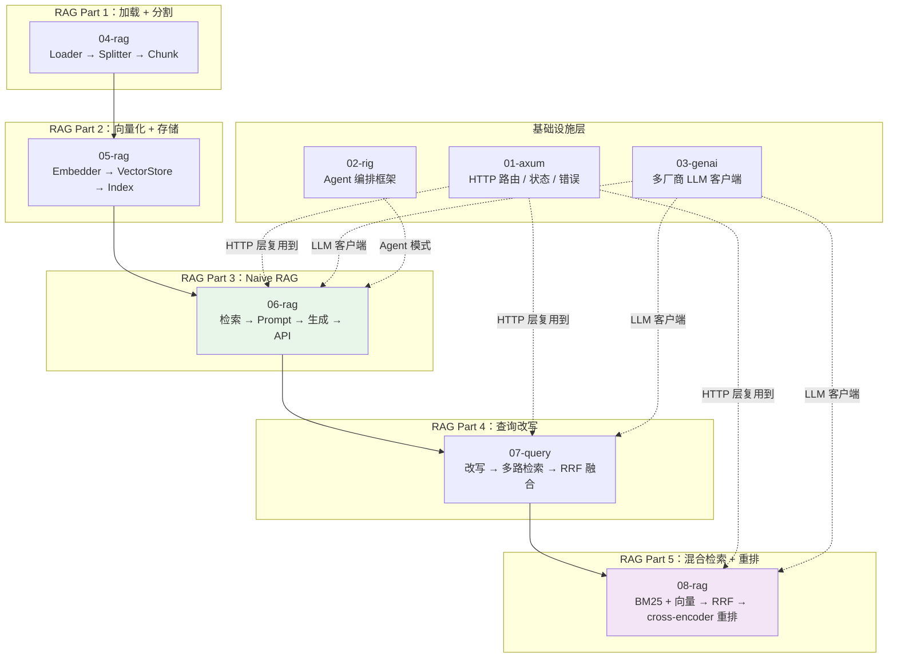
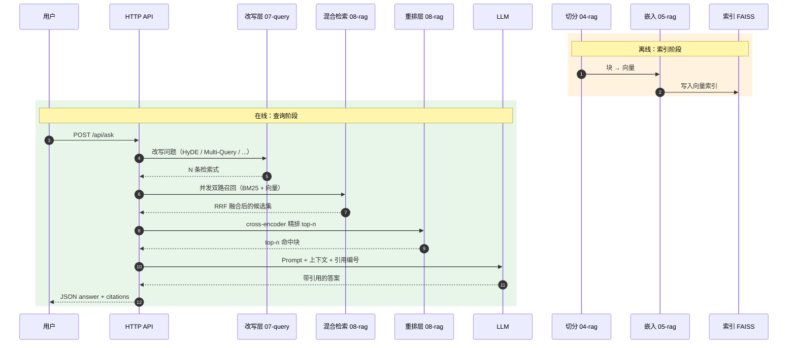
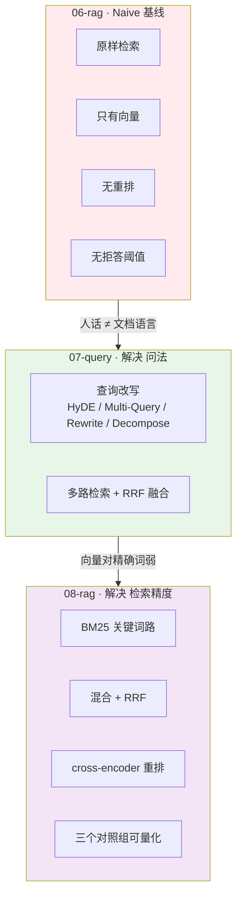
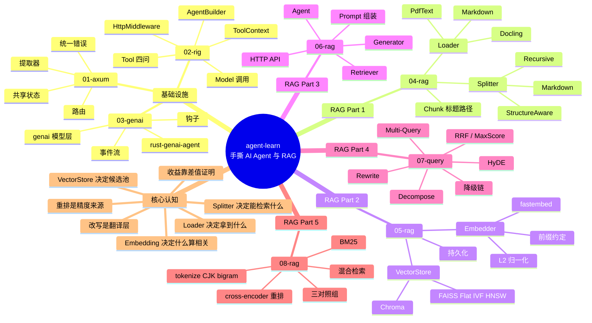

# agent-learn

从零手撕 AI Agent 与 RAG 全链路的 Rust 学习项目。**不依赖 LangChain / LlamaIndex
这类框架** —— 每一层都自己实现，把「框架帮你藏起来的东西」摊开来看。

```text
01-axum   HTTP 服务基础（路由 / 处理器 / 状态 / 错误）
02-rig    Rust 的 AI 编排框架（rig）
03-genai  多厂商 LLM 调用 + 工具 + Agent 循环（genai）
04-rag    RAG Part 1：文档加载 + 文本分块
05-rag    RAG Part 2：向量化 + 向量存储
06-rag    RAG Part 3：完整 Naive RAG 系统 + HTTP 问答 API + 自主 Agent
07-query  RAG Part 4：查询改写（HyDE / Multi-Query / Rewrite / Decompose）+ RRF 融合
08-rag    RAG Part 5：混合检索（BM25 + 向量）+ 重排（cross-encoder / Cohere）
```

## 全局架构全景



### RAG 主线数据流（离线索引 + 在线查询）



### 增强手段的演进阶梯



### 思维导图：整个仓库的知识地图



## RAG 主线

```text
04-rag                        05-rag                       06-rag
加载 → 分块          ─────→  向量化 → 存储        ─────→  检索 → 生成 → API
 Loader   Splitter             Embedder  VectorStore        Retriever  Generator
                                                         │
                                                         ▼
                                                     07-query
                                              查询改写 → 多路检索 → 融合
                                              Transformer  MultiQuery  RRF
                                                         │
                                                         ▼
                                                      08-rag
                                              双路检索 → RRF 融合 → 重排
                                              BM25  Hybrid  Reranker
```

| 模块 | 解决的问题 | 核心认知 |
|---|---|---|
| [04-rag](04-rag/) | 文档 → 块 | **Loader 决定你拿到什么文本，Splitter 决定模型能检索到什么** |
| [05-rag](05-rag/) | 块 → 可检索的索引 | **Embedding 决定「什么算相关」，VectorStore 决定「在多少候选里找」** |
| [06-rag](06-rag/) | 问题 → 带引用的答案 | **Naive RAG 的链路本身就是基线，每个增强手段都要用实测差值证明它值不值** |
| [07-query](07-query/) | 问法 → 检索式 | **人话和文档不是同一种语言，改写就是中间的翻译层；收益要用对比矩阵量化** |
| [08-rag](08-rag/) | 召回不准 | **向量和关键词的失败模式正好互补；召回只是粗筛，重排才是精度的来源** |

## 快速开始

```bash
# 依赖（macOS）
brew install faiss          # FAISS 的 C++ 库，05/06/07/08-rag 需要

# Makefile 统一入口（根目录）
make help                   # 查看所有目标
make build                  # 编译全部
make test                   # 跑全部测试
make lint                   # clippy 零警告
make 04                     # 04-rag：加载 + 分割
make 05                     # 05-rag：向量化 + 存储
make demo-06                # 06-rag：端到端问答
make compare-07             # 07-query：多策略改写对比 ★
make compare-08             # 08-rag：多模式检索对比 ★
make serve-08               # 启动 08-rag 服务（:3020）

# 各模块独立运行
cargo run -p axum-01                    # HTTP 服务
cargo run -p rag-04 -- pipeline         # 加载 + 分割
cargo run -p rag-05 -- search           # 向量检索
export DEEPSEEK_API_KEY=sk-...          # 06/07/08-rag 的生成环节需要
cargo run -p rag-06 -- demo             # 完整 RAG 问答
cargo run -p rag-07 -- compare          # 多策略对比（改写收益量化）
cargo run -p rag-08 -- compare          # 多模式对比（混合检索 + 重排收益量化）

# 测试
cargo test --workspace
```

每个子项目都有自己的 `Makefile`，也可以单独进入使用：

```bash
cd 08-rag && make help
```

## 依赖版本管理

所有成员 crate 的依赖版本在根 `Cargo.toml` 的 `[workspace.dependencies]` 里统一定义，
成员用 `dep = { workspace = true }` 引用 —— 版本只出现一处，避免模块之间版本漂移。

⚠️ 两个已知的版本陷阱（详见各模块 README）：

- `fastembed` 锁 4.x —— 与 `rig` 依赖的 `ort` 精确版本冲突
- `genai` 指向 AgentPrism fork —— 和上游 `genai 0.7` 的类型不互通
